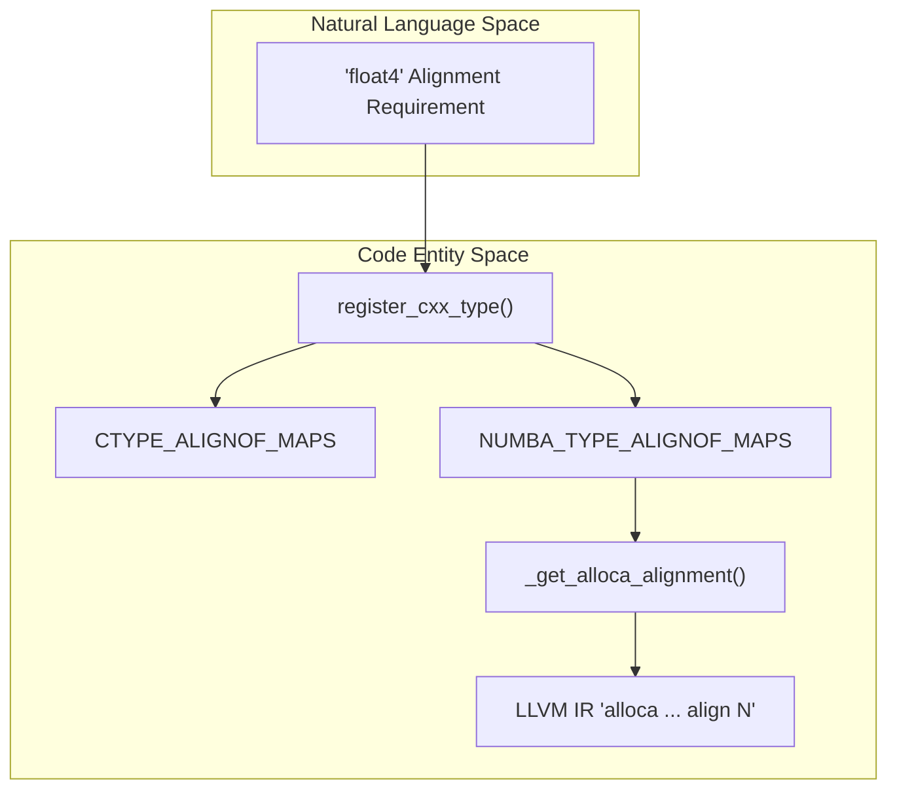
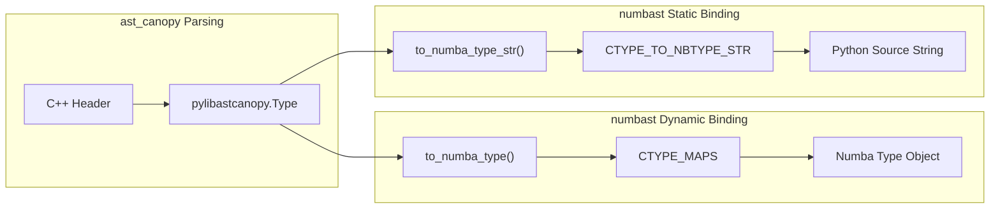

<!-- source: DeepWiki mcp.deepwiki.com · repo NVIDIA/numbast · page 3.3 Type System: C++ to Numba Type Mapping · fetched 2026-10-26 -->

# Type System: C++ to Numba Type Mapping

Relevant source files

The following files were used as context for generating this wiki page:

- [numbast/src/numbast/enum.py](numbast/src/numbast/enum.py)
- [numbast/src/numbast/functor.py](numbast/src/numbast/functor.py)
- [numbast/src/numbast/static/enum.py](numbast/src/numbast/static/enum.py)
- [numbast/src/numbast/static/tests/data/enum.cuh](numbast/src/numbast/static/tests/data/enum.cuh)
- [numbast/src/numbast/static/types.py](numbast/src/numbast/static/types.py)
- [numbast/src/numbast/types.py](numbast/src/numbast/types.py)
- [numbast/src/numbast/utils.py](numbast/src/numbast/utils.py)
- [numbast/tests/data/sample_enum.cuh](numbast/tests/data/sample_enum.cuh)
- [numbast/tests/test_callconv.py](numbast/tests/test_callconv.py)
- [numbast/tests/test_cuda_vector_types.py](numbast/tests/test_cuda_vector_types.py)
- [numbast/tests/test_register_cxx_type.py](numbast/tests/test_register_cxx_type.py)

This page documents the internal registries and logic used by Numbast to translate C++ types (parsed by `ast_canopy`) into Numba types. This system handles primitive mapping, CUDA vector types, alignment management, and the conversion of C++ enums into Python `IntEnum` objects.

## Core Type Registries

Numbast maintains several global registries in `numbast.types` to facilitate bidirectional mapping between C++ type strings and Numba type objects.

| Registry | Description | File Pointer |
| :--- | :--- | :--- |
| `INTEGER_TYPE_MAPS` | Maps C standard and `stdint.h` types to Numba integer types. | [numbast/src/numbast/types.py:25-46]() |
| `FLOATING_TYPE_MAPS` | Maps `float`, `double`, `__half`, and `__nv_bfloat16`. | [numbast/src/numbast/types.py:48-53]() |
| `CUDA_VECTOR_TYPE_MAPS` | Maps CUDA vector types (e.g., `float4`) to `numba.cuda.vector_types`. | [numbast/src/numbast/types.py:78-85]() |
| `CTYPE_MAPS` | The primary runtime registry used by `to_numba_type`. | [numbast/src/numbast/types.py:87-87]() |
| `NUMBA_TO_CTYPE_MAPS` | Reverse mapping from Numba types to C++ strings for shim generation. | [numbast/src/numbast/types.py:92-110]() |

### CUDA Vector Types and Alignment
CUDA vector types have specific alignment requirements (e.g., `float4` requires 16-byte alignment). Numbast stores these in `CUDA_VECTOR_TYPE_MAPS` as a tuple of `(numba_type, alignment)`.

*   **Mapping Logic**: Types like `int2` are mapped to `int32x2` [numbast/src/numbast/types.py:70-71]().
*   **Alignment Specifications**: The alignment is defined in `CUDA_VECTOR_TYPE_SPECS` [numbast/src/numbast/types.py:65-76]().

**Sources:** [numbast/src/numbast/types.py:25-110](), [numbast/tests/test_cuda_vector_types.py:18-59]()

## Type Conversion Functions

The system provides two primary pathways for type resolution: dynamic resolution (using Numba type objects) and static resolution (using string representations).

### Dynamic Resolution (`numbast.types`)
*   **`to_numba_type(cxx_name)`**: Resolves a C++ string to a Numba type. If the type is not found in `CTYPE_MAPS`, it falls back to a Numba `Opaque` type [numbast/src/numbast/types.py:241-260]().
*   **`to_numba_arg_type(ast_type)`**: Takes an `ast_canopy` Type object and resolves its `unqualified_non_ref_type_name` [numbast/src/numbast/types.py:263-264]().

### Static Resolution (`numbast.static.types`)
Used during static binding generation to produce valid Python source code.
*   **`to_numba_type_str(ty)`**: Converts a C++ type string to a string representing a Numba type (e.g., `"int32"`, `"CPointer(float64)"`). It also triggers import tracking in `BaseRenderer` [numbast/src/numbast/static/types.py:66-121]().
*   **Array Handling**: Fixed-size arrays (e.g., `int[4]`) are recursively mapped to Numba `UniTuple` strings [numbast/src/numbast/static/types.py:106-113]().

**Sources:** [numbast/src/numbast/types.py:241-264](), [numbast/src/numbast/static/types.py:66-138]()

## Alignment Management

Numbast tracks C++ alignment requirements that may exceed the standard ABI alignment of the corresponding Numba type.

### Implementation Flow: Alignment Tracking
The following diagram illustrates how alignment is registered and retrieved for use in LLVM IR generation.

*   **`register_cxx_type`**: Allows manual registration of types with explicit `alignof` values. It validates that the alignment is a positive power of two [numbast/src/numbast/types.py:122-188]().
*   **`_get_alloca_alignment`**: Used in `FunctionCallConv` to determine the alignment for stack allocations. It checks for a registered alignment in `NUMBA_TYPE_ALIGNOF_MAPS` before falling back to `context.get_abi_alignment` [numbast/tests/test_callconv.py:53-89]().

**Sources:** [numbast/src/numbast/types.py:122-188](), [numbast/tests/test_callconv.py:53-100](), [numbast/tests/test_register_cxx_type.py:66-112]()

## Enum Type Registry

C++ Enums are mapped to Python `IntEnum` classes. The mapping must be registered so that function signatures using the enum can resolve the type correctly.

### Dynamic Mode
The `bind_cxx_enum` function creates a Python `IntEnum` on the fly and calls `register_enum_type` to update the global `CTYPE_MAPS` [numbast/src/numbast/enum.py:10-22]().

### Static Mode
The `StaticEnumRenderer` generates the `IntEnum` class definition and calls `register_enum_type_str` [numbast/src/numbast/static/enum.py:54-85](). This ensures that the generated static module includes a mapping from the C++ enum name to the newly created Python enum identifier [numbast/src/numbast/static/types.py:32-56]().

**Sources:** [numbast/src/numbast/enum.py:10-46](), [numbast/src/numbast/static/enum.py:20-85](), [numbast/src/numbast/static/types.py:32-56]()

## Specialized Types

### FunctorType
Numbast supports passing Python functions as C++ functors via `FunctorType`.
*   **`Functor` Class**: Wraps a Python function and a signature. It provides a `shim()` method to generate the C++ struct with an `operator()` that invokes the Python function [numbast/src/numbast/functor.py:23-58]().
*   **Lowering**: The `constant_functortype` function lowers the functor to an `int64` ID in the LLVM IR [numbast/src/numbast/functor.py:78-81]().

### Opaque Fallback
When `to_numba_type` encounters a C++ type name it does not recognize, it creates a Numba `Opaque` type [numbast/src/numbast/types.py:255-260](). This allows Numbast to handle pointers to unknown structures without requiring full parsing of those structures, provided they are only handled as pointers in Python.

**Sources:** [numbast/src/numbast/functor.py:11-81](), [numbast/src/numbast/types.py:255-260]()

## Type Mapping Data Flow

The following diagram traces how a C++ type string from a header becomes a Numba-compatible type in both dynamic and static modes.

**Sources:** [numbast/src/numbast/types.py:241-260](), [numbast/src/numbast/static/types.py:66-121]()

---

