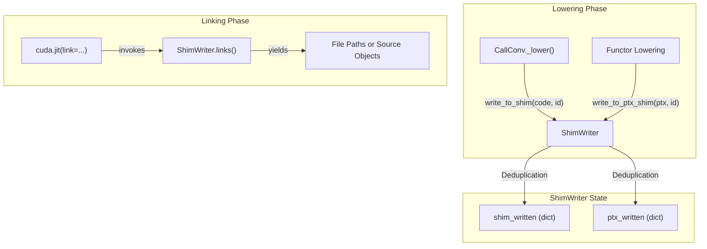

<!-- source: DeepWiki mcp.deepwiki.com · repo NVIDIA/numbast · page 3.4 Shim Writer and Call Convention · fetched 2026-10-26 -->

# Shim Writer and Call Convention

<details>
<summary>Relevant source files</summary>

The following files were used as context for generating this wiki page:

- [numbast/src/numbast/args.py](numbast/src/numbast/args.py)
- [numbast/src/numbast/callconv.py](numbast/src/numbast/callconv.py)
- [numbast/src/numbast/intent.py](numbast/src/numbast/intent.py)
- [numbast/src/numbast/shim_writer.py](numbast/src/numbast/shim_writer.py)
- [numbast/src/numbast/static/callconv.py](numbast/src/numbast/static/callconv.py)
- [numbast/src/numbast/static/tests/data/src/function_out.cu](numbast/src/numbast/static/tests/data/src/function_out.cu)
- [numbast/src/numbast/static/tests/test_function_static_bindings.py](numbast/src/numbast/static/tests/test_function_static_bindings.py)
- [numbast/tests/test_shim_writer.py](numbast/tests/test_shim_writer.py)
- [numbast_extensions/numbast_extensions/bf16/torch_interop.py](numbast_extensions/numbast_extensions/bf16/torch_interop.py)

</details>


The shim writing and call convention subsystem handles the bridge between Numba's LLVM IR generation and the physical C++ code that must be compiled and linked. It provides an abstraction for accumulating C++ shim source code, deduplicating it, and generating the necessary LLVM IR `alloca`, `store`, and `call` instructions to invoke these shims with correct alignment and argument intent.

## Shim Writer Abstraction

The `ShimWriterBase` [numbast/src/numbast/shim_writer.py:12-32]() defines the interface for managing generated C++ shims and PTX blobs. Its primary responsibility is to collect code fragments during the Numba lowering phase and provide them to the Numba linker.

### Implementation Classes

| Class | Role | Storage Mechanism |
| :--- | :--- | :--- |
| `FileShimWriter` | Writes shims to temporary `.cu` and `.ptx` files. [numbast/src/numbast/shim_writer.py:54-59]() | Uses `NamedTemporaryFile`. Shims are appended to one file, while each PTX gets its own file. [numbast/src/numbast/shim_writer.py:64-82]() |
| `MemoryShimWriter` | Keeps shims in memory as Numba source objects. [numbast/src/numbast/shim_writer.py:107-112]() | Stores strings in lists and yields `cuda.CUSource` or `cuda.PTXSource` objects. [numbast/src/numbast/shim_writer.py:117-151]() |

### Data Flow: Shim Accumulation
The following diagram illustrates how shims are registered and eventually consumed by the Numba JIT.

**Shim Writing and Linking Flow**

**Sources:** [numbast/src/numbast/shim_writer.py:12-151](), [numbast/src/numbast/callconv.py:56-61]()

## Call Convention Pipeline

The call convention system is responsible for generating the LLVM IR that bridges Numba types to the C++ ABI expected by the shim functions. This is primarily handled by `BaseCallConv` and its specialization `FunctionCallConv`.

### BaseCallConv
The `BaseCallConv` [numbast/src/numbast/callconv.py:39-54]() provides the template for shim function naming (defaulting to `{mangled_name}_nbst`) and implements the `_lazy_write_shim` mechanism. This ensures that the C++ shim code is only sent to the `ShimWriter` at the moment the function is actually lowered into LLVM IR [numbast/src/numbast/callconv.py:56-61]().

### FunctionCallConv and LLVM Generation
`FunctionCallConv` [numbast/src/numbast/callconv.py:70-100]() performs the heavy lifting of IR generation. It manages:

1.  **Return Slot Allocation**: If the C++ function returns a value (non-void), a stack slot (`alloca`) is created with proper alignment [numbast/src/numbast/callconv.py:134-139]().
2.  **Argument Preparation**: It uses `prepare_ir_types` to determine if arguments should be passed by value or by pointer [numbast/src/numbast/callconv.py:142-150]().
3.  **Intent Handling**: Integrates with `IntentPlan` to handle `out_return` parameters, which are moved from the Python argument list into the return value tuple [numbast/src/numbast/callconv.py:151-170]().
4.  **Alignment**: Uses `_set_alloca_alignment` to ensure stack slots respect C++ type requirements by comparing ABI alignment with Numba-specific alignment metadata [numbast/src/numbast/callconv.py:22-36]().

**Sources:** [numbast/src/numbast/callconv.py:70-170](), [numbast/src/numbast/args.py:9-51]()

## IntentPlan Integration

The `IntentPlan` dictates how parameters are treated during the call. It is computed by `compute_intent_plan` [numbast/src/numbast/intent.py:63-69]() based on C++ parameter types and user-provided overrides.

### Argument Intent Mapping
| Intent (`ArgIntent`) | Visible in Python? | Passed to Shim as |
| :--- | :--- | :--- |
| `in_` | Yes | Value or Pointer |
| `inout_ptr` | Yes | Pointer |
| `out_ptr` | Yes | Pointer |
| `out_return` | No (moved to return) | Pointer to stack slot |

**Sources:** [numbast/src/numbast/intent.py:139-166](), [numbast/src/numbast/callconv.py:151-170]()

## Static Binding Generation

For static bindings, the call convention logic must be "snapshotted" into the generated Python module because the runtime cannot depend on the full `numbast` package.

### Code Extraction and Rendering
The `numbast.static.callconv` module uses `inspect.getsource` to extract specific blocks of code from the live library and inject them into the static output [numbast/src/numbast/static/callconv.py:10-46]().

*   **Marker System**: Sections are delimited by `# NBST:BEGIN_CALLCONV` and `# NBST:END_CALLCONV` [numbast/src/numbast/callconv.py:8-15]().
*   **Alignment Maps**: Since `numbast.types` is not available in static mode, `_render_numba_type_alignof_src` snapshots the `NUMBA_TYPE_ALIGNOF_MAPS` dictionary into a static dictionary in the generated source [numbast/src/numbast/static/callconv.py:49-68]().

**Entity Relationship: Call Convention and Shims**
```mermaid
classDiagram
    class ShimWriterBase {
        <<abstract>>
        +write_to_shim(content, id)
        +write_to_ptx_shim(ptx, id)
        +links()
    }
    class BaseCallConv {
        +shim_writer: ShimWriterBase
        +itanium_mangled_name: str
        +shim_code: str
        +_lazy_write_shim()
    }
    class FunctionCallConv {
        +intent_plan: IntentPlan
        +out_return_types: list
        +_lower_impl(builder, context, sig, args)
    }
    class IntentPlan {
        +visible_param_indices: tuple
        +out_return_indices: tuple
        +pass_ptr_mask: tuple
    }

    BaseCallConv <|-- FunctionCallConv
    BaseCallConv o-- ShimWriterBase
    FunctionCallConv o-- IntentPlan
    FunctionCallConv ..> "numbast.args.prepare_ir_types" : calls
```
**Sources:** [numbast/src/numbast/callconv.py:39-101](), [numbast/src/numbast/shim_writer.py:12-32](), [numbast/src/numbast/intent.py:162-166]()

---

