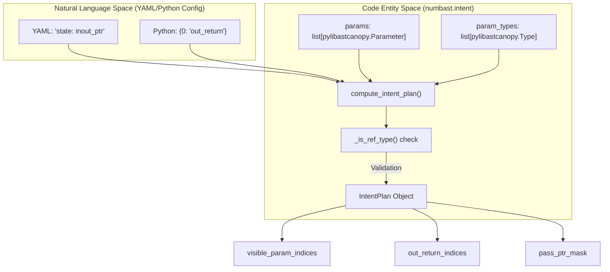
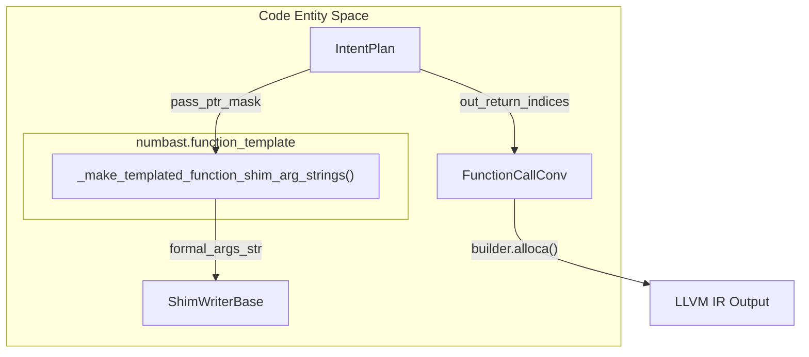

<!-- source: DeepWiki mcp.deepwiki.com · repo NVIDIA/numbast · page 3.5 Argument Intents · fetched 2026-10-26 -->

# Argument Intents

<details>
<summary>Relevant source files</summary>

The following files were used as context for generating this wiki page:

- [docs/source/argument_intents.rst](docs/source/argument_intents.rst)
- [docs/source/template.rst](docs/source/template.rst)
- [numbast/src/numbast/class_template.py](numbast/src/numbast/class_template.py)
- [numbast/src/numbast/function_template.py](numbast/src/numbast/function_template.py)
- [numbast/src/numbast/intent.py](numbast/src/numbast/intent.py)
- [numbast/src/numbast/static/tests/data/src/function_out.cu](numbast/src/numbast/static/tests/data/src/function_out.cu)

</details>


The Argument Intent system in Numbast provides a mechanism to control how C++ function and method parameters are projected into Python. By default, C++ parameters are exposed as "in" arguments. However, many C++ APIs use reference parameters (`T&`) for output or in-place modification. The intent system allows developers to specify whether these parameters should remain in the signature as pointers, or be promoted to Python return values.

## Intent Semantics

Numbast defines four primary intents through the `ArgIntent` enumeration.

| Intent | Behavior | Numba Type Mapping | Python Signature Impact |
| :--- | :--- | :--- | :--- |
| `in` | Default mode. Parameter is passed by value or reference. | Base type `T` | Stays in signature. |
| `inout_ptr` | C++ mutates the referenced state. | `CPointer(T)` | Stays in signature. |
| `out_ptr` | Explicit output buffer owned by caller. | `CPointer(T)` | Stays in signature. |
| `out_return` | Numbast manages storage and returns value. | `T` (internal storage) | **Removed** from signature. |

Sources: [numbast/src/numbast/intent_defs.py:11-23](), [docs/source/argument_intents.rst:42-73]()

### The `out_return` Promotion
When a parameter is marked as `out_return`, Numbast modifies the function's call convention:
1.  The parameter is removed from the visible Python arguments [numbast/src/numbast/intent.py:150-155]().
2.  In the generated LLVM IR/Shim, temporary storage is allocated for the parameter [docs/source/argument_intents.rst:71-71]().
3.  The C++ function is called with a reference to this temporary storage.
4.  The value in the temporary storage is then returned to Python.

If the C++ function already has a non-`void` return type, Numbast packs the original return value and all `out_return` values into a `types.Tuple` [docs/source/argument_intents.rst:109-114]().

## Intent Plan Computation

The `IntentPlan` is a structured record that describes how a specific function call should be handled based on its C++ declaration and any provided overrides.

### The `compute_intent_plan` Function
The core logic for resolving intents resides in `compute_intent_plan`. It processes parameter lists and applies overrides using the following precedence:
1.  **Defaults**: All parameters start as `ArgIntent.in_` [numbast/src/numbast/intent.py:97-97]().
2.  **Index-based Overrides**: Applied using 0-based integer keys [numbast/src/numbast/intent.py:107-112]().
3.  **Name-based Overrides**: Applied using parameter name strings; these take precedence over index-based overrides [numbast/src/numbast/intent.py:121-136]().

### Validation Rules
-   `inout_ptr`, `out_ptr`, and `out_return` are **only** valid for C++ reference types (`T&` or `T&&`) [numbast/src/numbast/intent.py:145-149]().
-   The number of overrides cannot exceed the number of parameters.
-   `out_return` can be explicitly disallowed in certain contexts (e.g., specific shim writers) via the `allow_out_return` flag [numbast/src/numbast/intent.py:68-68]().

### Intent Plan Data Flow
The following diagram illustrates how `compute_intent_plan` transforms C++ declarations and user configuration into an executable plan.

**Diagram: Intent Resolution Pipeline**

Sources: [numbast/src/numbast/intent.py:63-91](), [numbast/src/numbast/intent_defs.py:26-34]()

## Implementation in Binding Layers

The intent system is integrated into both the dynamic and static binding engines.

### Dynamic Binding Integration
In `bind_cxx_function_template`, the `arg_intent` dictionary is passed during the typing phase. The `AbstractTemplate` uses the plan to filter the arguments seen by Numba.

1.  **Typing**: `_select_templated_overload` uses the `visible_param_indices` from the `IntentPlan` to match Python arguments to C++ parameters [numbast/src/numbast/function_template.py:245-255]().
2.  **Lowering**: The `FunctionCallConv` utilizes the `pass_ptr_mask` to determine which LLVM values need to be passed by address [numbast/src/numbast/function_template.py:270-280]().

### Static Binding Configuration
In static mode, intents are defined in the YAML configuration file under the `Function Argument Intents` section.

```yaml
Function Argument Intents:
  # Keyed by function name
  stats_update_and_get_zscore:
    # Keyed by parameter name
    state: inout_ptr
    # Keyed by index
    2: out_return
```
Sources: [docs/source/argument_intents.rst:30-41](), [numbast/src/numbast/intent.py:100-119]()

## Relationship between Intents and Shim Generation

The `ShimWriter` and `FunctionCallConv` classes rely on the `IntentPlan` to generate the correct C++ bridge code.

**Diagram: Intent-Driven Code Generation**

Sources: [numbast/src/numbast/function_template.py:107-130](), [numbast/src/numbast/callconv.py:22-40]()

### Parameter String Building
The function `_make_templated_function_shim_arg_strings` inspects the `pass_ptr_mask`. If a parameter is marked as a pointer intent (`inout_ptr` or `out_ptr`), it generates a shim signature that expects a pointer (e.g., `T* arg0`) and dereferences it in the call (e.g., `func(*arg0)`) [numbast/src/numbast/function_template.py:140-152]().

Sources:
- `numbast/src/numbast/intent.py`
- `numbast/src/numbast/intent_defs.py`
- `numbast/src/numbast/function_template.py`
- `docs/source/argument_intents.rst`
- `numbast/src/numbast/callconv.py`

---

