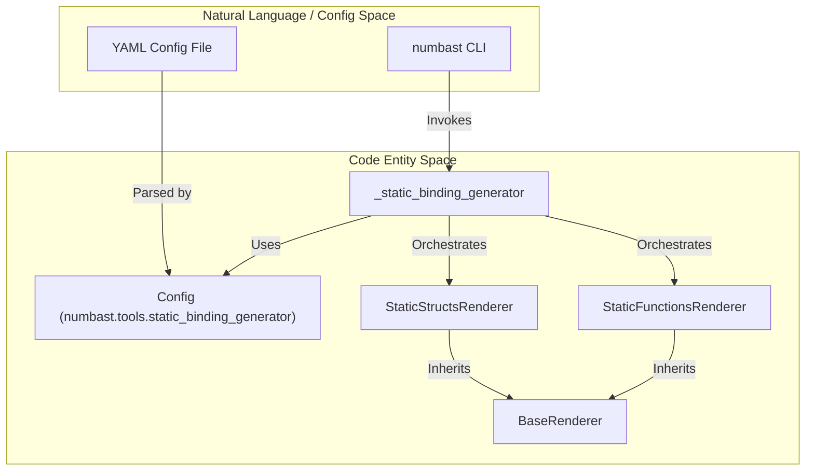
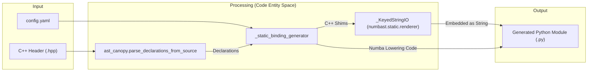

<!-- source: DeepWiki mcp.deepwiki.com · repo NVIDIA/numbast · page 4 Static Binding Generator · fetched 2026-10-26 -->

# Static Binding Generator

Relevant source files

The following files were used as context for generating this wiki page:

- [docs/source/generated/static_binding_schema_reference.rst](docs/source/generated/static_binding_schema_reference.rst)
- [docs/source/index.rst](docs/source/index.rst)
- [docs/source/numba_cuda_mlir.rst](docs/source/numba_cuda_mlir.rst)
- [docs/source/static.rst](docs/source/static.rst)
- [numbast/src/numbast/static/function.py](numbast/src/numbast/static/function.py)
- [numbast/src/numbast/static/renderer.py](numbast/src/numbast/static/renderer.py)
- [numbast/src/numbast/static/struct.py](numbast/src/numbast/static/struct.py)
- [numbast/src/numbast/static/tests/conftest.py](numbast/src/numbast/static/tests/conftest.py)
- [numbast/src/numbast/tools/static_binding_generator.py](numbast/src/numbast/tools/static_binding_generator.py)
- [numbast/src/numbast/tools/static_binding_generator.schema.yaml](numbast/src/numbast/tools/static_binding_generator.schema.yaml)

The Static Binding Generator is a workflow designed to produce standalone Python modules from CUDA C++ headers. Unlike dynamic binding, which requires `numbast` and `clang` at runtime to parse headers, the static generator performs parsing and code generation once. The resulting Python module depends only on Numba, making it suitable for distribution as a regular Python package.

### High-Level Workflow

The generator follows a pipeline that starts with a YAML configuration and ends with a formatted Python source file:

1.  **Configuration Loading**: The `numbast` CLI reads a YAML file and validates it against a schema using the `Config` class [numbast/src/numbast/tools/static_binding_generator.py:107-134]().
2.  **AST Parsing**: `ast_canopy` is invoked to parse the header files specified in the configuration, retaining only declarations from the allowed file list [numbast/src/numbast/tools/static_binding_generator.py:321-344]().
3.  **Code Rendering**: Specialized renderer classes (e.g., `StaticStructsRenderer`, `StaticFunctionsRenderer`) iterate over the parsed declarations to generate Numba type definitions, shims, and lowering implementations [numbast/src/numbast/tools/static_binding_generator.py:37-43]().
4.  **Module Assembly**: The generated snippets are assembled into a final template, including imports, shim streams, and reproducible metadata [numbast/src/numbast/static/renderer.py:200-221]().

### Static Generation Architecture

The diagram below illustrates the relationship between the configuration entities and the internal code classes responsible for processing them.

**Configuration to Code Entity Mapping**

Sources: [numbast/src/numbast/tools/static_binding_generator.py:107-150](), [numbast/src/numbast/tools/static_binding_generator.py:314-360](), [numbast/src/numbast/static/renderer.py:16-101]()

---

## Subsystems and Child Pages

### CLI Tool and Configuration Schema
The primary interface for static generation is the `numbast` command-line tool. It relies on a comprehensive YAML schema that defines how headers are searched, which symbols are excluded, and how API prefixes should be stripped. The `Config` class validates these inputs and handles complex logic like `API Prefix Removal` and `Function Argument Intents`.

For details, see [CLI Tool and Configuration Schema](#4.1).

### Rendering Pipeline: Structs, Functions, and Templates
The rendering pipeline transforms `ast_canopy` declarations into Python source code. It uses a hierarchy of renderer classes derived from `BaseRenderer`. These renderers manage:
*   **Shim Generation**: Producing C++ shims for constructors and functions [numbast/src/numbast/static/struct.py:166-180]().
*   **Lowering Logic**: Generating `@lower` and `@lower_cast` decorators for Numba's compiler [numbast/src/numbast/static/struct.py:181-203]().
*   **Import Tracking**: Automatically identifying and adding necessary Python imports (e.g., `numba.cuda.types`) based on the C++ types encountered [numbast/src/numbast/static/renderer.py:117-143]().

For details, see [Rendering Pipeline: Structs, Functions, and Templates](#4.2).

### Static Type Mapping and Code Generation
Static generation requires a mapping from C++ types to their string representations in Python. This is handled by a specialized type system that differs from the dynamic mode. It uses `CTYPE_TO_NBTYPE_STR` and `to_numba_type_str` to ensure that the generated code refers to valid Numba type identifiers.

For details, see [Static Type Mapping and Code Generation](#4.3).

---

### Binding Generation Data Flow

This diagram shows how data moves from the initial C++ header through the various rendering components to the final output file.

**Data Flow: Header to Standalone Module**

Sources: [numbast/src/numbast/tools/static_binding_generator.py:314-360](), [numbast/src/numbast/static/renderer.py:29-44](), [numbast/src/numbast/static/renderer.py:200-221]()

### Key Classes and Functions

| Entity | Role | File |
| :--- | :--- | :--- |
| `Config` | Validates YAML configuration and stores generation parameters. | [numbast/src/numbast/tools/static_binding_generator.py:107-134]() |
| `_static_binding_generator` | Main orchestration function that runs the parsing and rendering loop. | [numbast/src/numbast/tools/static_binding_generator.py:314-360]() |
| `BaseRenderer` | Base class for all renderers; manages shared imports and shim assembly. | [numbast/src/numbast/static/renderer.py:16-101]() |
| `StaticStructsRenderer` | Renders Numba `Record` types and their associated methods/constructors. | [numbast/src/numbast/static/struct.py:441-443]() |
| `StaticFunctionRenderer` | Renders function signatures and their lowering to C++ shims. | [numbast/src/numbast/static/function.py:63-75]() |
| `_KeyedStringIO` | A specialized string buffer that prevents duplicate shim code insertion. | [numbast/src/numbast/static/renderer.py:29-44]() |

Sources: [numbast/src/numbast/tools/static_binding_generator.py:107-360](), [numbast/src/numbast/static/renderer.py:16-101](), [numbast/src/numbast/static/struct.py:441-443](), [numbast/src/numbast/static/function.py:63-75]()

---

