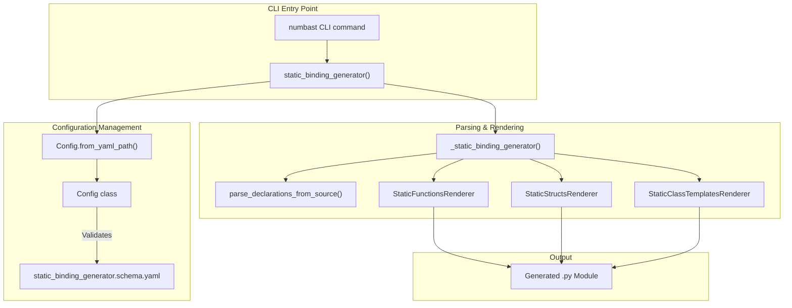
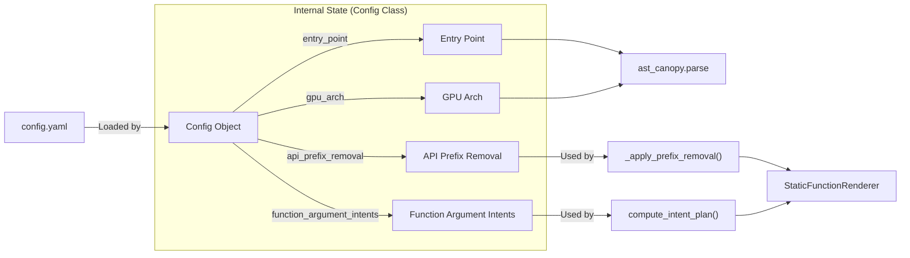

<!-- source: DeepWiki mcp.deepwiki.com · repo NVIDIA/numbast · page 4.1 CLI Tool and Configuration Schema · fetched 2026-10-26 -->

# CLI Tool and Configuration Schema

Relevant source files

The following files were used as context for generating this wiki page:

- [.gitignore](.gitignore)
- [ast_canopy/ast_canopy/shim_include/crt/math_functions.hpp](ast_canopy/ast_canopy/shim_include/crt/math_functions.hpp)
- [docs/source/_ext/static_binding_schema_doc.py](docs/source/_ext/static_binding_schema_doc.py)
- [docs/source/conf.py](docs/source/conf.py)
- [docs/source/generated/static_binding_schema_reference.rst](docs/source/generated/static_binding_schema_reference.rst)
- [docs/source/index.rst](docs/source/index.rst)
- [docs/source/numba_cuda_mlir.rst](docs/source/numba_cuda_mlir.rst)
- [docs/source/static.rst](docs/source/static.rst)
- [numbast/src/numbast/static/function.py](numbast/src/numbast/static/function.py)
- [numbast/src/numbast/static/renderer.py](numbast/src/numbast/static/renderer.py)
- [numbast/src/numbast/static/struct.py](numbast/src/numbast/static/struct.py)
- [numbast/src/numbast/static/tests/conftest.py](numbast/src/numbast/static/tests/conftest.py)
- [numbast/src/numbast/tools/__init__.py](numbast/src/numbast/tools/__init__.py)
- [numbast/src/numbast/tools/static_binding_generator.py](numbast/src/numbast/tools/static_binding_generator.py)
- [numbast/src/numbast/tools/static_binding_generator.schema.yaml](numbast/src/numbast/tools/static_binding_generator.schema.yaml)
- [numbast/src/numbast/tools/tests/config/cc.yml.j2](numbast/src/numbast/tools/tests/config/cc.yml.j2)
- [numbast/src/numbast/tools/tests/config/cooperative_launch.yml.j2](numbast/src/numbast/tools/tests/config/cooperative_launch.yml.j2)
- [numbast/src/numbast/tools/tests/config/cooperative_launch_invalid_regex.yml.j2](numbast/src/numbast/tools/tests/config/cooperative_launch_invalid_regex.yml.j2)
- [numbast/src/numbast/tools/tests/config/cooperative_launch_regex.yml.j2](numbast/src/numbast/tools/tests/config/cooperative_launch_regex.yml.j2)
- [numbast/src/numbast/tools/tests/config/module_callbacks.yml.j2](numbast/src/numbast/tools/tests/config/module_callbacks.yml.j2)
- [numbast/src/numbast/tools/tests/config/output_name.yml.j2](numbast/src/numbast/tools/tests/config/output_name.yml.j2)
- [numbast/src/numbast/tools/tests/config/prefix_removal.yml.j2](numbast/src/numbast/tools/tests/config/prefix_removal.yml.j2)
- [numbast/src/numbast/tools/tests/conftest.py](numbast/src/numbast/tools/tests/conftest.py)
- [numbast/src/numbast/tools/tests/module_callbacks.cuh](numbast/src/numbast/tools/tests/module_callbacks.cuh)
- [numbast/src/numbast/tools/tests/prefix_removal.cuh](numbast/src/numbast/tools/tests/prefix_removal.cuh)
- [numbast/src/numbast/tools/tests/test_cli.py](numbast/src/numbast/tools/tests/test_cli.py)
- [numbast/src/numbast/tools/tests/test_config_schema_docs.py](numbast/src/numbast/tools/tests/test_config_schema_docs.py)
- [numbast/src/numbast/tools/tests/test_module_callbacks.py](numbast/src/numbast/tools/tests/test_module_callbacks.py)
- [numbast/src/numbast/tools/tests/test_output_name.py](numbast/src/numbast/tools/tests/test_output_name.py)
- [numbast/src/numbast/tools/tests/test_prefix_removal.py](numbast/src/numbast/tools/tests/test_prefix_removal.py)
- [numbast/src/numbast/tools/tests/test_use_cooperative.py](numbast/src/numbast/tools/tests/test_use_cooperative.py)
- [numbast/src/numbast/tools/tests/use_cooperative.cuh](numbast/src/numbast/tools/tests/use_cooperative.cuh)
- [numbast/src/numbast/tools/yaml_tags.py](numbast/src/numbast/tools/yaml_tags.py)
- [numbast/tests/test_enum_arg.py](numbast/tests/test_enum_arg.py)
- [numbast_extensions/tests/thirdparty/CCCL/conftest.py](numbast_extensions/tests/thirdparty/CCCL/conftest.py)
- [numbast_extensions/tests/thirdparty/CCCL/test_block_load_store.py](numbast_extensions/tests/thirdparty/CCCL/test_block_load_store.py)
- [numbast_extensions/tests/thirdparty/CCCL/test_block_scan.py](numbast_extensions/tests/thirdparty/CCCL/test_block_scan.py)

The Numbast static binding generator provides a Command Line Interface (CLI) and a structured YAML configuration system to automate the creation of standalone Python modules from CUDA C++ headers. This mechanism allows developers to distribute bindings that depend only on Numba CUDA, removing the requirement for `clangdev` or `numbast` in the end-user's environment [docs/source/static.rst:4-5]().

## CLI Tool: `numbast`

The CLI tool is the primary entry point for static binding generation. It can be invoked via `python -m numbast` or the `numbast` command [docs/source/static.rst:73-73]().

### Command Line Arguments
The CLI is implemented using the `click` library in `numbast/src/numbast/tools/static_binding_generator.py`. Key arguments include:
*   `--cfg-path`: Path to the YAML configuration file [numbast/src/numbast/tools/static_binding_generator.py:440-440]().
*   `--output-dir`: Directory where the generated `.py` files will be saved [numbast/src/numbast/tools/static_binding_generator.py:445-445]().
*   `--fmt`: Boolean flag to trigger code formatting (via `ruff`) on the output [numbast/src/numbast/tools/static_binding_generator.py:455-455]().
*   `--entry-point`: (Optional) Overrides the entry point defined in the YAML [numbast/src/numbast/tools/static_binding_generator.py:421-421]().

### Execution Flow
The `static_binding_generator` function orchestrates the parsing and rendering process:
1.  **Configuration Loading**: Reads the YAML and initializes a `Config` object [numbast/src/numbast/tools/static_binding_generator.py:476-483]().
2.  **AST Parsing**: Calls `ast_canopy.parse_declarations_from_source` using the entry point and include paths from the config [numbast/src/numbast/tools/static_binding_generator.py:348-356]().
3.  **Filtering**: Filters declarations based on the `File List` (retain list) and `Exclude` rules [numbast/src/numbast/tools/static_binding_generator.py:365-374]().
4.  **Rendering**: Iterates through structs, functions, and templates, using specialized renderers (e.g., `StaticStructsRenderer`, `StaticFunctionsRenderer`) to generate Python source code [numbast/src/numbast/tools/static_binding_generator.py:382-414]().

### CLI System Overview
"Natural Language Space" to "Code Entity Space" mapping for the CLI execution.

Sources: [numbast/src/numbast/tools/static_binding_generator.py:339-418](), [numbast/src/numbast/tools/static_binding_generator.py:466-516]()

## Configuration Schema

The configuration is defined in a YAML schema file [numbast/src/numbast/tools/static_binding_generator.schema.yaml](). This schema acts as the authoritative contract for the generator [numbast/src/numbast/tools/static_binding_generator.py:110-112]().

### Required Fields
| Key | Type | Description |
| :--- | :--- | :--- |
| `Entry Point` | `string` | The primary CUDA C++ header file to parse [docs/source/generated/static_binding_schema_reference.rst:7-8](). |
| `GPU Arch` | `array[str]` | Target architecture (e.g., `["sm_80"]`). Currently, only one is supported per run [numbast/src/numbast/tools/static_binding_generator.py:207-210](). |
| `File List` | `array[str]` | List of files to retain declarations from. Others are ignored [docs/source/generated/static_binding_schema_reference.rst:34-36](). |

### Key Configuration Logic
The `Config` class [numbast/src/numbast/tools/static_binding_generator.py:107-107]() handles the mapping of YAML keys to internal logic:

*   **API Prefix Removal**: Removes specific prefixes from C++ names when rendering Python handles. It supports different lists for `Function`, `Struct`, and `Enum` [numbast/src/numbast/tools/static_binding_generator.py:186-193]().
*   **Function Argument Intents**: Maps function names to parameter-specific intent overrides (e.g., `in`, `out_ptr`). This influences how `compute_intent_plan` generates the final Numba signature [numbast/src/numbast/static/function.py:197-202]().
*   **MLIR Backend**: If `MLIR Backend: true` is set, the generator switches to the experimental MLIR-specific pipeline [numbast/src/numbast/tools/static_binding_generator.py:148-149]().
*   **Separate Registry**: When `Use Separate Registry: true`, the generated code creates local `TypingRegistry` and `TargetRegistry` instances instead of modifying Numba's global CUDA registry [numbast/src/numbast/static/renderer.py:17-27]().

### Data Flow: Config to Renderer
"Natural Language Space" to "Code Entity Space" mapping for configuration data flow.

Sources: [numbast/src/numbast/tools/static_binding_generator.py:135-214](), [numbast/src/numbast/static/function.py:173-202](), [numbast/src/numbast/utils.py:113-125]()

## Validation and Error Handling

The `Config` class performs several validation steps during initialization:
1.  **MLIR Constraints**: Ensures that MLIR-only options like `Module Link Variables Used` are only present if `MLIR Backend` is enabled [numbast/src/numbast/tools/static_binding_generator.py:80-98]().
2.  **Path Verification**: The `_verify_exists()` method checks that the `Entry Point` and all files in the `File List` exist on the filesystem [numbast/src/numbast/tools/static_binding_generator.py:217-226]().
3.  **Regex Validation**: Validates patterns in `Cooperative Launch Required Functions Regex` to prevent runtime failures during rendering [numbast/src/numbast/tools/static_binding_generator.py:228-237]().
4.  **Mangled Name Conflict**: The `StaticFunctionRenderer` maintains a `function_mangled_name_registry` to ensure no two functions generate the same shim name, which would cause C++ compilation errors [numbast/src/numbast/static/function.py:164-166]().

Sources: [numbast/src/numbast/tools/static_binding_generator.py:80-237](), [numbast/src/numbast/static/function.py:164-166]()

---

