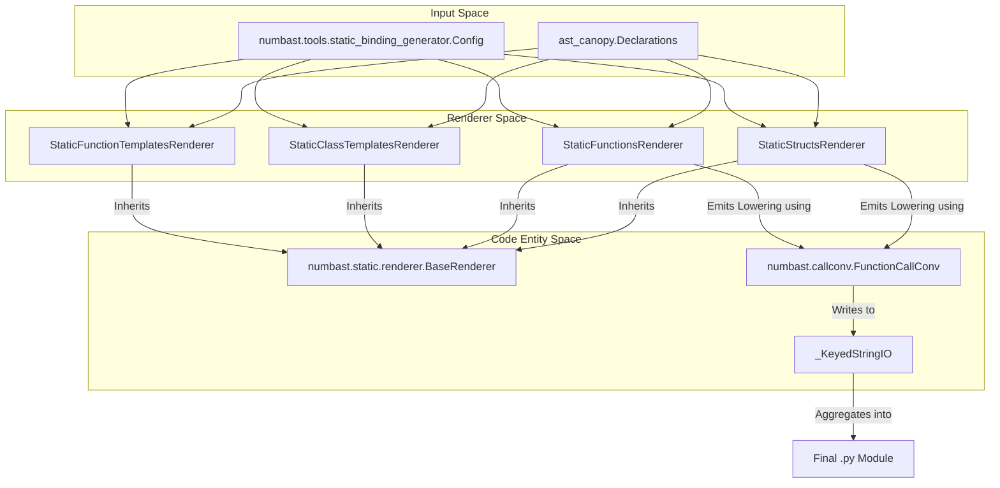
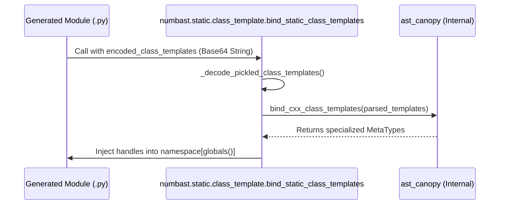

<!-- source: DeepWiki mcp.deepwiki.com · repo NVIDIA/numbast · page 4.2 Rendering Pipeline: Structs, Functions, and Templates · fetched 2026-10-26 -->

# Rendering Pipeline: Structs, Functions, and Templates

Relevant source files

The following files were used as context for generating this wiki page:

- [ast_canopy/tests/test_command_invocation.py](ast_canopy/tests/test_command_invocation.py)
- [numbast/src/numbast/args.py](numbast/src/numbast/args.py)
- [numbast/src/numbast/callconv.py](numbast/src/numbast/callconv.py)
- [numbast/src/numbast/static/__init__.py](numbast/src/numbast/static/__init__.py)
- [numbast/src/numbast/static/callconv.py](numbast/src/numbast/static/callconv.py)
- [numbast/src/numbast/static/class_template.py](numbast/src/numbast/static/class_template.py)
- [numbast/src/numbast/static/function.py](numbast/src/numbast/static/function.py)
- [numbast/src/numbast/static/function_template.py](numbast/src/numbast/static/function_template.py)
- [numbast/src/numbast/static/renderer.py](numbast/src/numbast/static/renderer.py)
- [numbast/src/numbast/static/struct.py](numbast/src/numbast/static/struct.py)
- [numbast/src/numbast/static/tests/conftest.py](numbast/src/numbast/static/tests/conftest.py)
- [numbast/src/numbast/static/tests/data/bf16.cuh](numbast/src/numbast/static/tests/data/bf16.cuh)
- [numbast/src/numbast/static/tests/data/class_template_static.cuh](numbast/src/numbast/static/tests/data/class_template_static.cuh)
- [numbast/src/numbast/static/tests/data/function_template_static.cuh](numbast/src/numbast/static/tests/data/function_template_static.cuh)
- [numbast/src/numbast/static/tests/test_bf16_support.py](numbast/src/numbast/static/tests/test_bf16_support.py)
- [numbast/src/numbast/static/tests/test_class_template_static_bindings.py](numbast/src/numbast/static/tests/test_class_template_static_bindings.py)
- [numbast/src/numbast/static/tests/test_enum_static_bindings.py](numbast/src/numbast/static/tests/test_enum_static_bindings.py)
- [numbast/src/numbast/static/tests/test_function_static_bindings.py](numbast/src/numbast/static/tests/test_function_static_bindings.py)
- [numbast/src/numbast/static/tests/test_function_template_static_bindings.py](numbast/src/numbast/static/tests/test_function_template_static_bindings.py)
- [numbast/src/numbast/static/tests/test_link_two_files.py](numbast/src/numbast/static/tests/test_link_two_files.py)
- [numbast/src/numbast/static/tests/test_operator_bindings.py](numbast/src/numbast/static/tests/test_operator_bindings.py)
- [numbast/src/numbast/static/tests/test_optional_template_runtime_imports.py](numbast/src/numbast/static/tests/test_optional_template_runtime_imports.py)
- [numbast/src/numbast/static/tests/test_static_demo.py](numbast/src/numbast/static/tests/test_static_demo.py)
- [numbast/src/numbast/static/tests/test_struct_static_bindings.py](numbast/src/numbast/static/tests/test_struct_static_bindings.py)
- [numbast/src/numbast/static/typedef.py](numbast/src/numbast/static/typedef.py)
- [numbast/src/numbast/tools/static_binding_generator.py](numbast/src/numbast/tools/static_binding_generator.py)
- [numbast/tests/data/sample_function.cuh](numbast/tests/data/sample_function.cuh)

The static rendering pipeline is responsible for transforming C++ declarations parsed by `ast_canopy` into standalone Python source code. Unlike dynamic binding, which generates types in memory at runtime, the static pipeline produces a `.py` file containing Numba `typing` and `lowering` logic, embedded C++ shims, and serialized template metadata.

### Core Rendering Architecture

The pipeline is built on a hierarchy of renderer classes that manage the conversion of specific C++ entities (Structs, Functions, Templates) into Python strings.

#### BaseRenderer and KeyedStringIO
The `BaseRenderer` class serves as the foundation for all static code generation. It maintains class-level state for tracking required Python imports, C++ header includes, and exposed symbols to ensure the final module is self-contained and free of duplicates [numbast/src/numbast/static/renderer.py:16-101]().

A critical component of the generated code is the `_KeyedStringIO` class. This custom stream ensures that C++ shim fragments are written to the module's `shim_stream` exactly once, even if multiple Numba kernels or functions reference the same shim [numbast/src/numbast/static/renderer.py:29-44]().

#### Data Flow: From Declarations to Module
The `_static_binding_generator` orchestrates the flow of data through these renderers [numbast/src/numbast/tools/static_binding_generator.py:13-43]().

1.  **Parsing**: `ast_canopy` provides a `Declarations` object.
2.  **Renderer Initialization**: Renderers like `StaticStructsRenderer` and `StaticFunctionsRenderer` are instantiated with these declarations and configuration parameters (e.g., `gpu_arch`, `function_argument_intents`).
3.  **String Assembly**: Each renderer produces Python code blocks for typing, lowering, and shims.
4.  **Template Injection**: The results are injected into a final Python module template.

**Static Rendering Data Flow**

Sources: [numbast/src/numbast/static/renderer.py:16-44](), [numbast/src/numbast/static/struct.py:42-165](), [numbast/src/numbast/static/function.py:63-149](), [numbast/src/numbast/tools/static_binding_generator.py:107-214]().

---

### Struct and Function Rendering

#### StaticStructRenderer
The `StaticStructsRenderer` handles C++ structs by generating Numba `Type` and `DataModel` definitions. For each constructor and method, it utilizes sub-renderers like `StaticStructCtorRenderer` [numbast/src/numbast/static/struct.py:52-111]().

*   **Shim Generation**: Constructors are wrapped in `extern "C" __device__` functions that use placement `new` to initialize the struct [numbast/src/numbast/static/struct.py:67-73]().
*   **Lowering**: The renderer produces `@lower` decorators that utilize `FunctionCallConv` to bridge the Numba IR to the generated C++ shim [numbast/src/numbast/static/struct.py:75-86]().

#### StaticFunctionsRenderer
Functions are rendered with support for complex argument intents. The `StaticFunctionRenderer` uses `compute_intent_plan` to determine which parameters should be treated as `out_return` values, which are then stripped from the Python signature and added to the return tuple [numbast/src/numbast/static/function.py:143-202]().

**Function Rendering Components**
| Component | Implementation | Role |
| :--- | :--- | :--- |
| **Python API** | `function_python_api_template` | Defines the empty Python function used as a dispatch handle [numbast/src/numbast/static/function.py:133-136](). |
| **C++ Shim** | `c_ext_shim_template` | Wraps the original C++ function for ABI compatibility [numbast/src/numbast/static/function.py:79-85](). |
| **Lowering** | `lowering_template` | Registers the implementation with Numba's target registry [numbast/src/numbast/static/function.py:105-119](). |
| **Intent Plan** | `compute_intent_plan` | Maps C++ arguments to Python-visible arguments and returns [numbast/src/numbast/static/function.py:197-202](). |

Sources: [numbast/src/numbast/static/struct.py:52-165](), [numbast/src/numbast/static/function.py:63-202]().

---

### Template Binding and Serialization

Because C++ templates (Class and Function) require specialization at runtime, the static generator cannot pre-render every possible instantiation. Instead, it serializes the `ast_canopy` declaration objects into the generated module.

#### Serialization Pipeline
1.  **Pickling**: `StaticClassTemplatesRenderer` and `StaticFunctionTemplatesRenderer` take the list of template declarations and pickle them using the `HIGHEST_PROTOCOL` [numbast/src/numbast/static/class_template.py:157-161]().
2.  **Encoding**: The pickled bytes are Base64-encoded into a string literal within the generated Python file [numbast/src/numbast/static/class_template.py:163-168]().
3.  **Hydration**: At runtime, the generated module calls `bind_static_class_templates` or `bind_static_function_templates`, which decodes and unpickles the declarations to perform dynamic specialization [numbast/src/numbast/static/class_template.py:37-88](), [numbast/src/numbast/static/function_template.py:38-88]().

**Template Hydration Logic**

Sources: [numbast/src/numbast/static/class_template.py:37-103](), [numbast/src/numbast/static/function_template.py:38-104]().

---

### Shim Stream Assembly and Call Convention

The static pipeline ensures that the generated module is "standalone" regarding Numba's interaction with C++.

#### Shim Stream Assembly
The generator assembles a `shim_prefix` containing necessary `#include` directives and predefined macros [numbast/src/numbast/static/renderer.py:46-53](). This prefix is combined with the `shim_stream` (an instance of `_KeyedStringIO`) to create a `CUSource` object [numbast/src/numbast/static/renderer.py:52]().

#### Calling Convention (FunctionCallConv)
The `FunctionCallConv` class is the primary engine for generating LLVM IR during Numba's lowering phase. It handles:
1.  **Alloca Alignment**: Ensuring stack slots for arguments and return values respect C++ ABI requirements via `_set_alloca_alignment` [numbast/src/numbast/callconv.py:33-36]().
2.  **Argument Passing**: Converting Numba types to LLVM IR and deciding whether to pass by value or reference based on the `intent_plan` [numbast/src/numbast/callconv.py:141-160]().
3.  **Return Value Promotion**: Capturing C++ return values and `out_return` parameters into a Python tuple [numbast/src/numbast/callconv.py:102-120]().

To maintain the "standalone" nature of static bindings, the generator extracts the source code for `FunctionCallConv` and its dependencies from the `numbast` package and embeds it directly into the generated module's `CALLCONV_SRC` block [numbast/src/numbast/static/callconv.py:71-79]().

Sources: [numbast/src/numbast/static/renderer.py:46-64](), [numbast/src/numbast/callconv.py:39-120](), [numbast/src/numbast/static/callconv.py:71-79]().

---

