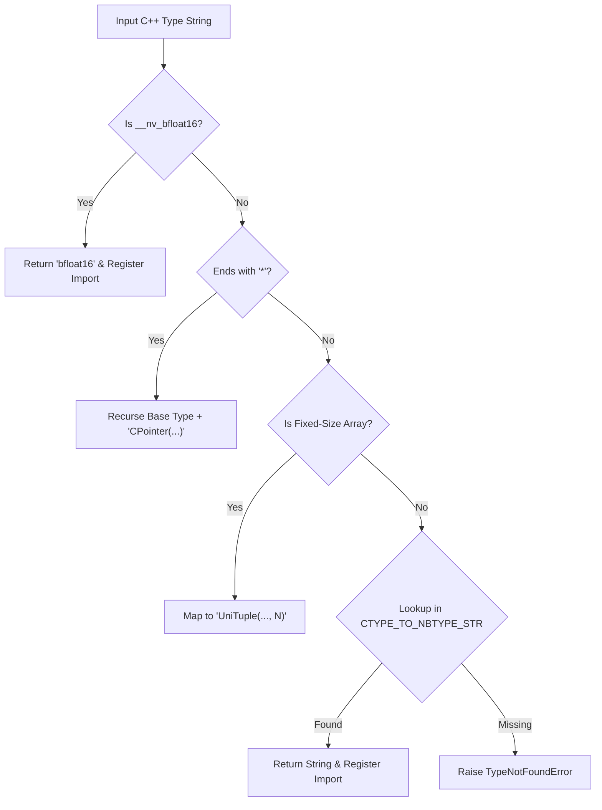
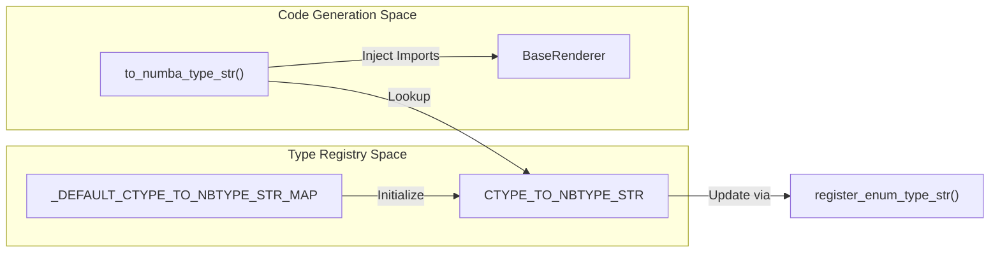

<!-- source: DeepWiki mcp.deepwiki.com · repo NVIDIA/numbast · page 4.3 Static Type Mapping and Code Generation · fetched 2026-10-26 -->

# Static Type Mapping and Code Generation

Relevant source files

The following files were used as context for generating this wiki page:

- [numbast/src/numbast/static/types.py](numbast/src/numbast/static/types.py)
- [numbast/src/numbast/tools/tests/test_symbol_exposure.py](numbast/src/numbast/tools/tests/test_symbol_exposure.py)
- [numbast/src/numbast/types.py](numbast/src/numbast/types.py)
- [pixi.lock](pixi.lock)
- [pixi.toml](pixi.toml)

The static binding generator in Numbast relies on a specialized type mapping system that translates C++ types into Python string representations of Numba types. Unlike the dynamic mode which works with live Numba type objects, the static mode generates source code, requiring a mechanism to track necessary imports and produce valid Python expressions for type annotations.

## The Static Type Registry

The static type system is built around `CTYPE_TO_NBTYPE_STR`, a mapping of C++ type names to their Numba type string equivalents. This registry is initialized by copying the dynamic `CTYPE_MAPS` and converting the values to strings [numbast/src/numbast/static/types.py:11-18]().

### Core Mapping Functions

| Function | Purpose |
| :--- | :--- |
| `to_numba_type_str(ty)` | Maps a C++ type string (including pointers and arrays) to a Numba type string and registers required imports [numbast/src/numbast/static/types.py:66-121](). |
| `to_numba_arg_type_str(ast_type)` | Converts an `ast_canopy` Type object into a Numba string, specifically for function arguments [numbast/src/numbast/static/types.py:124-137](). |
| `register_enum_type_str(...)` | Adds a C++ enum to the static registry, mapping it to an `IntEnumMember` string [numbast/src/numbast/static/types.py:32-56](). |
| `reset_types()` | Clears the current registry and restores it to the default built-in mappings [numbast/src/numbast/static/types.py:59-63](). |

### Type Mapping Logic Flow
The following diagram illustrates how a C++ type string is transformed into a Numba type expression during code generation.

**C++ to Numba String Transformation**

**Sources:** [numbast/src/numbast/static/types.py:66-121](), [numbast/src/numbast/types.py:16-17]()

## Import Injection and BaseRenderer Coupling

The static type system is tightly coupled with `BaseRenderer`. When `to_numba_type_str` encounters a type like `CPointer` or `UniTuple`, it calls `BaseRenderer._try_import_numba_type` [numbast/src/numbast/static/types.py:83, 93, 112]().

This mechanism ensures that the final generated Python file contains the necessary imports from `numba.cuda` or `numba.types` to support the types used in the function signatures and struct definitions.

### Type Registration and Scoping

**Sources:** [numbast/src/numbast/static/types.py:11-19](), [numbast/src/numbast/static/types.py:32-56](), [numbast/src/numbast/static/types.py:120]()

## Complex Type Handling

### Pointers and Arrays
Static type mapping recursively handles C++ pointers and multi-dimensional arrays:
*   **Pointers:** `T*` becomes `CPointer(to_numba_type_str(T))` [numbast/src/numbast/static/types.py:90-94]().
*   **Arrays:** `T[M][N]` is parsed into nested `UniTuple` expressions. For example, `float[4]` becomes `UniTuple(float32, 4)` [numbast/src/numbast/static/types.py:106-113]().

### Enumerations
C++ enums are mapped to Numba's `IntEnumMember`. The `register_enum_type_str` function allows users to specify the Python-side enum class name and the underlying integer width (defaulting to `int64`) [numbast/src/numbast/static/types.py:32-56]().

### Valid Enum Underlying Types
The system validates that the underlying integer type for an enum is one of the supported Numba integer strings:
*   `int8`, `int16`, `int32`, `int64`
*   `uint8`, `uint16`, `uint32`, `uint64`
[numbast/src/numbast/static/types.py:20-29]()

## Lifecycle Management: reset_types()

Because the static generator might be used to generate multiple modules within the same process (e.g., during testing or complex build pipelines), the `reset_types()` function is provided [numbast/src/numbast/static/types.py:59-63](). This function:
1.  Clears the global `CTYPE_TO_NBTYPE_STR` dictionary.
2.  Repopulates it with the default mappings (primitive types, CUDA vectors, etc.).

This ensures that type registrations from one generation session do not "leak" into subsequent sessions.

**Sources:**
*   [numbast/src/numbast/static/types.py:1-138]()
*   [numbast/src/numbast/types.py:16-46]()
*   [numbast/src/numbast/types.py:78-85]()

---

