<!-- source: DeepWiki mcp.deepwiki.com · repo NVIDIA/numbast · page 5 Experimental MLIR Backend · fetched 2026-10-26 -->

# Experimental MLIR Backend

<details>
<summary>Relevant source files</summary>

The following files were used as context for generating this wiki page:

- [numbast/src/numbast/experimental/mlir/function.py](numbast/src/numbast/experimental/mlir/function.py)
- [numbast/src/numbast/experimental/mlir/function_template.py](numbast/src/numbast/experimental/mlir/function_template.py)
- [numbast/src/numbast/experimental/mlir/static/function.py](numbast/src/numbast/experimental/mlir/static/function.py)
- [numbast/src/numbast/experimental/mlir/struct.py](numbast/src/numbast/experimental/mlir/struct.py)
- [numbast/src/numbast/experimental/mlir/tools/static_binding_generator.py](numbast/src/numbast/experimental/mlir/tools/static_binding_generator.py)
- [numbast/src/numbast/experimental/mlir/tools/tests/test_config_loading.py](numbast/src/numbast/experimental/mlir/tools/tests/test_config_loading.py)
- [numbast/src/numbast/experimental/mlir/utils.py](numbast/src/numbast/experimental/mlir/utils.py)
- [numbast/src/numbast/tools/tests/test_mlir_backend_routing.py](numbast/src/numbast/tools/tests/test_mlir_backend_routing.py)

</details>


The Experimental MLIR Backend is a specialized binding infrastructure within `numbast` designed to work with the `numba-cuda-mlir` ecosystem. While the default backend targets standard Numba-CUDA, this backend utilizes a distinct set of registries and a specific shim pipeline to enable C++ interop for MLIR-based CUDA kernels.

It is housed primarily within the `numbast.experimental.mlir` namespace and supports both dynamic (runtime) and static (code-generated) binding modes.

### Architecture Overview

The MLIR backend mirrors the standard `numbast` pipeline but replaces the Numba-CUDA core components with `numba-cuda-mlir` equivalents. This includes using a specific `typing_registry` and `lowering_registry` [numbast/experimental/mlir/function.py:19-21](), and a specialized `FunctionCallConv` for handling MLIR-specific IR generation [numbast/experimental/mlir/callconv.py]().

#### System Mapping: MLIR Binding Logic
The following diagram maps the high-level MLIR binding concepts to their implementing classes and functions in the codebase.

```mermaid
graph TD
    subgraph "Natural Language Space"
        A["Dynamic MLIR Binding"]
        B["Static MLIR Binding"]
        C["Shim Generation"]
        D["Intent Management"]
    end

    subgraph "Code Entity Space"
        A --> |"Implements"| E["bind_cxx_function"]
        A --> |"Implements"| F["bind_cxx_struct"]
        B --> |"Orchestrates"| G["StaticFunctionsRenderer"]
        B --> |"Orchestrates"| H["StaticStructsRenderer"]
        C --> |"Writes code"| I["ShimWriterBase"]
        C --> |"Templates"| J["make_function_shim"]
        D --> |"Calculates"| K["compute_intent_plan"]
    end

    E["numbast.experimental.mlir.function.bind_cxx_non_operator_function"]
    F["numbast.experimental.mlir.struct.bind_cxx_struct"]
    G["numbast.experimental.mlir.static.function.StaticFunctionsRenderer"]
    H["numbast.experimental.mlir.static.struct.StaticStructsRenderer"]
    I["numbast.experimental.mlir.shim_writer.ShimWriterBase"]
    J["numbast.experimental.mlir.utils.make_function_shim"]
    K["numbast.experimental.mlir.intent.compute_intent_plan"]
```


**Sources:** [numbast/experimental/mlir/function.py:127-134](), [numbast/experimental/mlir/struct.py:271-275](), [numbast/experimental/mlir/static/function.py:73-75](), [numbast/experimental/mlir/utils.py:134-140](), [numbast/experimental/mlir/intent.py:13-15]().

### Key Differences from Default Backend

1.  **Registry Management**: The MLIR backend requires manual registry refreshes via `refresh_numba_cuda_mlir_registries` to make late additions visible to the `numba-cuda-mlir` compiler [numbast/experimental/mlir/utils.py:16-20]().
2.  **Shim Convention**: MLIR shims typically pass the return value by reference as the first argument (`retval`) and return an `int` status code, matching the expectations of the MLIR lowering pipeline [numbast/experimental/mlir/function.py:38-44]().
3.  **Static Configuration**: The static generator is explicitly triggered by setting `MLIR Backend: true` in the YAML configuration [numbast/experimental/mlir/tools/static_binding_generator.py:52-58]().

### Operational Modes

#### MLIR Dynamic Binding
Dynamic binding allows users to wrap C++ functions and structs at runtime. It uses `ast_canopy` to parse headers and immediately registers the resulting symbols into the `numba-cuda-mlir` typing and lowering contexts. This mode is ideal for interactive development and rapid prototyping.

For details, see [MLIR Dynamic Binding](#5.1).

#### MLIR Static Binding Generator
The static generator is a CLI tool that produces standalone Python modules containing all necessary Numba-MLIR registrations and C++ shim code. It supports advanced features like `cooperative_launch_required` detection via regex [numbast/experimental/mlir/tools/static_binding_generator.py:103-106]() and specialized rendering for MLIR types.

For details, see [MLIR Static Binding Generator](#5.2).

### Data Flow: C++ to MLIR-Numba
The diagram below illustrates how a C++ declaration is transformed into an MLIR-compatible Numba lowering.

```mermaid
graph LR
    subgraph "Input"
        "C++ Header" --> "ast_canopy"
    end

    subgraph "Numbast MLIR Pipeline"
        "ast_canopy" --> "IntentPlan"
        "IntentPlan" --> "ShimWriter"
        "ShimWriter" --> "FunctionCallConv"
    end

    subgraph "Numba-MLIR Integration"
        "FunctionCallConv" --> "lowering_registry"
        "lowering_registry" --> "MLIR Kernel"
    end

    "IntentPlan"["compute_intent_plan"]
    "ShimWriter"["MemoryShimWriter"]
    "FunctionCallConv"["FunctionCallConv"]
    "lowering_registry"["numba_cuda_mlir.extending.lowering_registry"]
```
**Sources:** [numbast/experimental/mlir/intent.py:13-15](), [numbast/experimental/mlir/shim_writer.py:55-58](), [numbast/experimental/mlir/callconv.py:18-20](), [numbast/experimental/mlir/function.py:19-21]().

### Configuration
When using the static generator, the `Config` object validates MLIR-specific flags. For instance, the `Module Link Variables Used` attribute is only valid if `mlir_backend` is set to `True` [numbast/experimental/mlir/tools/static_binding_generator.py:147-151]().

**Sources:**
- `numbast/experimental/mlir/tools/static_binding_generator.py`
- `numbast/experimental/mlir/function.py`
- `numbast/experimental/mlir/struct.py`
- `numbast/experimental/mlir/utils.py`
- `numbast/experimental/mlir/callconv.py`
- `numbast/tools/tests/test_mlir_backend_routing.py`

---

