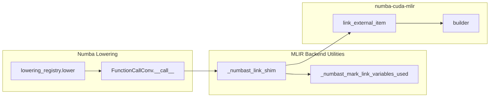

<!-- source: DeepWiki mcp.deepwiki.com · repo NVIDIA/numbast · page 5.1 MLIR Dynamic Binding · fetched 2026-10-26 -->

# MLIR Dynamic Binding

<details>
<summary>Relevant source files</summary>

The following files were used as context for generating this wiki page:

- [numbast/src/numbast/experimental/mlir/class_template.py](numbast/src/numbast/experimental/mlir/class_template.py)
- [numbast/src/numbast/experimental/mlir/function.py](numbast/src/numbast/experimental/mlir/function.py)
- [numbast/src/numbast/experimental/mlir/function_template.py](numbast/src/numbast/experimental/mlir/function_template.py)
- [numbast/src/numbast/experimental/mlir/static/function.py](numbast/src/numbast/experimental/mlir/static/function.py)
- [numbast/src/numbast/experimental/mlir/static/renderer.py](numbast/src/numbast/experimental/mlir/static/renderer.py)
- [numbast/src/numbast/experimental/mlir/static/struct.py](numbast/src/numbast/experimental/mlir/static/struct.py)
- [numbast/src/numbast/experimental/mlir/struct.py](numbast/src/numbast/experimental/mlir/struct.py)
- [numbast/src/numbast/experimental/mlir/utils.py](numbast/src/numbast/experimental/mlir/utils.py)

</details>


The `numbast.experimental.mlir` namespace provides an experimental binding API tailored for the `numba-cuda-mlir` backend. While it shares conceptual similarities with the default Numbast dynamic binding pipeline, it utilizes a distinct set of Numba types, models, and registration registries specifically compatible with the MLIR-based CUDA compiler.

## Overview and Purpose

The MLIR dynamic binding system automates the generation of Numba-compatible wrappers for C++ functions, structs, and templates at runtime. It differs from the standard backend by targeting the `numba_cuda_mlir` type system [numbast/experimental/mlir/struct.py:8-15]() and using a specialized `FunctionCallConv` that handles shim linking via the MLIR builder [numbast/experimental/mlir/static/renderer.py:159-162]().

### Key Differences from Default Backend
*   **Type System**: Uses `numba_cuda_mlir.types` and `numba_cuda_mlir.models` [numbast/experimental/mlir/struct.py:21-22]().
*   **Registries**: Target and typing registrations are performed against `numba_cuda_mlir.extending.typing_registry` and `lowering_registry` [numbast/experimental/mlir/function.py:19-20]().
*   **Shim Linking**: Shims are linked using `_numbast_link_shim`, which interacts with the MLIR builder's external item linking mechanism [numbast/experimental/mlir/static/renderer.py:159-162]().

## Dynamic Binding API

### bind_cxx_function
This function creates a Numba-callable binding for a C++ function. It supports both standard functions and operator overloads.

*   **Non-Operator Functions**: Handled by `bind_cxx_non_operator_function`. It supports `ArgIntent` overrides to control which reference parameters are treated as input, output, or inout [numbast/experimental/mlir/function.py:127-157]().
*   **Operator Overloads**: Handled by `bind_cxx_operator_overload_function`. It maps C++ operators to Python operators (e.g., `operator+` to `operator.add`) [numbast/experimental/mlir/function.py:58-93]().

### bind_cxx_struct
Registers a C++ struct as a Numba type. This involves:
1.  **Type Creation**: Generating a unique Numba type using `make_unique_type_name` [numbast/experimental/mlir/struct.py:46]().
2.  **Data Model**: Registering a `StructModel` or `PrimitiveModel` [numbast/experimental/mlir/struct.py:22]().
3.  **Constructors**: Binding C++ constructors via `bind_cxx_struct_ctors`, which generates shims for placement new [numbast/experimental/mlir/struct.py:158-185]().
4.  **Methods**: Binding member functions using `bind_cxx_struct_methods` [numbast/experimental/mlir/struct.py:255-261]().

### bind_cxx_function_template / bind_cxx_class_template
These functions handle C++ templates by deferring specialization until Numba's typing phase.
*   **Function Templates**: Uses `MetaFunctionType` to represent the unspecialized template [numbast/experimental/mlir/class_template.py:135-141]().
*   **Class Templates**: Uses `MetaType` and a `ConcreteTypeCache` to manage on-the-fly specializations generated via `ast_canopy` [numbast/experimental/mlir/class_template.py:112-132]().

### refresh_numba_cuda_mlir_registries
Late additions to the Numbast registries are not automatically visible to the MLIR backend. This function triggers `refresh_registries` from `numba_cuda_mlir` to synchronize the state [numbast/experimental/mlir/utils.py:16-20]().

**Sources:**
* [numbast/src/numbast/experimental/mlir/function.py:58-157]()
* [numbast/src/numbast/experimental/mlir/struct.py:21-46, 158-261]()
* [numbast/src/numbast/experimental/mlir/class_template.py:112-141]()
* [numbast/src/numbast/experimental/mlir/utils.py:16-20]()

## Data Flow and Architecture

The MLIR dynamic binding pipeline follows a structured flow from C++ declaration to Numba lowering.

### MLIR Binding Data Flow
The diagram below illustrates how a C++ declaration is transformed into a callable Numba entity within the MLIR backend.

Title: MLIR Binding Data Flow
```mermaid
graph TD
    subgraph "Natural Language Space"
        Decl["C++ Function/Struct Declaration"]
        Intent["Argument Intent (in/out/inout)"]
    end

    subgraph "Code Entity Space"
        AC["ast_canopy.decl.Function / Struct"]
        SW["MemoryShimWriter"]
        CC["FunctionCallConv"]
        MLIR_B["MLIR Builder"]
    end

    Decl --> AC
    AC -->|parse| SW
    Intent -->|compute| IP["IntentPlan"]
    
    SW -->|generate| Shim["C++ Shim Source"]
    Shim --> CC
    IP --> CC
    
    CC -->|@lower| Lower["Numba Lowering Function"]
    Lower -->|calls| MLIR_Link["_numbast_link_shim"]
    MLIR_Link --> MLIR_B
```
**Sources:**
* [numbast/src/numbast/experimental/mlir/function.py:183-205]()
* [numbast/src/numbast/experimental/mlir/static/renderer.py:159-162]()
* [numbast/src/numbast/experimental/mlir/callconv.py:1-20]() (referenced via import in function.py)

## Implementation Details

### Shim Generation
The MLIR backend uses specialized templates for generating C++ shims that bridge the gap between Numba's calling convention and C++ mangled functions.

| Template Name | Purpose |
| :--- | :--- |
| `struct_ctor_shim_layer_template` | Wraps placement new for struct constructors [numbast/experimental/mlir/struct.py:54-60](). |
| `struct_method_shim_layer_template` | Wraps member function calls using `self->method_name` [numbast/experimental/mlir/struct.py:62-68](). |
| `function_binding_shim_template` | Wraps standalone C++ functions [numbast/experimental/mlir/function.py:38-44](). |

### Lowering and Linking
Unlike the standard backend, the MLIR lowering must explicitly notify the MLIR builder about the external shim source. This is achieved through the `_numbast_link_shim` utility [numbast/experimental/mlir/static/renderer.py:159-162]().

Title: MLIR Shim Linking Architecture


**Sources:**
* [numbast/src/numbast/experimental/mlir/struct.py:54-68]()
* [numbast/src/numbast/experimental/mlir/function.py:38-44]()
* [numbast/src/numbast/experimental/mlir/static/renderer.py:106-162]()

### Template Handling
Templates in the MLIR backend use a "MetaType" strategy. When a template is first encountered, Numbast registers a `MetaType` (for classes) or `MetaFunctionType` (for functions) [numbast/experimental/mlir/class_template.py:125-141]().

When Numba attempts to type a call to a template:
1.  **Deduction**: `deduce_templated_overloads` determines the correct specialization based on concrete argument types [numbast/experimental/mlir/class_template.py:67-68]().
2.  **Specialization**: `ast_canopy` is used to parse the specific instantiation [numbast/experimental/mlir/class_template.py:37-43]().
3.  **Caching**: The specialized Numba type is stored in `ConcreteTypeCache` to avoid redundant parsing [numbast/experimental/mlir/class_template.py:112]().

**Sources:**
* [numbast/src/numbast/experimental/mlir/class_template.py:37-141]()

---

