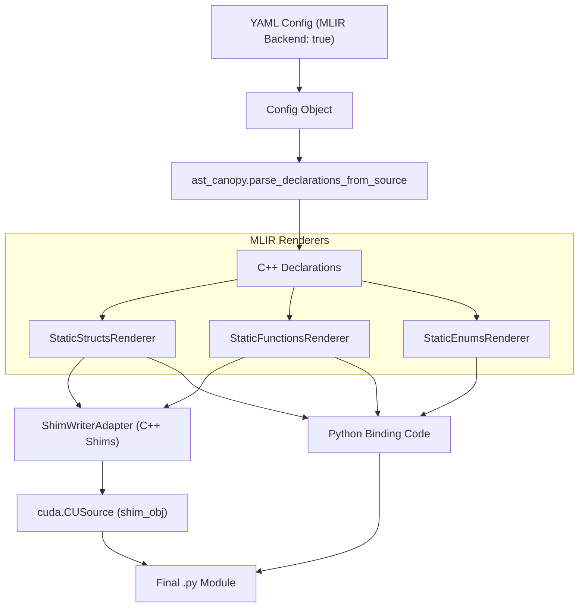
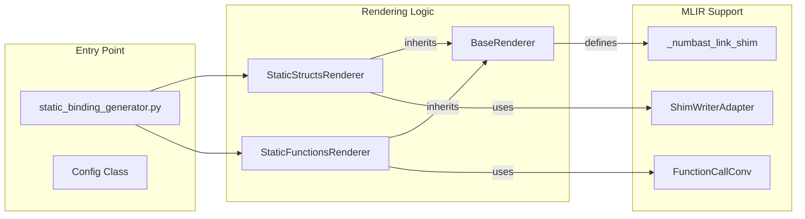

<!-- source: DeepWiki mcp.deepwiki.com · repo NVIDIA/numbast · page 5.2 MLIR Static Binding Generator · fetched 2026-10-26 -->

# MLIR Static Binding Generator

Relevant source files

The following files were used as context for generating this wiki page:

- [numbast/src/numbast/experimental/mlir/class_template.py](numbast/src/numbast/experimental/mlir/class_template.py)
- [numbast/src/numbast/experimental/mlir/static/renderer.py](numbast/src/numbast/experimental/mlir/static/renderer.py)
- [numbast/src/numbast/experimental/mlir/static/struct.py](numbast/src/numbast/experimental/mlir/static/struct.py)
- [numbast/src/numbast/experimental/mlir/static/tests/test_struct_static_bindings.py](numbast/src/numbast/experimental/mlir/static/tests/test_struct_static_bindings.py)
- [numbast/src/numbast/experimental/mlir/tools/static_binding_generator.py](numbast/src/numbast/experimental/mlir/tools/static_binding_generator.py)
- [numbast/src/numbast/experimental/mlir/tools/tests/test_config_loading.py](numbast/src/numbast/experimental/mlir/tools/tests/test_config_loading.py)
- [numbast/src/numbast/tools/tests/test_mlir_backend_routing.py](numbast/src/numbast/tools/tests/test_mlir_backend_routing.py)

The MLIR Static Binding Generator is an experimental toolset within Numbast designed to produce standalone Python binding modules specifically for the `numba-cuda-mlir` backend. It extends the core static binding logic to support MLIR-specific type systems, registry management, and shim linking requirements.

## Overview and Configuration

The MLIR backend is activated via a specific configuration flag in the YAML schema. When enabled, the generator switches from the standard Numba backend to the `numba-cuda-mlir` ecosystem, utilizing its specific data models and type representations.

### MLIR Backend Activation
The generator detects the requirement for the MLIR backend through the `MLIR Backend` (or `mlir_backend`) key in the configuration file [numbast/src/numbast/experimental/mlir/tools/static_binding_generator.py:52-64](). If this flag is set to `True`, the tool utilizes the `numba_cuda_mlir` namespace for imports and type resolution [numbast/src/numbast/experimental/mlir/tools/static_binding_generator.py:15-20]().

### Configuration Schema Extensions
The `Config` class for MLIR supports several specific attributes:
*   **`mlir_backend`**: Boolean flag to enable the MLIR-specific pipeline [numbast/src/numbast/experimental/mlir/tools/static_binding_generator.py:128-130]().
*   **`cooperative_launch_required_functions_regex`**: A list of regex patterns. Functions matching these patterns are flagged to require cooperative kernel launches [numbast/src/numbast/experimental/mlir/tools/static_binding_generator.py:103-106]().
*   **`module_link_variables_used`**: A list of C++ variables that must be marked as "used" during the linking phase to prevent optimization stripping [numbast/src/numbast/experimental/mlir/tools/static_binding_generator.py:147]().

Sources: [numbast/src/numbast/experimental/mlir/tools/static_binding_generator.py:52-151](), [numbast/src/numbast/tools/tests/test_mlir_backend_routing.py:113-123]()

## Rendering Pipeline

The MLIR rendering pipeline mirrors the standard Numba pipeline but replaces the base components with MLIR-aware counterparts.

### BaseRenderer and Registry Management
The `BaseRenderer` for MLIR provides templates for setting up the `numba-cuda-mlir` typing and lowering registries. Unlike the standard backend, it explicitly handles `refresh_registries` calls to ensure that generated entries are visible to the MLIR compiler [numbast/src/numbast/experimental/mlir/static/renderer.py:36-55]().

### StaticFunctionRenderer
The `StaticFunctionsRenderer` handles the generation of Numba-compatible wrappers for C++ functions. Key features include:
*   **Cooperative Launch Handling**: If a function matches the `cooperative_launch_required` regex, the generated Python wrapper is decorated or configured to trigger a cooperative launch in the MLIR backend.
*   **Shim Integration**: Functions utilize `FunctionCallConv` to bridge the Python call site to the C++ shim [numbast/src/numbast/experimental/mlir/static/function.py:37-39]().

### StaticStructRenderer
The `StaticStructsRenderer` manages the lifecycle of C++ structs in the MLIR context. It generates:
1.  **Type Classes**: Inheriting from `numba_cuda_mlir.types.Type` [numbast/src/numbast/experimental/mlir/static/struct.py:10]().
2.  **Data Models**: Utilizing `StructModel` or `PrimitiveModel` from the MLIR namespace [numbast/src/numbast/experimental/mlir/static/struct.py:11-15]().
3.  **Constructors**: Rendered via `StaticStructCtorRenderer`, which creates `extern "C"` shims that use placement `new` to initialize the struct memory [numbast/src/numbast/experimental/mlir/static/struct.py:76-82]().

Sources: [numbast/src/numbast/experimental/mlir/static/renderer.py:23-55](), [numbast/src/numbast/experimental/mlir/static/struct.py:51-114]()

## Data Flow: From YAML to Binding

The following diagram illustrates how the `static_binding_generator` processes a configuration to produce an MLIR-compatible binding module.

**MLIR Static Generation Flow**

Sources: [numbast/src/numbast/experimental/mlir/tools/static_binding_generator.py:27-41](), [numbast/src/numbast/experimental/mlir/static/renderer.py:84-93]()

## Shim and Linking Infrastructure

MLIR bindings rely on a specialized linking mechanism to connect the Numba IR to the generated C++ shims.

### ShimWriterAdapter
The `ShimWriterAdapter` wraps a `_KeyedStringIO` stream. It ensures that shim code is deduplicated via keys (typically mangled names) before being written to the final module's `shim_stream` [numbast/src/numbast/experimental/mlir/static/renderer.py:57-72](), [numbast/src/numbast/experimental/mlir/static/renderer.py:84-93]().

### _numbast_link_shim
This helper function is injected into every generated module. It handles the low-level interaction with the MLIR builder to link the `CUSource` (containing the shims) and mark required variables as used [numbast/src/numbast/experimental/mlir/static/renderer.py:159-162]().

| Entity | Role | Source |
| :--- | :--- | :--- |
| `CUSource` | Container for the C++ shim source code in the generated module. | [numbast/src/numbast/experimental/mlir/static/renderer.py:80]() |
| `_numbast_link_external_item` | Dispatches the linking request to the MLIR builder. | [numbast/src/numbast/experimental/mlir/static/renderer.py:106-122]() |
| `module_link_variables_used` | Injected list of symbols to protect from linker optimization. | [numbast/src/numbast/experimental/mlir/static/renderer.py:81]() |

Sources: [numbast/src/numbast/experimental/mlir/static/renderer.py:57-162]()

## Code Entity Mapping

This diagram maps the high-level system components to their specific implementation classes and functions.

**MLIR Static Binding System Entities**

Sources: [numbast/src/numbast/experimental/mlir/tools/static_binding_generator.py:27-41](), [numbast/src/numbast/experimental/mlir/static/struct.py:51-54](), [numbast/src/numbast/experimental/mlir/static/renderer.py:159-162]()

## Test Infrastructure

Testing for MLIR-generated modules is performed using `pytest` and the `numba-cuda-mlir` runtime. 

### Integration Tests
Tests verify that generated bindings can be imported and used within a `@cuda.jit` kernel linked with the corresponding implementation source.
*   **Struct Construction**: Verifies that `Foo()` in Python correctly invokes the C++ constructor shim [numbast/src/numbast/experimental/mlir/static/tests/test_struct_static_bindings.py:51-64]().
*   **Method Dispatch**: Ensures that instance methods (e.g., `foo.get_x()`) correctly route through the `FunctionCallConv` to the MLIR backend [numbast/src/numbast/experimental/mlir/static/tests/test_struct_static_bindings.py:130-141]().
*   **Type Casting**: Validates that conversion operators and `lower_cast` implementations allow interoperability between C++ types and Numba primitives [numbast/src/numbast/experimental/mlir/static/tests/test_struct_static_bindings.py:97-110]().

Sources: [numbast/src/numbast/experimental/mlir/static/tests/test_struct_static_bindings.py:1-170]()

---

