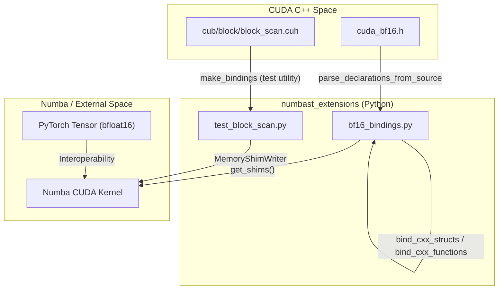
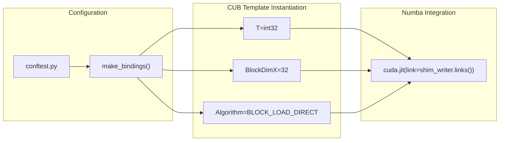

<!-- source: DeepWiki mcp.deepwiki.com · repo NVIDIA/numbast · page 6 numbast_extensions: Built-in Bindings · fetched 2026-10-26 -->

# numbast_extensions: Built-in Bindings

Relevant source files

The following files were used as context for generating this wiki page:

- [.gitignore](.gitignore)
- [ast_canopy/ast_canopy/shim_include/crt/math_functions.hpp](ast_canopy/ast_canopy/shim_include/crt/math_functions.hpp)
- [numbast/src/numbast/tools/tests/test_cli.py](numbast/src/numbast/tools/tests/test_cli.py)
- [numbast/tests/test_enum_arg.py](numbast/tests/test_enum_arg.py)
- [numbast_extensions/README.md](numbast_extensions/README.md)
- [numbast_extensions/numbast_extensions/__init__.py](numbast_extensions/numbast_extensions/__init__.py)
- [numbast_extensions/numbast_extensions/bf16/bf16_bindings.py](numbast_extensions/numbast_extensions/bf16/bf16_bindings.py)
- [numbast_extensions/tests/static/test_static_bf16.py](numbast_extensions/tests/static/test_static_bf16.py)
- [numbast_extensions/tests/test_bfloat16.py](numbast_extensions/tests/test_bfloat16.py)
- [numbast_extensions/tests/test_torch_bf16.py](numbast_extensions/tests/test_torch_bf16.py)
- [numbast_extensions/tests/thirdparty/CCCL/conftest.py](numbast_extensions/tests/thirdparty/CCCL/conftest.py)
- [numbast_extensions/tests/thirdparty/CCCL/test_block_load_store.py](numbast_extensions/tests/thirdparty/CCCL/test_block_load_store.py)
- [numbast_extensions/tests/thirdparty/CCCL/test_block_scan.py](numbast_extensions/tests/thirdparty/CCCL/test_block_scan.py)

The `numbast_extensions` package provides pre-built Numba bindings for specialized CUDA types and third-party libraries. These extensions serve two primary purposes: providing immediate support for exotic types like `bfloat16` and acting as reference implementations for the `numbast` binding generation pipeline.

While `numbast` provides the engine for creating bindings, `numbast_extensions` contains the actual generated code and specialized configurations required for complex CUDA C++ headers [numbast_extensions/README.md:3-9]().

### System Architecture and Code Mapping

The following diagram illustrates how `numbast_extensions` bridges the gap between raw CUDA C++ headers and the Numba ecosystem.

**Diagram: Extension Binding Pipeline**

Sources: [numbast_extensions/numbast_extensions/bf16/bf16_bindings.py:6-14](), [numbast_extensions/tests/thirdparty/CCCL/test_block_scan.py:24-31](), [numbast_extensions/tests/test_torch_bf16.py:19-25]()

## bfloat16 Bindings

The `bfloat16` extension provides Numba support for `__nv_bfloat16` and `__nv_bfloat162` types found in `cuda_bf16.h`. It includes support for arithmetic operators, logical operators, and native math functions (e.g., `hsin`, `hsqrt`) [numbast_extensions/README.md:20-32]().

The implementation utilizes `TYPE_SPECIALIZATION` and `DATA_MODEL_SPECIALIZATION` dictionaries to map CUDA C++ types to Numba `PrimitiveModel` or `StructModel` [numbast_extensions/numbast_extensions/bf16/bf16_bindings.py:50-65](). It also includes a critical Workaround (WAR) for NVBug 4549708, using a specific `#define` pretext in the `MemoryShimWriter` to prevent ABI mismatches during linking [numbast_extensions/numbast_extensions/bf16/bf16_bindings.py:78-85]().

### Key Features:
*   **Compute Capability:** Requires `sm_80` or higher; a warning is issued on older hardware [numbast_extensions/numbast_extensions/bf16/bf16_bindings.py:20-26]().
*   **PyTorch Interop:** Demonstrates how `numbast`-bound functions like `hsin` can operate directly on PyTorch tensors with `torch.bfloat16` dtype [numbast_extensions/tests/test_torch_bf16.py:18-37]().
*   **Alias Resolution:** Automatically resolves `typedef` aliases like `nv_bfloat16` to their underlying types [numbast_extensions/numbast_extensions/bf16/bf16_bindings.py:74-76]().

For technical details on the specialization and WAR pretext, see [bfloat16 Bindings](#6.1).

Sources: [numbast_extensions/numbast_extensions/bf16/bf16_bindings.py:1-113](), [numbast_extensions/README.md:20-32]()

## CCCL (CUB) Third-Party Bindings

The extensions package includes test-driven bindings for the CUDA Core C++ Library (CCCL), specifically the CUB collective primitives. These serve as a benchmark for `numbast`'s ability to handle complex C++ class templates with heavy template metaprogramming [numbast_extensions/tests/thirdparty/CCCL/test_block_load_store.py:17-18]().

The bindings cover essential CUB operations:
*   **BlockLoad/BlockStore:** Support for `DIRECT` algorithms and data movement between global and local memory [numbast_extensions/tests/thirdparty/CCCL/test_block_load_store.py:58-69]().
*   **BlockScan:** Support for `InclusiveSum` using the `BLOCK_SCAN_RAKING` algorithm [numbast_extensions/tests/thirdparty/CCCL/test_block_scan.py:38-46]().

**Diagram: CCCL Binding Workflow**

Sources: [numbast_extensions/tests/thirdparty/CCCL/conftest.py:25-37](), [numbast_extensions/tests/thirdparty/CCCL/test_block_load_store.py:71-91]()

### Infrastructure
The CCCL bindings utilize a specialized `conftest.py` that detects the CCCL include path via `cuda.pathfinder` and handles version-specific changes (such as the shift from `BLOCK_DIM_X` to `BlockDimX` in CUB 3.2+) [numbast_extensions/tests/thirdparty/CCCL/conftest.py:40-45, 78-87]().

For details on the CCCL test infrastructure and template handling, see [CCCL (CUB) Third-Party Bindings](#6.2).

Sources: [numbast_extensions/tests/thirdparty/CCCL/test_block_load_store.py:1-154](), [numbast_extensions/tests/thirdparty/CCCL/test_block_scan.py:1-108](), [numbast_extensions/tests/thirdparty/CCCL/conftest.py:1-122]()

---

