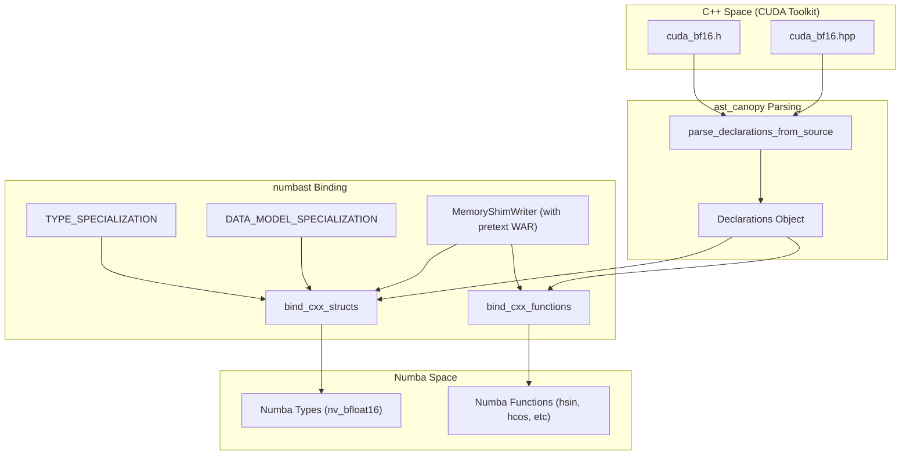
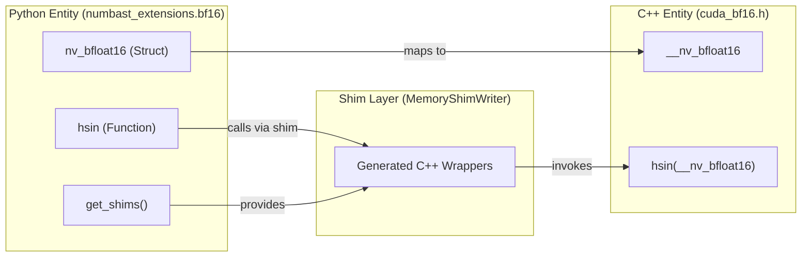

<!-- source: DeepWiki mcp.deepwiki.com · repo NVIDIA/numbast · page 6.1 bfloat16 Bindings · fetched 2026-10-26 -->

# bfloat16 Bindings

<details>
<summary>Relevant source files</summary>

The following files were used as context for generating this wiki page:

- [ast_canopy/tests/test_command_invocation.py](ast_canopy/tests/test_command_invocation.py)
- [numbast/src/numbast/static/tests/data/bf16.cuh](numbast/src/numbast/static/tests/data/bf16.cuh)
- [numbast/src/numbast/static/tests/test_bf16_support.py](numbast/src/numbast/static/tests/test_bf16_support.py)
- [numbast/tests/data/sample_function.cuh](numbast/tests/data/sample_function.cuh)
- [numbast_extensions/numbast_extensions/bf16/bf16_bindings.py](numbast_extensions/numbast_extensions/bf16/bf16_bindings.py)
- [numbast_extensions/tests/test_bfloat16.py](numbast_extensions/tests/test_bfloat16.py)
- [numbast_extensions/tests/test_torch_bf16.py](numbast_extensions/tests/test_torch_bf16.py)

</details>


The `bfloat16` bindings provide Numba-compatible interfaces for the `__nv_bfloat16` and `__nv_bfloat162` types defined in the CUDA Toolkit. These bindings allow Numba users to perform high-performance brain-floating-point arithmetic within CUDA kernels, leveraging hardware acceleration available on modern GPU architectures.

## Overview and Hardware Requirements

The `bfloat16` implementation in `numbast_extensions` dynamically parses the CUDA Toolkit headers to generate Numba types, data models, and function lowerings.

*   **Compute Capability**: Hardware support for `bfloat16` arithmetic requires **sm_80** (Ampere) or later [numbast_extensions/numbast_extensions/bf16/bf16_bindings.py:20-28](). If the current device's compute capability is lower than 8.0, a warning is issued, and most features will be unavailable [numbast_extensions/numbast_extensions/bf16/bf16_bindings.py:20-26]().
*   **Headers**: The bindings specifically target `cuda_bf16.h` and `cuda_bf16.hpp` located in the CUDA installation include directory [numbast_extensions/numbast_extensions/bf16/bf16_bindings.py:34-36]().

## Implementation Logic

The binding process utilizes `ast_canopy` to ingest the C++ definitions and `numbast` to register them into the Numba ecosystem.

### Parsing and Specialization
The system parses `cuda_bf16.h` using the compute capability of the current device as the target architecture (e.g., `sm_80`) [numbast_extensions/numbast_extensions/bf16/bf16_bindings.py:38-42](). Because `bfloat16` types often behave like primitive numbers but are implemented as structs or unions in C++, explicit specialization is required to ensure Numba treats them correctly.

| C++ Type | Numba Type Specialization | Data Model Specialization |
| :--- | :--- | :--- |
| `__nv_bfloat16` | `types.Number` | `PrimitiveModel` |
| `__nv_bfloat16_raw` | `types.Number` | `PrimitiveModel` |
| `nv_bfloat16` | `types.Number` | `PrimitiveModel` |
| `__nv_bfloat162` | `types.Type` | `StructModel` |
| `__nv_bfloat162_raw` | `types.Type` | `StructModel` |
| `nv_bfloat162` | `types.Type` | `StructModel` |

Sources: [numbast_extensions/numbast_extensions/bf16/bf16_bindings.py:50-65]()

### The NVBug 4549708 Workaround
A critical component of the `bfloat16` binding is the `pretext` string used by the `MemoryShimWriter`. This is a workaround (WAR) for **NVBug 4549708**, which addresses an ABI mismatch between the `bf16` definitions and the linked libraries that can cause "unspecified launch failures" [numbast_extensions/numbast_extensions/bf16/bf16_bindings.py:78-83]().

The `pretext` forces the inclusion of the `.hpp` headers from the `.h` headers and ensures the shim code correctly sees the intended C++ definitions [numbast_extensions/numbast_extensions/bf16/bf16_bindings.py:80-83]().

### Data Flow Diagram: bf16 Binding Generation
This diagram illustrates how C++ headers are transformed into Numba-usable objects.

Title: bf16 Binding Generation Pipeline

Sources: [numbast_extensions/numbast_extensions/bf16/bf16_bindings.py:38-97]()

## Alias Resolution and Typedefs

The CUDA headers define several aliases (e.g., `nv_bfloat16` is often a typedef for `__nv_bfloat16`). To ensure the Python API is intuitive, the binding generator builds a map of `aliases` from the parsed `typedefs` [numbast_extensions/numbast_extensions/bf16/bf16_bindings.py:74-76]().

After the primary types are bound via `bind_cxx_structs`, the script iterates through these aliases and updates the global namespace so that both the underlying name and the alias point to the same Numba type object [numbast_extensions/numbast_extensions/bf16/bf16_bindings.py:102-105]().

## Usage in Kernels

To use these bindings, users must link the generated shims into their CUDA kernels using the `link` keyword in the `@cuda.jit` decorator.

### Example: Arithmetic and Math Functions
The bindings support standard arithmetic operators (`+`, `-`, `*`, `/`), comparison operators, and math intrinsics like `hsin`, `hcos`, and `hsqrt` [numbast_extensions/tests/test_bfloat16.py:112-201]().

```python
from numbast_extensions.bf16 import nv_bfloat16, hsin, get_shims
from numba import cuda

@cuda.jit(link=get_shims())
def bfloat16_kernel(a, b, out):
    i = cuda.grid(1)
    # Automatic conversion and arithmetic
    val = nv_bfloat16(a[i]) + nv_bfloat16(b[i])
    out[i] = hsin(val)
```
Sources: [numbast_extensions/tests/test_torch_bf16.py:19-23](), [numbast_extensions/tests/test_bfloat16.py:112-123]()

### Interoperability with PyTorch
The bindings are compatible with PyTorch `bfloat16` tensors. When a PyTorch tensor is passed to a Numba kernel, it is treated as an array of the underlying 16-bit values, which can then be cast to `nv_bfloat16` for computation [numbast_extensions/tests/test_torch_bf16.py:25-36]().

### System Entity Mapping
The following diagram maps Python-side symbols to their C++ counterparts within the `bf16` binding context.

Title: bf16 Symbol Mapping

Sources: [numbast_extensions/numbast_extensions/bf16/bf16_bindings.py:85-106](), [numbast_extensions/tests/test_torch_bf16.py:19-36]()

## Exported API
The `numbast_extensions.bf16` module exports:
1.  **Types**: `nv_bfloat16`, `nv_bfloat162`, and their `_raw` variants [numbast_extensions/numbast_extensions/bf16/bf16_bindings.py:109-112]().
2.  **Functions**: All math and utility functions parsed from the headers (excluding `atomicAdd`) [numbast_extensions/numbast_extensions/bf16/bf16_bindings.py:67-69, 110]().
3.  **Shims**: The `get_shims` function, which returns the list of C++ shim sources required for linking [numbast_extensions/numbast_extensions/bf16/bf16_bindings.py:106]().

Sources: [numbast_extensions/numbast_extensions/bf16/bf16_bindings.py:108-113]()

---

