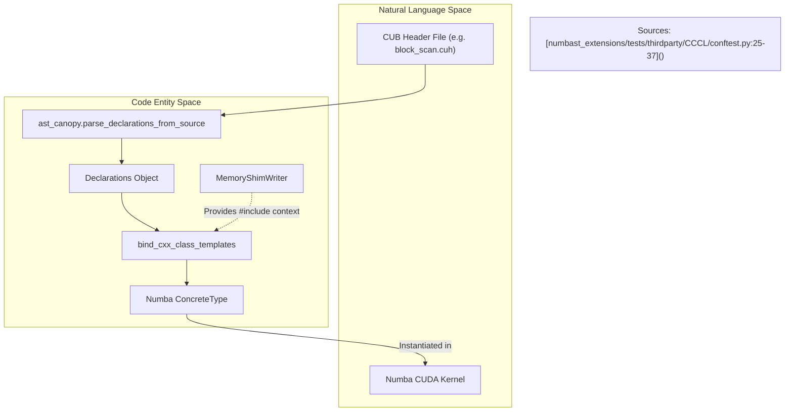
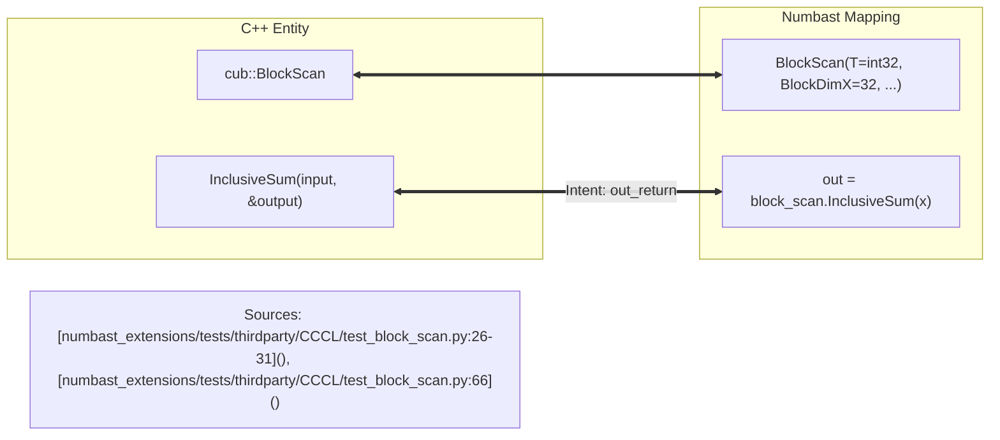

<!-- source: DeepWiki mcp.deepwiki.com · repo NVIDIA/numbast · page 6.2 CCCL (CUB) Third-Party Bindings · fetched 2026-10-26 -->

# CCCL (CUB) Third-Party Bindings

Relevant source files

The following files were used as context for generating this wiki page:

- [.gitignore](.gitignore)
- [ast_canopy/ast_canopy/shim_include/crt/math_functions.hpp](ast_canopy/ast_canopy/shim_include/crt/math_functions.hpp)
- [numbast/src/numbast/tools/tests/test_cli.py](numbast/src/numbast/tools/tests/test_cli.py)
- [numbast/tests/test_enum_arg.py](numbast/tests/test_enum_arg.py)
- [numbast_extensions/tests/thirdparty/CCCL/conftest.py](numbast_extensions/tests/thirdparty/CCCL/conftest.py)
- [numbast_extensions/tests/thirdparty/CCCL/test_block_load_store.py](numbast_extensions/tests/thirdparty/CCCL/test_block_load_store.py)
- [numbast_extensions/tests/thirdparty/CCCL/test_block_scan.py](numbast_extensions/tests/thirdparty/CCCL/test_block_scan.py)

This page documents the integration of the CUDA C++ Core Libraries (CCCL), specifically the **CUB** library, within `numbast_extensions`. These bindings provide Numba-compatible interfaces for collective block-level operations like `BlockLoad`, `BlockStore`, and `BlockScan`.

The CCCL bindings serve as a primary reference implementation for the static binding generator, demonstrating how to handle complex C++ class templates, template argument deduction, and argument intents (e.g., converting C++ pointers to Numba return values).

## Binding Infrastructure and conftest Setup

The testing and generation infrastructure for CCCL is located in `numbast_extensions/tests/thirdparty/CCCL/`. Because CCCL undergoes significant API changes between CUDA versions (notably the shift from SCREAMING_SNAKE_CASE to CamelCase template parameters in CUDA 13.2+), the setup includes logic to detect the environment and adapt the bindings accordingly.

### Key Setup Functions

*   **`make_bindings`**: A helper that orchestrates the parsing of CUB headers via `ast_canopy` and the registration of class templates via `numbast`. It applies `arg_intent` maps to ensure C++ methods behave naturally in Python [numbast_extensions/tests/thirdparty/CCCL/conftest.py:25-37]().
*   **`_read_cub_version`**: Parses `cub/version.cuh` to determine the specific CUB version. This is critical for determining if the library uses the legacy identifier style (e.g., `BLOCK_DIM_X`) or the modern style (e.g., `BlockDimX`) [numbast_extensions/tests/thirdparty/CCCL/conftest.py:48-68]().
*   **`use_new_cccl_template_keyword_names`**: A fixture that returns a boolean indicating if CUB 3.2.0 (CUDA 13.2) or higher is present, triggering the use of modern template parameter names [numbast_extensions/tests/thirdparty/CCCL/conftest.py:78-87]().

### CCCL Binding Data Flow

The following diagram illustrates how a CUB header is transformed into a usable Numba-JIT kernel component.

**CUB Binding Generation Flow**

## BlockLoad and BlockStore Bindings

The `BlockLoad` and `BlockStore` bindings allow threads within a CUDA block to collectively load data from global memory into local registers (or local arrays) and store them back.

### Implementation Details
The bindings are created using a `MemoryShimWriter` that includes the necessary CUB headers. Specific `arg_intent` configurations are applied to map C++ output pointers to Python-friendly constructs:
*   **BlockLoad**: Maps the `dst_items` parameter of the `Load` method to `out_ptr` [numbast_extensions/tests/thirdparty/CCCL/test_block_load_store.py:32-37]().
*   **BlockStore**: Maps the `items` parameter of the `Store` method to `out_ptr` [numbast_extensions/tests/thirdparty/CCCL/test_block_load_store.py:39-44]().

### Usage in Kernels
Inside a `@cuda.jit` kernel, the bound class template is instantiated with template arguments (like `T`, `BlockDimX`, and `Algorithm`). Because `numbast` handles the underlying C++ shim generation, users can pass Numba types (like `int32`) directly as template arguments [numbast_extensions/tests/thirdparty/CCCL/test_block_load_store.py:75-91]().

Sources: `[numbast_extensions/tests/thirdparty/CCCL/test_block_load_store.py:21-57]()`, `[numbast_extensions/tests/thirdparty/CCCL/test_block_load_store.py:71-106]()`

## BlockScan Bindings

The `BlockScan` bindings provide prefix sum (scan) capabilities across a thread block. This implementation demonstrates the `out_return` intent, where a C++ pass-by-reference output is transformed into a standard Python function return value.

### Intent Mapping
The `InclusiveSum` method is configured with `{"output": "out_return"}` [numbast_extensions/tests/thirdparty/CCCL/test_block_scan.py:30](). This allows the Numba code to look like:
`out = block_scan.InclusiveSum(x)` instead of passing a pointer to a result variable.

**BlockScan Entity Mapping**

Sources: `[numbast_extensions/tests/thirdparty/CCCL/test_block_scan.py:16-36]()`, `[numbast_extensions/tests/thirdparty/CCCL/test_block_scan.py:48-70]()`

## Reference for Static Binding Generator

The CCCL bindings serve as a real-world test case for the `numbast` static binding generator's capabilities:

| Feature | CCCL Implementation Example |
| :--- | :--- |
| **Template Specialization** | Handling `cub::BlockScanAlgorithm::BLOCK_SCAN_RAKING` as a template argument [numbast_extensions/tests/thirdparty/CCCL/test_block_scan.py:58](). |
| **Enum Integration** | Using C++ enums (e.g., `Fruit.Apple`) as arguments to bound functions [numbast/tests/test_enum_arg.py:55-73](). |
| **Shim Linking** | Dynamically linking generated C++ shims using `@cuda.jit(link=shim_writer.links())` [numbast_extensions/tests/thirdparty/CCCL/test_block_load_store.py:73](). |
| **Pointer Interop** | Using `cffi` to bridge Numba arrays to C++ pointers (`ffi.from_buffer`) [numbast_extensions/tests/thirdparty/CCCL/test_block_load_store.py:97-101](). |

Sources: `[numbast_extensions/tests/thirdparty/CCCL/test_block_load_store.py:73-106]()`, `[numbast/tests/test_enum_arg.py:55-73]()`

---

