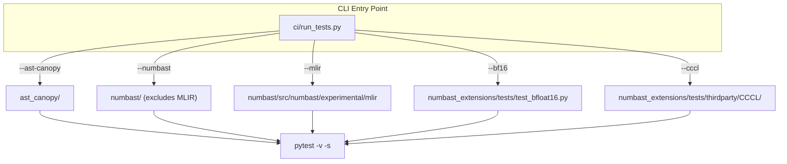
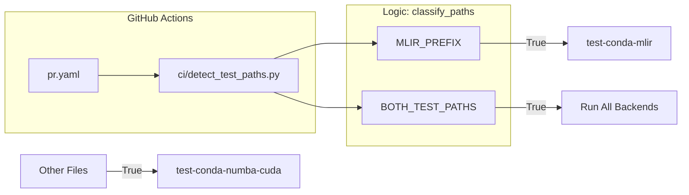

<!-- source: DeepWiki mcp.deepwiki.com · repo NVIDIA/numbast · page 7 Testing Infrastructure · fetched 2026-10-26 -->

# Testing Infrastructure

Relevant source files

The following files were used as context for generating this wiki page:

- [.github/workflows/ci.yaml](.github/workflows/ci.yaml)
- [.github/workflows/pr.yaml](.github/workflows/pr.yaml)
- [.gitignore](.gitignore)
- [ast_canopy/ast_canopy/shim_include/crt/math_functions.hpp](ast_canopy/ast_canopy/shim_include/crt/math_functions.hpp)
- [ci/detect_test_paths.py](ci/detect_test_paths.py)
- [ci/run_tests.py](ci/run_tests.py)
- [numbast/src/numbast/__init__.py](numbast/src/numbast/__init__.py)
- [numbast/src/numbast/experimental/mlir/tests/conftest.py](numbast/src/numbast/experimental/mlir/tests/conftest.py)
- [numbast/src/numbast/experimental/mlir/tools/tests/test_symbol_exposure.py](numbast/src/numbast/experimental/mlir/tools/tests/test_symbol_exposure.py)
- [numbast/src/numbast/tools/tests/test_cli.py](numbast/src/numbast/tools/tests/test_cli.py)
- [numbast/tests/test_enum_arg.py](numbast/tests/test_enum_arg.py)
- [numbast_extensions/tests/thirdparty/CCCL/conftest.py](numbast_extensions/tests/thirdparty/CCCL/conftest.py)
- [numbast_extensions/tests/thirdparty/CCCL/test_block_load_store.py](numbast_extensions/tests/thirdparty/CCCL/test_block_load_store.py)
- [numbast_extensions/tests/thirdparty/CCCL/test_block_scan.py](numbast_extensions/tests/thirdparty/CCCL/test_block_scan.py)

The Numbast project employs a multi-layered testing strategy to ensure the correctness of C++ AST parsing, Numba type registration, and both dynamic and static binding generation. The test suite is distributed across the core packages—`ast_canopy`, `numbast`, and `numbast_extensions`—and is integrated into a sophisticated CI/CD pipeline that handles multiple Numba backends.

### High-Level Test Organization

The testing infrastructure is designed to validate the project from low-level C++ parsing to high-level integration with third-party libraries like CCCL (CUB).

| Package | Test Focus | Key Tools |
| :--- | :--- | :--- |
| **ast_canopy** | Clang AST traversal, C++ declaration extraction, and serialization. | `pytest`, `libastcanopy` |
| **numbast** | Dynamic binding registration, Numba data models, and static code generation. | `pytest`, `numba-cuda`, `numba-cuda-mlir` |
| **numbast_extensions** | Correctness of pre-built bindings for `bfloat16` and `CCCL`. | `pytest`, `CCCL`, `cffi` |
| **CI/CD** | Automated builds, change detection, and cross-backend validation. | `GitHub Actions`, `pixi`, `conda` |

Sources: [ci/run_tests.py:38-52](), [numbast/src/numbast/tools/tests/test_cli.py:1-15]()

### Test Execution Flow

The `ci/run_tests.py` script serves as the central entry point for developers to run specific subsets of the test suite. It wraps `pytest` and handles complex configurations such as ignoring MLIR-specific tests when running standard `numbast` tests.

Title: Test Execution and Sub-package Selection

Sources: [ci/run_tests.py:8-10](), [ci/run_tests.py:38-52](), [ci/run_tests.py:64-81]()

---

### [ast_canopy Tests](#7.1)
The `ast_canopy` test suite focuses on the fidelity of the C++ parsing layer. It utilizes `.cu` and `.cuh` test data files to verify that `parse_declarations_from_source` correctly extracts records, functions, and templates. Key areas include testing name mangling (including CRTP and dependent types), attribute parsing (e.g., `__host__`, `__device__`), and template instantiation behavior.

For details, see [ast_canopy Tests](#7.1).

### [numbast Tests: Dynamic and Static Bindings](#7.2)
The `numbast` test suite covers both operational modes of the library. 
- **Dynamic Tests:** Validate `bind_cxx_struct` and `bind_cxx_function` at runtime, ensuring Numba can correctly lower calls to C++ shims.
- **Static Tests:** Use `CliRunner` to invoke the `static_binding_generator` and verify the generated Python code. Tests like `test_cli_yml_inputs_full_spec` actually execute the generated code within a `@cuda.jit` kernel to ensure end-to-end functionality.

For details, see [numbast Tests: Dynamic and Static Bindings](#7.2).

Sources: [numbast/src/numbast/tools/tests/test_cli.py:104-127](), [numbast/src/numbast/tools/tests/test_cli.py:179-223]()

### [CI/CD Pipelines and Change Detection](#7.3)
Numbast uses GitHub Actions for continuous integration. A critical component is `ci/detect_test_paths.py`, which analyzes changed files in a PR to determine if the `numba-cuda` backend, the `mlir` backend, or both need to be tested. This optimization reduces CI time by avoiding expensive MLIR tests when only core logic is touched.

Title: CI Change Detection and Workflow Routing

For details, see [CI/CD Pipelines and Change Detection](#7.3).

Sources: [.github/workflows/pr.yaml:33-51](), [ci/detect_test_paths.py:12-27](), [ci/detect_test_paths.py:35-56]()

### Integration Testing with CCCL
The `numbast_extensions` package contains integration tests that use `MemoryShimWriter` to bind complex C++ templates from NVIDIA's CCCL (CUB). These tests, such as `TestBlockScan` and `TestBlockLoadStore`, serve as the ultimate validation of Numbast's ability to handle high-performance CUDA C++ libraries.

Sources: [numbast_extensions/tests/thirdparty/CCCL/test_block_load_store.py:17-57](), [numbast_extensions/tests/thirdparty/CCCL/test_block_scan.py:16-36]()

---

