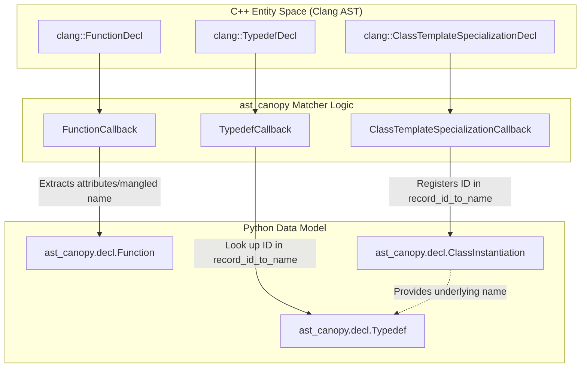
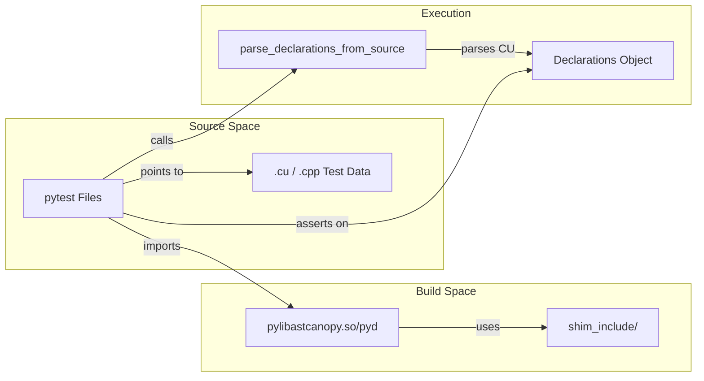

<!-- source: DeepWiki mcp.deepwiki.com · repo NVIDIA/numbast · page 7.1 ast_canopy Tests · fetched 2026-10-26 -->

# ast_canopy Tests

Relevant source files

The following files were used as context for generating this wiki page:

- [ast_canopy/ast_canopy/decl.py](ast_canopy/ast_canopy/decl.py)
- [ast_canopy/cpp/src/detail/matchers/class_template_specialization_matcher.cpp](ast_canopy/cpp/src/detail/matchers/class_template_specialization_matcher.cpp)
- [ast_canopy/cpp/src/function.cpp](ast_canopy/cpp/src/function.cpp)
- [ast_canopy/cpp/src/template.cpp](ast_canopy/cpp/src/template.cpp)
- [ast_canopy/cpp/src/type.cpp](ast_canopy/cpp/src/type.cpp)
- [ast_canopy/pyproject.toml](ast_canopy/pyproject.toml)
- [ast_canopy/tests/conftest.py](ast_canopy/tests/conftest.py)
- [ast_canopy/tests/data/attributes.cu](ast_canopy/tests/data/attributes.cu)
- [ast_canopy/tests/data/inline_hint_macro_fix.cu](ast_canopy/tests/data/inline_hint_macro_fix.cu)
- [ast_canopy/tests/data/noinline_macro_fix.cu](ast_canopy/tests/data/noinline_macro_fix.cu)
- [ast_canopy/tests/data/pp_function.cu](ast_canopy/tests/data/pp_function.cu)
- [ast_canopy/tests/data/sample_crtp_dependent.cu](ast_canopy/tests/data/sample_crtp_dependent.cu)
- [ast_canopy/tests/data/sample_itanium_mangled_names.cu](ast_canopy/tests/data/sample_itanium_mangled_names.cu)
- [ast_canopy/tests/data/sample_null_qualtype.cu](ast_canopy/tests/data/sample_null_qualtype.cu)
- [ast_canopy/tests/data/sample_template_template_param.cu](ast_canopy/tests/data/sample_template_template_param.cu)
- [ast_canopy/tests/data/sample_typedef_template_inst.cu](ast_canopy/tests/data/sample_typedef_template_inst.cu)
- [ast_canopy/tests/data/sample_types.cu](ast_canopy/tests/data/sample_types.cu)
- [ast_canopy/tests/host/cuda_headers/include/cuda.h](ast_canopy/tests/host/cuda_headers/include/cuda.h)
- [ast_canopy/tests/host/data/sample_host_function.cpp](ast_canopy/tests/host/data/sample_host_function.cpp)
- [ast_canopy/tests/host/test_cuda_h.py](ast_canopy/tests/host/test_cuda_h.py)
- [ast_canopy/tests/host/test_function.py](ast_canopy/tests/host/test_function.py)
- [ast_canopy/tests/test_attributes.py](ast_canopy/tests/test_attributes.py)
- [ast_canopy/tests/test_crtp_dependent_mangle.py](ast_canopy/tests/test_crtp_dependent_mangle.py)
- [ast_canopy/tests/test_inline_hint_fix.py](ast_canopy/tests/test_inline_hint_fix.py)
- [ast_canopy/tests/test_mangled_name.py](ast_canopy/tests/test_mangled_name.py)
- [ast_canopy/tests/test_noinline_fix.py](ast_canopy/tests/test_noinline_fix.py)
- [ast_canopy/tests/test_null_qualtype_guard.py](ast_canopy/tests/test_null_qualtype_guard.py)
- [ast_canopy/tests/test_parse_type.py](ast_canopy/tests/test_parse_type.py)
- [ast_canopy/tests/test_template_template_param.py](ast_canopy/tests/test_template_template_param.py)
- [ast_canopy/tests/test_typedef_template_instantiation.py](ast_canopy/tests/test_typedef_template_instantiation.py)
- [ci/build_wheels.sh](ci/build_wheels.sh)
- [pyproject.toml](pyproject.toml)

The `ast_canopy` test suite validates the Clang-based C++ AST parsing layer. It ensures that CUDA C++ headers are correctly transformed into Python dataclasses, handling complex scenarios such as template instantiations, mangled names, and attribute extraction.

## Test Suite Overview

The test suite is organized into Python test files located in `ast_canopy/tests/` and corresponding CUDA/C++ data files in `ast_canopy/tests/data/`.

### Key Components
*   **Test Data (.cu/.cpp):** Minimal C++ source files used to trigger specific AST edge cases.
*   **Python Test Cases:** Utilize `pytest` to invoke `parse_declarations_from_source` and assert the structure of the returned `Declarations` object.
*   **Host-Mode Tests:** Located in `ast_canopy/tests/host/`, these verify that the parser functions correctly when targeting host code or standard C++ headers.

Sources: [ast_canopy/tests/test_parse_type.py:1-10](), [ast_canopy/tests/host/test_function.py:1-10]()

## Core Functional Tests

### Mangled Name Generation
The test `test_mangled_name` verifies that `ast_canopy` correctly computes Itanium-style mangled names for C++ functions, which is critical for linking and Numba shim generation.

*   **Implementation:** The C++ backend uses `clang::ItaniumMangleContext` to generate names [ast_canopy/cpp/src/function.cpp:158-175]().
*   **Test Logic:** Parses `sample_itanium_mangled_names.cu` and asserts that the `mangled_name` attribute of the `Function` object starts with the Itanium prefix `_Z` [ast_canopy/tests/test_crtp_dependent_mangle.py:70-75]().

Sources: [ast_canopy/cpp/src/function.cpp:148-176](), [ast_canopy/tests/test_mangled_name.py:1-15]()

### CRTP and Dependent Signature Guarding
A critical fix addressed a segfault in the Clang mangler when processing uninstantiated template-dependent signatures (e.g., Curiously Recurring Template Pattern or CRTP).

*   **Implementation:** The function `has_dependent_signature` detects if a function's return type or parameters are unresolved [ast_canopy/cpp/src/function.cpp:41-56]().
*   **Fallback Mechanism:** If dependent, it uses `make_dependent_signature_fallback` to create a stable, non-Itanium name containing encoded fragments of the signature [ast_canopy/cpp/src/function.cpp:86-129]().
*   **Verification:** `test_crtp_header_does_not_segfault` ensures that headers containing CRTP (like Eigen) can be parsed without crashing the Python process [ast_canopy/tests/test_crtp_dependent_mangle.py:34-38]().

Sources: [ast_canopy/cpp/src/function.cpp:34-56](), [ast_canopy/tests/test_crtp_dependent_mangle.py:4-19]()

### Typedef Template Instantiation
This test validates the fix for a `std::out_of_range` crash that occurred when a `typedef` referred to a class template instantiation.

*   **Implementation:** The `ClassTemplateSpecializationCallback` registers the IDs of template instantiations in a shared `record_id_to_name` map [ast_canopy/cpp/src/detail/matchers/class_template_specialization_matcher.cpp:97-132]().
*   **Test Logic:** `test_underlying_name_comes_from_registered_template_specialization` checks that a typedef like `typedef Storage<float, 3> Vec3fStorage` correctly resolves its `underlying_name` to `Storage<float, 3>` [ast_canopy/tests/test_typedef_template_instantiation.py:50-59]().

Sources: [ast_canopy/tests/test_typedef_template_instantiation.py:4-19](), [ast_canopy/tests/data/sample_typedef_template_inst.cu:20-28]()

## Attribute and Macro Handling

### Attribute Extraction
The test `test_function_with_attributes` verifies that C++ attributes (e.g., `[[maybe_unused]]`, `__attribute__((noinline))`) are captured during parsing.

*   **Data Flow:** Attributes are collected from the `clang::FunctionDecl` and stored in a set within the `Function` dataclass [ast_canopy/cpp/src/function.cpp:144-146]().
*   **Verification:** The test iterates through functions and templates, asserting that the `attributes` set matches expected values defined in `attributes.cu` [ast_canopy/tests/test_attributes.py:14-26]().

Sources: [ast_canopy/tests/test_attributes.py:14-50](), [ast_canopy/tests/data/attributes.cu:6-41]()

### Null QualType Guard
Ensures robustness when Clang returns a null `QualType`.
*   **Implementation:** `ast_canopy::Type` constructor includes a guard that produces a `<null-type>` placeholder instead of dereferencing a null pointer [ast_canopy/cpp/src/type.cpp:88-95]().
*   **Test:** `test_null_qualtype_guard.py` triggers this path using `sample_null_qualtype.cu`.

Sources: [ast_canopy/cpp/src/type.cpp:88-95](), [ast_canopy/tests/test_null_qualtype_guard.py:1-15]()

## System Integration Diagrams

### Parsing Logic Flow
This diagram maps the relationship between C++ Matcher Callbacks and the resulting Python Data Model.

Title: AST Traversal to Python Objects

Sources: [ast_canopy/cpp/src/function.cpp:131-176](), [ast_canopy/cpp/src/detail/matchers/class_template_specialization_matcher.cpp:97-132](), [ast_canopy/ast_canopy/decl.py:62-93]()

### Test Infrastructure Components
This diagram shows how the test suite interacts with the build artifacts and source data.

Title: Test Execution Data Flow

Sources: [ast_canopy/pyproject.toml:18-23](), [ast_canopy/tests/test_typedef_template_instantiation.py:28-37](), [ci/build_wheels.sh:23-28]()

## Summary of Key Test Files

| Test File | Target Feature | Key C++ Implementation |
| :--- | :--- | :--- |
| `test_mangled_name.py` | Itanium Mangling | `clang::ItaniumMangleContext` |
| `test_crtp_dependent_mangle.py` | CRTP / Dependent Types | `has_dependent_signature` |
| `test_typedef_template_instantiation.py` | Typedef resolution | `record_id_to_name` map |
| `test_attributes.py` | C++ Attributes | `FD->attrs()` traversal |
| `test_parse_type.py` | Type System | `remove_qualifier_recursive_to_name` |

Sources: [ast_canopy/cpp/src/function.cpp:19-56](), [ast_canopy/cpp/src/type.cpp:53-74](), [ast_canopy/tests/test_attributes.py:29-50]()

---

