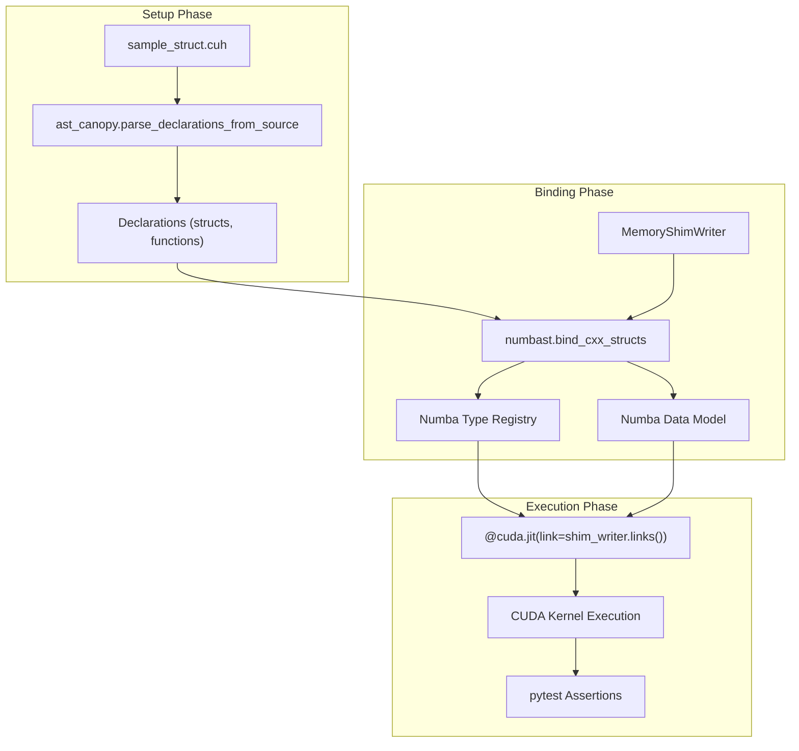
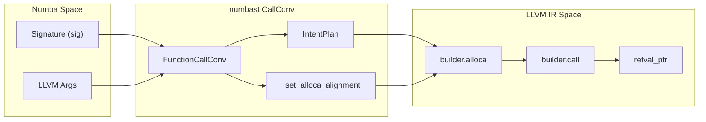

<!-- source: DeepWiki mcp.deepwiki.com · repo NVIDIA/numbast · page 7.2 numbast Tests: Dynamic and Static Bindings · fetched 2026-10-26 -->

# numbast Tests: Dynamic and Static Bindings

Relevant source files

The following files were used as context for generating this wiki page:

- [ast_canopy/ast_canopy/instantiations.py](ast_canopy/ast_canopy/instantiations.py)
- [ast_canopy/tests/test_class_template_specialization.py](ast_canopy/tests/test_class_template_specialization.py)
- [docs/source/api_reference.rst](docs/source/api_reference.rst)
- [docs/source/dynamic.rst](docs/source/dynamic.rst)
- [docs/source/supported_declarations.rst](docs/source/supported_declarations.rst)
- [numbast/benchmarks/test_arithmetic.py](numbast/benchmarks/test_arithmetic.py)
- [numbast/benchmarks/test_rtc.py](numbast/benchmarks/test_rtc.py)
- [numbast/src/numbast/args.py](numbast/src/numbast/args.py)
- [numbast/src/numbast/callconv.py](numbast/src/numbast/callconv.py)
- [numbast/src/numbast/errors.py](numbast/src/numbast/errors.py)
- [numbast/src/numbast/static/__init__.py](numbast/src/numbast/static/__init__.py)
- [numbast/src/numbast/static/callconv.py](numbast/src/numbast/static/callconv.py)
- [numbast/src/numbast/static/class_template.py](numbast/src/numbast/static/class_template.py)
- [numbast/src/numbast/static/function_template.py](numbast/src/numbast/static/function_template.py)
- [numbast/src/numbast/static/tests/data/class_template_static.cuh](numbast/src/numbast/static/tests/data/class_template_static.cuh)
- [numbast/src/numbast/static/tests/data/conflict_func_name_1.cuh](numbast/src/numbast/static/tests/data/conflict_func_name_1.cuh)
- [numbast/src/numbast/static/tests/data/conflict_func_name_2.cuh](numbast/src/numbast/static/tests/data/conflict_func_name_2.cuh)
- [numbast/src/numbast/static/tests/data/function_template_static.cuh](numbast/src/numbast/static/tests/data/function_template_static.cuh)
- [numbast/src/numbast/static/tests/data/multiple_decls.cuh](numbast/src/numbast/static/tests/data/multiple_decls.cuh)
- [numbast/src/numbast/static/tests/test_class_template_static_bindings.py](numbast/src/numbast/static/tests/test_class_template_static_bindings.py)
- [numbast/src/numbast/static/tests/test_conflict_shim_names.py](numbast/src/numbast/static/tests/test_conflict_shim_names.py)
- [numbast/src/numbast/static/tests/test_enum_static_bindings.py](numbast/src/numbast/static/tests/test_enum_static_bindings.py)
- [numbast/src/numbast/static/tests/test_function_static_bindings.py](numbast/src/numbast/static/tests/test_function_static_bindings.py)
- [numbast/src/numbast/static/tests/test_function_template_static_bindings.py](numbast/src/numbast/static/tests/test_function_template_static_bindings.py)
- [numbast/src/numbast/static/tests/test_link_two_files.py](numbast/src/numbast/static/tests/test_link_two_files.py)
- [numbast/src/numbast/static/tests/test_multiple_decls.py](numbast/src/numbast/static/tests/test_multiple_decls.py)
- [numbast/src/numbast/static/tests/test_operator_bindings.py](numbast/src/numbast/static/tests/test_operator_bindings.py)
- [numbast/src/numbast/static/tests/test_optional_template_runtime_imports.py](numbast/src/numbast/static/tests/test_optional_template_runtime_imports.py)
- [numbast/src/numbast/static/tests/test_static_demo.py](numbast/src/numbast/static/tests/test_static_demo.py)
- [numbast/src/numbast/static/tests/test_struct_static_bindings.py](numbast/src/numbast/static/tests/test_struct_static_bindings.py)
- [numbast/tests/data/sample_class_template.cuh](numbast/tests/data/sample_class_template.cuh)
- [numbast/tests/test_callconv.py](numbast/tests/test_callconv.py)
- [numbast/tests/test_class_template.py](numbast/tests/test_class_template.py)
- [numbast/tests/test_cuda_vector_types.py](numbast/tests/test_cuda_vector_types.py)
- [numbast/tests/test_register_cxx_type.py](numbast/tests/test_register_cxx_type.py)
- [numbast/tests/test_struct.py](numbast/tests/test_struct.py)

The `numbast` test suite is designed to validate the end-to-end pipeline of binding generation, from C++ AST parsing to Numba JIT execution. It covers two primary operational modes: **Dynamic Binding** (runtime generation in memory) and **Static Binding** (ahead-of-time generation of Python source modules).

## Purpose and Scope

The test infrastructure ensures that:
1.  **Dynamic Bindings**: `bind_cxx_struct` and `bind_cxx_function` correctly register types and lowerings in Numba's global registry during a Python session [docs/source/dynamic.rst:1-5]().
2.  **Static Bindings**: The `numbast` CLI and rendering pipeline produce valid, standalone Python code that can be imported and linked without the `ast_canopy` parser present at runtime [numbast/src/numbast/static/callconv.py:51-55]().
3.  **Template Specialization**: Class and function templates are correctly materialized into concrete Numba types and device functions [numbast/tests/test_class_template.py:16-20]().
4.  **ABI and Calling Convention**: Shims correctly handle alignment, pointers, and argument intents (in, out, inout) [numbast/src/numbast/callconv.py:102-105]().

## Dynamic Binding Tests

Dynamic binding tests verify that C++ declarations parsed by `ast_canopy` are immediately usable within `@cuda.jit` kernels.

### Struct and Function Tests
The suite validates that POD (Plain Old Data) structs preserve their memory layout when lowered to LLVM.
*   **Data Layout**: Tests confirm that nested structs and multidimensional arrays (e.g., `float[2][12]`) map to correct LLVM `ArrayType` structures [numbast/tests/test_struct.py:64-72]().
*   **Method Dispatch**: Verifies that instance methods and overloaded operators (e.g., `operator+`) are correctly shimmed and callable from Numba [numbast/tests/test_struct.py:183-195]().

### Class Template Tests
Dynamic tests for class templates focus on the `bind_cxx_class_templates` API.
*   **Specialization**: Tests materializing concrete types from templates like `BlockScan<T, BLOCK_DIM_X>` by passing arguments at runtime [numbast/tests/test_class_template.py:82-92]().
*   **Caching**: Validates the `ConcreteTypeCache` to ensure that identical template specializations reuse the same Numba type object [numbast/tests/test_class_template.py:33-38]().

### Custom Type Registration
The `test_register_cxx_type.py` suite validates the `register_cxx_type` utility, which allows users to map C++ type strings (e.g., `third_party::Handle`) to Numba types without parsing the original definition [numbast/tests/test_register_cxx_type.py:4-11]().

| Test Case | Feature Validated | Source Entity |
| :--- | :--- | :--- |
| `test_unregistered_type_is_opaque` | Default fallback for unknown types | `to_numba_type` [numbast/tests/test_register_cxx_type.py:41-45]() |
| `test_register_records_explicit_alignment` | Alignment metadata enforcement | `register_cxx_type(..., alignof=32)` [numbast/tests/test_register_cxx_type.py:66-71]() |
| `test_pod_struct_array_fields` | LLVM IR shape preservation | `StructModel` [numbast/tests/test_struct.py:92-112]() |

**Sources:** [numbast/tests/test_struct.py:1-220](), [numbast/tests/test_register_cxx_type.py:1-124](), [docs/source/dynamic.rst:1-164]().

## Static Binding Tests

Static binding tests utilize a `make_binding` fixture to simulate the CLI rendering process, producing a temporary Python module that is then exercised via Numba.

### Function and Argument Intent
Tests in `test_function_static_bindings.py` verify the `IntentPlan` logic, specifically how C++ pointers are promoted to Python return values.
*   **out_return**: A C++ function `void add_out(int x, int* out)` is tested to ensure it appears in Python as `out = add_out(x)` [numbast/src/numbast/static/tests/test_function_static_bindings.py:175-180]().
*   **inout_ptr**: Verifies that references/pointers intended for mutation are correctly handled via FFI buffers [numbast/src/numbast/static/tests/test_function_static_bindings.py:202-208]().

### Static Template Rendering
The `StaticClassTemplatesRenderer` and `StaticFunctionTemplatesRenderer` are tested for their ability to serialize template declarations into Base64-encoded pickles within the generated source [numbast/src/numbast/static/class_template.py:91-104](). This allows the static module to specialize templates at runtime using the embedded AST data.

### Calling Convention and Alignment
A critical part of static testing is ensuring the generated code is "standalone."
*   **Alignment Helpers**: The generator must inject a snapshot of the alignment map (`_NUMBA_TYPE_ALIGNOF_MAPS`) into the static module so it does not depend on `numbast.types` at runtime [numbast/src/numbast/static/callconv.py:49-68]().
*   **Shim Injection**: Tests verify that the `CALLCONV_SRC` (containing `BaseCallConv` and `FunctionCallConv` logic) is correctly concatenated into the output [numbast/src/numbast/static/callconv.py:71-79]().

**Sources:** [numbast/src/numbast/static/tests/test_function_static_bindings.py:1-210](), [numbast/src/numbast/static/callconv.py:1-80](), [numbast/src/numbast/static/class_template.py:1-192]().

## Data Flow: From C++ Header to Test Execution

The following diagram illustrates the data flow within the test suite for a dynamic binding test case.

**Dynamic Binding Test Flow**

**Sources:** [numbast/tests/test_struct.py:23-36](), [docs/source/dynamic.rst:70-91]().

## Implementation Detail: Call Convention Tests

The `test_callconv.py` and `numbast/src/numbast/callconv.py` files document the low-level LLVM IR generation for shims.

### LLVM IR Lowering
The `FunctionCallConv._lower_impl` function is the core of the testable logic for argument passing:
1.  **Allocation**: It creates stack allocations (`alloca`) for the C++ return value and any arguments passed by reference [numbast/src/numbast/callconv.py:129-140]().
2.  **Alignment**: It applies alignment using `_set_alloca_alignment`, which checks for explicit `alignof_` attributes on Numba types [numbast/src/numbast/callconv.py:33-36]().
3.  **Shim Call**: It generates the LLVM `call` instruction to the mangled shim name (e.g., `{mangled_name}_nbst`) [numbast/src/numbast/callconv.py:52-54]().

**Call Convention Entity Mapping**

**Sources:** [numbast/src/numbast/callconv.py:102-170](), [numbast/src/numbast/callconv.py:33-36]().

## Demo Test
The `test_static_demo.py` serves as a "Golden Test" that mimics the user experience described in the documentation. It performs a full cycle:
1.  Parses a demo header.
2.  Generates a static binding module.
3.  Compiles a kernel using the generated module.
4.  Verifies mathematical correctness (e.g., `hsqrt` and `operator+`) on the GPU [docs/source/dynamic.rst:80-91]().

**Sources:** [numbast/src/numbast/static/tests/test_static_demo.py](), [docs/source/dynamic.rst:48-91]().

---

