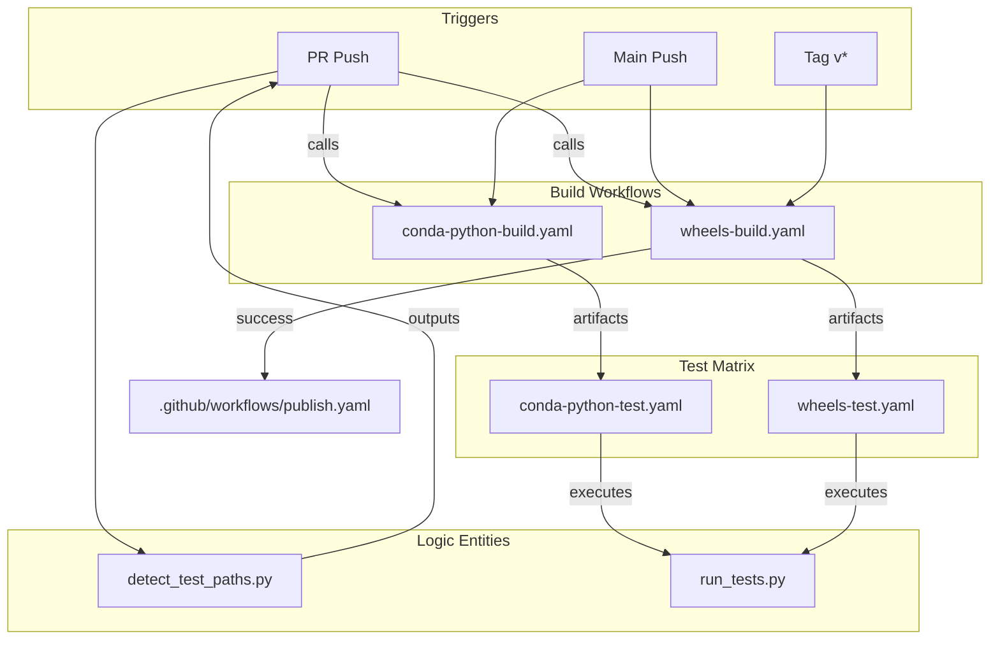
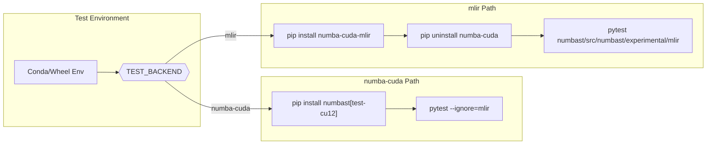

<!-- source: DeepWiki mcp.deepwiki.com · repo NVIDIA/numbast · page 7.3 CI/CD Pipelines and Change Detection · fetched 2026-10-26 -->

# CI/CD Pipelines and Change Detection

Relevant source files

The following files were used as context for generating this wiki page:

- [.github/workflows/ci.yaml](.github/workflows/ci.yaml)
- [.github/workflows/conda-python-build.yaml](.github/workflows/conda-python-build.yaml)
- [.github/workflows/conda-python-test.yaml](.github/workflows/conda-python-test.yaml)
- [.github/workflows/pr.yaml](.github/workflows/pr.yaml)
- [.github/workflows/publish.yaml](.github/workflows/publish.yaml)
- [.github/workflows/wheels-build.yaml](.github/workflows/wheels-build.yaml)
- [.github/workflows/wheels-test.yaml](.github/workflows/wheels-test.yaml)
- [.pre-commit-config.yaml](.pre-commit-config.yaml)
- [CONTRIBUTING.md](CONTRIBUTING.md)
- [ci/condarc.tmpl](ci/condarc.tmpl)
- [ci/detect_test_paths.py](ci/detect_test_paths.py)
- [ci/run_tests.py](ci/run_tests.py)
- [conda/recipe/build-astcanopy.sh](conda/recipe/build-astcanopy.sh)
- [conda/recipe/build-numbast.sh](conda/recipe/build-numbast.sh)
- [conda/recipe/conda_build_config.yaml](conda/recipe/conda_build_config.yaml)
- [conda/recipe/meta.yaml](conda/recipe/meta.yaml)
- [numbast/src/numbast/__init__.py](numbast/src/numbast/__init__.py)
- [numbast/src/numbast/experimental/mlir/tests/conftest.py](numbast/src/numbast/experimental/mlir/tests/conftest.py)
- [numbast/src/numbast/experimental/mlir/tools/tests/test_symbol_exposure.py](numbast/src/numbast/experimental/mlir/tools/tests/test_symbol_exposure.py)

The Numbast CI/CD system is built on GitHub Actions and designed to handle the complexities of a multi-package repository (ast_canopy, numbast, numbast_extensions) across two primary execution backends: the standard `numba-cuda` backend and the experimental `mlir` (numba-cuda-mlir) backend. The system optimizes resource usage through intelligent change detection and supports both Conda and Wheel distribution formats.

## Pipeline Architecture

The CI/CD infrastructure is split into two main top-level workflows: `pr.yaml` for pull requests and `ci.yaml` for merges to the main branch. These workflows orchestrate several specialized sub-workflows for building and testing.

### Workflow Orchestration
- **`pr.yaml`**: Triggered on pushes to PR branches [`.github/workflows/pr.yaml`:4-7](). It runs checks, builds both Conda packages and Wheels, and executes tests based on detected changes [`.github/workflows/pr.yaml`:11-23]().
- **`ci.yaml`**: Triggered on pushes to the `main` branch [`.github/workflows/ci.yaml`:4-7](). It performs a full build-and-test suite and concludes with a documentation deployment [`.github/workflows/ci.yaml`:55-67]().
- **`publish.yaml`**: Triggered by tags (`v*`) or manual dispatch to upload verified wheels to PyPI [`.github/workflows/publish.yaml`:4-8]().

### CI/CD Component Interaction
The following diagram illustrates the flow from code change to artifact publication.

**CI/CD Data Flow and Entity Mapping**

Sources: [`.github/workflows/pr.yaml:11-23`](), [`.github/workflows/ci.yaml:9-67`](), [`.github/workflows/publish.yaml:4-18`](), [`ci/run_tests.py:38-52`]()

---

## Change Detection Logic

To minimize unnecessary GPU runner utilization, Numbast employs a Python-based classifier to determine which test suites must run based on the files modified in a PR.

### `detect_test_paths.py`
This script reads a list of changed files from `stdin` and outputs boolean flags to `GITHUB_OUTPUT` [`ci/detect_test_paths.py:74-79`]().

- **MLIR Tests Only**: If changes are confined to the `numbast/src/numbast/experimental/mlir/` directory [`ci/detect_test_paths.py:12-12`]().
- **Dual Backend Tests**: If core files like `numbast/__init__.py`, `static_binding_generator.py`, or CI configuration files in `ci/` or `.github/workflows/` are modified [`ci/detect_test_paths.py:20-32`]().
- **Numba-CUDA Tests Only**: The default for any other changes (e.g., `ast_canopy` or standard `numbast` core) [`ci/detect_test_paths.py:50-50`]().

| Variable | Scope / Definition | Impact |
| :--- | :--- | :--- |
| `MLIR_PREFIX` | `numbast/src/numbast/experimental/mlir/` | Triggers `run_mlir_tests` |
| `BOTH_TEST_PATHS` | Core registry, static generator, version files | Triggers both backends |
| `BOTH_TEST_PREFIXES` | `.github/workflows/`, `ci/` | Triggers both backends |

Sources: [`ci/detect_test_paths.py:12-32`](), [`ci/detect_test_paths.py:35-56`]()

---

## Test Execution and CLI Flags

The `ci/run_tests.py` script serves as the unified entry point for all testing activities within the CI containers. It abstracts `pytest` calls and handles JUnit XML report generation for the RAPIDS dashboard [`ci/run_tests.py:11-27`]().

### `run_tests.py` CLI Options
The script uses `click` to provide a granular interface for test selection [`ci/run_tests.py:38-51`]().

| Flag | Logic / Action | Target Directory |
| :--- | :--- | :--- |
| `--ast-canopy` | Runs C++ AST parser tests | `ast_canopy/` |
| `--numbast` | Runs core binding tests (ignores MLIR) | `numbast/` |
| `--mlir` | Runs experimental MLIR backend tests | `numbast/src/numbast/experimental/mlir` |
| `--bf16` | Runs specialized bfloat16 tests | `numbast_extensions/tests/` |
| `--cccl` | Runs CUB/CCCL integration tests | `numbast_extensions/tests/thirdparty/CCCL/` |
| `--all-tests` | Runs all of the above (mutually exclusive) | All |

Sources: [`ci/run_tests.py:38-81`]()

---

## Dual-Backend Test Matrix

Numbast tests against two distinct backends to ensure compatibility. The CI matrix is dynamically computed to handle these variations across Python versions and CUDA versions.

### Backend Configurations
1.  **Numba-CUDA**: The default backend. It requires `numba-cuda` and is tested across all supported Python versions (3.10 - 3.14) [`.github/workflows/conda-python-test.yaml:74-76`]().
2.  **MLIR**: The experimental backend. It requires `numba-cuda-mlir` and explicitly uninstalls `numba-cuda` to prevent collision during testing [`.github/workflows/wheels-test.yaml:147-152`]().
    - **Restriction**: MLIR tests are filtered to exclude Python 3.10 in PRs to reduce latency [`.github/workflows/pr.yaml:81-81`]().

**Backend Routing and Test Logic**

Sources: [`.github/workflows/wheels-test.yaml:132-152`](), [`.github/workflows/pr.yaml:70-81`](), [`ci/run_tests.py:66-69`]()

---

## Build Pipelines: Conda vs. Wheels

The repository supports two independent build systems to cater to different distribution needs.

### Conda Pipeline (`conda-python-build.yaml`)
- **Matrix**: Built for `amd64` and `arm64` across Python 3.10 through 3.14 [`.github/workflows/conda-python-build.yaml:60-72`]().
- **Tooling**: Uses `rapids-mamba-retry` and `conda-build` [`.github/workflows/conda-python-build.yaml:130-131`]().
- **Environment**: Uses `ci/condarc.tmpl` to configure internal NVIDIA/RAPIDS mirrors [`.github/workflows/conda-python-build.yaml:117-117`]().

### Wheels Pipeline (`wheels-build.yaml`)
- **Matrix**: Targets `manylinux_2_28` for both `x86_64` and `aarch64` [`.github/workflows/wheels-build.yaml:58-60`]().
- **LLVM Handling**: Since `ast_canopy` requires a specific Clang version, the pipeline includes a cached LLVM build step (`ci/llvm-build-static.sh`) to ensure consistent C++ AST parsing capabilities [`.github/workflows/wheels-build.yaml:104-123`]().
- **Sccache**: Extensively uses `sccache` to speed up the compilation of the C++ components in `ast_canopy` [`.github/workflows/wheels-build.yaml:120-135`]().

Sources: [`.github/workflows/conda-python-build.yaml:60-91`](), [`.github/workflows/wheels-build.yaml:58-123`]()

---

