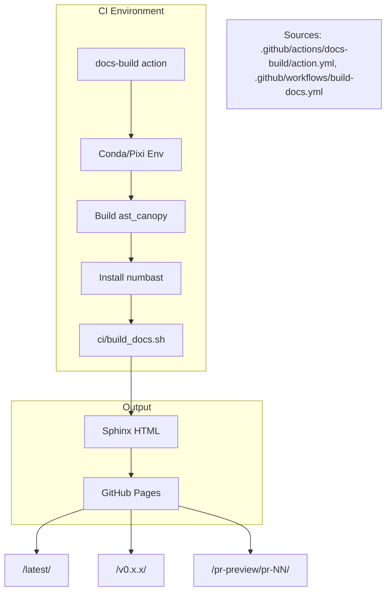
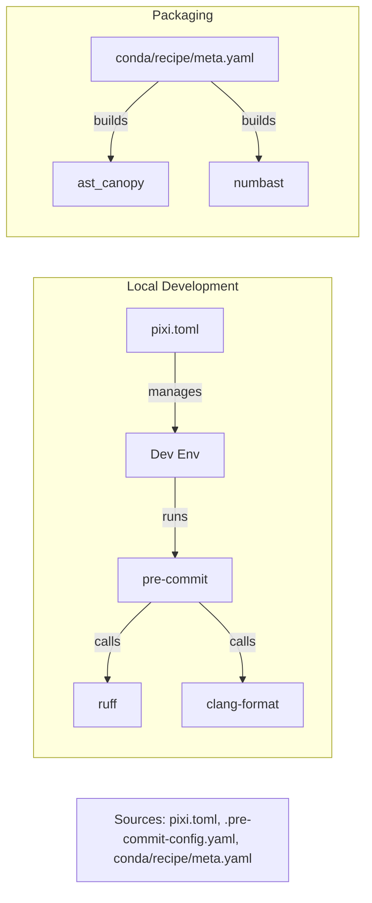

<!-- source: DeepWiki mcp.deepwiki.com · repo NVIDIA/numbast · page 8 Documentation and Developer Tooling · fetched 2026-10-26 -->

# Documentation and Developer Tooling

Relevant source files

The following files were used as context for generating this wiki page:

- [.github/actions/docs-build/action.yml](.github/actions/docs-build/action.yml)
- [.github/workflows/build-docs.yml](.github/workflows/build-docs.yml)
- [.pre-commit-config.yaml](.pre-commit-config.yaml)
- [CONTRIBUTING.md](CONTRIBUTING.md)
- [ci/build_docs.sh](ci/build_docs.sh)
- [ci/check_style.sh](ci/check_style.sh)
- [conda/recipe/build-astcanopy.sh](conda/recipe/build-astcanopy.sh)
- [conda/recipe/build-numbast.sh](conda/recipe/build-numbast.sh)
- [conda/recipe/conda_build_config.yaml](conda/recipe/conda_build_config.yaml)
- [conda/recipe/meta.yaml](conda/recipe/meta.yaml)
- [docs/source/_ext/static_binding_schema_doc.py](docs/source/_ext/static_binding_schema_doc.py)
- [docs/source/conf.py](docs/source/conf.py)
- [numbast/src/numbast/tools/tests/test_config_schema_docs.py](numbast/src/numbast/tools/tests/test_config_schema_docs.py)
- [numbast/src/numbast/tools/tests/test_symbol_exposure.py](numbast/src/numbast/tools/tests/test_symbol_exposure.py)
- [pixi.lock](pixi.lock)
- [pixi.toml](pixi.toml)

This section covers the infrastructure supporting Numbast's development lifecycle, including the automated documentation pipeline, code quality enforcement, and environment management. Numbast utilizes a combination of Sphinx for documentation, GitHub Actions for CI/CD and PR previews, and Pixi/Conda for reproducible development environments.

## Documentation Pipeline

Numbast's documentation is built using Sphinx and the `nvidia-sphinx-theme` [.github/actions/docs-build/action.yml:65-65](). The build process is orchestrated via a composite GitHub Action that handles environment setup, dependency installation, and the execution of the documentation build scripts.

### Build and Deployment Flow

The documentation system supports multi-versioning and automated PR previews. When a pull request is opened, a dedicated workflow builds the documentation and deploys it to a unique subdirectory on GitHub Pages, allowing reviewers to see the rendered impact of documentation changes.

| Component | Description |
| :--- | :--- |
| `docs-build` Action | Installs `clangdev`, `cuda-cudart`, and Python dependencies to build `ast_canopy` and `numbast` before running Sphinx [.github/actions/docs-build/action.yml:19-65](). |
| `build_docs.sh` | The entry point script that triggers the Sphinx build process [ci/build_docs.sh:1-12](). |
| PR Previews | Deploys docs to `docs/pr-preview/pr-<number>/` and posts a sticky comment with the URL [.github/workflows/build-docs.yml:108-116](). |
| Versioning | Uses `versions.json` and `nv-versions.json` to manage the version picker in the UI [CONTRIBUTING.md:49-50](). |

**Documentation System Architecture**

For details, see [Documentation Build and Deployment](#8.1).

## Developer Tooling and Environment

Numbast uses `pixi` and `conda` to manage complex dependencies like `clangdev` and the CUDA Toolkit, ensuring that developers and CI environments remain synchronized.

### Environment Management
The `pixi.toml` file defines multiple environments (e.g., `test-cu12`, `test-cu13`) with specific versions of `numba-cuda` and `cuda-toolkit` [pixi.toml:60-80](). It also defines tasks for common developer operations:
- `build-ast-canopy`: Compiles the C++ layer [pixi.toml:82-83]().
- `install-numbast`: Installs the binding generator in editable mode [pixi.toml:85-87]().
- `test`: Runs the `pytest` suite across the packages [pixi.toml:93-101]().

### Code Quality and Style
Code style is enforced via `pre-commit` hooks. The project uses `ruff` for Python linting and formatting, `clang-format` for C++ code, and `codespell` for typo detection [.pre-commit-config.yaml:24-45]().

**Tooling Integration Map**

### Conda Packaging
Numbast is distributed as a split Conda package. The recipe in `conda/recipe/meta.yaml` defines two primary outputs:
1. `ast_canopy`: Contains the C++ shared library and Python bindings [conda/recipe/meta.yaml:20-45]().
2. `numbast`: The Python binding generator which depends on `ast_canopy` [conda/recipe/meta.yaml:61-81]().

For details, see [Contributing, Style, and Conda Packaging](#8.2).

***

**Sources:**
- [.github/actions/docs-build/action.yml:1-94]()
- [.github/workflows/build-docs.yml:1-171]()
- [pixi.toml:1-110]()
- [.pre-commit-config.yaml:1-93]()
- [conda/recipe/meta.yaml:1-105]()
- [CONTRIBUTING.md:44-71]()

---

