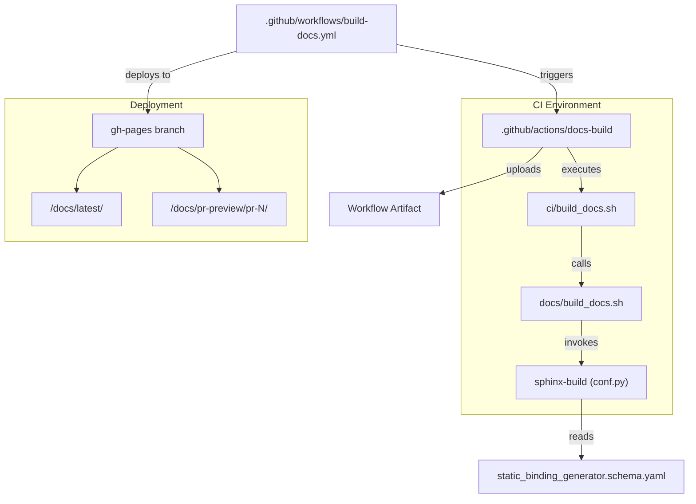

<!-- source: DeepWiki mcp.deepwiki.com · repo NVIDIA/numbast · page 8.1 Documentation Build and Deployment · fetched 2026-10-26 -->

# Documentation Build and Deployment

Relevant source files

The following files were used as context for generating this wiki page:

- [.github/actions/docs-build/action.yml](.github/actions/docs-build/action.yml)
- [.github/workflows/build-docs.yml](.github/workflows/build-docs.yml)
- [ci/build_docs.sh](ci/build_docs.sh)
- [ci/check_style.sh](ci/check_style.sh)
- [docs/README.md](docs/README.md)
- [docs/build_docs.sh](docs/build_docs.sh)
- [docs/source/_ext/static_binding_schema_doc.py](docs/source/_ext/static_binding_schema_doc.py)
- [docs/source/ast_canopy_overview.rst](docs/source/ast_canopy_overview.rst)
- [docs/source/conf.py](docs/source/conf.py)
- [docs/source/install.rst](docs/source/install.rst)
- [docs/source/overview.rst](docs/source/overview.rst)
- [numbast/src/numbast/tools/tests/test_config_schema_docs.py](numbast/src/numbast/tools/tests/test_config_schema_docs.py)
- [numbast/src/numbast/tools/tests/test_repro_info.py](numbast/src/numbast/tools/tests/test_repro_info.py)

The Numbast documentation system is designed to provide comprehensive, versioned technical references for both the `ast_canopy` and `numbast` packages. It leverages Sphinx for content generation, a custom NVIDIA theme for consistent styling, and a GitHub Actions-based CI/CD pipeline for automated PR previews and production deployments to GitHub Pages.

## Documentation Build Architecture

The build process is orchestrated by a combination of shell scripts and Sphinx configuration files. The system supports building a specific version (linked to the package version) or a "latest" alias that redirects to the most recent stable documentation.

### The Build Pipeline

The primary entry point for building documentation is `docs/build_docs.sh`. This script handles version detection, parallel Sphinx execution, and directory structuring for the version switcher.

**Build Data Flow:**
1.  **Version Detection**: The script determines the version string (e.g., `0.1.0`) by querying the installed `numbast` package metadata via `importlib.metadata` [`docs/build_docs.sh:18-27`]().
2.  **Sphinx Execution**: Runs `make html` with parallel jobs (`-j 4`) [`docs/build_docs.sh:30`]().
3.  **Artifact Organization**: 
    *   Copies `versions.json` and `nv-versions.json` into the build directory to support the frontend version switcher [`docs/build_docs.sh:38-39`]().
    *   Generates a redirect `index.html` from a template to point users to the `/latest/` path [`docs/build_docs.sh:42`]().
    *   Creates a `latest` directory which is a copy (or move) of the specific version directory [`docs/build_docs.sh:45-49`]().

### Natural Language to Code Entity Mapping: Build System

| Natural Language Concept | Code Entity / Symbol | Role |
| :--- | :--- | :--- |
| Version Environment Variable | `SPHINX_NUMBAST_VER` | Controls the output subdirectory and switcher match [`docs/source/conf.py:33`](). |
| Build Entry Point | `docs/build_docs.sh` | Main logic for organizing versioned HTML folders [`docs/build_docs.sh:1-53`](). |
| Project Root Build Wrapper | `ci/build_docs.sh` | Delegates to the `docs/` script from the repository root [`ci/build_docs.sh:5-11`](). |
| Static Schema Generator | `generate_static_binding_schema_reference` | Extension function that converts YAML schema to RST [`docs/source/conf.py:9-24`](). |

**Sources:** [`docs/build_docs.sh:1-53`](), [`ci/build_docs.sh:1-12`](), [`docs/source/conf.py:1-34`]().

## Sphinx Configuration and Extensions

The Sphinx setup in `docs/source/conf.py` integrates standard extensions with custom logic for documenting the Numbast static binding generator.

### Key Extensions
*   **autodoc/autosummary**: Automatically generates API documentation from Python docstrings [`docs/source/conf.py:37-39`]().
*   **nvidia-sphinx-theme**: Provides the NVIDIA corporate look and feel, including the version switcher [`docs/source/conf.py:53-60`]().
*   **static_binding_schema_doc**: A custom extension located in `docs/source/_ext/` that parses `static_binding_generator.schema.yaml` and renders it as a human-readable reference in the documentation [`docs/source/conf.py:9-24`]().

### Versioning Logic
The documentation uses two JSON files to manage the version dropdown:
*   `versions.json`: Standard Sphinx versioning file.
*   `nv-versions.json`: Used by the `nvidia-sphinx-theme` to populate the `version-switcher` component [`docs/source/conf.py:55-60`]().

**Sources:** [`docs/source/conf.py:35-71`](), [`docs/source/_ext/static_binding_schema_doc.py:155-173`]().

## CI/CD and Deployment (GitHub Actions)

Numbast uses a sophisticated deployment strategy involving a composite action and a primary workflow to handle both production releases and Pull Request (PR) previews.

### `docs-build` Composite Action
Located at `.github/actions/docs-build/action.yml`, this action encapsulates the environment setup and build execution.

**Execution Steps:**
1.  **Environment Setup**: Creates a Conda environment with `python=3.12` and installs system dependencies like `clangdev`, `cmake`, and `cuda-cudart` [`.github/actions/docs-build/action.yml:19-27`]().
2.  **Dependency Resolution**: Attempts to install `ast_canopy` and `numbast` from previously built wheel artifacts if available; otherwise, it builds from source [`.github/actions/docs-build/action.yml:45-61`]().
3.  **Documentation Generation**: Invokes `ci/build_docs.sh` [`.github/actions/docs-build/action.yml:71-78`]().
4.  **Artifact Preparation**: Moves the HTML output to a `_site` directory and adds a `.nojekyll` file to bypass GitHub Pages' Jekyll processing [`.github/actions/docs-build/action.yml:80-85`]().

### PR Previews and Deployment Workflow
The `build-docs.yml` workflow manages the actual deployment to the `gh-pages` branch.

**Implementation Details:**
*   **PR Previews**: Deploys documentation to a subdirectory `docs/pr-preview/pr-<number>/` [`.github/workflows/build-docs.yml:163-171`]().
*   **URL Generation**: Dynamically constructs the preview URL and outputs it for use in PR sticky comments [`.github/workflows/build-docs.yml:108-116`]().
*   **Cleanup**: When a PR is closed, the workflow can be triggered to deploy an empty directory to the preview path, effectively removing the stale documentation [`.github/workflows/build-docs.yml:131-136`]().

### System Component Interaction

**Sources:** [`.github/actions/docs-build/action.yml:1-94`](), [`.github/workflows/build-docs.yml:75-171`](), [`docs/build_docs.sh:1-53`]().

## Development Workflow

For local development of documentation, the project recommends using `pixi`.

### Local Build Commands
Developers can use the following commands from the repository root:
*   **Build all versions**: `pixi run -e test-cu13 build-docs` [`docs/source/install.rst:82`]().
*   **Build latest only**: `pixi run -e test-cu13 build-docs latest-only` [`docs/source/install.rst:88`]().

### Style Checking
Documentation and code style are enforced via `pre-commit`. The script `ci/check_style.sh` runs these checks, ensuring that documentation source files (`.rst`, `.md`) adhere to project standards [`ci/check_style.sh:1-15`]().

**Sources:** [`docs/source/install.rst:57-113`](), [`docs/README.md:1-20`](), [`ci/check_style.sh:1-15`]().

---

