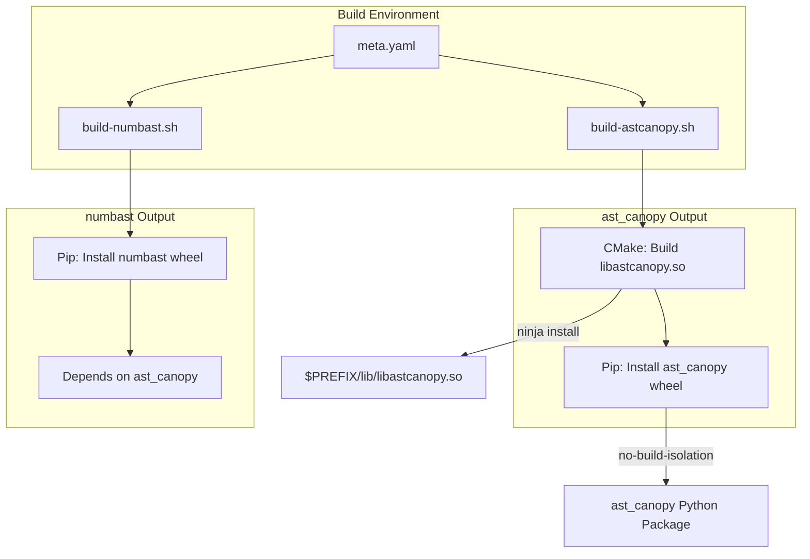

<!-- source: DeepWiki mcp.deepwiki.com · repo NVIDIA/numbast · page 8.2 Contributing, Style, and Conda Packaging · fetched 2026-10-26 -->

# Contributing, Style, and Conda Packaging

<details>
<summary>Relevant source files</summary>

The following files were used as context for generating this wiki page:

- [.pre-commit-config.yaml](.pre-commit-config.yaml)
- [CONTRIBUTING.md](CONTRIBUTING.md)
- [ci/build_conda_python.sh](ci/build_conda_python.sh)
- [ci/test_conda_python.sh](ci/test_conda_python.sh)
- [conda/environment_template.yaml](conda/environment_template.yaml)
- [conda/recipe/build-astcanopy.sh](conda/recipe/build-astcanopy.sh)
- [conda/recipe/build-numbast.sh](conda/recipe/build-numbast.sh)
- [conda/recipe/conda_build_config.yaml](conda/recipe/conda_build_config.yaml)
- [conda/recipe/meta.yaml](conda/recipe/meta.yaml)
- [numbast/pyproject.toml](numbast/pyproject.toml)
- [numbast_extensions/pyproject.toml](numbast_extensions/pyproject.toml)

</details>


This page documents the developer-facing infrastructure of the Numbast project. It covers the contribution workflow, the enforcement of code style via pre-commit hooks, the Conda packaging recipe used for distribution, and the template for establishing a consistent development environment.

## Contribution Workflow

Contributions to Numbast are categorized into bug reports, feature requests, and code implementations. The project follows a standard GitHub-based flow involving issues and Pull Requests (PRs).

### Issue Reporting and Triage
Users encountering issues are encouraged to file an issue describing the encounter. For bug reports, it is requested to include environment details by running the `print_env.sh` script [CONTRIBUTING.md:5-12]().

### Development Process
1.  **Setup**: Developers should refer to the project `README.md` to configure their local environment [CONTRIBUTING.md:27-28]().
2.  **Selection**: Work is typically picked from issues labeled `good first issue` or `help wanted` [CONTRIBUTING.md:29-30]().
3.  **Implementation**: Code changes must include updates to relevant unit tests [CONTRIBUTING.md:34-34]().
4.  **Submission**: PRs are created against the `main` branch. CI status checks must pass before a maintainer merges the code [CONTRIBUTING.md:35-38]().

### Release Management
Numbast maintains two release paths: mainline and patch releases.

*   **Mainline Releases**: Involves updating `VERSION` in the root and documentation version files (`docs/nv-versions.json`, `docs/versions.json`). Releases are tagged with annotated tags containing a changelog generated from git history [CONTRIBUTING.md:46-70]().
*   **Patch Releases**: Created from maintenance branches (e.g., `0.6.x-patch`) to provide fixes for previous major/minor versions without disrupting the `main` branch [CONTRIBUTING.md:74-97]().

Sources: [CONTRIBUTING.md:1-105]()

## Code Style and Pre-commit Hooks

Numbast enforces a strict code style across Python, C++, and configuration files using `pre-commit`. The configuration is defined in `.pre-commit-config.yaml`.

### Linting and Formatting Tools
The project utilizes the following tools via hooks:
*   **Ruff**: Handles Python linting and formatting, configured via `pyproject.toml` [numbast/pyproject.toml:70-71]() [.pre-commit-config.yaml:24-30]().
*   **Clang-Format**: Ensures consistent C++ style for the `ast_canopy` layer [.pre-commit-config.yaml:31-38]().
*   **Codespell**: Checks for common misspellings in the codebase [.pre-commit-config.yaml:39-45]().
*   **Yamlfmt & Taplo**: Formats YAML and TOML files respectively [.pre-commit-config.yaml:46-60]().

### Pre-commit Configuration
The hooks are configured to exclude specific files, such as auto-generated Conda recipes or external headers like `cuda.h` [.pre-commit-config.yaml:11-17]() [.pre-commit-config.yaml:35-38]().

| Hook ID | Purpose | Target Files |
| :--- | :--- | :--- |
| `check-ast` | Validates Python syntax | `.py` |
| `ruff` | Linting and auto-fix | `.py` |
| `clang-format` | C++ code formatting | `.cpp`, `.h`, `.cu` |
| `validate-pyproject` | Validates `pyproject.toml` schema | `pyproject.toml` |
| `rstcheck` | Validates Sphinx documentation | `.rst` |

Sources: [.pre-commit-config.yaml:1-93](), [numbast/pyproject.toml:70-71]()

## Development Environment

The project provides an `environment_template.yaml` to create a reproducible Conda environment for development. This template is used to ensure all developers and CI systems use compatible versions of LLVM/Clang and Numba.

### Key Dependencies
*   **Compiler Stack**: `clangdev` (v18 to v21), `cmake` (>=3.29), and `ninja` [conda/environment_template.yaml:10-11]().
*   **Numba Ecosystem**: `numba-cuda` (>=0.25.0) [conda/environment_template.yaml:12-12]().
*   **Python Tooling**: `pybind11`, `scikit-build-core`, `ruff`, and `pytest` [conda/environment_template.yaml:13-27]().

Sources: [conda/environment_template.yaml:1-32]()

## Conda Packaging

Numbast is distributed as a split Conda package: `ast_canopy` (the C++ parser) and `numbast` (the Python binding generator).

### Recipe Structure
The `conda/recipe/meta.yaml` defines a multi-output build process.

**Conda Build Flow**

Sources: [conda/recipe/meta.yaml:19-92](), [conda/recipe/build-astcanopy.sh:12-30]()

### Build Scripts
*   **`build-astcanopy.sh`**: Executes a two-step build. It first compiles the C++ `astcanopy` shared library using CMake/Ninja and installs it into the Conda `$PREFIX`. Then, it installs the Python package using `pip` with `--no-build-isolation` to ensure it links against the newly built library [conda/recipe/build-astcanopy.sh:12-30]().
*   **`build-numbast.sh`**: A simpler script that installs the `numbast` Python package via `pip` [conda/recipe/build-numbast.sh:7-10]().
*   **`conda_build_config.yaml`**: Pins the compiler versions (GCC 14) and the C standard library (sysroot 2.28) to ensure binary compatibility [conda/recipe/conda_build_config.yaml:3-10]().

### CI Build and Test Pipeline
The CI system uses `ci/build_conda_python.sh` to trigger the build, utilizing `sccache` for compilation caching [ci/build_conda_python.sh:7-31](). Post-build, `ci/test_conda_python.sh` creates a fresh environment containing the built packages to verify functionality [ci/test_conda_python.sh:27-49]().

**CI Test Matrix Logic**
```mermaid
graph TD
    "Start Conda Test" --> "Identify Version"["Get Version from Git Tag"]
    "Identify Version" --> "Create Env"["mamba create -n test"]
    "Create Env" --> "Backend Check"{"TEST_BACKEND?"}
    
    "Backend Check" -- "numba-cuda" --> "Run Numba Tests"["ci/run_tests.py --numbast"]
    "Backend Check" -- "mlir" --> "Swap Backend"["pip uninstall numba-cuda && pip install numba-cuda-mlir"]
    "Swap Backend" --> "Run MLIR Tests"["ci/run_tests.py --mlir"]
```
Sources: [ci/test_conda_python.sh:11-99](), [ci/build_conda_python.sh:14-31]()

### Package Metadata
*   **numbast**: Requires `numba-cuda`, `ast_canopy`, `pyyaml`, `click`, and `jinja2` [numbast/pyproject.toml:19-25]().
*   **ast_canopy**: Requires `clangdev` and `cuda-version` at runtime to facilitate header parsing [conda/recipe/meta.yaml:38-45]().

Sources: [numbast/pyproject.toml:1-48](), [conda/recipe/meta.yaml:1-105]()

---

