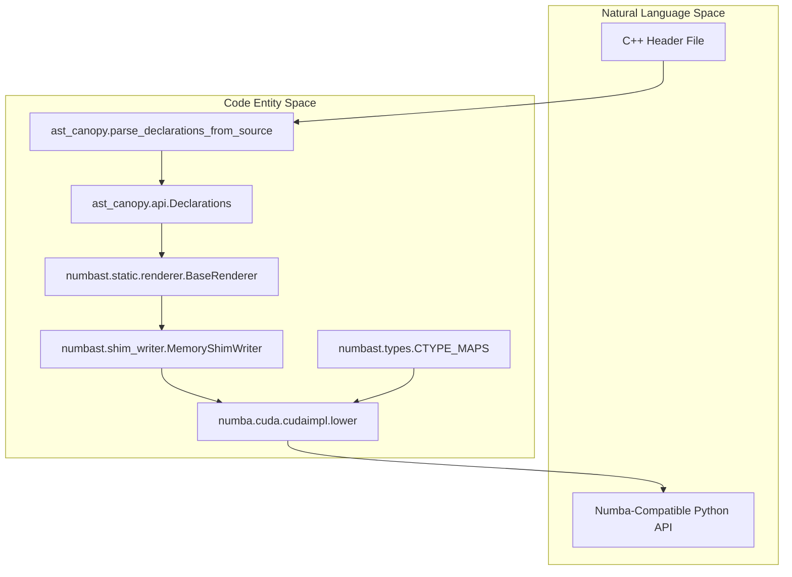
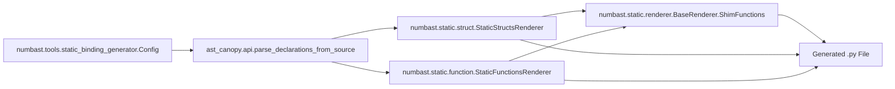

<!-- source: DeepWiki mcp.deepwiki.com · repo NVIDIA/numbast · page 9 Glossary · fetched 2026-10-26 -->

# Glossary

Relevant source files

The following files were used as context for generating this wiki page:

- [AGENTS.md](AGENTS.md)
- [CHANGELOG.md](CHANGELOG.md)
- [README.md](README.md)
- [VERSION](VERSION)
- [ast_canopy/README.md](ast_canopy/README.md)
- [ast_canopy/ast_canopy/api.py](ast_canopy/ast_canopy/api.py)
- [ast_canopy/cpp/src/ast_canopy.cpp](ast_canopy/cpp/src/ast_canopy.cpp)
- [ast_canopy/tests/test_parse_from_source.py](ast_canopy/tests/test_parse_from_source.py)
- [docs/nv-versions.json](docs/nv-versions.json)
- [docs/source/argument_intents.rst](docs/source/argument_intents.rst)
- [docs/source/faq.rst](docs/source/faq.rst)
- [docs/source/quickstart.rst](docs/source/quickstart.rst)
- [docs/source/template.rst](docs/source/template.rst)
- [docs/versions.json](docs/versions.json)
- [numbast/README.md](numbast/README.md)
- [numbast/src/numbast/class_template.py](numbast/src/numbast/class_template.py)
- [numbast/src/numbast/experimental/mlir/function.py](numbast/src/numbast/experimental/mlir/function.py)
- [numbast/src/numbast/experimental/mlir/function_template.py](numbast/src/numbast/experimental/mlir/function_template.py)
- [numbast/src/numbast/experimental/mlir/static/function.py](numbast/src/numbast/experimental/mlir/static/function.py)
- [numbast/src/numbast/experimental/mlir/struct.py](numbast/src/numbast/experimental/mlir/struct.py)
- [numbast/src/numbast/experimental/mlir/utils.py](numbast/src/numbast/experimental/mlir/utils.py)
- [numbast/src/numbast/function.py](numbast/src/numbast/function.py)
- [numbast/src/numbast/function_template.py](numbast/src/numbast/function_template.py)
- [numbast/src/numbast/shim_writer.py](numbast/src/numbast/shim_writer.py)
- [numbast/src/numbast/static/function.py](numbast/src/numbast/static/function.py)
- [numbast/src/numbast/static/renderer.py](numbast/src/numbast/static/renderer.py)
- [numbast/src/numbast/static/struct.py](numbast/src/numbast/static/struct.py)
- [numbast/src/numbast/static/tests/conftest.py](numbast/src/numbast/static/tests/conftest.py)
- [numbast/src/numbast/static/types.py](numbast/src/numbast/static/types.py)
- [numbast/src/numbast/struct.py](numbast/src/numbast/struct.py)
- [numbast/src/numbast/tools/static_binding_generator.py](numbast/src/numbast/tools/static_binding_generator.py)
- [numbast/src/numbast/types.py](numbast/src/numbast/types.py)
- [numbast/tests/test_shim_writer.py](numbast/tests/test_shim_writer.py)
- [numbast_extensions/numbast_extensions/bf16/torch_interop.py](numbast_extensions/numbast_extensions/bf16/torch_interop.py)

This page provides definitions for codebase-specific terms, jargon, and architectural concepts used in the Numbast and `ast_canopy` projects.

## Core Concepts

### ast_canopy
The front-end parsing library that uses Clang/LLVM to traverse C++ ASTs and extract declarations (structs, functions, templates) into a Python-accessible format [ast_canopy/ast_canopy/api.py:17-26](). It serves as the foundation for both dynamic and static binding generation.

### Numbast
The binding generation engine that consumes `ast_canopy` declarations to register C++ types and functions with the Numba compiler [README.md:3-5](). It supports two operational modes: **Dynamic** (runtime generation) and **Static** (ahead-of-time code generation).

### Shim / Shim Layer
A small C++ wrapper function generated by Numbast that bridges the gap between Numba's LLVM IR and the actual C++ API [numbast/src/numbast/struct.py:36-50](). Shims are typically declared `extern "C" __device__` to allow them to be linked into the CUDA kernel at runtime [numbast/src/numbast/static/function.py:79-85]().

### Lowering
The process in Numba of converting a high-level Python operation into LLVM IR. Numbast provides custom lowerings for C++ constructors, methods, and functions using the `@lower` decorator [numbast/src/numbast/struct.py:120-128]().

### Intent Plan
A mapping that determines how C++ function arguments are exposed to Python. It handles the conversion of pointer/reference parameters into Python return values (e.g., `out_return`) or mutable arguments [numbast/src/numbast/intent.py:197-202]().

---

## Technical Terms & Entities

| Term | Description | Code Pointer |
| :--- | :--- | :--- |
| **`Declarations`** | A dataclass containing the result of an AST parse, including structs, functions, and templates. | [ast_canopy/ast_canopy/api.py:56-65]() |
| **`StaticStructsRenderer`** | Orchestrates the generation of Python code for binding C++ structs in static mode. | [numbast/src/numbast/static/struct.py:42-109]() |
| **`FunctionCallConv`** | Manages the calling convention logic, handling argument passing and return value extraction for shim calls. | [numbast/src/numbast/struct.py:33-33]() |
| **`KeyedStringIO`** | A specialized string buffer used during static generation to ensure shim code is only written once even if referenced multiple times. | [numbast/src/numbast/static/renderer.py:29-44]() |
| **`CTYPE_MAPS`** | A registry mapping C++ type strings (e.g., `int`, `float`) to Numba type objects. | [numbast/src/numbast/types.py:87-87]() |
| **`Opaque`** | A fallback Numba type used for C++ types whose internal layout is unknown or irrelevant to the binding. | [numbast/src/numbast/types.py:122-132]() |

---

## Data Flow: C++ to Numba Binding

The following diagram illustrates how a C++ declaration is transformed into a functional Numba binding through the Numbast pipeline.

**System Entity Mapping: Declaration to Binding**

**Sources:** [ast_canopy/ast_canopy/api.py:56-65](), [numbast/src/numbast/static/renderer.py:16-27](), [numbast/src/numbast/types.py:87-110](), [numbast/src/numbast/struct.py:120-128]()

---

## Static Binding Pipeline

The static binding generator transforms a YAML configuration into a standalone Python module.

**Code Entity Flow: Static Generation**

**Sources:** [numbast/src/numbast/tools/static_binding_generator.py:107-133](), [numbast/src/numbast/static/struct.py:42-109](), [numbast/src/numbast/static/function.py:63-132](), [numbast/src/numbast/static/renderer.py:46-53]()

---

## Abbreviations

*   **AST**: Abstract Syntax Tree.
*   **CCCL**: CUDA C++ Core Libraries (includes Thrust, CUB, and libcu++).
*   **CTYPE**: C-Type (refers to the string representation of a C++ type).
*   **IR**: Intermediate Representation (specifically LLVM IR used by Numba).
*   **MLIR**: Multi-Level Intermediate Representation (an experimental backend supported by Numbast) [README.md:9-12]().
*   **SBG**: Static Binding Generator.

**Sources:**
- [numbast/src/numbast/tools/static_binding_generator.py:1-216]()
- [ast_canopy/ast_canopy/api.py:1-210]()
- [numbast/src/numbast/struct.py:1-210]()
- [numbast/src/numbast/types.py:1-228]()
- [numbast/src/numbast/static/renderer.py:1-204]()
- [numbast/src/numbast/static/function.py:1-210]()
- [README.md:1-23]()