# Page: Numbast Overview

# Numbast Overview

<details>
<summary>Relevant source files</summary>

The following files were used as context for generating this wiki page:

- [AGENTS.md](AGENTS.md)
- [CHANGELOG.md](CHANGELOG.md)
- [README.md](README.md)
- [VERSION](VERSION)
- [ast_canopy/README.md](ast_canopy/README.md)
- [ci/build_conda_python.sh](ci/build_conda_python.sh)
- [ci/test_conda_python.sh](ci/test_conda_python.sh)
- [conda/environment_template.yaml](conda/environment_template.yaml)
- [docs/nv-versions.json](docs/nv-versions.json)
- [docs/source/quickstart.rst](docs/source/quickstart.rst)
- [docs/versions.json](docs/versions.json)
- [numbast/README.md](numbast/README.md)
- [numbast/pyproject.toml](numbast/pyproject.toml)
- [numbast_extensions/pyproject.toml](numbast_extensions/pyproject.toml)

</details>


Numbast is an automated pipeline designed to parse CUDA C++ headers and generate Python bindings that are compatible with **Numba CUDA**. It enables CUDA Python projects to expose existing C++ device APIs (such as those in CCCL/CUB) without requiring developers to manually write Numba typing, lowering, or C-shim code for every function or type [numbast/README.md:3-7]().

### Core Purpose
The project bridges the gap between the CUDA C++ ecosystem and Python-based GPU kernels. By leveraging Clang-based AST parsing, it automates the creation of the boilerplate necessary for Numba to understand C++ memory layouts, function signatures, and template specializations [numbast/README.md:8-12]().

## System Architecture

Numbast is structured into two primary packages that separate the concerns of C++ parsing and Numba integration.

### 1. `ast_canopy`
The front-end parsing layer. It uses Clang tooling to traverse C++ Abstract Syntax Trees (AST) and serializes declaration metadata (structs, functions, enums, templates) into structured Python objects [numbast/README.md:8-10]().
*   **Key Function**: `parse_declarations_from_source` [numbast/README.md:42-42]().
*   **Scope**: Handles header discovery, macro expansion, and C++ type resolution.

### 2. `numbast`
The binding generation core. It consumes the metadata from `ast_canopy` to register Numba types or generate standalone Python source code [numbast/README.md:10-12]().
*   **Key Components**: `ShimWriter` classes, type mapping registries, and the static code generator [numbast/README.md:45-45](), [numbast/pyproject.toml:31-31]().

### Logical Data Flow
The following diagram illustrates how a CUDA C++ header is transformed into a usable Numba entity.

**C++ to Numba Transformation Flow**
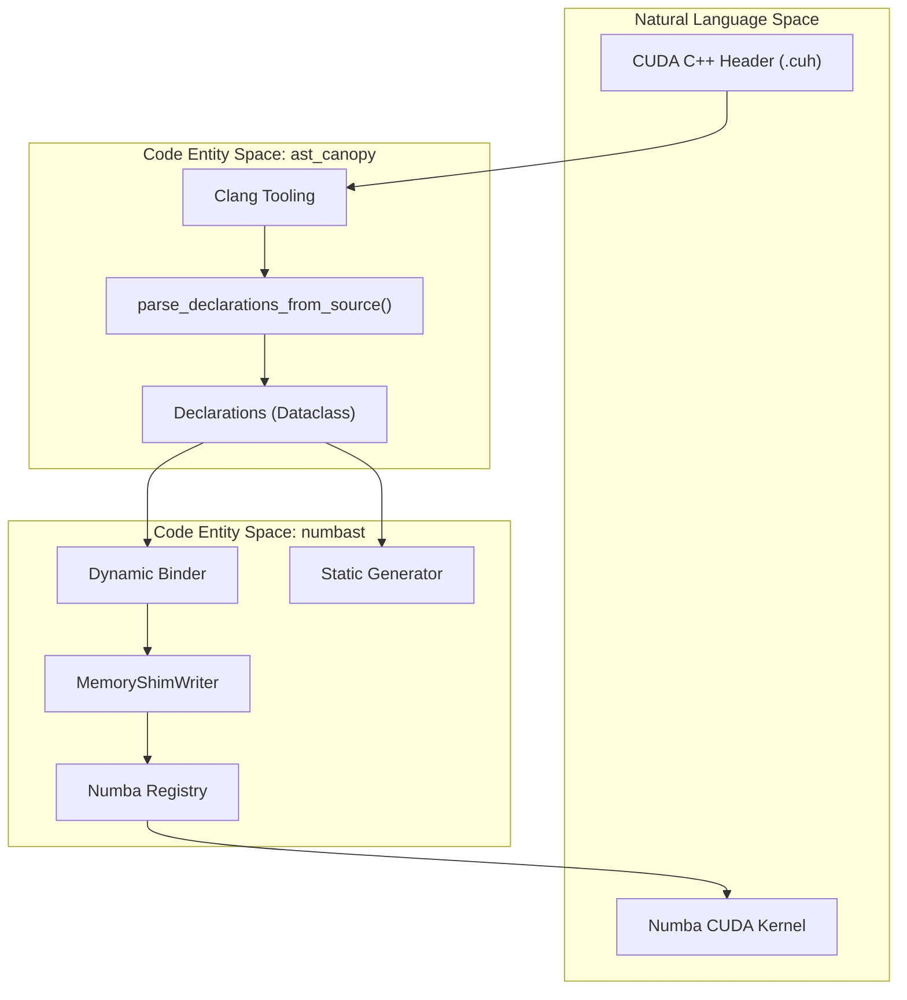
Sources: [numbast/README.md:42-58](), [numbast/README.md:8-12]()

## Operational Modes

Numbast supports two complementary workflows depending on the deployment environment and performance requirements.

### Dynamic Binding (Runtime)
Bindings are generated and registered in memory during the Python session. This is ideal for development and experimentation [numbast/README.md:37-39]().
*   **Mechanism**: Uses `bind_cxx_struct` and `bind_cxx_function` to update Numba's internal registries on the fly [numbast/README.md:45-51]().
*   **Requirements**: Requires `ast_canopy`, `clangdev`, and the original C++ headers at runtime [numbast/README.md:38-39]().

### Static Binding (Build-time)
A CLI tool generates a standalone `.py` module containing all necessary Numba code.
*   **Mechanism**: Invoked via `python -m numbast` using a YAML configuration file [numbast/README.md:66-67](), [numbast/pyproject.toml:30-31]().
*   **Requirements**: The generated module only depends on `numba-cuda`; `numbast` and Clang are not required by the end user [numbast/README.md:62-64]().

**Comparison of Binding Modes**
| Feature | Dynamic Mode | Static Mode |
| :--- | :--- | :--- |
| **Primary Entry Point** | `bind_cxx_function` | `numbast` CLI |
| **Output** | In-memory Numba types | Standalone `.py` file |
| **Runtime Deps** | `ast_canopy`, `clangdev`, headers | `numba-cuda` only |
| **Best For** | Rapid Prototyping | Production Libraries |

Sources: [numbast/README.md:35-68](), [numbast/pyproject.toml:30-31]()

## Integration with Numba Backends

Numbast primarily targets the standard `numba-cuda` backend but has recently added support for the experimental **MLIR-based** backend [README.md:9-12]().

**Backend Architecture**
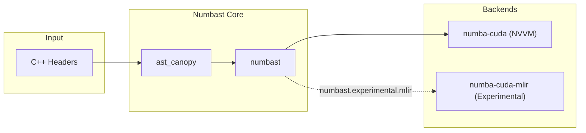
Sources: [README.md:9-12](), [numbast/pyproject.toml:42-42]()

## Project Resources

Detailed information on specific subsystems and processes can be found in the child pages:

*   **[Getting Started & Installation](#1.1)**: Setup instructions for Conda/pip and environment requirements like `clangdev` and `cuda-toolkit` [conda/environment_template.yaml:10-25]().
*   **[Changelog & Release Process](#1.2)**: History of changes and the `AGENTS.md` workflow for publishing new versions [AGENTS.md:3-50](), [CHANGELOG.md:1-12]().

Sources: [numbast/README.md:80-88](), [numbast/pyproject.toml:19-25]()

---

# Page: Getting Started & Installation

# Getting Started & Installation

<details>
<summary>Relevant source files</summary>

The following files were used as context for generating this wiki page:

- [README.md](README.md)
- [ast_canopy/README.md](ast_canopy/README.md)
- [ast_canopy/pyproject.toml](ast_canopy/pyproject.toml)
- [ast_canopy/tests/host/cuda_headers/include/cuda.h](ast_canopy/tests/host/cuda_headers/include/cuda.h)
- [ast_canopy/tests/host/data/sample_host_function.cpp](ast_canopy/tests/host/data/sample_host_function.cpp)
- [ast_canopy/tests/host/test_cuda_h.py](ast_canopy/tests/host/test_cuda_h.py)
- [ast_canopy/tests/host/test_function.py](ast_canopy/tests/host/test_function.py)
- [ci/build_conda_python.sh](ci/build_conda_python.sh)
- [ci/build_wheels.sh](ci/build_wheels.sh)
- [ci/test_conda_python.sh](ci/test_conda_python.sh)
- [conda/environment_template.yaml](conda/environment_template.yaml)
- [docs/README.md](docs/README.md)
- [docs/build_docs.sh](docs/build_docs.sh)
- [docs/source/install.rst](docs/source/install.rst)
- [docs/source/quickstart.rst](docs/source/quickstart.rst)
- [numbast/README.md](numbast/README.md)
- [numbast/pyproject.toml](numbast/pyproject.toml)
- [numbast_extensions/pyproject.toml](numbast_extensions/pyproject.toml)
- [pyproject.toml](pyproject.toml)

</details>


This page provides a comprehensive guide to setting up the Numbast ecosystem. Numbast consists of two primary packages: `ast_canopy` (the C++ AST parsing engine) and `numbast` (the Numba binding generator).

## Environment Requirements

Numbast requires a specific set of system and Python dependencies to bridge the gap between CUDA C++ headers and Numba kernels.

### System Dependencies
*   **Clang/LLVM**: `ast_canopy` is built on `libClangTooling`. It specifically requires `clangdev` versions between 18 and 22.0 `[conda/environment_template.yaml:11-11]()`.
*   **CUDA Toolkit**: A working CUDA installation is required for both parsing headers (via `ast_canopy`) and executing kernels (via `numba-cuda`). Supported versions include CUDA 12.x and 13.x `[docs/source/install.rst:29-30]()`.
*   **C++ Compiler**: A standard C++ compiler is required to build the `ast_canopy` shared library `[conda/environment_template.yaml:19-19]()`.

### Python Dependencies
*   **Numba**: `numba-cuda >= 0.25.0` `[numbast/pyproject.toml:20-20]()`.
*   **Python**: Version 3.7 or higher `[numbast/pyproject.toml:13-13]()`.
*   **ast_canopy**: The parsing backend `[numbast/pyproject.toml:21-21]()`.

---

## Installation Methods

### 1. Using pip (Recommended for Users)
The easiest way to install Numbast is via PyPI. This installs the pre-compiled `ast_canopy` wheels and the pure-Python `numbast` package.

```bash
pip install numbast
```
`[docs/source/install.rst:12-12]()`

### 2. Using Conda
Numbast is available via the `numba`, `conda-forge`, and `nvidia` channels `[conda/environment_template.yaml:4-7]()`.

```bash
conda install -c numba -c conda-forge -c nvidia numbast
```
`[docs/source/install.rst:20-20]()`

### 3. From Source (Recommended for Development)
For development, the project uses **Pixi** to manage environments and dependencies. The repository defines specific test groups for different CUDA versions.

```bash
# Install environment for CUDA 12
pixi install -e test-cu12

# Build and install local packages
pixi run -e test-cu12 build-ast-canopy
pixi run -e test-cu12 install-numbast
```
`[docs/source/install.rst:35-42]()`

---

## Data Flow and Architecture

The installation process sets up a pipeline where `ast_canopy` acts as the front-end parser and `numbast` acts as the backend generator.

### System Component Mapping
This diagram maps natural language concepts to the specific code entities and files that implement them.

**Figure 1: Component Entity Mapping**
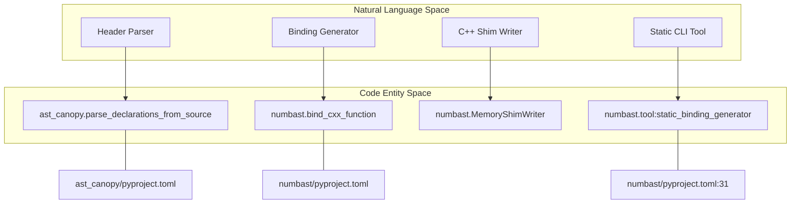
Sources: `[ast_canopy/pyproject.toml:9-12]()`, `[numbast/pyproject.toml:9-31]()`, `[numbast/README.md:41-48]()`.

### Installation & Build Pipeline
The following diagram illustrates the data flow during the installation and build of `ast_canopy`.

**Figure 2: Build and Linkage Flow**
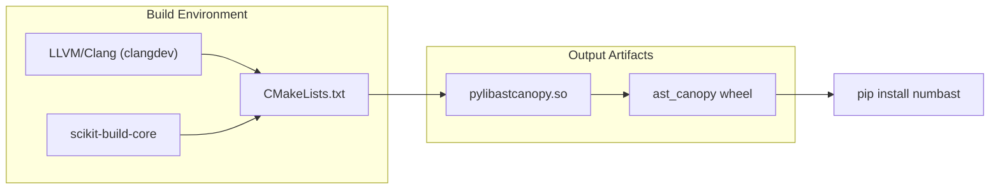
Sources: `[ast_canopy/pyproject.toml:4-6]()`, `[ci/build_wheels.sh:7-28]()`, `[conda/environment_template.yaml:10-25]()`.

---

## Quickstart Example

Once installed, you can use Numbast in **Dynamic Mode** to bind C++ functions on the fly. This requires `ast_canopy` to parse the source and `numbast` to register the types with Numba.

### Minimal End-to-End Script
This example demonstrates parsing a local header and calling a C++ function from a Numba CUDA kernel.

```python
from ast_canopy import parse_declarations_from_source
from numba import cuda, types
from numba.core.datamodel.models import PrimitiveModel
from numbast import MemoryShimWriter, bind_cxx_function, bind_cxx_struct

# 1. Parse the C++ Header
# [numbast/README.md:47-47]
decls = parse_declarations_from_source("demo.cuh", ["demo.cuh"], "sm_80")

# 2. Initialize Shim Writer to hold generated C++ code
# [numbast/README.md:48-48]
shim_writer = MemoryShimWriter('#include "demo.cuh"')

# 3. Bind C++ Structs and Functions
# [numbast/README.md:50-51]
MyType = bind_cxx_struct(shim_writer, decls.structs[0], types.Number, PrimitiveModel)
my_function = bind_cxx_function(shim_writer, decls.functions[0])

# 4. Use in a Numba CUDA Kernel
# [numbast/README.md:54-57]
@cuda.jit(link=shim_writer.links())
def kernel(out):
    value = MyType(1.0)
    out[0] = my_function(value)
```

### Static Generation CLI
Alternatively, use the CLI to generate standalone Python modules that do not require Clang at runtime.

```bash
python -m numbast --cfg-path config.yml --output-dir ./generated
```
`[numbast/README.md:67-67]()`

Sources: `[numbast/README.md:35-67]()`, `[numbast/pyproject.toml:30-31]()`.

---

# Page: Changelog & Release Process

# Changelog & Release Process

<details>
<summary>Relevant source files</summary>

The following files were used as context for generating this wiki page:

- [AGENTS.md](AGENTS.md)
- [CHANGELOG.md](CHANGELOG.md)
- [VERSION](VERSION)
- [ast_canopy/VERSION](ast_canopy/VERSION)
- [docs/nv-versions.json](docs/nv-versions.json)
- [docs/versions.json](docs/versions.json)
- [numbast/VERSION](numbast/VERSION)
- [numbast_extensions/VERSION](numbast_extensions/VERSION)

</details>


This page documents the Numbast versioning strategy, the automated release workflow driven by `AGENTS.md`, and the history of architectural milestones. The release process is designed to maintain synchronization between the core `numbast` package, the `ast_canopy` C++ parser, and the documentation site.

## Versioning Scheme

Numbast follows a unified versioning scheme where the root repository version is mirrored across all sub-packages.

| Component | Version Source | Role |
| :--- | :--- | :--- |
| **Root Repository** | [VERSION:1-1]() | Source of truth for the entire project. |
| **numbast** | [numbast/VERSION:1-1]() | Python binding generation core. |
| **ast_canopy** | [ast_canopy/VERSION:1-1]() | C++ AST parsing layer. |
| **numbast_extensions** | [numbast_extensions/VERSION:1-1]() | Pre-built bindings (e.g., bfloat16). |

Documentation versions are tracked in [docs/versions.json:1-9]() and [docs/nv-versions.json:1-30](), which map version strings to specific deployment URLs on GitHub Pages.

## Release Process Workflow

The release process is codified in [AGENTS.md:1-94]() as a set of "Skills" for automation agents or maintainers. It distinguishes between **Mainline Releases** (from `main`) and **Patch Releases** (from maintenance branches).

### Mainline Release (Skill: Publish a New Numbast Mainline Version)

Mainline releases occur when new features or breaking changes are merged into the `main` branch.

#### Data Flow: Mainline Release
The following diagram illustrates the transition from development to a tagged release.

"Mainline Release Data Flow"
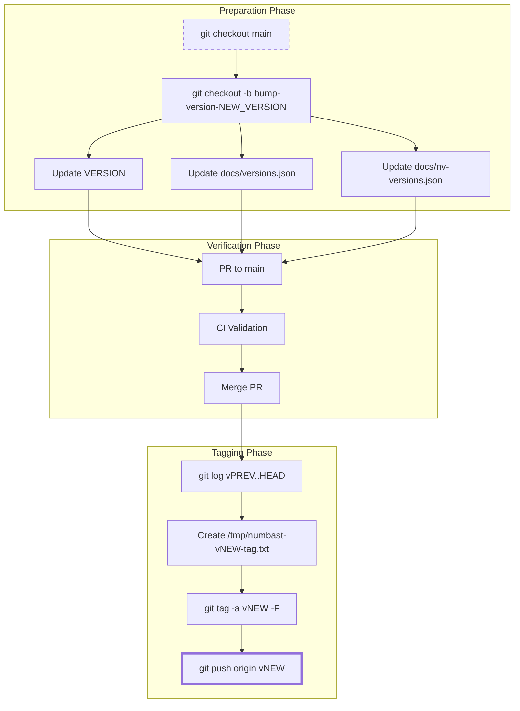
**Sources:** [AGENTS.md:3-49]()

### Patch Release (Skill: Publish a Numbast Patch Release Line)

Patch releases are used for critical fixes targeting a specific previous version without incorporating all changes from `main`.

1.  **Maintenance Branch**: A branch named `PATCH_BRANCH` (e.g., `0.6.x-patch`) is created from a previous tag [AGENTS.md:62-65]().
2.  **Fix Integration**: Short-lived branches for fixes target the `PATCH_BRANCH` [AGENTS.md:66-66]().
3.  **Versioning**: A specific version bump PR is opened against the `PATCH_BRANCH` [AGENTS.md:67-73]().
4.  **Tagging**: The tag is created at the tip of the `PATCH_BRANCH`, not `main` [AGENTS.md:91-91]().

**Sources:** [AGENTS.md:50-94]()

---

## Major Architectural Milestones

The following table summarizes significant changes in the Numbast architecture as documented in the changelog.

| Version | Date | Key Architectural Changes |
| :--- | :--- | :--- |
| **0.5.0** | Aug 2025 | Removed RAPIDS and `pynvjitlink` dependencies [CHANGELOG.md:17-18](). Adopted GNU extension standard for Clang parsing [CHANGELOG.md:19-19](). Introduced custom typing/target registry hooks [CHANGELOG.md:20-20](). |
| **0.4.0** | Jun 2025 | Switched to **Itanium Name Mangler** for resolving shim function conflicts [CHANGELOG.md:39-39](). Added `ConstExpr Vardecl Matcher` to extract values from `VarDecl` [CHANGELOG.md:49-49](). |
| **0.3.0** | May 2025 | Implemented **Streamed Shim Function Writes** using `KeyedStringIO` to prevent duplicate lowering [CHANGELOG.md:61-61](). Added `active_linking_library` support for shim code objects [CHANGELOG.md:60-60](). |
| **0.2.0** | Nov 2024 | Introduced the **Static Binding Generator CLI** (`python -m numbast`) [CHANGELOG.md:77-77](). Standardized on `numba-cuda` dependency [CHANGELOG.md:80-80](). |
| **0.1.0** | Feb 2024 | Initial release. `ast_canopy` support for top-level declarations [CHANGELOG.md:89-89](). |

**Sources:** [CHANGELOG.md:1-90]()

---

## Release Artifacts & Metadata

The release process ensures that several metadata files are synchronized to allow the documentation and build systems to function correctly.

### Documentation Version Mapping
The `docs/versions.json` file provides a simple key-value map for the documentation UI, while `docs/nv-versions.json` provides the full URL structure used by the Sphinx theme.

"Documentation Metadata Mapping"
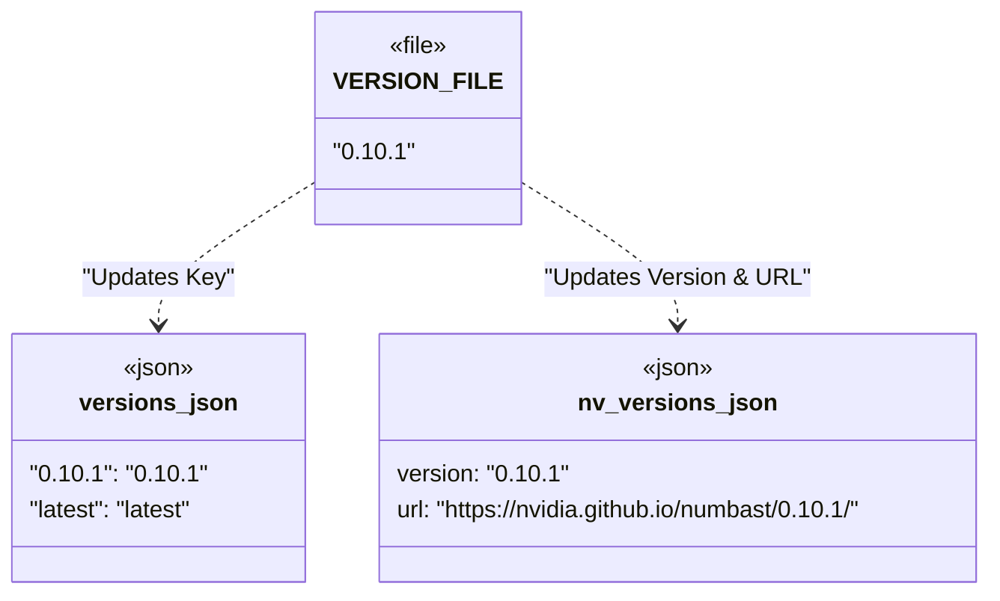
**Sources:** [VERSION:1-1](), [docs/versions.json:1-9](), [docs/nv-versions.json:1-30]()

### Changelog Generation
The changelog is generated non-interactively using `git log` with a specific format string:
`git log v<PREVIOUS_VERSION>..HEAD --pretty=format:"- %s"` [AGENTS.md:26-26]().
This output is used both for the PR description and the annotated git tag [AGENTS.md:32-35]().

**Sources:** [AGENTS.md:25-35]()

---

# Page: ast_canopy: C++ AST Parsing Layer

# ast_canopy: C++ AST Parsing Layer

<details>
<summary>Relevant source files</summary>

The following files were used as context for generating this wiki page:

- [ast_canopy/ast_canopy/api.py](ast_canopy/ast_canopy/api.py)
- [ast_canopy/ast_canopy/pylibastcanopy.cpp](ast_canopy/ast_canopy/pylibastcanopy.cpp)
- [ast_canopy/ast_canopy/pylibastcanopy.pyi](ast_canopy/ast_canopy/pylibastcanopy.pyi)
- [ast_canopy/cpp/include/ast_canopy/ast_canopy.hpp](ast_canopy/cpp/include/ast_canopy/ast_canopy.hpp)
- [ast_canopy/cpp/src/ast_canopy.cpp](ast_canopy/cpp/src/ast_canopy.cpp)
- [ast_canopy/tests/test_parse_from_source.py](ast_canopy/tests/test_parse_from_source.py)
- [docs/source/faq.rst](docs/source/faq.rst)

</details>


`ast_canopy` is the parsing front-end of the Numbast ecosystem. It leverages Clang's C++ driver and AST matching infrastructure to extract structural information from CUDA C++ source files and headers, converting them into a hierarchy of Python-accessible objects. This layer abstracts the complexities of the Clang AST (Abstract Syntax Tree) and provides a clean data model for the downstream `numbast` package to generate Numba-compatible bindings.

### Core Role in Numbast
`ast_canopy` acts as a bridge between the C++ source code and Python. It handles environment discovery (finding CUDA and system headers), drives the Clang parser with appropriate flags (e.g., `-xcuda`, `--cuda-path`), and traverses the resulting AST to identify structs, functions, templates, and enums.

The following diagram illustrates the transition from C++ source code entities to the Python objects provided by `ast_canopy`.

**C++ to Python Entity Mapping**
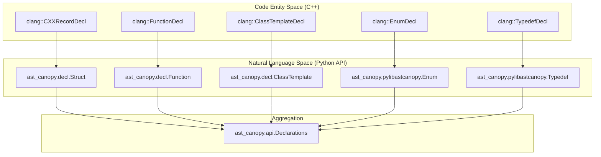
Sources: [ast_canopy/ast_canopy/api.py:56-64](), [ast_canopy/cpp/include/ast_canopy/ast_canopy.hpp:197-221](), [ast_canopy/ast_canopy/pylibastcanopy.cpp:15-100]()

---

### Python API Overview
The primary entry point for users is `parse_declarations_from_source`, which coordinates the environment setup and parsing logic. The results are returned in a `Declarations` dataclass containing lists of extracted entities.

- **Environment Discovery**: The API includes helpers like `get_cuda_include_dir_for_clang` and `get_default_compiler_search_paths` to ensure Clang can resolve standard and CUDA-specific headers.
- **Filtering**: The `files_to_retain` parameter allows users to filter the results, ensuring that only declarations from specific files are returned, even if the parser processed a large header graph.

For details on the Python interface, see [Python API: parse_declarations_from_source](#2.1).

Sources: [ast_canopy/ast_canopy/api.py:56-64](), [ast_canopy/ast_canopy/api.py:210-213]()

---

### C++ Core and AST Traversal
The heavy lifting is performed by a C++ shared library (`astcanopy`) and its `pybind11` bindings (`pylibastcanopy`).

- **AST Matching**: The system uses `clang::ast_matchers` to identify specific C++ constructs. Callbacks like `RecordCallback` and `FunctionCallback` populate C++ structs (e.g., `ast_canopy::Record`, `ast_canopy::Function`) with metadata.
- **Data Model**: The C++ layer captures detailed information including `execution_space` (host vs. device), `method_kind` (constructors vs. operators), and mangled names for linking.
- **Serialization**: Most core structs implement `py::pickle` support, allowing the extracted AST data to be cached or transferred between processes.

For details on the C++ implementation, see [C++ Core: AST Traversal and Data Model](#2.2).

**AST Parsing Pipeline**
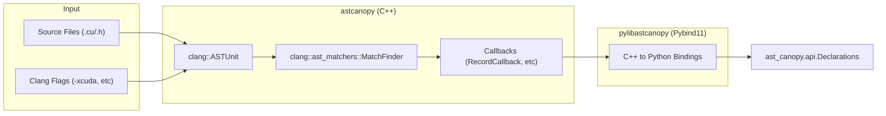
Sources: [ast_canopy/cpp/src/ast_canopy.cpp:154-180](), [ast_canopy/cpp/src/ast_canopy.cpp:81-150](), [ast_canopy/ast_canopy/pylibastcanopy.cpp:15-49]()

---

### Build System and Requirements
`ast_canopy` has significant build-time dependencies on LLVM and Clang. It uses `scikit-build-core` and CMake to manage the compilation of the C++ extensions.

- **Clang Versioning**: The codebase strictly supports Clang versions 18 through 21.
- **Shim Headers**: To handle differences between CUDA versions (e.g., CUDA 12 vs 13), `ast_canopy` includes a `shim_include` directory that provides compatibility wrappers during the parsing phase.
- **Packaging**: The build process ensures that the resulting Python wheel contains the necessary shared libraries and C++ resources required for parsing.

For details on the build process and environment requirements, see [Build System: CMake and scikit-build-core](#2.3).

Sources: [ast_canopy/cpp/src/ast_canopy.cpp:26-27](), [ast_canopy/ast_canopy/api.py:42-53](), [docs/source/faq.rst:70-82]()

---

### Child Pages
- [Python API: parse_declarations_from_source](#2.1)
- [C++ Core: AST Traversal and Data Model](#2.2)
- [Build System: CMake and scikit-build-core](#2.3)

---

# Page: Python API: parse_declarations_from_source

# Python API: parse_declarations_from_source

<details>
<summary>Relevant source files</summary>

The following files were used as context for generating this wiki page:

- [ast_canopy/ast_canopy/__init__.py](ast_canopy/ast_canopy/__init__.py)
- [ast_canopy/ast_canopy/api.py](ast_canopy/ast_canopy/api.py)
- [ast_canopy/ast_canopy/constants.py](ast_canopy/ast_canopy/constants.py)
- [ast_canopy/ast_canopy/fdcap_min.py](ast_canopy/ast_canopy/fdcap_min.py)
- [ast_canopy/cpp/src/ast_canopy.cpp](ast_canopy/cpp/src/ast_canopy.cpp)
- [ast_canopy/cpp/src/record.cpp](ast_canopy/cpp/src/record.cpp)
- [ast_canopy/tests/data/sample_record_incomplete.cu](ast_canopy/tests/data/sample_record_incomplete.cu)
- [ast_canopy/tests/test_parse_from_source.py](ast_canopy/tests/test_parse_from_source.py)
- [ast_canopy/tests/test_record_incomplete.py](ast_canopy/tests/test_record_incomplete.py)
- [docs/source/faq.rst](docs/source/faq.rst)

</details>


The `ast_canopy` Python API provides the primary interface for extracting C++ declarations from CUDA source files. It leverages a Clang-based backend to parse headers and source code into structured Python dataclasses, facilitating the generation of Numba bindings.

## Core API: parse_declarations_from_source

The central function of the `ast_canopy` package is `parse_declarations_from_source`. It orchestrates the environment resolution, Clang command-line construction, and the invocation of the C++ AST traversal engine.

### Data Flow and Implementation
When called, the function performs the following steps:
1. **Environment Resolution**: It gathers necessary include paths for the CUDA Toolkit, Clang resource headers, and system C++ headers (libstdc++) [ast_canopy/ast_canopy/api.py:234-245]().
2. **Command-Line Assembly**: It constructs a list of Clang compiler flags, including `-xcuda`, `--cuda-device-only`, and target architecture (e.g., `sm_80`) [ast_canopy/ast_canopy/api.py:252-277]().
3. **AST Parsing**: It calls the underlying pybind11-wrapped C++ function `parse_declarations_from_command_line` [ast_canopy/ast_canopy/api.py:301-305]().
4. **Filtering**: It uses the `files_to_retain` mechanism to ensure only declarations from specified files are returned, preventing the pollution of the results with standard library or system headers [ast_canopy/cpp/src/ast_canopy.cpp:155-157]().

### The Declarations Dataclass
The result of a parse operation is encapsulated in a `Declarations` dataclass, which serves as a container for various C++ entities.

| Field | Type | Description |
| :--- | :--- | :--- |
| `structs` | `list[Struct]` | Non-templated C++ structs, classes, and unions. |
| `functions` | `list[Function]` | Free-standing (non-member) C++ functions. |
| `function_templates` | `list[FunctionTemplate]` | Free-standing function templates. |
| `class_templates` | `list[ClassTemplate]` | C++ class/struct templates. |
| `class_template_specializations` | `list[ClassTemplateSpecialization]` | Explicit or implicit template instantiations. |
| `typedefs` | `list[Typedef]` | C++ type aliases and typedefs. |
| `enums` | `list[Enum]` | C++ enumerations (scoped and unscoped). |

**Sources:** [ast_canopy/ast_canopy/api.py:56-65](), [ast_canopy/ast_canopy/api.py:210-310]()

## Environment Resolution Helpers

Parsing CUDA C++ requires discovering specific system resources. `ast_canopy` includes several helpers to automate this.

### CUDA Include Discovery
`get_cuda_include_dir_for_clang` uses `cuda.pathfinder` to locate CUDA Toolkit headers. It handles different layouts for CUDA 12 and 13, including support for pip-installed toolkit wheels and system-wide installations [ast_canopy/ast_canopy/api.py:210-231]().

### Clang Resource Directory
`get_clang_resource_dir` locates the builtin Clang headers (e.g., `<stddef.h>`, `__clang_cuda_runtime_wrapper.h`). It prioritizes the directory associated with the `ast_canopy` installation or falls back to searching the system path for a `clang` binary [ast_canopy/ast_canopy/api.py:173-208]().

### libstdc++ Fallback
`libstdcxx_include_dirs_fallback` provides a mechanism to find system C++ headers on Linux (typically in `/usr/include/c++/<version>`) if the Clang driver fails to report them automatically [ast_canopy/ast_canopy/api.py:130-170]().

**Sources:** [ast_canopy/ast_canopy/api.py:130-231](), [docs/source/faq.rst:70-125]()

## System Architecture Diagrams

The following diagrams illustrate the relationship between the Python API and the underlying C++ entities.

### Natural Language to Code Entity Mapping: Parsing Flow
This diagram maps the high-level request to parse a file to the specific internal classes and functions involved.

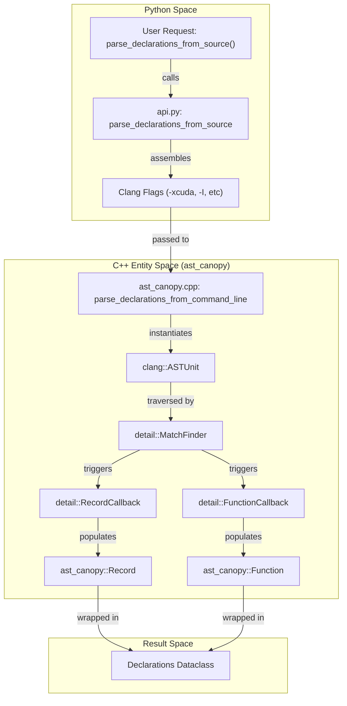
**Sources:** [ast_canopy/ast_canopy/api.py:210-310](), [ast_canopy/cpp/src/ast_canopy.cpp:154-200]()

### Entity Relationship: Declarations and Layout
This diagram shows how the `Declarations` object relates to the underlying C++ structural information extracted by the parser.

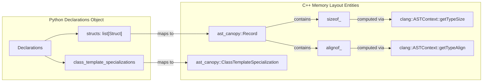
**Sources:** [ast_canopy/ast_canopy/api.py:56-65](), [ast_canopy/cpp/src/record.cpp:19-97]()

## Filtering with files_to_retain

The `files_to_retain` parameter is critical for performance and clarity. C++ headers often include a vast tree of dependencies. By passing a list of filenames to `files_to_retain`, the parser ignores any declaration whose source location does not match one of the provided paths [ast_canopy/cpp/src/ast_canopy.cpp:72-79]().

### Special Case: Incomplete Types
If a struct or class template specialization is encountered that is incomplete (e.g., only forward-declared), `ast_canopy` cannot compute its size or alignment. In these cases, the parser assigns sentinel values:
*   `INVALID_SIZE_OF`: Indicates the size could not be determined.
*   `INVALID_ALIGN_OF`: Indicates the alignment could not be determined.

This prevents the parser from crashing when encountering complex template hierarchies [ast_canopy/cpp/src/record.cpp:85-97]().

**Sources:** [ast_canopy/cpp/src/record.cpp:85-97](), [ast_canopy/ast_canopy/constants.py:1-10](), [ast_canopy/tests/test_record_incomplete.py:81-101]()

## Constant Evaluation: value_from_constexpr_vardecl

In addition to parsing structural declarations, `ast_canopy` can extract the values of `constexpr` variables. The `value_from_constexpr_vardecl` function takes a `ConstExprVar` object and returns its evaluated constant value (e.g., an integer or boolean) from the AST [ast_canopy/ast_canopy/api.py:19]().

**Sources:** [ast_canopy/ast_canopy/api.py:19](), [ast_canopy/ast_canopy/__init__.py:10-19]()

---

# Page: C++ Core: AST Traversal and Data Model

# C++ Core: AST Traversal and Data Model

<details>
<summary>Relevant source files</summary>

The following files were used as context for generating this wiki page:

- [ast_canopy/ast_canopy/__init__.py](ast_canopy/ast_canopy/__init__.py)
- [ast_canopy/ast_canopy/constants.py](ast_canopy/ast_canopy/constants.py)
- [ast_canopy/ast_canopy/decl.py](ast_canopy/ast_canopy/decl.py)
- [ast_canopy/ast_canopy/pylibastcanopy.cpp](ast_canopy/ast_canopy/pylibastcanopy.cpp)
- [ast_canopy/ast_canopy/pylibastcanopy.pyi](ast_canopy/ast_canopy/pylibastcanopy.pyi)
- [ast_canopy/cpp/include/ast_canopy/ast_canopy.hpp](ast_canopy/cpp/include/ast_canopy/ast_canopy.hpp)
- [ast_canopy/cpp/src/class_template.cpp](ast_canopy/cpp/src/class_template.cpp)
- [ast_canopy/cpp/src/class_template_specialization.cpp](ast_canopy/cpp/src/class_template_specialization.cpp)
- [ast_canopy/cpp/src/constexpr_vardecl.cpp](ast_canopy/cpp/src/constexpr_vardecl.cpp)
- [ast_canopy/cpp/src/detail/matchers.hpp](ast_canopy/cpp/src/detail/matchers.hpp)
- [ast_canopy/cpp/src/detail/matchers/class_template_specialization_matcher.cpp](ast_canopy/cpp/src/detail/matchers/class_template_specialization_matcher.cpp)
- [ast_canopy/cpp/src/detail/matchers/function_matcher.cpp](ast_canopy/cpp/src/detail/matchers/function_matcher.cpp)
- [ast_canopy/cpp/src/detail/matchers/record_matcher.cpp](ast_canopy/cpp/src/detail/matchers/record_matcher.cpp)
- [ast_canopy/cpp/src/enum.cpp](ast_canopy/cpp/src/enum.cpp)
- [ast_canopy/cpp/src/function.cpp](ast_canopy/cpp/src/function.cpp)
- [ast_canopy/cpp/src/function_template.cpp](ast_canopy/cpp/src/function_template.cpp)
- [ast_canopy/cpp/src/record.cpp](ast_canopy/cpp/src/record.cpp)
- [ast_canopy/cpp/src/template.cpp](ast_canopy/cpp/src/template.cpp)
- [ast_canopy/cpp/src/template_param.cpp](ast_canopy/cpp/src/template_param.cpp)
- [ast_canopy/cpp/src/type.cpp](ast_canopy/cpp/src/type.cpp)
- [ast_canopy/cpp/src/typedef.cpp](ast_canopy/cpp/src/typedef.cpp)
- [ast_canopy/tests/conftest.py](ast_canopy/tests/conftest.py)
- [ast_canopy/tests/data/sample_crtp_dependent.cu](ast_canopy/tests/data/sample_crtp_dependent.cu)
- [ast_canopy/tests/data/sample_itanium_mangled_names.cu](ast_canopy/tests/data/sample_itanium_mangled_names.cu)
- [ast_canopy/tests/data/sample_macro.cu](ast_canopy/tests/data/sample_macro.cu)
- [ast_canopy/tests/data/sample_null_qualtype.cu](ast_canopy/tests/data/sample_null_qualtype.cu)
- [ast_canopy/tests/data/sample_record_incomplete.cu](ast_canopy/tests/data/sample_record_incomplete.cu)
- [ast_canopy/tests/data/sample_template_template_param.cu](ast_canopy/tests/data/sample_template_template_param.cu)
- [ast_canopy/tests/data/sample_typedef_template_inst.cu](ast_canopy/tests/data/sample_typedef_template_inst.cu)
- [ast_canopy/tests/data/sample_types.cu](ast_canopy/tests/data/sample_types.cu)
- [ast_canopy/tests/data/sample_unsupported_template_args.cu](ast_canopy/tests/data/sample_unsupported_template_args.cu)
- [ast_canopy/tests/test_crtp_dependent_mangle.py](ast_canopy/tests/test_crtp_dependent_mangle.py)
- [ast_canopy/tests/test_mangled_name.py](ast_canopy/tests/test_mangled_name.py)
- [ast_canopy/tests/test_null_qualtype_guard.py](ast_canopy/tests/test_null_qualtype_guard.py)
- [ast_canopy/tests/test_parse_macro.py](ast_canopy/tests/test_parse_macro.py)
- [ast_canopy/tests/test_parse_type.py](ast_canopy/tests/test_parse_type.py)
- [ast_canopy/tests/test_record_incomplete.py](ast_canopy/tests/test_record_incomplete.py)
- [ast_canopy/tests/test_template_template_param.py](ast_canopy/tests/test_template_template_param.py)
- [ast_canopy/tests/test_typedef_template_instantiation.py](ast_canopy/tests/test_typedef_template_instantiation.py)
- [ast_canopy/tests/test_unsupported_template_args.py](ast_canopy/tests/test_unsupported_template_args.py)
- [numbast/src/numbast/tools/tests/macros.cuh](numbast/src/numbast/tools/tests/macros.cuh)
- [numbast/src/numbast/tools/tests/test_macros.py](numbast/src/numbast/tools/tests/test_macros.py)

</details>


This page documents the C++ internals of `ast_canopy`, the layer responsible for parsing CUDA C++ source code using Clang and exposing a structured data model to Python. It details the core C++ structs, the AST traversal mechanism using Clang Matchers, and the pybind11 bindings that bridge the C++ and Python layers.

## Data Model and Core Structs

The `ast_canopy` data model is defined as a hierarchy of C++ structs that mirror C++ language constructs. These structs are designed to be serializable and easy to consume from Python.

### Core Struct Hierarchy

| Struct | Description |
| :--- | :--- |
| `Type` | Represents a C++ type, storing its name, unqualified name, and reference properties [ast_canopy/cpp/include/ast_canopy/ast_canopy.hpp:50-65](). |
| `Record` | Represents a `struct` or `class`. Contains fields, methods, nested records, and layout information (`sizeof`, `alignof`) [ast_canopy/cpp/include/ast_canopy/ast_canopy.hpp:197-215](). |
| `Function` | Represents a C++ function, including return type, parameters, execution space, and mangled name [ast_canopy/cpp/include/ast_canopy/ast_canopy.hpp:138-159](). |
| `Method` | Inherits from `Function`; represents a class member function with an associated `method_kind` [ast_canopy/cpp/include/ast_canopy/ast_canopy.hpp:177-190](). |
| `Template` | Base struct for templates, holding `TemplateParam` lists [ast_canopy/cpp/include/ast_canopy/ast_canopy.hpp:112-122](). |
| `ClassTemplate` | Represents a class template declaration [ast_canopy/cpp/include/ast_canopy/ast_canopy.hpp:228-243](). |
| `Enum` | Represents a C++ enumeration and its constant values [ast_canopy/cpp/include/ast_canopy/ast_canopy.hpp:67-82](). |
| `Declarations` | The top-level container returned by the parser, holding collections of all parsed entities [ast_canopy/ast_canopy/pylibastcanopy.pyi:27-35](). |

### Enums for Metadata

The system uses several enums to categorize C++ entities:
*   **`execution_space`**: Identifies where a function can run (`host`, `device`, `host_device`, `global_`) [ast_canopy/cpp/include/ast_canopy/ast_canopy.hpp:33]().
*   **`method_kind`**: Categorizes constructors (default, copy, move, converting) and destructors [ast_canopy/cpp/include/ast_canopy/ast_canopy.hpp:35-44]().
*   **`access_kind`**: Standard C++ access specifiers (`public_`, `protected_`, `private_`) [ast_canopy/cpp/include/ast_canopy/ast_canopy.hpp:48]().

### C++ Data Model Overview
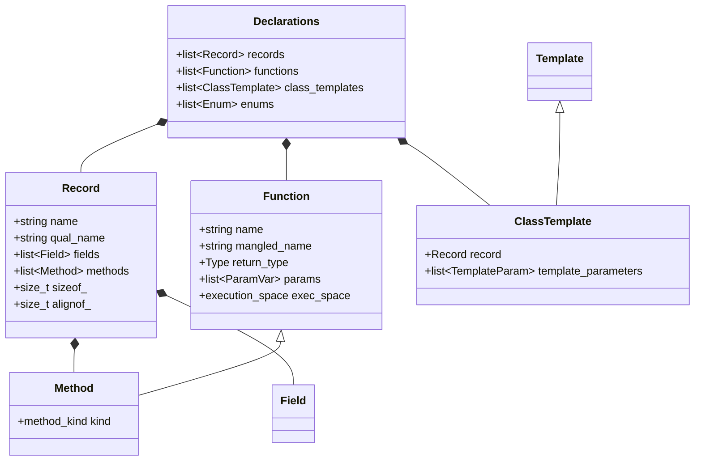
**Sources:** [ast_canopy/cpp/include/ast_canopy/ast_canopy.hpp:30-243](), [ast_canopy/ast_canopy/pylibastcanopy.pyi:9-125]()

## AST Traversal and MatchFinder

The parsing process uses Clang's `ASTMatchFinder` to locate specific declarations in the AST. Callbacks are registered for different types of C++ nodes.

### Matcher Callbacks

The `ast_canopy::detail` namespace contains several callback classes that inherit from `MatchFinder::MatchCallback` [ast_canopy/cpp/src/detail/matchers.hpp:41-121]().

1.  **`RecordCallback`**: Extracts struct/class definitions. It iterates through the `DeclContext` to find fields, methods, and nested declarations [ast_canopy/cpp/src/record.cpp:19-77]().
2.  **`FunctionCallback`**: Handles standalone functions and computes their Itanium mangled names [ast_canopy/cpp/src/function.cpp:131-176]().
3.  **`ClassTemplateSpecializationCallback`**: Specifically handles template instantiations. It captures the actual template arguments and registers the specialization's ID in a shared map to allow `Typedef` resolution [ast_canopy/cpp/src/detail/matchers/class_template_specialization_matcher.cpp:97-132]().

### Execution Space Detection
The `get_execution_space` helper identifies CUDA attributes on function declarations:
*   `__global__` -> `execution_space::global_`
*   `__host__ __device__` -> `execution_space::host_device`
*   Standard functions default to `execution_space::undefined` or `host` [ast_canopy/cpp/src/function.cpp:19-32]().

### Mangling and Dependent Signatures
For functions with template-dependent signatures (where types are not yet resolved), the Clang mangler can crash. `ast_canopy` detects this using `has_dependent_signature` and falls back to a stable, byte-encoded fallback name instead of a standard Itanium mangled symbol [ast_canopy/cpp/src/function.cpp:41-129]().

### Traversal Logic Flow
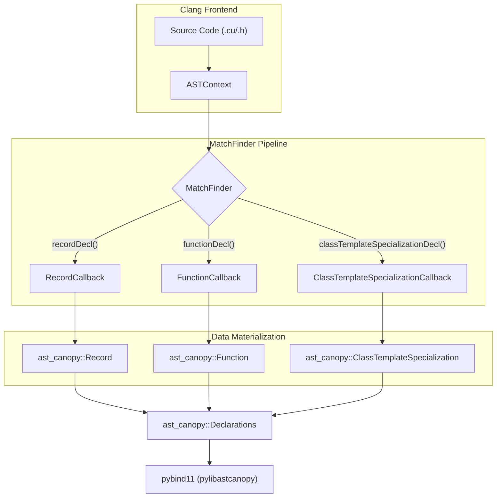
**Sources:** [ast_canopy/cpp/src/detail/matchers.hpp:25-121](), [ast_canopy/cpp/src/function.cpp:131-176](), [ast_canopy/cpp/src/detail/matchers/class_template_specialization_matcher.cpp:101-132]()

## Pybind11 Bindings (`pylibastcanopy`)

The `pylibastcanopy` module exposes the C++ structs to Python. It is defined in `ast_canopy/ast_canopy/pylibastcanopy.cpp`.

### Serialization (Pickle Support)
Most core classes implement `py::pickle` to allow `Declarations` objects to be saved and loaded across Python sessions. This is critical for caching parsed headers [ast_canopy/ast_canopy/pylibastcanopy.cpp:59-70]().

### Key Bindings

*   **Enums**: `execution_space`, `method_kind`, `template_param_kind`, and `access_kind` are mapped to Python enums [ast_canopy/ast_canopy/pylibastcanopy.cpp:23-48]().
*   **Type**: Exposes `name`, `unqualified_non_ref_type_name`, and reference check methods [ast_canopy/ast_canopy/pylibastcanopy.cpp:50-57]().
*   **Record**: Exposes fields, methods, and layout constants. If a record is incomplete or dependent, `sizeof_` and `alignof_` return `INVALID_SIZE_OF` / `INVALID_ALIGN_OF` [ast_canopy/ast_canopy/pylibastcanopy.cpp:18-19](), [ast_canopy/cpp/src/record.cpp:85-97]().

### Binding Association
| C++ Entity | Python Binding | Role |
| :--- | :--- | :--- |
| `ast_canopy::Type` | `pylibastcanopy.Type` | Type metadata provider [ast_canopy/ast_canopy/pylibastcanopy.cpp:50]() |
| `ast_canopy::Record` | `pylibastcanopy.Record` | Struct/Class definition [ast_canopy/ast_canopy/pylibastcanopy.cpp:211]() |
| `ast_canopy::Function` | `pylibastcanopy.Function` | Function/Operator metadata [ast_canopy/ast_canopy/pylibastcanopy.cpp:158]() |
| `ast_canopy::Declarations` | `pylibastcanopy.Declarations` | Aggregate container [ast_canopy/ast_canopy/pylibastcanopy.cpp:280]() |

**Sources:** [ast_canopy/ast_canopy/pylibastcanopy.cpp:15-300](), [ast_canopy/cpp/include/ast_canopy/ast_canopy.hpp:25-28]()

## Type Resolution and Normalization

`ast_canopy` performs normalization on type names to ensure consistency between the C++ parser and Numba's type system.

### Qualifier Removal
The function `remove_qualifier_recursive_to_name` recursively strips `const`, `volatile`, and references from types. For example, `const int*` is normalized to `int*` [ast_canopy/cpp/src/type.cpp:53-74]().

### Portability for `stdint` Types
Types like `uint64_t` are handled specially. Instead of resolving them to their underlying platform-specific canonical type (e.g., `unsigned long long`), `ast_canopy` preserves the `stdint` name if detected via `contains_stdint_type` to ensure portability of generated bindings [ast_canopy/cpp/src/type.cpp:21-35](), [ast_canopy/cpp/src/type.cpp:99-101]().

**Sources:** [ast_canopy/cpp/src/type.cpp:21-110]()

---

# Page: Build System: CMake and scikit-build-core

# Build System: CMake and scikit-build-core

<details>
<summary>Relevant source files</summary>

The following files were used as context for generating this wiki page:

- [ast_canopy/CMakeLists.txt](ast_canopy/CMakeLists.txt)
- [ast_canopy/build.sh](ast_canopy/build.sh)
- [ast_canopy/cpp/CMakeLists.txt](ast_canopy/cpp/CMakeLists.txt)
- [ast_canopy/cpp/cmake/ast_canopy_llvm.cmake](ast_canopy/cpp/cmake/ast_canopy_llvm.cmake)
- [ast_canopy/pyproject.toml](ast_canopy/pyproject.toml)
- [ast_canopy/tests/host/cuda_headers/include/cuda.h](ast_canopy/tests/host/cuda_headers/include/cuda.h)
- [ast_canopy/tests/host/data/sample_host_function.cpp](ast_canopy/tests/host/data/sample_host_function.cpp)
- [ast_canopy/tests/host/test_cuda_h.py](ast_canopy/tests/host/test_cuda_h.py)
- [ast_canopy/tests/host/test_function.py](ast_canopy/tests/host/test_function.py)
- [ci/build_wheels.sh](ci/build_wheels.sh)
- [pyproject.toml](pyproject.toml)

</details>


This page describes the build infrastructure for the `ast_canopy` package, which serves as the C++ front-end for Numbast. The system utilizes a multi-stage approach involving Bash entrypoints, CMake for C++ compilation and library discovery, and `scikit-build-core` for Python wheel integration.

### Build Architecture Overview

The build system is designed to handle two distinct components: the core C++ library (`astcanopy`) and the Python bindings (`pylibastcanopy`). It must also manage complex dependencies on LLVM and Clang libraries, ensuring consistent Run-Time Type Information (RTTI) support across the stack.

The following diagram illustrates the flow from the build entrypoint to the final packaged wheel:

**Figure 1: ast_canopy Build and Packaging Flow**
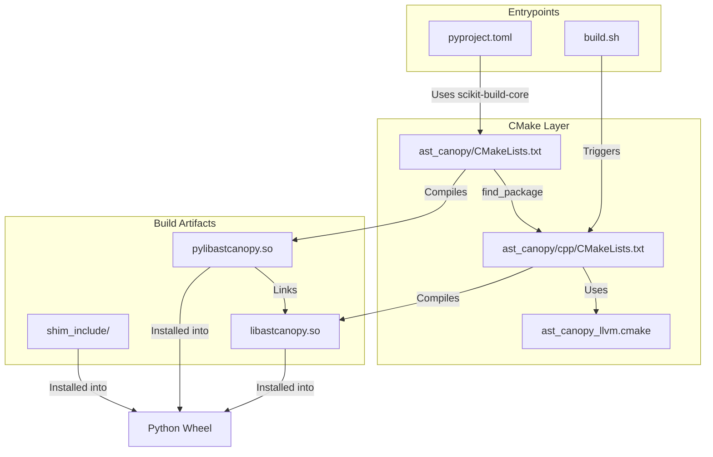
**Sources:** [ast_canopy/build.sh:1-18](), [ast_canopy/CMakeLists.txt:12-34](), [ast_canopy/cpp/CMakeLists.txt:19-55](), [ast_canopy/pyproject.toml:4-10]()

---

### The build.sh Entrypoint

The `build.sh` script provides a unified interface for developers to configure and compile the C++ core. It handles environment normalization, build type selection (Debug/Release), and LLVM linkage preferences.

| Option | Description | Implementation |
| :--- | :--- | :--- |
| `--develop` | Sets `Editable_Mode` for development. | [ast_canopy/build.sh:71-74]() |
| `--debug` | Sets `CMAKE_BUILD_TYPE` to `Debug`. | [ast_canopy/build.sh:75-78]() |
| `--llvm-linkage` | Chooses `STATIC` or `SHARED` linkage for Clang/LLVM. | [ast_canopy/build.sh:79-87]() |
| `--incremental` | Reuses existing build cache in `cpp/build`. | [ast_canopy/build.sh:88-91]() |

The script also performs critical path normalization, converting between colon-separated environment paths and semicolon-separated CMake paths via `normalize_cmake_prefix_path` [ast_canopy/build.sh:21-28]().

**Sources:** [ast_canopy/build.sh:41-106](), [ast_canopy/build.sh:185-195]()

---

### CMake Structure and LLVM Linkage

The C++ core is defined in `ast_canopy/cpp/CMakeLists.txt`. It builds a shared library `astcanopy` containing the AST traversal logic [ast_canopy/cpp/CMakeLists.txt:19-43]().

#### LLVM/Clang Integration
The project requires several Clang components (e.g., `clangTooling`, `clangASTMatchers`). Linkage is managed by the helper function `ast_canopy_target_link_clang` [ast_canopy/cpp/cmake/ast_canopy_llvm.cmake:11-51]().

**Linkage Verification Logic:**
1.  It iterates through required targets like `clangAST` and `clangSema` [ast_canopy/cpp/cmake/ast_canopy_llvm.cmake:13-27]().
2.  It checks the `TYPE` property of the discovered targets against the requested `LLVM_LINKAGE` [ast_canopy/cpp/cmake/ast_canopy_llvm.cmake:37-38]().
3.  If `LLVM_LINKAGE` is `STATIC` but shared libraries are found, it raises a `FATAL_ERROR` to prevent binary incompatibility [ast_canopy/cpp/cmake/ast_canopy_llvm.cmake:41-44]().

#### RTTI Requirements
Because Clang's AST Matchers rely heavily on C++ Run-Time Type Information, both the core library and the Python bindings must be compiled with `-frtti` [ast_canopy/cpp/CMakeLists.txt:78](), [ast_canopy/CMakeLists.txt:28](). This is enforced via `CMAKE_CXX_FLAGS` in the build script [ast_canopy/build.sh:190]().

**Sources:** [ast_canopy/cpp/CMakeLists.txt:55-82](), [ast_canopy/cpp/cmake/ast_canopy_llvm.cmake:1-51](), [ast_canopy/build.sh:193-194]()

---

### Python Integration with scikit-build-core

The `ast_canopy/pyproject.toml` file defines `scikit-build-core` as the build backend [ast_canopy/pyproject.toml:4-6](). This integration allows the Python package to manage the CMake lifecycle during `pip install` or `pip wheel`.

**Figure 2: Code Entity Association (Python to C++ Build)**
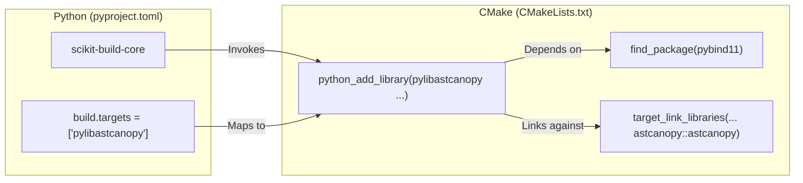

#### Packaging Header Shims
The `shim_include` directory contains C++ headers required at runtime by Numbast for template instantiation. These must be explicitly included in the wheel.
*   **CMake Install:** `install(DIRECTORY ... DESTINATION ast_canopy)` ensures the files are placed in the install tree [ast_canopy/CMakeLists.txt:40-43]().
*   **SDist Inclusion:** `sdist.include` in `pyproject.toml` ensures these headers are present in source distributions [ast_canopy/pyproject.toml:23]().

**Sources:** [ast_canopy/pyproject.toml:18-23](), [ast_canopy/CMakeLists.txt:23-43]()

---

### CI Wheel Build Pipeline

The `ci/build_wheels.sh` script automates the production of redistributable wheels. It forces static LLVM linkage to ensure the resulting binaries are self-contained and do not depend on the host's LLVM installation.

1.  **Static Build:** Executes `./build.sh --llvm-linkage=STATIC --no-install` [ci/build_wheels.sh:26]().
2.  **Multi-version Python:** Iterates through supported Python versions (3.10 through 3.14) to generate specific wheels [ci/build_wheels.sh:32-34]().
3.  **Auditwheel Repair:** Uses `auditwheel repair` to bundle the internal `libastcanopy.so` into the wheel, ensuring the library can be found via `LD_LIBRARY_PATH` during the repair process [ci/build_wheels.sh:37-40]().

**Sources:** [ci/build_wheels.sh:7-40]()

---

# Page: Numbast: Binding Generation Core

# Numbast: Binding Generation Core

<details>
<summary>Relevant source files</summary>

The following files were used as context for generating this wiki page:

- [.github/workflows/ci.yaml](.github/workflows/ci.yaml)
- [.github/workflows/pr.yaml](.github/workflows/pr.yaml)
- [README.md](README.md)
- [ast_canopy/README.md](ast_canopy/README.md)
- [ci/detect_test_paths.py](ci/detect_test_paths.py)
- [ci/run_tests.py](ci/run_tests.py)
- [docs/source/quickstart.rst](docs/source/quickstart.rst)
- [numbast/README.md](numbast/README.md)
- [numbast/src/numbast/__init__.py](numbast/src/numbast/__init__.py)
- [numbast/src/numbast/experimental/mlir/tests/conftest.py](numbast/src/numbast/experimental/mlir/tests/conftest.py)
- [numbast/src/numbast/experimental/mlir/tools/tests/test_symbol_exposure.py](numbast/src/numbast/experimental/mlir/tools/tests/test_symbol_exposure.py)
- [numbast/src/numbast/function.py](numbast/src/numbast/function.py)
- [numbast/src/numbast/struct.py](numbast/src/numbast/struct.py)

</details>


The `numbast` package provides the core logic for translating C++ declarations (parsed by `ast_canopy`) into Numba-compatible Python bindings. It automates the generation of Numba typing templates, lowering implementations, and C++ shim code required to bridge the Python/C++ boundary in CUDA kernels [numbast/README.md:1-7]().

### Binding Pipeline Overview

The system operates by consuming `ast_canopy` declaration objects and registering them within Numba's internal registries. The pipeline follows a structured sequence to ensure C++ types and functions are correctly represented in Numba's IR and data models.

#### Natural Language to Code Entity Space: Core Pipeline
| Concept | Code Entity | File Reference |
|:---|:---|:---|
| **Binding Entrypoint** | `bind_cxx_struct`, `bind_cxx_function` | [numbast/src/numbast/__init__.py:17-28]() |
| **Type Mapping** | `to_numba_type`, `to_numba_arg_type` | [numbast/src/numbast/types.py]() |
| **Call Bridge** | `FunctionCallConv` | [numbast/src/numbast/callconv.py:23-23]() |
| **Shim Generation** | `MemoryShimWriter`, `FileShimWriter` | [numbast/src/numbast/shim_writer.py:45-46]() |
| **Intent Analysis** | `compute_intent_plan`, `ArgIntent` | [numbast/src/numbast/intent.py:26-26]() |

#### Binding System Architecture
```mermaid
graph TD
    subgraph "Input Layer"
        A["ast_canopy.decl.Struct"] --> D
        B["ast_canopy.decl.Function"] --> D
        C["ast_canopy.decl.ClassTemplate"] --> D
    end

    subgraph "Numbast Core Engine"
        D["Binding Dispatcher"] --> E["Type Registry (types.py)"]
        D --> F["Shim Generator (shim_writer.py)"]
        D --> G["Call Convention (callconv.py)"]
        G --> H["Intent Planner (intent.py)"]
    end

    subgraph "Numba Integration"
        E --> I["register_model"]
        G --> J["@lower"]
        F --> K["shim_writer.links()"]
    end

    Sources: ["numbast/src/numbast/struct.py:25-34", "numbast/src/numbast/function.py:16-23"]
```

---

### Operational Modes

Numbast supports two primary workflows depending on whether the C++ environment is available at runtime [numbast/README.md:31-34]().

#### 1. Dynamic Binding Generation
Used for development and experimentation. It parses headers and registers bindings at runtime. This mode requires `ast_canopy`, `Clang`, and CUDA headers to be present on the system executing the Python code [numbast/README.md:35-40]().
*   **Key Functions:** `bind_cxx_struct`, `bind_cxx_function`.
*   **Shim Management:** Uses `MemoryShimWriter` to store generated C++ shims in memory for just-in-time linking [numbast/src/numbast/struct.py:34]().

#### 2. Static Binding Generation
Used for production packaging. A CLI tool generates a standalone Python module containing all Numba registration logic and a static C++ shim file [numbast/README.md:60-65]().
*   **CLI:** `python -m numbast --cfg-path config.yml` [numbast/README.md:66-68]().
*   **Benefit:** End users do not need `ast_canopy` or `Clang` at runtime.

---

### Major Subsystems

#### [Dynamic Binding: bind_cxx_struct and bind_cxx_function](#3.1)
Details the lifecycle of a binding, including how C++ constructors are mapped to Numba `lower` calls [numbast/src/numbast/struct.py:63-148]() and how operator overloads (e.g., `+`, `*`) are mapped to Python operators [numbast/src/numbast/function.py:78-81]().

#### [Template Binding: Class and Function Templates](#3.2)
Explains the management of C++ templates. Numbast handles on-the-fly specialization by materializing concrete types when Numba encounters specific template arguments at runtime [numbast/src/numbast/__init__.py:33-40]().

#### [Type System: C++ to Numba Type Mapping](#3.3)
Covers the translation layer between C++ types and Numba types. It utilizes `CTYPE_MAPS` to resolve fundamental types and handles complex scenarios like pointers, references, and CUDA-specific vector types [numbast/src/numbast/struct.py:25]().

#### [Shim Writer and Call Convention](#3.4)
The `ShimWriter` abstraction (e.g., `MemoryShimWriter`) manages the accumulation of C++ source code needed to bridge Python calls to C++ device functions [numbast/src/numbast/shim_writer.py:45-46](). `FunctionCallConv` manages the LLVM IR generation to invoke these shims [numbast/src/numbast/callconv.py:23-23]().

#### [Argument Intents](#3.5)
The `ArgIntent` system allows users to define how C++ reference parameters should behave in Python (e.g., as input, output, or returned values) via `compute_intent_plan` [numbast/src/numbast/intent.py:26-26]().

---

### Code Entity Space: Class Roles
```mermaid
classDiagram
    class bind_cxx_struct {
        +registers_model()
        +bind_ctors()
        +bind_methods()
    }
    class bind_cxx_function {
        +resolves_overloads()
        +creates_shim()
        +registers_lowering()
    }
    class FunctionCallConv {
        +builder
        +context
        +__call__(sig, args)
    }
    class ShimWriter {
        +add_shim(code)
        +links()
    }

    bind_cxx_struct --> ShimWriter : uses
    bind_cxx_function --> FunctionCallConv : creates
    FunctionCallConv --> ShimWriter : references code

    Sources: ["numbast/src/numbast/struct.py:63-86", "numbast/src/numbast/function.py:125-155", "numbast/src/numbast/callconv.py:23-23"]
```

**Sources:**
- [numbast/src/numbast/struct.py:1-190]()
- [numbast/src/numbast/function.py:1-205]()
- [numbast/src/numbast/__init__.py:1-80]()
- [numbast/README.md:1-95]()

---

# Page: Dynamic Binding: bind_cxx_struct and bind_cxx_function

# Dynamic Binding: bind_cxx_struct and bind_cxx_function

<details>
<summary>Relevant source files</summary>

The following files were used as context for generating this wiki page:

- [docs/source/api_reference.rst](docs/source/api_reference.rst)
- [docs/source/dynamic.rst](docs/source/dynamic.rst)
- [docs/source/supported_declarations.rst](docs/source/supported_declarations.rst)
- [numbast/src/numbast/function.py](numbast/src/numbast/function.py)
- [numbast/src/numbast/static/tests/data/src/struct.cu](numbast/src/numbast/static/tests/data/src/struct.cu)
- [numbast/src/numbast/static/tests/data/struct.cuh](numbast/src/numbast/static/tests/data/struct.cuh)
- [numbast/src/numbast/struct.py](numbast/src/numbast/struct.py)
- [numbast/tests/data/sample_name_override.cuh](numbast/tests/data/sample_name_override.cuh)
- [numbast/tests/data/sample_struct.cuh](numbast/tests/data/sample_struct.cuh)
- [numbast/tests/demo/demo.cuh](numbast/tests/demo/demo.cuh)
- [numbast/tests/demo/demo.py](numbast/tests/demo/demo.py)
- [numbast/tests/demo/test_demo.py](numbast/tests/demo/test_demo.py)
- [numbast/tests/test_bind_cxx_struct_name_override.py](numbast/tests/test_bind_cxx_struct_name_override.py)
- [numbast/tests/test_struct.py](numbast/tests/test_struct.py)

</details>


Dynamic binding generation allows Numbast to produce Numba-compatible bindings at runtime. This system parses C++ headers via `ast_canopy`, generates intermediate C++ shim code, and registers types, data models, and lowering functions directly into Numba's global registries. This mode is ideal for rapid prototyping and interactive development where a separate compilation step for bindings is undesirable [docs/source/dynamic.rst:1-12]().

## System Overview

The dynamic binding process bridges the gap between `ast_canopy` declarations and Numba's internal compiler machinery. It uses a `ShimWriter` to accumulate the necessary C-linkage wrappers required to call C++ methods and functions from LLVM IR [numbast/src/numbast/struct.py:27-34]().

### Data Flow: C++ to Numba Registry

The following diagram illustrates how a C++ declaration is transformed into a live Numba object during dynamic binding.

**Binding Transformation Pipeline**
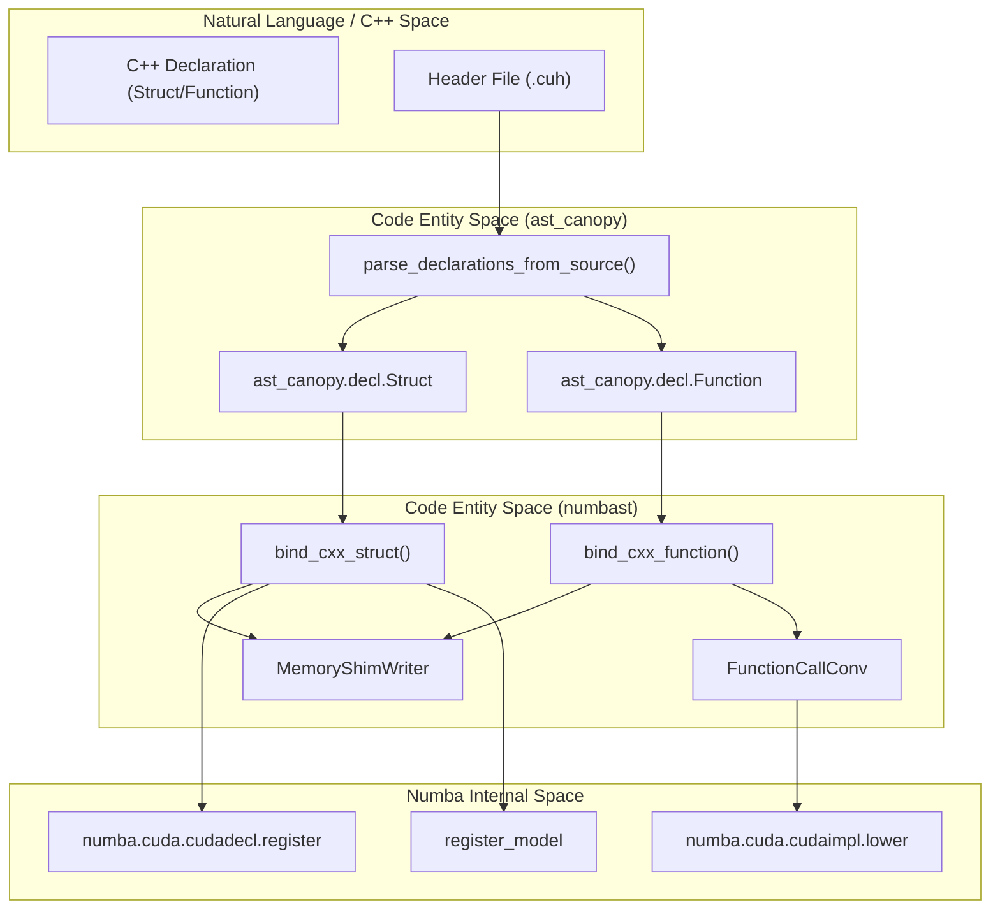
**Sources:** [numbast/src/numbast/struct.py:63-128](), [numbast/src/numbast/function.py:125-155](), [docs/source/dynamic.rst:48-78]()

---

## Struct Binding Lifecycle

Binding a C++ struct via `bind_cxx_struct` involves a multi-stage lifecycle that configures how Numba perceives and interacts with the C++ type [numbast/src/numbast/struct.py:63-69]().

### 1. Type Creation and Data Model
Numbast creates a Python class representing the C++ struct and associates it with a Numba `Type`. The `register_model` function links this type to a `DataModel` (usually `StructModel` or `PrimitiveModel`), defining the memory layout in LLVM [numbast/src/numbast/struct.py:11-20]().

*   **Field Mapping:** `StructModel` layouts support POD fields, including fixed-size arrays, multidimensional arrays, and nested POD structs [docs/source/supported_declarations.rst:15-17]().
*   **Alignment:** Numbast honors C++ alignment attributes (e.g., `__attribute__((aligned(N)))`) during model registration [docs/source/dynamic.rst:29-30]().

### 2. Constructors (Ctors)
`bind_cxx_struct_ctor` generates a shim that uses C++ placement `new` to initialize the object [numbast/src/numbast/struct.py:36-42]().
*   **Lowering:** A `@lower` decorator is used to map the Python constructor call to a `FunctionCallConv` that invokes the shim [numbast/src/numbast/struct.py:120-128]().
*   **Converting Constructors:** If a constructor is marked as a converting constructor in the AST, Numbast also registers a `lower_cast` for implicit type conversion [numbast/src/numbast/struct.py:130-145]().

### 3. Methods and Attributes
*   **Regular Methods:** Instance methods are bound by passing a `self` pointer to a generated shim [numbast/src/numbast/struct.py:44-50]().
*   **Attributes:** Public fields are exposed for read access via `make_attribute_wrapper` [numbast/src/numbast/struct.py:14-15](), [docs/source/supported_declarations.rst:11-12]().

### 4. Name Overrides and Sanitization
When binding template specializations, the parsed name (e.g., `Vec`) may be insufficient. The `name=` parameter allows providing a fully qualified C++ name (e.g., `demo::Vec<float, 3>`) [numbast/tests/test_bind_cxx_struct_name_override.py:4-11]().
Since these names contain characters invalid in C symbols (like `<` or `:`), `_sanitize_c_identifier` replaces them with underscores for shim function names [numbast/src/numbast/struct.py:53-61]().

**Sources:** [numbast/src/numbast/struct.py:36-61](), [numbast/src/numbast/struct.py:150-190](), [docs/source/supported_declarations.rst:6-17]()

---

## Function Binding and Dispatch

Functions are bound using `bind_cxx_function`, which handles both free functions and operator overloads [numbast/src/numbast/function.py:45-50]().

### Function Dispatch Registry
Numbast maintains internal registries to manage overloads and Python-side function objects:
*   `overload_registry`: Maps function names to lists of Numba `Signature` objects [numbast/src/numbast/function.py:41]().
*   `func_obj_registry`: Maps function names to the Python-callable objects used in JIT kernels [numbast/src/numbast/function.py:42]().

### Operator Overload Mapping
C++ operators are automatically mapped to their Python equivalents (e.g., `operator+` becomes `operator.add`) [numbast/src/numbast/function.py:78-80]().

| C++ Operator | Python Operator | Numba Registry |
| :--- | :--- | :--- |
| `operator+` | `operator.add` | `@lower(py_op, ...)` |
| `operator-` | `operator.sub` | `@lower(py_op, ...)` |
| `operator*` | `operator.mul` | `@lower(py_op, ...)` |

**Sources:** [numbast/src/numbast/function.py:41-43](), [numbast/src/numbast/function.py:78-121]()

---

## Implementation Detail: Shim Generation

Every bound entity requires a C-linkage shim to bridge the Numba (LLVM) environment and the C++ ABI.

**Shim Execution Flow**
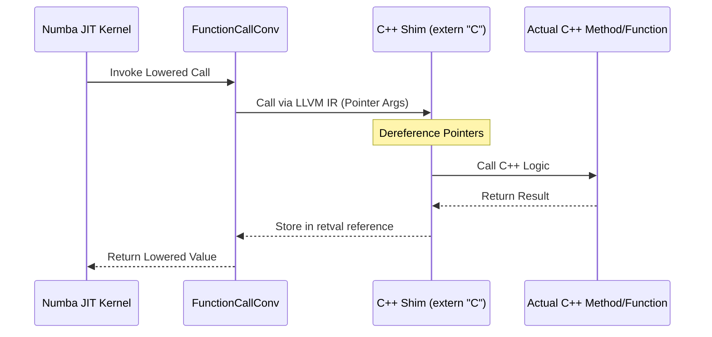
**Sources:** [numbast/src/numbast/function.py:25-31](), [numbast/src/numbast/struct.py:101-118](), [numbast/src/numbast/callconv.py:23]()

### Argument Intent Handling
`bind_cxx_non_operator_function` utilizes the `IntentPlan` system to determine how reference parameters are treated. By default, references are treated as input values, but they can be configured via `arg_intent` to be exposed as `CPointer` types or promoted to Python return values [numbast/src/numbast/function.py:168-200]().

**Sources:** [numbast/src/numbast/function.py:125-200](), [numbast/src/numbast/intent.py:26-27]()

---

# Page: Template Binding: Class and Function Templates

# Template Binding: Class and Function Templates

<details>
<summary>Relevant source files</summary>

The following files were used as context for generating this wiki page:

- [ast_canopy/ast_canopy/instantiations.py](ast_canopy/ast_canopy/instantiations.py)
- [ast_canopy/tests/test_class_template_specialization.py](ast_canopy/tests/test_class_template_specialization.py)
- [docs/source/argument_intents.rst](docs/source/argument_intents.rst)
- [docs/source/template.rst](docs/source/template.rst)
- [numbast/src/numbast/class_template.py](numbast/src/numbast/class_template.py)
- [numbast/src/numbast/deduction.py](numbast/src/numbast/deduction.py)
- [numbast/src/numbast/function_template.py](numbast/src/numbast/function_template.py)
- [numbast/src/numbast/overload_selection.py](numbast/src/numbast/overload_selection.py)
- [numbast/tests/data/sample_class_template.cuh](numbast/tests/data/sample_class_template.cuh)
- [numbast/tests/data/sample_function_template.cuh](numbast/tests/data/sample_function_template.cuh)
- [numbast/tests/test_class_template.py](numbast/tests/test_class_template.py)
- [numbast/tests/test_deduction.py](numbast/tests/test_deduction.py)
- [numbast/tests/test_function_template.py](numbast/tests/test_function_template.py)

</details>


This page explains how Numbast handles C++ class and function templates. Unlike non-templated entities, templates are bound using a two-tier system: **MetaTypes** (representing the unspecialized template) and **ConcreteTypes** (representing specific instantiations). Specializations are generated on-the-fly by invoking `ast_canopy` parsing during the Numba typing phase.

## MetaType vs. ConcreteType

Numbast distinguishes between the template definition and its concrete instantiations to integrate with Numba's type system.

| Concept | Implementation | Role |
|:---|:---|:---|
| **MetaType** | `MetaType` [numbast/src/numbast/class_template.py:86-90]() | A Numba type representing the unspecialized C++ class template. It acts as a factory. |
| **MetaFunctionType** | `MetaFunctionType` [numbast/src/numbast/class_template.py:92-96]() | A Numba type representing an unspecialized C++ function template. |
| **ConcreteType** | Numba `TypeRef` [numbast/src/numbast/class_template.py:73]() | A specific instantiation (e.g., `Foo<int, 32>`). These are cached and registered as standard Numba types. |

### System Data Flow: Template Specialization
The following diagram illustrates how a Python call to a template results in a concrete C++ specialization.

**Diagram: Template Specialization Flow**
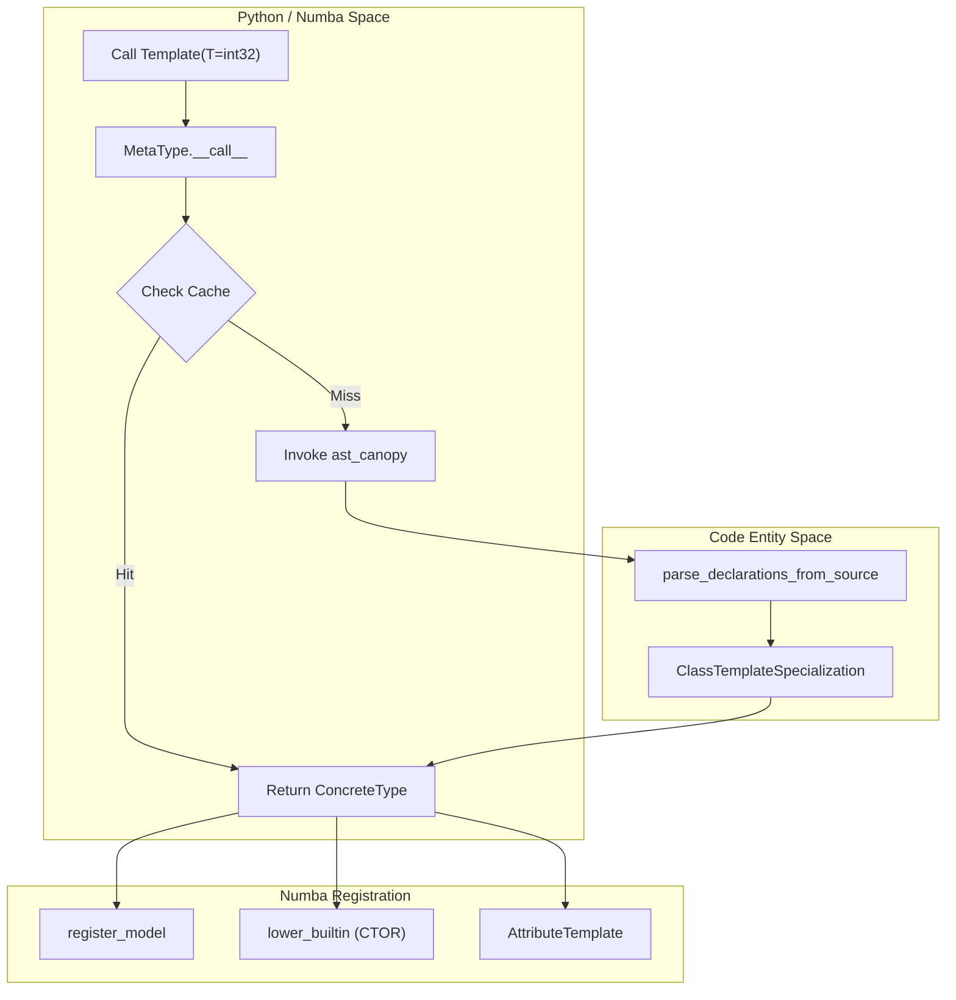
Sources: [numbast/src/numbast/class_template.py:40-46](), [numbast/src/numbast/class_template.py:73-74](), [numbast/src/numbast/class_template.py:86-96]()

## Class Template Binding

Class templates are bound via `bind_cxx_class_templates`. When a class template is invoked in a `@cuda.jit` kernel, Numbast performs the following steps:

1.  **Template Argument Resolution**: It combines explicit keyword arguments (e.g., `Foo(T=np.int32)`) with arguments deduced from constructor parameters [docs/source/template.rst:63-74]().
2.  **Specialization**: If the specific combination of template arguments hasn't been seen, Numbast triggers `ast_canopy` to parse a temporary C++ snippet containing the specialization (e.g., `template class Foo<int, 128>;`) [ast_canopy/ast_canopy/instantiations.py:98-121]().
3.  **Caching**: The resulting `ClassTemplateSpecialization` is stored in `ConcreteTypeDeclCache`, and the Numba type is stored in `ConcreteTypeCache` [numbast/src/numbast/class_template.py:73-74]().
4.  **Member Binding**: Methods and fields of the concrete specialization are bound using the standard `bind_cxx_struct` logic, but specialized for the resolved types [numbast/src/numbast/class_template.py:166-184]().

### ConcreteTypeCache
To avoid redundant parsing and LLVM IR generation, Numbast maintains global caches for specialized types.
*   `ConcreteTypeCache`: Maps specialization parameters to Numba `TypeRef` [numbast/src/numbast/class_template.py:73]().
*   `ConcreteTypeDeclCache`: Maps specialization parameters to `ast_canopy` declaration objects [numbast/src/numbast/class_template.py:74]().
*   `clear_concrete_type_caches()`: Utility to reset these caches between test runs or sessions [numbast/src/numbast/class_template.py:80-83]().

Sources: [numbast/src/numbast/class_template.py:73-83](), [numbast/src/numbast/class_template.py:166-215](), [docs/source/template.rst:7-36]()

## Function Template Binding and Deduction

Function templates are bound using `bind_cxx_function_template`. They rely heavily on **Template Argument Deduction (TAD)** to select the correct overload and specialize types based on the Numba types of the call arguments.

### Overload Selection Logic
The function `_select_templated_overload` performs the initial filtering [numbast/src/numbast/overload_selection.py:13-34]():
1.  **Arity Matching**: It calculates the "visible arity" of each C++ overload, accounting for `ArgIntent` (e.g., `out_return` parameters are hidden from the Python signature) [numbast/src/numbast/overload_selection.py:39-53]().
2.  **Deduction**: It attempts to deduce template parameters for each candidate using `deduce_templated_overloads` [numbast/src/numbast/deduction.py:105-110]().
3.  **Ambiguity Check**: If multiple overloads match the arity and deduction succeeds for more than one, a `TypeError` is raised [numbast/src/numbast/overload_selection.py:68-72]().

### Template Argument Deduction (TAD) Implementation
The deduction engine in `numbast.deduction` mimics C++ TAD:
*   **Pattern Matching**: `_deduce_from_type_pattern` uses regex to match concrete Numba types against C++ template patterns (e.g., matching `float*` against `T*` deduces `T=float`) [numbast/src/numbast/deduction.py:91-122]().
*   **Consistency**: If a placeholder (like `T`) appears multiple times in a signature, all occurrences must deduce to the same type [numbast/src/numbast/deduction.py:155-157]().
*   **Substitution**: Once deduced, placeholders are replaced in the C++ function signature to create a specialized `Function` declaration [numbast/src/numbast/deduction.py:161-205]().

**Diagram: Deduction and Shim Generation**
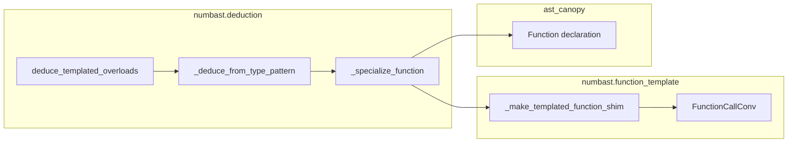
Sources: [numbast/src/numbast/deduction.py:91-158](), [numbast/src/numbast/overload_selection.py:13-74](), [numbast/src/numbast/function_template.py:190-210]()

## Templated Methods

Methods within a class template can themselves be templated. Numbast handles this "nested" templating by:
1.  Resolving the class template specialization first.
2.  Treating the templated method as a function template bound to the specialized class instance.
3.  Resolving per-method `arg_intent` overrides during the method call [numbast/src/numbast/class_template.py:216-221]().

### Shim Generation for Templated Entities
Because the exact signature of a template specialization isn't known until runtime, shims for templated functions and methods are generated dynamically as strings and passed to the `ShimWriter`.

*   `_make_templated_function_shim`: Generates the `extern "C"` bridge function [numbast/src/numbast/function_template.py:71-102]().
*   `_make_templated_function_shim_arg_strings`: Handles complex C++ types like array references (`T (&arg)[N]`) during shim generation [numbast/src/numbast/function_template.py:107-187]().

Sources: [numbast/src/numbast/class_template.py:216-240](), [numbast/src/numbast/function_template.py:71-187]()

---

# Page: Type System: C++ to Numba Type Mapping

# Type System: C++ to Numba Type Mapping

<details>
<summary>Relevant source files</summary>

The following files were used as context for generating this wiki page:

- [numbast/src/numbast/enum.py](numbast/src/numbast/enum.py)
- [numbast/src/numbast/functor.py](numbast/src/numbast/functor.py)
- [numbast/src/numbast/static/enum.py](numbast/src/numbast/static/enum.py)
- [numbast/src/numbast/static/tests/data/enum.cuh](numbast/src/numbast/static/tests/data/enum.cuh)
- [numbast/src/numbast/static/types.py](numbast/src/numbast/static/types.py)
- [numbast/src/numbast/types.py](numbast/src/numbast/types.py)
- [numbast/src/numbast/utils.py](numbast/src/numbast/utils.py)
- [numbast/tests/data/sample_enum.cuh](numbast/tests/data/sample_enum.cuh)
- [numbast/tests/test_callconv.py](numbast/tests/test_callconv.py)
- [numbast/tests/test_cuda_vector_types.py](numbast/tests/test_cuda_vector_types.py)
- [numbast/tests/test_register_cxx_type.py](numbast/tests/test_register_cxx_type.py)

</details>


This page documents the internal registries and logic used by Numbast to translate C++ types (parsed by `ast_canopy`) into Numba types. This system handles primitive mapping, CUDA vector types, alignment management, and the conversion of C++ enums into Python `IntEnum` objects.

## Core Type Registries

Numbast maintains several global registries in `numbast.types` to facilitate bidirectional mapping between C++ type strings and Numba type objects.

| Registry | Description | File Pointer |
| :--- | :--- | :--- |
| `INTEGER_TYPE_MAPS` | Maps C standard and `stdint.h` types to Numba integer types. | [numbast/src/numbast/types.py:25-46]() |
| `FLOATING_TYPE_MAPS` | Maps `float`, `double`, `__half`, and `__nv_bfloat16`. | [numbast/src/numbast/types.py:48-53]() |
| `CUDA_VECTOR_TYPE_MAPS` | Maps CUDA vector types (e.g., `float4`) to `numba.cuda.vector_types`. | [numbast/src/numbast/types.py:78-85]() |
| `CTYPE_MAPS` | The primary runtime registry used by `to_numba_type`. | [numbast/src/numbast/types.py:87-87]() |
| `NUMBA_TO_CTYPE_MAPS` | Reverse mapping from Numba types to C++ strings for shim generation. | [numbast/src/numbast/types.py:92-110]() |

### CUDA Vector Types and Alignment
CUDA vector types have specific alignment requirements (e.g., `float4` requires 16-byte alignment). Numbast stores these in `CUDA_VECTOR_TYPE_MAPS` as a tuple of `(numba_type, alignment)`.

*   **Mapping Logic**: Types like `int2` are mapped to `int32x2` [numbast/src/numbast/types.py:70-71]().
*   **Alignment Specifications**: The alignment is defined in `CUDA_VECTOR_TYPE_SPECS` [numbast/src/numbast/types.py:65-76]().

**Sources:** [numbast/src/numbast/types.py:25-110](), [numbast/tests/test_cuda_vector_types.py:18-59]()

## Type Conversion Functions

The system provides two primary pathways for type resolution: dynamic resolution (using Numba type objects) and static resolution (using string representations).

### Dynamic Resolution (`numbast.types`)
*   **`to_numba_type(cxx_name)`**: Resolves a C++ string to a Numba type. If the type is not found in `CTYPE_MAPS`, it falls back to a Numba `Opaque` type [numbast/src/numbast/types.py:241-260]().
*   **`to_numba_arg_type(ast_type)`**: Takes an `ast_canopy` Type object and resolves its `unqualified_non_ref_type_name` [numbast/src/numbast/types.py:263-264]().

### Static Resolution (`numbast.static.types`)
Used during static binding generation to produce valid Python source code.
*   **`to_numba_type_str(ty)`**: Converts a C++ type string to a string representing a Numba type (e.g., `"int32"`, `"CPointer(float64)"`). It also triggers import tracking in `BaseRenderer` [numbast/src/numbast/static/types.py:66-121]().
*   **Array Handling**: Fixed-size arrays (e.g., `int[4]`) are recursively mapped to Numba `UniTuple` strings [numbast/src/numbast/static/types.py:106-113]().

**Sources:** [numbast/src/numbast/types.py:241-264](), [numbast/src/numbast/static/types.py:66-138]()

## Alignment Management

Numbast tracks C++ alignment requirements that may exceed the standard ABI alignment of the corresponding Numba type.

### Implementation Flow: Alignment Tracking
The following diagram illustrates how alignment is registered and retrieved for use in LLVM IR generation.

```mermaid
graph TD
    subgraph "Natural Language Space"
        A["'float4' Alignment Requirement"]
    end

    subgraph "Code Entity Space"
        B["register_cxx_type()"]
        C["CTYPE_ALIGNOF_MAPS"]
        D["NUMBA_TYPE_ALIGNOF_MAPS"]
        E["_get_alloca_alignment()"]
        F["LLVM IR 'alloca ... align N'"]
    end

    A --> B
    B --> C
    B --> D
    D --> E
    E --> F
```

*   **`register_cxx_type`**: Allows manual registration of types with explicit `alignof` values. It validates that the alignment is a positive power of two [numbast/src/numbast/types.py:122-188]().
*   **`_get_alloca_alignment`**: Used in `FunctionCallConv` to determine the alignment for stack allocations. It checks for a registered alignment in `NUMBA_TYPE_ALIGNOF_MAPS` before falling back to `context.get_abi_alignment` [numbast/tests/test_callconv.py:53-89]().

**Sources:** [numbast/src/numbast/types.py:122-188](), [numbast/tests/test_callconv.py:53-100](), [numbast/tests/test_register_cxx_type.py:66-112]()

## Enum Type Registry

C++ Enums are mapped to Python `IntEnum` classes. The mapping must be registered so that function signatures using the enum can resolve the type correctly.

### Dynamic Mode
The `bind_cxx_enum` function creates a Python `IntEnum` on the fly and calls `register_enum_type` to update the global `CTYPE_MAPS` [numbast/src/numbast/enum.py:10-22]().

### Static Mode
The `StaticEnumRenderer` generates the `IntEnum` class definition and calls `register_enum_type_str` [numbast/src/numbast/static/enum.py:54-85](). This ensures that the generated static module includes a mapping from the C++ enum name to the newly created Python enum identifier [numbast/src/numbast/static/types.py:32-56]().

**Sources:** [numbast/src/numbast/enum.py:10-46](), [numbast/src/numbast/static/enum.py:20-85](), [numbast/src/numbast/static/types.py:32-56]()

## Specialized Types

### FunctorType
Numbast supports passing Python functions as C++ functors via `FunctorType`.
*   **`Functor` Class**: Wraps a Python function and a signature. It provides a `shim()` method to generate the C++ struct with an `operator()` that invokes the Python function [numbast/src/numbast/functor.py:23-58]().
*   **Lowering**: The `constant_functortype` function lowers the functor to an `int64` ID in the LLVM IR [numbast/src/numbast/functor.py:78-81]().

### Opaque Fallback
When `to_numba_type` encounters a C++ type name it does not recognize, it creates a Numba `Opaque` type [numbast/src/numbast/types.py:255-260](). This allows Numbast to handle pointers to unknown structures without requiring full parsing of those structures, provided they are only handled as pointers in Python.

**Sources:** [numbast/src/numbast/functor.py:11-81](), [numbast/src/numbast/types.py:255-260]()

## Type Mapping Data Flow

The following diagram traces how a C++ type string from a header becomes a Numba-compatible type in both dynamic and static modes.

```mermaid
graph LR
    subgraph "ast_canopy Parsing"
        A["C++ Header"] --> B["pylibastcanopy.Type"]
    end

    subgraph "numbast Dynamic Binding"
        B --> C["to_numba_type()"]
        C --> D["CTYPE_MAPS"]
        D --> E["Numba Type Object"]
    end

    subgraph "numbast Static Binding"
        B --> F["to_numba_type_str()"]
        F --> G["CTYPE_TO_NBTYPE_STR"]
        G --> H["Python Source String"]
    end
```

**Sources:** [numbast/src/numbast/types.py:241-260](), [numbast/src/numbast/static/types.py:66-121]()

---

# Page: Shim Writer and Call Convention

# Shim Writer and Call Convention

<details>
<summary>Relevant source files</summary>

The following files were used as context for generating this wiki page:

- [numbast/src/numbast/args.py](numbast/src/numbast/args.py)
- [numbast/src/numbast/callconv.py](numbast/src/numbast/callconv.py)
- [numbast/src/numbast/intent.py](numbast/src/numbast/intent.py)
- [numbast/src/numbast/shim_writer.py](numbast/src/numbast/shim_writer.py)
- [numbast/src/numbast/static/callconv.py](numbast/src/numbast/static/callconv.py)
- [numbast/src/numbast/static/tests/data/src/function_out.cu](numbast/src/numbast/static/tests/data/src/function_out.cu)
- [numbast/src/numbast/static/tests/test_function_static_bindings.py](numbast/src/numbast/static/tests/test_function_static_bindings.py)
- [numbast/tests/test_shim_writer.py](numbast/tests/test_shim_writer.py)
- [numbast_extensions/numbast_extensions/bf16/torch_interop.py](numbast_extensions/numbast_extensions/bf16/torch_interop.py)

</details>


The shim writing and call convention subsystem handles the bridge between Numba's LLVM IR generation and the physical C++ code that must be compiled and linked. It provides an abstraction for accumulating C++ shim source code, deduplicating it, and generating the necessary LLVM IR `alloca`, `store`, and `call` instructions to invoke these shims with correct alignment and argument intent.

## Shim Writer Abstraction

The `ShimWriterBase` [numbast/src/numbast/shim_writer.py:12-32]() defines the interface for managing generated C++ shims and PTX blobs. Its primary responsibility is to collect code fragments during the Numba lowering phase and provide them to the Numba linker.

### Implementation Classes

| Class | Role | Storage Mechanism |
| :--- | :--- | :--- |
| `FileShimWriter` | Writes shims to temporary `.cu` and `.ptx` files. [numbast/src/numbast/shim_writer.py:54-59]() | Uses `NamedTemporaryFile`. Shims are appended to one file, while each PTX gets its own file. [numbast/src/numbast/shim_writer.py:64-82]() |
| `MemoryShimWriter` | Keeps shims in memory as Numba source objects. [numbast/src/numbast/shim_writer.py:107-112]() | Stores strings in lists and yields `cuda.CUSource` or `cuda.PTXSource` objects. [numbast/src/numbast/shim_writer.py:117-151]() |

### Data Flow: Shim Accumulation
The following diagram illustrates how shims are registered and eventually consumed by the Numba JIT.

**Shim Writing and Linking Flow**
```mermaid
graph TD
    subgraph "Lowering Phase"
        A["CallConv._lower()"] -- "write_to_shim(code, id)" --> B["ShimWriter"]
        C["Functor Lowering"] -- "write_to_ptx_shim(ptx, id)" --> B
    end

    subgraph "ShimWriter State"
        B -- "Deduplication" --> D["shim_written (dict)"]
        B -- "Deduplication" --> E["ptx_written (dict)"]
    end

    subgraph "Linking Phase"
        F["cuda.jit(link=...)"] -- "invokes" --> G["ShimWriter.links()"]
        G -- "yields" --> H["File Paths or Source Objects"]
    end
```
**Sources:** [numbast/src/numbast/shim_writer.py:12-151](), [numbast/src/numbast/callconv.py:56-61]()

## Call Convention Pipeline

The call convention system is responsible for generating the LLVM IR that bridges Numba types to the C++ ABI expected by the shim functions. This is primarily handled by `BaseCallConv` and its specialization `FunctionCallConv`.

### BaseCallConv
The `BaseCallConv` [numbast/src/numbast/callconv.py:39-54]() provides the template for shim function naming (defaulting to `{mangled_name}_nbst`) and implements the `_lazy_write_shim` mechanism. This ensures that the C++ shim code is only sent to the `ShimWriter` at the moment the function is actually lowered into LLVM IR [numbast/src/numbast/callconv.py:56-61]().

### FunctionCallConv and LLVM Generation
`FunctionCallConv` [numbast/src/numbast/callconv.py:70-100]() performs the heavy lifting of IR generation. It manages:

1.  **Return Slot Allocation**: If the C++ function returns a value (non-void), a stack slot (`alloca`) is created with proper alignment [numbast/src/numbast/callconv.py:134-139]().
2.  **Argument Preparation**: It uses `prepare_ir_types` to determine if arguments should be passed by value or by pointer [numbast/src/numbast/callconv.py:142-150]().
3.  **Intent Handling**: Integrates with `IntentPlan` to handle `out_return` parameters, which are moved from the Python argument list into the return value tuple [numbast/src/numbast/callconv.py:151-170]().
4.  **Alignment**: Uses `_set_alloca_alignment` to ensure stack slots respect C++ type requirements by comparing ABI alignment with Numba-specific alignment metadata [numbast/src/numbast/callconv.py:22-36]().

**Sources:** [numbast/src/numbast/callconv.py:70-170](), [numbast/src/numbast/args.py:9-51]()

## IntentPlan Integration

The `IntentPlan` dictates how parameters are treated during the call. It is computed by `compute_intent_plan` [numbast/src/numbast/intent.py:63-69]() based on C++ parameter types and user-provided overrides.

### Argument Intent Mapping
| Intent (`ArgIntent`) | Visible in Python? | Passed to Shim as |
| :--- | :--- | :--- |
| `in_` | Yes | Value or Pointer |
| `inout_ptr` | Yes | Pointer |
| `out_ptr` | Yes | Pointer |
| `out_return` | No (moved to return) | Pointer to stack slot |

**Sources:** [numbast/src/numbast/intent.py:139-166](), [numbast/src/numbast/callconv.py:151-170]()

## Static Binding Generation

For static bindings, the call convention logic must be "snapshotted" into the generated Python module because the runtime cannot depend on the full `numbast` package.

### Code Extraction and Rendering
The `numbast.static.callconv` module uses `inspect.getsource` to extract specific blocks of code from the live library and inject them into the static output [numbast/src/numbast/static/callconv.py:10-46]().

*   **Marker System**: Sections are delimited by `# NBST:BEGIN_CALLCONV` and `# NBST:END_CALLCONV` [numbast/src/numbast/callconv.py:8-15]().
*   **Alignment Maps**: Since `numbast.types` is not available in static mode, `_render_numba_type_alignof_src` snapshots the `NUMBA_TYPE_ALIGNOF_MAPS` dictionary into a static dictionary in the generated source [numbast/src/numbast/static/callconv.py:49-68]().

**Entity Relationship: Call Convention and Shims**
```mermaid
classDiagram
    class ShimWriterBase {
        <<abstract>>
        +write_to_shim(content, id)
        +write_to_ptx_shim(ptx, id)
        +links()
    }
    class BaseCallConv {
        +shim_writer: ShimWriterBase
        +itanium_mangled_name: str
        +shim_code: str
        +_lazy_write_shim()
    }
    class FunctionCallConv {
        +intent_plan: IntentPlan
        +out_return_types: list
        +_lower_impl(builder, context, sig, args)
    }
    class IntentPlan {
        +visible_param_indices: tuple
        +out_return_indices: tuple
        +pass_ptr_mask: tuple
    }

    BaseCallConv <|-- FunctionCallConv
    BaseCallConv o-- ShimWriterBase
    FunctionCallConv o-- IntentPlan
    FunctionCallConv ..> "numbast.args.prepare_ir_types" : calls
```
**Sources:** [numbast/src/numbast/callconv.py:39-101](), [numbast/src/numbast/shim_writer.py:12-32](), [numbast/src/numbast/intent.py:162-166]()

---

# Page: Argument Intents

# Argument Intents

<details>
<summary>Relevant source files</summary>

The following files were used as context for generating this wiki page:

- [docs/source/argument_intents.rst](docs/source/argument_intents.rst)
- [docs/source/template.rst](docs/source/template.rst)
- [numbast/src/numbast/class_template.py](numbast/src/numbast/class_template.py)
- [numbast/src/numbast/function_template.py](numbast/src/numbast/function_template.py)
- [numbast/src/numbast/intent.py](numbast/src/numbast/intent.py)
- [numbast/src/numbast/static/tests/data/src/function_out.cu](numbast/src/numbast/static/tests/data/src/function_out.cu)

</details>


The Argument Intent system in Numbast provides a mechanism to control how C++ function and method parameters are projected into Python. By default, C++ parameters are exposed as "in" arguments. However, many C++ APIs use reference parameters (`T&`) for output or in-place modification. The intent system allows developers to specify whether these parameters should remain in the signature as pointers, or be promoted to Python return values.

## Intent Semantics

Numbast defines four primary intents through the `ArgIntent` enumeration.

| Intent | Behavior | Numba Type Mapping | Python Signature Impact |
| :--- | :--- | :--- | :--- |
| `in` | Default mode. Parameter is passed by value or reference. | Base type `T` | Stays in signature. |
| `inout_ptr` | C++ mutates the referenced state. | `CPointer(T)` | Stays in signature. |
| `out_ptr` | Explicit output buffer owned by caller. | `CPointer(T)` | Stays in signature. |
| `out_return` | Numbast manages storage and returns value. | `T` (internal storage) | **Removed** from signature. |

Sources: [numbast/src/numbast/intent_defs.py:11-23](), [docs/source/argument_intents.rst:42-73]()

### The `out_return` Promotion
When a parameter is marked as `out_return`, Numbast modifies the function's call convention:
1.  The parameter is removed from the visible Python arguments [numbast/src/numbast/intent.py:150-155]().
2.  In the generated LLVM IR/Shim, temporary storage is allocated for the parameter [docs/source/argument_intents.rst:71-71]().
3.  The C++ function is called with a reference to this temporary storage.
4.  The value in the temporary storage is then returned to Python.

If the C++ function already has a non-`void` return type, Numbast packs the original return value and all `out_return` values into a `types.Tuple` [docs/source/argument_intents.rst:109-114]().

## Intent Plan Computation

The `IntentPlan` is a structured record that describes how a specific function call should be handled based on its C++ declaration and any provided overrides.

### The `compute_intent_plan` Function
The core logic for resolving intents resides in `compute_intent_plan`. It processes parameter lists and applies overrides using the following precedence:
1.  **Defaults**: All parameters start as `ArgIntent.in_` [numbast/src/numbast/intent.py:97-97]().
2.  **Index-based Overrides**: Applied using 0-based integer keys [numbast/src/numbast/intent.py:107-112]().
3.  **Name-based Overrides**: Applied using parameter name strings; these take precedence over index-based overrides [numbast/src/numbast/intent.py:121-136]().

### Validation Rules
-   `inout_ptr`, `out_ptr`, and `out_return` are **only** valid for C++ reference types (`T&` or `T&&`) [numbast/src/numbast/intent.py:145-149]().
-   The number of overrides cannot exceed the number of parameters.
-   `out_return` can be explicitly disallowed in certain contexts (e.g., specific shim writers) via the `allow_out_return` flag [numbast/src/numbast/intent.py:68-68]().

### Intent Plan Data Flow
The following diagram illustrates how `compute_intent_plan` transforms C++ declarations and user configuration into an executable plan.

**Diagram: Intent Resolution Pipeline**
```mermaid
graph TD
    subgraph "Natural Language Space (YAML/Python Config)"
        A["YAML: 'state: inout_ptr'"]
        B["Python: {0: 'out_return'}"]
    end

    subgraph "Code Entity Space (numbast.intent)"
        C["params: list[pylibastcanopy.Parameter]"]
        D["param_types: list[pylibastcanopy.Type]"]
        E["compute_intent_plan()"]
        F["_is_ref_type() check"]
        G["IntentPlan Object"]
    end

    A --> E
    B --> E
    C --> E
    D --> E
    E --> F
    F -- "Validation" --> G
    
    G --> H["visible_param_indices"]
    G --> I["out_return_indices"]
    G --> J["pass_ptr_mask"]
```
Sources: [numbast/src/numbast/intent.py:63-91](), [numbast/src/numbast/intent_defs.py:26-34]()

## Implementation in Binding Layers

The intent system is integrated into both the dynamic and static binding engines.

### Dynamic Binding Integration
In `bind_cxx_function_template`, the `arg_intent` dictionary is passed during the typing phase. The `AbstractTemplate` uses the plan to filter the arguments seen by Numba.

1.  **Typing**: `_select_templated_overload` uses the `visible_param_indices` from the `IntentPlan` to match Python arguments to C++ parameters [numbast/src/numbast/function_template.py:245-255]().
2.  **Lowering**: The `FunctionCallConv` utilizes the `pass_ptr_mask` to determine which LLVM values need to be passed by address [numbast/src/numbast/function_template.py:270-280]().

### Static Binding Configuration
In static mode, intents are defined in the YAML configuration file under the `Function Argument Intents` section.

```yaml
Function Argument Intents:
  # Keyed by function name
  stats_update_and_get_zscore:
    # Keyed by parameter name
    state: inout_ptr
    # Keyed by index
    2: out_return
```
Sources: [docs/source/argument_intents.rst:30-41](), [numbast/src/numbast/intent.py:100-119]()

## Relationship between Intents and Shim Generation

The `ShimWriter` and `FunctionCallConv` classes rely on the `IntentPlan` to generate the correct C++ bridge code.

**Diagram: Intent-Driven Code Generation**
```mermaid
graph TD
    subgraph "Code Entity Space"
        IP["IntentPlan"]
        SW["ShimWriterBase"]
        FCC["FunctionCallConv"]
        
        subgraph "numbast.function_template"
            MTS["_make_templated_function_shim_arg_strings()"]
        end
    end

    IP -- "pass_ptr_mask" --> MTS
    IP -- "out_return_indices" --> FCC
    MTS -- "formal_args_str" --> SW
    FCC -- "builder.alloca()" --> IR["LLVM IR Output"]
```
Sources: [numbast/src/numbast/function_template.py:107-130](), [numbast/src/numbast/callconv.py:22-40]()

### Parameter String Building
The function `_make_templated_function_shim_arg_strings` inspects the `pass_ptr_mask`. If a parameter is marked as a pointer intent (`inout_ptr` or `out_ptr`), it generates a shim signature that expects a pointer (e.g., `T* arg0`) and dereferences it in the call (e.g., `func(*arg0)`) [numbast/src/numbast/function_template.py:140-152]().

Sources:
- `numbast/src/numbast/intent.py`
- `numbast/src/numbast/intent_defs.py`
- `numbast/src/numbast/function_template.py`
- `docs/source/argument_intents.rst`
- `numbast/src/numbast/callconv.py`

---

# Page: Static Binding Generator

# Static Binding Generator

<details>
<summary>Relevant source files</summary>

The following files were used as context for generating this wiki page:

- [docs/source/generated/static_binding_schema_reference.rst](docs/source/generated/static_binding_schema_reference.rst)
- [docs/source/index.rst](docs/source/index.rst)
- [docs/source/numba_cuda_mlir.rst](docs/source/numba_cuda_mlir.rst)
- [docs/source/static.rst](docs/source/static.rst)
- [numbast/src/numbast/static/function.py](numbast/src/numbast/static/function.py)
- [numbast/src/numbast/static/renderer.py](numbast/src/numbast/static/renderer.py)
- [numbast/src/numbast/static/struct.py](numbast/src/numbast/static/struct.py)
- [numbast/src/numbast/static/tests/conftest.py](numbast/src/numbast/static/tests/conftest.py)
- [numbast/src/numbast/tools/static_binding_generator.py](numbast/src/numbast/tools/static_binding_generator.py)
- [numbast/src/numbast/tools/static_binding_generator.schema.yaml](numbast/src/numbast/tools/static_binding_generator.schema.yaml)

</details>


The Static Binding Generator is a workflow designed to produce standalone Python modules from CUDA C++ headers. Unlike dynamic binding, which requires `numbast` and `clang` at runtime to parse headers, the static generator performs parsing and code generation once. The resulting Python module depends only on Numba, making it suitable for distribution as a regular Python package.

### High-Level Workflow

The generator follows a pipeline that starts with a YAML configuration and ends with a formatted Python source file:

1.  **Configuration Loading**: The `numbast` CLI reads a YAML file and validates it against a schema using the `Config` class [numbast/src/numbast/tools/static_binding_generator.py:107-134]().
2.  **AST Parsing**: `ast_canopy` is invoked to parse the header files specified in the configuration, retaining only declarations from the allowed file list [numbast/src/numbast/tools/static_binding_generator.py:321-344]().
3.  **Code Rendering**: Specialized renderer classes (e.g., `StaticStructsRenderer`, `StaticFunctionsRenderer`) iterate over the parsed declarations to generate Numba type definitions, shims, and lowering implementations [numbast/src/numbast/tools/static_binding_generator.py:37-43]().
4.  **Module Assembly**: The generated snippets are assembled into a final template, including imports, shim streams, and reproducible metadata [numbast/src/numbast/static/renderer.py:200-221]().

### Static Generation Architecture

The diagram below illustrates the relationship between the configuration entities and the internal code classes responsible for processing them.

**Configuration to Code Entity Mapping**
```mermaid
graph TD
    subgraph "Natural Language / Config Space"
        YAML["YAML Config File"]
        CLI["numbast CLI"]
    end

    subgraph "Code Entity Space"
        ConfigClass["Config (numbast.tools.static_binding_generator)"]
        GenFunc["_static_binding_generator"]
        StructRen["StaticStructsRenderer"]
        FuncRen["StaticFunctionsRenderer"]
        BaseRen["BaseRenderer"]
    end

    YAML -- "Parsed by" --> ConfigClass
    CLI -- "Invokes" --> GenFunc
    GenFunc -- "Uses" --> ConfigClass
    GenFunc -- "Orchestrates" --> StructRen
    GenFunc -- "Orchestrates" --> FuncRen
    StructRen -- "Inherits" --> BaseRen
    FuncRen -- "Inherits" --> BaseRen
```
Sources: [numbast/src/numbast/tools/static_binding_generator.py:107-150](), [numbast/src/numbast/tools/static_binding_generator.py:314-360](), [numbast/src/numbast/static/renderer.py:16-101]()

---

## Subsystems and Child Pages

### CLI Tool and Configuration Schema
The primary interface for static generation is the `numbast` command-line tool. It relies on a comprehensive YAML schema that defines how headers are searched, which symbols are excluded, and how API prefixes should be stripped. The `Config` class validates these inputs and handles complex logic like `API Prefix Removal` and `Function Argument Intents`.

For details, see [CLI Tool and Configuration Schema](#4.1).

### Rendering Pipeline: Structs, Functions, and Templates
The rendering pipeline transforms `ast_canopy` declarations into Python source code. It uses a hierarchy of renderer classes derived from `BaseRenderer`. These renderers manage:
*   **Shim Generation**: Producing C++ shims for constructors and functions [numbast/src/numbast/static/struct.py:166-180]().
*   **Lowering Logic**: Generating `@lower` and `@lower_cast` decorators for Numba's compiler [numbast/src/numbast/static/struct.py:181-203]().
*   **Import Tracking**: Automatically identifying and adding necessary Python imports (e.g., `numba.cuda.types`) based on the C++ types encountered [numbast/src/numbast/static/renderer.py:117-143]().

For details, see [Rendering Pipeline: Structs, Functions, and Templates](#4.2).

### Static Type Mapping and Code Generation
Static generation requires a mapping from C++ types to their string representations in Python. This is handled by a specialized type system that differs from the dynamic mode. It uses `CTYPE_TO_NBTYPE_STR` and `to_numba_type_str` to ensure that the generated code refers to valid Numba type identifiers.

For details, see [Static Type Mapping and Code Generation](#4.3).

---

### Binding Generation Data Flow

This diagram shows how data moves from the initial C++ header through the various rendering components to the final output file.

**Data Flow: Header to Standalone Module**
```mermaid
graph LR
    subgraph "Input"
        Header["C++ Header (.hpp)"]
        YAML["config.yaml"]
    end

    subgraph "Processing (Code Entity Space)"
        Canopy["ast_canopy.parse_declarations_from_source"]
        Renderer["_static_binding_generator"]
        ShimStream["_KeyedStringIO (numbast.static.renderer)"]
    end

    subgraph "Output"
        PythonModule["Generated Python Module (.py)"]
    end

    Header --> Canopy
    YAML --> Renderer
    Canopy -- "Declarations" --> Renderer
    Renderer -- "C++ Shims" --> ShimStream
    ShimStream -- "Embedded as String" --> PythonModule
    Renderer -- "Numba Lowering Code" --> PythonModule
```
Sources: [numbast/src/numbast/tools/static_binding_generator.py:314-360](), [numbast/src/numbast/static/renderer.py:29-44](), [numbast/src/numbast/static/renderer.py:200-221]()

### Key Classes and Functions

| Entity | Role | File |
| :--- | :--- | :--- |
| `Config` | Validates YAML configuration and stores generation parameters. | [numbast/src/numbast/tools/static_binding_generator.py:107-134]() |
| `_static_binding_generator` | Main orchestration function that runs the parsing and rendering loop. | [numbast/src/numbast/tools/static_binding_generator.py:314-360]() |
| `BaseRenderer` | Base class for all renderers; manages shared imports and shim assembly. | [numbast/src/numbast/static/renderer.py:16-101]() |
| `StaticStructsRenderer` | Renders Numba `Record` types and their associated methods/constructors. | [numbast/src/numbast/static/struct.py:441-443]() |
| `StaticFunctionRenderer` | Renders function signatures and their lowering to C++ shims. | [numbast/src/numbast/static/function.py:63-75]() |
| `_KeyedStringIO` | A specialized string buffer that prevents duplicate shim code insertion. | [numbast/src/numbast/static/renderer.py:29-44]() |

Sources: [numbast/src/numbast/tools/static_binding_generator.py:107-360](), [numbast/src/numbast/static/renderer.py:16-101](), [numbast/src/numbast/static/struct.py:441-443](), [numbast/src/numbast/static/function.py:63-75]()

---

# Page: CLI Tool and Configuration Schema

# CLI Tool and Configuration Schema

<details>
<summary>Relevant source files</summary>

The following files were used as context for generating this wiki page:

- [.gitignore](.gitignore)
- [ast_canopy/ast_canopy/shim_include/crt/math_functions.hpp](ast_canopy/ast_canopy/shim_include/crt/math_functions.hpp)
- [docs/source/_ext/static_binding_schema_doc.py](docs/source/_ext/static_binding_schema_doc.py)
- [docs/source/conf.py](docs/source/conf.py)
- [docs/source/generated/static_binding_schema_reference.rst](docs/source/generated/static_binding_schema_reference.rst)
- [docs/source/index.rst](docs/source/index.rst)
- [docs/source/numba_cuda_mlir.rst](docs/source/numba_cuda_mlir.rst)
- [docs/source/static.rst](docs/source/static.rst)
- [numbast/src/numbast/static/function.py](numbast/src/numbast/static/function.py)
- [numbast/src/numbast/static/renderer.py](numbast/src/numbast/static/renderer.py)
- [numbast/src/numbast/static/struct.py](numbast/src/numbast/static/struct.py)
- [numbast/src/numbast/static/tests/conftest.py](numbast/src/numbast/static/tests/conftest.py)
- [numbast/src/numbast/tools/__init__.py](numbast/src/numbast/tools/__init__.py)
- [numbast/src/numbast/tools/static_binding_generator.py](numbast/src/numbast/tools/static_binding_generator.py)
- [numbast/src/numbast/tools/static_binding_generator.schema.yaml](numbast/src/numbast/tools/static_binding_generator.schema.yaml)
- [numbast/src/numbast/tools/tests/config/cc.yml.j2](numbast/src/numbast/tools/tests/config/cc.yml.j2)
- [numbast/src/numbast/tools/tests/config/cooperative_launch.yml.j2](numbast/src/numbast/tools/tests/config/cooperative_launch.yml.j2)
- [numbast/src/numbast/tools/tests/config/cooperative_launch_invalid_regex.yml.j2](numbast/src/numbast/tools/tests/config/cooperative_launch_invalid_regex.yml.j2)
- [numbast/src/numbast/tools/tests/config/cooperative_launch_regex.yml.j2](numbast/src/numbast/tools/tests/config/cooperative_launch_regex.yml.j2)
- [numbast/src/numbast/tools/tests/config/module_callbacks.yml.j2](numbast/src/numbast/tools/tests/config/module_callbacks.yml.j2)
- [numbast/src/numbast/tools/tests/config/output_name.yml.j2](numbast/src/numbast/tools/tests/config/output_name.yml.j2)
- [numbast/src/numbast/tools/tests/config/prefix_removal.yml.j2](numbast/src/numbast/tools/tests/config/prefix_removal.yml.j2)
- [numbast/src/numbast/tools/tests/conftest.py](numbast/src/numbast/tools/tests/conftest.py)
- [numbast/src/numbast/tools/tests/module_callbacks.cuh](numbast/src/numbast/tools/tests/module_callbacks.cuh)
- [numbast/src/numbast/tools/tests/prefix_removal.cuh](numbast/src/numbast/tools/tests/prefix_removal.cuh)
- [numbast/src/numbast/tools/tests/test_cli.py](numbast/src/numbast/tools/tests/test_cli.py)
- [numbast/src/numbast/tools/tests/test_config_schema_docs.py](numbast/src/numbast/tools/tests/test_config_schema_docs.py)
- [numbast/src/numbast/tools/tests/test_module_callbacks.py](numbast/src/numbast/tools/tests/test_module_callbacks.py)
- [numbast/src/numbast/tools/tests/test_output_name.py](numbast/src/numbast/tools/tests/test_output_name.py)
- [numbast/src/numbast/tools/tests/test_prefix_removal.py](numbast/src/numbast/tools/tests/test_prefix_removal.py)
- [numbast/src/numbast/tools/tests/test_use_cooperative.py](numbast/src/numbast/tools/tests/test_use_cooperative.py)
- [numbast/src/numbast/tools/tests/use_cooperative.cuh](numbast/src/numbast/tools/tests/use_cooperative.cuh)
- [numbast/src/numbast/tools/yaml_tags.py](numbast/src/numbast/tools/yaml_tags.py)
- [numbast/tests/test_enum_arg.py](numbast/tests/test_enum_arg.py)
- [numbast_extensions/tests/thirdparty/CCCL/conftest.py](numbast_extensions/tests/thirdparty/CCCL/conftest.py)
- [numbast_extensions/tests/thirdparty/CCCL/test_block_load_store.py](numbast_extensions/tests/thirdparty/CCCL/test_block_load_store.py)
- [numbast_extensions/tests/thirdparty/CCCL/test_block_scan.py](numbast_extensions/tests/thirdparty/CCCL/test_block_scan.py)

</details>


The Numbast static binding generator provides a Command Line Interface (CLI) and a structured YAML configuration system to automate the creation of standalone Python modules from CUDA C++ headers. This mechanism allows developers to distribute bindings that depend only on Numba CUDA, removing the requirement for `clangdev` or `numbast` in the end-user's environment [docs/source/static.rst:4-5]().

## CLI Tool: `numbast`

The CLI tool is the primary entry point for static binding generation. It can be invoked via `python -m numbast` or the `numbast` command [docs/source/static.rst:73-73]().

### Command Line Arguments
The CLI is implemented using the `click` library in `numbast/src/numbast/tools/static_binding_generator.py`. Key arguments include:
*   `--cfg-path`: Path to the YAML configuration file [numbast/src/numbast/tools/static_binding_generator.py:440-440]().
*   `--output-dir`: Directory where the generated `.py` files will be saved [numbast/src/numbast/tools/static_binding_generator.py:445-445]().
*   `--fmt`: Boolean flag to trigger code formatting (via `ruff`) on the output [numbast/src/numbast/tools/static_binding_generator.py:455-455]().
*   `--entry-point`: (Optional) Overrides the entry point defined in the YAML [numbast/src/numbast/tools/static_binding_generator.py:421-421]().

### Execution Flow
The `static_binding_generator` function orchestrates the parsing and rendering process:
1.  **Configuration Loading**: Reads the YAML and initializes a `Config` object [numbast/src/numbast/tools/static_binding_generator.py:476-483]().
2.  **AST Parsing**: Calls `ast_canopy.parse_declarations_from_source` using the entry point and include paths from the config [numbast/src/numbast/tools/static_binding_generator.py:348-356]().
3.  **Filtering**: Filters declarations based on the `File List` (retain list) and `Exclude` rules [numbast/src/numbast/tools/static_binding_generator.py:365-374]().
4.  **Rendering**: Iterates through structs, functions, and templates, using specialized renderers (e.g., `StaticStructsRenderer`, `StaticFunctionsRenderer`) to generate Python source code [numbast/src/numbast/tools/static_binding_generator.py:382-414]().

### CLI System Overview
"Natural Language Space" to "Code Entity Space" mapping for the CLI execution.

```mermaid
graph TD
    subgraph "CLI Entry Point"
        A["numbast CLI command"] --> B["static_binding_generator()"]
    end

    subgraph "Configuration Management"
        B --> C["Config.from_yaml_path()"]
        C --> D["Config class"]
        D -- "Validates" --> E["static_binding_generator.schema.yaml"]
    end

    subgraph "Parsing & Rendering"
        B --> F["_static_binding_generator()"]
        F --> G["parse_declarations_from_source()"]
        F --> H["StaticFunctionsRenderer"]
        F --> I["StaticStructsRenderer"]
        F --> J["StaticClassTemplatesRenderer"]
    end

    subgraph "Output"
        H & I & J --> K["Generated .py Module"]
    end
```
Sources: [numbast/src/numbast/tools/static_binding_generator.py:339-418](), [numbast/src/numbast/tools/static_binding_generator.py:466-516]()

## Configuration Schema

The configuration is defined in a YAML schema file [numbast/src/numbast/tools/static_binding_generator.schema.yaml](). This schema acts as the authoritative contract for the generator [numbast/src/numbast/tools/static_binding_generator.py:110-112]().

### Required Fields
| Key | Type | Description |
| :--- | :--- | :--- |
| `Entry Point` | `string` | The primary CUDA C++ header file to parse [docs/source/generated/static_binding_schema_reference.rst:7-8](). |
| `GPU Arch` | `array[str]` | Target architecture (e.g., `["sm_80"]`). Currently, only one is supported per run [numbast/src/numbast/tools/static_binding_generator.py:207-210](). |
| `File List` | `array[str]` | List of files to retain declarations from. Others are ignored [docs/source/generated/static_binding_schema_reference.rst:34-36](). |

### Key Configuration Logic
The `Config` class [numbast/src/numbast/tools/static_binding_generator.py:107-107]() handles the mapping of YAML keys to internal logic:

*   **API Prefix Removal**: Removes specific prefixes from C++ names when rendering Python handles. It supports different lists for `Function`, `Struct`, and `Enum` [numbast/src/numbast/tools/static_binding_generator.py:186-193]().
*   **Function Argument Intents**: Maps function names to parameter-specific intent overrides (e.g., `in`, `out_ptr`). This influences how `compute_intent_plan` generates the final Numba signature [numbast/src/numbast/static/function.py:197-202]().
*   **MLIR Backend**: If `MLIR Backend: true` is set, the generator switches to the experimental MLIR-specific pipeline [numbast/src/numbast/tools/static_binding_generator.py:148-149]().
*   **Separate Registry**: When `Use Separate Registry: true`, the generated code creates local `TypingRegistry` and `TargetRegistry` instances instead of modifying Numba's global CUDA registry [numbast/src/numbast/static/renderer.py:17-27]().

### Data Flow: Config to Renderer
"Natural Language Space" to "Code Entity Space" mapping for configuration data flow.

```mermaid
graph LR
    YAML["config.yaml"] -- "Loaded by" --> CFG["Config Object"]
    
    subgraph "Internal State (Config Class)"
        CFG -- "entry_point" --> EP["Entry Point"]
        CFG -- "gpu_arch" --> GA["GPU Arch"]
        CFG -- "api_prefix_removal" --> APR["API Prefix Removal"]
        CFG -- "function_argument_intents" --> FAI["Function Argument Intents"]
    end

    EP --> CANOPY["ast_canopy.parse"]
    GA --> CANOPY
    
    APR -- "Used by" --> UTIL["_apply_prefix_removal()"]
    FAI -- "Used by" --> INTENT["compute_intent_plan()"]
    
    UTIL --> RENDER["StaticFunctionRenderer"]
    INTENT --> RENDER
```
Sources: [numbast/src/numbast/tools/static_binding_generator.py:135-214](), [numbast/src/numbast/static/function.py:173-202](), [numbast/src/numbast/utils.py:113-125]()

## Validation and Error Handling

The `Config` class performs several validation steps during initialization:
1.  **MLIR Constraints**: Ensures that MLIR-only options like `Module Link Variables Used` are only present if `MLIR Backend` is enabled [numbast/src/numbast/tools/static_binding_generator.py:80-98]().
2.  **Path Verification**: The `_verify_exists()` method checks that the `Entry Point` and all files in the `File List` exist on the filesystem [numbast/src/numbast/tools/static_binding_generator.py:217-226]().
3.  **Regex Validation**: Validates patterns in `Cooperative Launch Required Functions Regex` to prevent runtime failures during rendering [numbast/src/numbast/tools/static_binding_generator.py:228-237]().
4.  **Mangled Name Conflict**: The `StaticFunctionRenderer` maintains a `function_mangled_name_registry` to ensure no two functions generate the same shim name, which would cause C++ compilation errors [numbast/src/numbast/static/function.py:164-166]().

Sources: [numbast/src/numbast/tools/static_binding_generator.py:80-237](), [numbast/src/numbast/static/function.py:164-166]()

---

# Page: Rendering Pipeline: Structs, Functions, and Templates

# Rendering Pipeline: Structs, Functions, and Templates

<details>
<summary>Relevant source files</summary>

The following files were used as context for generating this wiki page:

- [ast_canopy/tests/test_command_invocation.py](ast_canopy/tests/test_command_invocation.py)
- [numbast/src/numbast/args.py](numbast/src/numbast/args.py)
- [numbast/src/numbast/callconv.py](numbast/src/numbast/callconv.py)
- [numbast/src/numbast/static/__init__.py](numbast/src/numbast/static/__init__.py)
- [numbast/src/numbast/static/callconv.py](numbast/src/numbast/static/callconv.py)
- [numbast/src/numbast/static/class_template.py](numbast/src/numbast/static/class_template.py)
- [numbast/src/numbast/static/function.py](numbast/src/numbast/static/function.py)
- [numbast/src/numbast/static/function_template.py](numbast/src/numbast/static/function_template.py)
- [numbast/src/numbast/static/renderer.py](numbast/src/numbast/static/renderer.py)
- [numbast/src/numbast/static/struct.py](numbast/src/numbast/static/struct.py)
- [numbast/src/numbast/static/tests/conftest.py](numbast/src/numbast/static/tests/conftest.py)
- [numbast/src/numbast/static/tests/data/bf16.cuh](numbast/src/numbast/static/tests/data/bf16.cuh)
- [numbast/src/numbast/static/tests/data/class_template_static.cuh](numbast/src/numbast/static/tests/data/class_template_static.cuh)
- [numbast/src/numbast/static/tests/data/function_template_static.cuh](numbast/src/numbast/static/tests/data/function_template_static.cuh)
- [numbast/src/numbast/static/tests/test_bf16_support.py](numbast/src/numbast/static/tests/test_bf16_support.py)
- [numbast/src/numbast/static/tests/test_class_template_static_bindings.py](numbast/src/numbast/static/tests/test_class_template_static_bindings.py)
- [numbast/src/numbast/static/tests/test_enum_static_bindings.py](numbast/src/numbast/static/tests/test_enum_static_bindings.py)
- [numbast/src/numbast/static/tests/test_function_static_bindings.py](numbast/src/numbast/static/tests/test_function_static_bindings.py)
- [numbast/src/numbast/static/tests/test_function_template_static_bindings.py](numbast/src/numbast/static/tests/test_function_template_static_bindings.py)
- [numbast/src/numbast/static/tests/test_link_two_files.py](numbast/src/numbast/static/tests/test_link_two_files.py)
- [numbast/src/numbast/static/tests/test_operator_bindings.py](numbast/src/numbast/static/tests/test_operator_bindings.py)
- [numbast/src/numbast/static/tests/test_optional_template_runtime_imports.py](numbast/src/numbast/static/tests/test_optional_template_runtime_imports.py)
- [numbast/src/numbast/static/tests/test_static_demo.py](numbast/src/numbast/static/tests/test_static_demo.py)
- [numbast/src/numbast/static/tests/test_struct_static_bindings.py](numbast/src/numbast/static/tests/test_struct_static_bindings.py)
- [numbast/src/numbast/static/typedef.py](numbast/src/numbast/static/typedef.py)
- [numbast/src/numbast/tools/static_binding_generator.py](numbast/src/numbast/tools/static_binding_generator.py)
- [numbast/tests/data/sample_function.cuh](numbast/tests/data/sample_function.cuh)

</details>


The static rendering pipeline is responsible for transforming C++ declarations parsed by `ast_canopy` into standalone Python source code. Unlike dynamic binding, which generates types in memory at runtime, the static pipeline produces a `.py` file containing Numba `typing` and `lowering` logic, embedded C++ shims, and serialized template metadata.

### Core Rendering Architecture

The pipeline is built on a hierarchy of renderer classes that manage the conversion of specific C++ entities (Structs, Functions, Templates) into Python strings.

#### BaseRenderer and KeyedStringIO
The `BaseRenderer` class serves as the foundation for all static code generation. It maintains class-level state for tracking required Python imports, C++ header includes, and exposed symbols to ensure the final module is self-contained and free of duplicates [numbast/src/numbast/static/renderer.py:16-101]().

A critical component of the generated code is the `_KeyedStringIO` class. This custom stream ensures that C++ shim fragments are written to the module's `shim_stream` exactly once, even if multiple Numba kernels or functions reference the same shim [numbast/src/numbast/static/renderer.py:29-44]().

#### Data Flow: From Declarations to Module
The `_static_binding_generator` orchestrates the flow of data through these renderers [numbast/src/numbast/tools/static_binding_generator.py:13-43]().

1.  **Parsing**: `ast_canopy` provides a `Declarations` object.
2.  **Renderer Initialization**: Renderers like `StaticStructsRenderer` and `StaticFunctionsRenderer` are instantiated with these declarations and configuration parameters (e.g., `gpu_arch`, `function_argument_intents`).
3.  **String Assembly**: Each renderer produces Python code blocks for typing, lowering, and shims.
4.  **Template Injection**: The results are injected into a final Python module template.

**Static Rendering Data Flow**
```mermaid
graph TD
    subgraph "Input Space"
        A["ast_canopy.Declarations"]
        B["numbast.tools.static_binding_generator.Config"]
    end

    subgraph "Renderer Space"
        C["StaticStructsRenderer"]
        D["StaticFunctionsRenderer"]
        E["StaticClassTemplatesRenderer"]
        F["StaticFunctionTemplatesRenderer"]
    end

    subgraph "Code Entity Space"
        G["numbast.static.renderer.BaseRenderer"]
        H["_KeyedStringIO"]
        I["numbast.callconv.FunctionCallConv"]
    end

    A --> C & D & E & F
    B --> C & D & E & F
    C & D & E & F -- "Inherits" --> G
    C & D -- "Emits Lowering using" --> I
    I -- "Writes to" --> H
    H -- "Aggregates into" --> J["Final .py Module"]
```
Sources: [numbast/src/numbast/static/renderer.py:16-44](), [numbast/src/numbast/static/struct.py:42-165](), [numbast/src/numbast/static/function.py:63-149](), [numbast/src/numbast/tools/static_binding_generator.py:107-214]().

---

### Struct and Function Rendering

#### StaticStructRenderer
The `StaticStructsRenderer` handles C++ structs by generating Numba `Type` and `DataModel` definitions. For each constructor and method, it utilizes sub-renderers like `StaticStructCtorRenderer` [numbast/src/numbast/static/struct.py:52-111]().

*   **Shim Generation**: Constructors are wrapped in `extern "C" __device__` functions that use placement `new` to initialize the struct [numbast/src/numbast/static/struct.py:67-73]().
*   **Lowering**: The renderer produces `@lower` decorators that utilize `FunctionCallConv` to bridge the Numba IR to the generated C++ shim [numbast/src/numbast/static/struct.py:75-86]().

#### StaticFunctionsRenderer
Functions are rendered with support for complex argument intents. The `StaticFunctionRenderer` uses `compute_intent_plan` to determine which parameters should be treated as `out_return` values, which are then stripped from the Python signature and added to the return tuple [numbast/src/numbast/static/function.py:143-202]().

**Function Rendering Components**
| Component | Implementation | Role |
| :--- | :--- | :--- |
| **Python API** | `function_python_api_template` | Defines the empty Python function used as a dispatch handle [numbast/src/numbast/static/function.py:133-136](). |
| **C++ Shim** | `c_ext_shim_template` | Wraps the original C++ function for ABI compatibility [numbast/src/numbast/static/function.py:79-85](). |
| **Lowering** | `lowering_template` | Registers the implementation with Numba's target registry [numbast/src/numbast/static/function.py:105-119](). |
| **Intent Plan** | `compute_intent_plan` | Maps C++ arguments to Python-visible arguments and returns [numbast/src/numbast/static/function.py:197-202](). |

Sources: [numbast/src/numbast/static/struct.py:52-165](), [numbast/src/numbast/static/function.py:63-202]().

---

### Template Binding and Serialization

Because C++ templates (Class and Function) require specialization at runtime, the static generator cannot pre-render every possible instantiation. Instead, it serializes the `ast_canopy` declaration objects into the generated module.

#### Serialization Pipeline
1.  **Pickling**: `StaticClassTemplatesRenderer` and `StaticFunctionTemplatesRenderer` take the list of template declarations and pickle them using the `HIGHEST_PROTOCOL` [numbast/src/numbast/static/class_template.py:157-161]().
2.  **Encoding**: The pickled bytes are Base64-encoded into a string literal within the generated Python file [numbast/src/numbast/static/class_template.py:163-168]().
3.  **Hydration**: At runtime, the generated module calls `bind_static_class_templates` or `bind_static_function_templates`, which decodes and unpickles the declarations to perform dynamic specialization [numbast/src/numbast/static/class_template.py:37-88](), [numbast/src/numbast/static/function_template.py:38-88]().

**Template Hydration Logic**
```mermaid
sequenceDiagram
    participant GM as Generated Module (.py)
    participant BH as numbast.static.class_template.bind_static_class_templates
    participant AC as ast_canopy (Internal)
    
    GM->>BH: Call with encoded_class_templates (Base64 String)
    BH->>BH: _decode_pickled_class_templates()
    BH->>AC: bind_cxx_class_templates(parsed_templates)
    AC-->>BH: Returns specialized MetaTypes
    BH->>GM: Inject handles into namespace[globals()]
```
Sources: [numbast/src/numbast/static/class_template.py:37-103](), [numbast/src/numbast/static/function_template.py:38-104]().

---

### Shim Stream Assembly and Call Convention

The static pipeline ensures that the generated module is "standalone" regarding Numba's interaction with C++.

#### Shim Stream Assembly
The generator assembles a `shim_prefix` containing necessary `#include` directives and predefined macros [numbast/src/numbast/static/renderer.py:46-53](). This prefix is combined with the `shim_stream` (an instance of `_KeyedStringIO`) to create a `CUSource` object [numbast/src/numbast/static/renderer.py:52]().

#### Calling Convention (FunctionCallConv)
The `FunctionCallConv` class is the primary engine for generating LLVM IR during Numba's lowering phase. It handles:
1.  **Alloca Alignment**: Ensuring stack slots for arguments and return values respect C++ ABI requirements via `_set_alloca_alignment` [numbast/src/numbast/callconv.py:33-36]().
2.  **Argument Passing**: Converting Numba types to LLVM IR and deciding whether to pass by value or reference based on the `intent_plan` [numbast/src/numbast/callconv.py:141-160]().
3.  **Return Value Promotion**: Capturing C++ return values and `out_return` parameters into a Python tuple [numbast/src/numbast/callconv.py:102-120]().

To maintain the "standalone" nature of static bindings, the generator extracts the source code for `FunctionCallConv` and its dependencies from the `numbast` package and embeds it directly into the generated module's `CALLCONV_SRC` block [numbast/src/numbast/static/callconv.py:71-79]().

Sources: [numbast/src/numbast/static/renderer.py:46-64](), [numbast/src/numbast/callconv.py:39-120](), [numbast/src/numbast/static/callconv.py:71-79]().

---

# Page: Static Type Mapping and Code Generation

# Static Type Mapping and Code Generation

<details>
<summary>Relevant source files</summary>

The following files were used as context for generating this wiki page:

- [numbast/src/numbast/static/types.py](numbast/src/numbast/static/types.py)
- [numbast/src/numbast/tools/tests/test_symbol_exposure.py](numbast/src/numbast/tools/tests/test_symbol_exposure.py)
- [numbast/src/numbast/types.py](numbast/src/numbast/types.py)
- [pixi.lock](pixi.lock)
- [pixi.toml](pixi.toml)

</details>


The static binding generator in Numbast relies on a specialized type mapping system that translates C++ types into Python string representations of Numba types. Unlike the dynamic mode which works with live Numba type objects, the static mode generates source code, requiring a mechanism to track necessary imports and produce valid Python expressions for type annotations.

## The Static Type Registry

The static type system is built around `CTYPE_TO_NBTYPE_STR`, a mapping of C++ type names to their Numba type string equivalents. This registry is initialized by copying the dynamic `CTYPE_MAPS` and converting the values to strings [numbast/src/numbast/static/types.py:11-18]().

### Core Mapping Functions

| Function | Purpose |
| :--- | :--- |
| `to_numba_type_str(ty)` | Maps a C++ type string (including pointers and arrays) to a Numba type string and registers required imports [numbast/src/numbast/static/types.py:66-121](). |
| `to_numba_arg_type_str(ast_type)` | Converts an `ast_canopy` Type object into a Numba string, specifically for function arguments [numbast/src/numbast/static/types.py:124-137](). |
| `register_enum_type_str(...)` | Adds a C++ enum to the static registry, mapping it to an `IntEnumMember` string [numbast/src/numbast/static/types.py:32-56](). |
| `reset_types()` | Clears the current registry and restores it to the default built-in mappings [numbast/src/numbast/static/types.py:59-63](). |

### Type Mapping Logic Flow
The following diagram illustrates how a C++ type string is transformed into a Numba type expression during code generation.

**C++ to Numba String Transformation**
```mermaid
graph TD
    A["Input C++ Type String"] --> B{"Is __nv_bfloat16?"}
    B -- "Yes" --> C["Return 'bfloat16' & Register Import"]
    B -- "No" --> D{"Ends with '*'?"}
    D -- "Yes" --> E["Recurse Base Type + 'CPointer(...)'"]
    D -- "No" --> F{"Is Fixed-Size Array?"}
    F -- "Yes" --> G["Map to 'UniTuple(..., N)'"]
    F -- "No" --> H{"Lookup in CTYPE_TO_NBTYPE_STR"}
    H -- "Found" --> I["Return String & Register Import"]
    H -- "Missing" --> J["Raise TypeNotFoundError"]
```
**Sources:** [numbast/src/numbast/static/types.py:66-121](), [numbast/src/numbast/types.py:16-17]()

## Import Injection and BaseRenderer Coupling

The static type system is tightly coupled with `BaseRenderer`. When `to_numba_type_str` encounters a type like `CPointer` or `UniTuple`, it calls `BaseRenderer._try_import_numba_type` [numbast/src/numbast/static/types.py:83, 93, 112]().

This mechanism ensures that the final generated Python file contains the necessary imports from `numba.cuda` or `numba.types` to support the types used in the function signatures and struct definitions.

### Type Registration and Scoping
```mermaid
graph LR
    subgraph "Type Registry Space"
        REG["CTYPE_TO_NBTYPE_STR"]
        DEF["_DEFAULT_CTYPE_TO_NBTYPE_STR_MAP"]
    end

    subgraph "Code Generation Space"
        TR["to_numba_type_str()"]
        BR["BaseRenderer"]
    end

    DEF -- "Initialize" --> REG
    TR -- "Lookup" --> REG
    TR -- "Inject Imports" --> BR
    REG -- "Update via" --> RE["register_enum_type_str()"]
```
**Sources:** [numbast/src/numbast/static/types.py:11-19](), [numbast/src/numbast/static/types.py:32-56](), [numbast/src/numbast/static/types.py:120]()

## Complex Type Handling

### Pointers and Arrays
Static type mapping recursively handles C++ pointers and multi-dimensional arrays:
*   **Pointers:** `T*` becomes `CPointer(to_numba_type_str(T))` [numbast/src/numbast/static/types.py:90-94]().
*   **Arrays:** `T[M][N]` is parsed into nested `UniTuple` expressions. For example, `float[4]` becomes `UniTuple(float32, 4)` [numbast/src/numbast/static/types.py:106-113]().

### Enumerations
C++ enums are mapped to Numba's `IntEnumMember`. The `register_enum_type_str` function allows users to specify the Python-side enum class name and the underlying integer width (defaulting to `int64`) [numbast/src/numbast/static/types.py:32-56]().

### Valid Enum Underlying Types
The system validates that the underlying integer type for an enum is one of the supported Numba integer strings:
*   `int8`, `int16`, `int32`, `int64`
*   `uint8`, `uint16`, `uint32`, `uint64`
[numbast/src/numbast/static/types.py:20-29]()

## Lifecycle Management: reset_types()

Because the static generator might be used to generate multiple modules within the same process (e.g., during testing or complex build pipelines), the `reset_types()` function is provided [numbast/src/numbast/static/types.py:59-63](). This function:
1.  Clears the global `CTYPE_TO_NBTYPE_STR` dictionary.
2.  Repopulates it with the default mappings (primitive types, CUDA vectors, etc.).

This ensures that type registrations from one generation session do not "leak" into subsequent sessions.

**Sources:**
*   [numbast/src/numbast/static/types.py:1-138]()
*   [numbast/src/numbast/types.py:16-46]()
*   [numbast/src/numbast/types.py:78-85]()

---

# Page: Experimental MLIR Backend

# Experimental MLIR Backend

<details>
<summary>Relevant source files</summary>

The following files were used as context for generating this wiki page:

- [numbast/src/numbast/experimental/mlir/function.py](numbast/src/numbast/experimental/mlir/function.py)
- [numbast/src/numbast/experimental/mlir/function_template.py](numbast/src/numbast/experimental/mlir/function_template.py)
- [numbast/src/numbast/experimental/mlir/static/function.py](numbast/src/numbast/experimental/mlir/static/function.py)
- [numbast/src/numbast/experimental/mlir/struct.py](numbast/src/numbast/experimental/mlir/struct.py)
- [numbast/src/numbast/experimental/mlir/tools/static_binding_generator.py](numbast/src/numbast/experimental/mlir/tools/static_binding_generator.py)
- [numbast/src/numbast/experimental/mlir/tools/tests/test_config_loading.py](numbast/src/numbast/experimental/mlir/tools/tests/test_config_loading.py)
- [numbast/src/numbast/experimental/mlir/utils.py](numbast/src/numbast/experimental/mlir/utils.py)
- [numbast/src/numbast/tools/tests/test_mlir_backend_routing.py](numbast/src/numbast/tools/tests/test_mlir_backend_routing.py)

</details>


The Experimental MLIR Backend is a specialized binding infrastructure within `numbast` designed to work with the `numba-cuda-mlir` ecosystem. While the default backend targets standard Numba-CUDA, this backend utilizes a distinct set of registries and a specific shim pipeline to enable C++ interop for MLIR-based CUDA kernels.

It is housed primarily within the `numbast.experimental.mlir` namespace and supports both dynamic (runtime) and static (code-generated) binding modes.

### Architecture Overview

The MLIR backend mirrors the standard `numbast` pipeline but replaces the Numba-CUDA core components with `numba-cuda-mlir` equivalents. This includes using a specific `typing_registry` and `lowering_registry` [numbast/experimental/mlir/function.py:19-21](), and a specialized `FunctionCallConv` for handling MLIR-specific IR generation [numbast/experimental/mlir/callconv.py]().

#### System Mapping: MLIR Binding Logic
The following diagram maps the high-level MLIR binding concepts to their implementing classes and functions in the codebase.

```mermaid
graph TD
    subgraph "Natural Language Space"
        A["Dynamic MLIR Binding"]
        B["Static MLIR Binding"]
        C["Shim Generation"]
        D["Intent Management"]
    end

    subgraph "Code Entity Space"
        A --> |"Implements"| E["bind_cxx_function"]
        A --> |"Implements"| F["bind_cxx_struct"]
        B --> |"Orchestrates"| G["StaticFunctionsRenderer"]
        B --> |"Orchestrates"| H["StaticStructsRenderer"]
        C --> |"Writes code"| I["ShimWriterBase"]
        C --> |"Templates"| J["make_function_shim"]
        D --> |"Calculates"| K["compute_intent_plan"]
    end

    E["numbast.experimental.mlir.function.bind_cxx_non_operator_function"]
    F["numbast.experimental.mlir.struct.bind_cxx_struct"]
    G["numbast.experimental.mlir.static.function.StaticFunctionsRenderer"]
    H["numbast.experimental.mlir.static.struct.StaticStructsRenderer"]
    I["numbast.experimental.mlir.shim_writer.ShimWriterBase"]
    J["numbast.experimental.mlir.utils.make_function_shim"]
    K["numbast.experimental.mlir.intent.compute_intent_plan"]
```
**Sources:** [numbast/experimental/mlir/function.py:127-134](), [numbast/experimental/mlir/struct.py:271-275](), [numbast/experimental/mlir/static/function.py:73-75](), [numbast/experimental/mlir/utils.py:134-140](), [numbast/experimental/mlir/intent.py:13-15]().

### Key Differences from Default Backend

1.  **Registry Management**: The MLIR backend requires manual registry refreshes via `refresh_numba_cuda_mlir_registries` to make late additions visible to the `numba-cuda-mlir` compiler [numbast/experimental/mlir/utils.py:16-20]().
2.  **Shim Convention**: MLIR shims typically pass the return value by reference as the first argument (`retval`) and return an `int` status code, matching the expectations of the MLIR lowering pipeline [numbast/experimental/mlir/function.py:38-44]().
3.  **Static Configuration**: The static generator is explicitly triggered by setting `MLIR Backend: true` in the YAML configuration [numbast/experimental/mlir/tools/static_binding_generator.py:52-58]().

### Operational Modes

#### MLIR Dynamic Binding
Dynamic binding allows users to wrap C++ functions and structs at runtime. It uses `ast_canopy` to parse headers and immediately registers the resulting symbols into the `numba-cuda-mlir` typing and lowering contexts. This mode is ideal for interactive development and rapid prototyping.

For details, see [MLIR Dynamic Binding](#5.1).

#### MLIR Static Binding Generator
The static generator is a CLI tool that produces standalone Python modules containing all necessary Numba-MLIR registrations and C++ shim code. It supports advanced features like `cooperative_launch_required` detection via regex [numbast/experimental/mlir/tools/static_binding_generator.py:103-106]() and specialized rendering for MLIR types.

For details, see [MLIR Static Binding Generator](#5.2).

### Data Flow: C++ to MLIR-Numba
The diagram below illustrates how a C++ declaration is transformed into an MLIR-compatible Numba lowering.

```mermaid
graph LR
    subgraph "Input"
        "C++ Header" --> "ast_canopy"
    end

    subgraph "Numbast MLIR Pipeline"
        "ast_canopy" --> "IntentPlan"
        "IntentPlan" --> "ShimWriter"
        "ShimWriter" --> "FunctionCallConv"
    end

    subgraph "Numba-MLIR Integration"
        "FunctionCallConv" --> "lowering_registry"
        "lowering_registry" --> "MLIR Kernel"
    end

    "IntentPlan"["compute_intent_plan"]
    "ShimWriter"["MemoryShimWriter"]
    "FunctionCallConv"["FunctionCallConv"]
    "lowering_registry"["numba_cuda_mlir.extending.lowering_registry"]
```
**Sources:** [numbast/experimental/mlir/intent.py:13-15](), [numbast/experimental/mlir/shim_writer.py:55-58](), [numbast/experimental/mlir/callconv.py:18-20](), [numbast/experimental/mlir/function.py:19-21]().

### Configuration
When using the static generator, the `Config` object validates MLIR-specific flags. For instance, the `Module Link Variables Used` attribute is only valid if `mlir_backend` is set to `True` [numbast/experimental/mlir/tools/static_binding_generator.py:147-151]().

**Sources:**
- `numbast/experimental/mlir/tools/static_binding_generator.py`
- `numbast/experimental/mlir/function.py`
- `numbast/experimental/mlir/struct.py`
- `numbast/experimental/mlir/utils.py`
- `numbast/experimental/mlir/callconv.py`
- `numbast/tools/tests/test_mlir_backend_routing.py`

---

# Page: MLIR Dynamic Binding

# MLIR Dynamic Binding

<details>
<summary>Relevant source files</summary>

The following files were used as context for generating this wiki page:

- [numbast/src/numbast/experimental/mlir/class_template.py](numbast/src/numbast/experimental/mlir/class_template.py)
- [numbast/src/numbast/experimental/mlir/function.py](numbast/src/numbast/experimental/mlir/function.py)
- [numbast/src/numbast/experimental/mlir/function_template.py](numbast/src/numbast/experimental/mlir/function_template.py)
- [numbast/src/numbast/experimental/mlir/static/function.py](numbast/src/numbast/experimental/mlir/static/function.py)
- [numbast/src/numbast/experimental/mlir/static/renderer.py](numbast/src/numbast/experimental/mlir/static/renderer.py)
- [numbast/src/numbast/experimental/mlir/static/struct.py](numbast/src/numbast/experimental/mlir/static/struct.py)
- [numbast/src/numbast/experimental/mlir/struct.py](numbast/src/numbast/experimental/mlir/struct.py)
- [numbast/src/numbast/experimental/mlir/utils.py](numbast/src/numbast/experimental/mlir/utils.py)

</details>


The `numbast.experimental.mlir` namespace provides an experimental binding API tailored for the `numba-cuda-mlir` backend. While it shares conceptual similarities with the default Numbast dynamic binding pipeline, it utilizes a distinct set of Numba types, models, and registration registries specifically compatible with the MLIR-based CUDA compiler.

## Overview and Purpose

The MLIR dynamic binding system automates the generation of Numba-compatible wrappers for C++ functions, structs, and templates at runtime. It differs from the standard backend by targeting the `numba_cuda_mlir` type system [numbast/experimental/mlir/struct.py:8-15]() and using a specialized `FunctionCallConv` that handles shim linking via the MLIR builder [numbast/experimental/mlir/static/renderer.py:159-162]().

### Key Differences from Default Backend
*   **Type System**: Uses `numba_cuda_mlir.types` and `numba_cuda_mlir.models` [numbast/experimental/mlir/struct.py:21-22]().
*   **Registries**: Target and typing registrations are performed against `numba_cuda_mlir.extending.typing_registry` and `lowering_registry` [numbast/experimental/mlir/function.py:19-20]().
*   **Shim Linking**: Shims are linked using `_numbast_link_shim`, which interacts with the MLIR builder's external item linking mechanism [numbast/experimental/mlir/static/renderer.py:159-162]().

## Dynamic Binding API

### bind_cxx_function
This function creates a Numba-callable binding for a C++ function. It supports both standard functions and operator overloads.

*   **Non-Operator Functions**: Handled by `bind_cxx_non_operator_function`. It supports `ArgIntent` overrides to control which reference parameters are treated as input, output, or inout [numbast/experimental/mlir/function.py:127-157]().
*   **Operator Overloads**: Handled by `bind_cxx_operator_overload_function`. It maps C++ operators to Python operators (e.g., `operator+` to `operator.add`) [numbast/experimental/mlir/function.py:58-93]().

### bind_cxx_struct
Registers a C++ struct as a Numba type. This involves:
1.  **Type Creation**: Generating a unique Numba type using `make_unique_type_name` [numbast/experimental/mlir/struct.py:46]().
2.  **Data Model**: Registering a `StructModel` or `PrimitiveModel` [numbast/experimental/mlir/struct.py:22]().
3.  **Constructors**: Binding C++ constructors via `bind_cxx_struct_ctors`, which generates shims for placement new [numbast/experimental/mlir/struct.py:158-185]().
4.  **Methods**: Binding member functions using `bind_cxx_struct_methods` [numbast/experimental/mlir/struct.py:255-261]().

### bind_cxx_function_template / bind_cxx_class_template
These functions handle C++ templates by deferring specialization until Numba's typing phase.
*   **Function Templates**: Uses `MetaFunctionType` to represent the unspecialized template [numbast/experimental/mlir/class_template.py:135-141]().
*   **Class Templates**: Uses `MetaType` and a `ConcreteTypeCache` to manage on-the-fly specializations generated via `ast_canopy` [numbast/experimental/mlir/class_template.py:112-132]().

### refresh_numba_cuda_mlir_registries
Late additions to the Numbast registries are not automatically visible to the MLIR backend. This function triggers `refresh_registries` from `numba_cuda_mlir` to synchronize the state [numbast/experimental/mlir/utils.py:16-20]().

**Sources:**
* [numbast/src/numbast/experimental/mlir/function.py:58-157]()
* [numbast/src/numbast/experimental/mlir/struct.py:21-46, 158-261]()
* [numbast/src/numbast/experimental/mlir/class_template.py:112-141]()
* [numbast/src/numbast/experimental/mlir/utils.py:16-20]()

## Data Flow and Architecture

The MLIR dynamic binding pipeline follows a structured flow from C++ declaration to Numba lowering.

### MLIR Binding Data Flow
The diagram below illustrates how a C++ declaration is transformed into a callable Numba entity within the MLIR backend.

Title: MLIR Binding Data Flow
```mermaid
graph TD
    subgraph "Natural Language Space"
        Decl["C++ Function/Struct Declaration"]
        Intent["Argument Intent (in/out/inout)"]
    end

    subgraph "Code Entity Space"
        AC["ast_canopy.decl.Function / Struct"]
        SW["MemoryShimWriter"]
        CC["FunctionCallConv"]
        MLIR_B["MLIR Builder"]
    end

    Decl --> AC
    AC -->|parse| SW
    Intent -->|compute| IP["IntentPlan"]
    
    SW -->|generate| Shim["C++ Shim Source"]
    Shim --> CC
    IP --> CC
    
    CC -->|@lower| Lower["Numba Lowering Function"]
    Lower -->|calls| MLIR_Link["_numbast_link_shim"]
    MLIR_Link --> MLIR_B
```
**Sources:**
* [numbast/src/numbast/experimental/mlir/function.py:183-205]()
* [numbast/src/numbast/experimental/mlir/static/renderer.py:159-162]()
* [numbast/src/numbast/experimental/mlir/callconv.py:1-20]() (referenced via import in function.py)

## Implementation Details

### Shim Generation
The MLIR backend uses specialized templates for generating C++ shims that bridge the gap between Numba's calling convention and C++ mangled functions.

| Template Name | Purpose |
| :--- | :--- |
| `struct_ctor_shim_layer_template` | Wraps placement new for struct constructors [numbast/experimental/mlir/struct.py:54-60](). |
| `struct_method_shim_layer_template` | Wraps member function calls using `self->method_name` [numbast/experimental/mlir/struct.py:62-68](). |
| `function_binding_shim_template` | Wraps standalone C++ functions [numbast/experimental/mlir/function.py:38-44](). |

### Lowering and Linking
Unlike the standard backend, the MLIR lowering must explicitly notify the MLIR builder about the external shim source. This is achieved through the `_numbast_link_shim` utility [numbast/experimental/mlir/static/renderer.py:159-162]().

Title: MLIR Shim Linking Architecture
```mermaid
graph LR
    subgraph "Numba Lowering"
        direction TB
        L["lowering_registry.lower"]
        CC["FunctionCallConv.__call__"]
    end

    subgraph "MLIR Backend Utilities"
        Link["_numbast_link_shim"]
        Mark["_numbast_mark_link_variables_used"]
    end

    subgraph "numba-cuda-mlir"
        Builder["builder"]
        LinkExt["link_external_item"]
    end

    L --> CC
    CC --> Link
    Link --> Mark
    Link --> LinkExt
    LinkExt --> Builder
```

**Sources:**
* [numbast/src/numbast/experimental/mlir/struct.py:54-68]()
* [numbast/src/numbast/experimental/mlir/function.py:38-44]()
* [numbast/src/numbast/experimental/mlir/static/renderer.py:106-162]()

### Template Handling
Templates in the MLIR backend use a "MetaType" strategy. When a template is first encountered, Numbast registers a `MetaType` (for classes) or `MetaFunctionType` (for functions) [numbast/experimental/mlir/class_template.py:125-141]().

When Numba attempts to type a call to a template:
1.  **Deduction**: `deduce_templated_overloads` determines the correct specialization based on concrete argument types [numbast/experimental/mlir/class_template.py:67-68]().
2.  **Specialization**: `ast_canopy` is used to parse the specific instantiation [numbast/experimental/mlir/class_template.py:37-43]().
3.  **Caching**: The specialized Numba type is stored in `ConcreteTypeCache` to avoid redundant parsing [numbast/experimental/mlir/class_template.py:112]().

**Sources:**
* [numbast/src/numbast/experimental/mlir/class_template.py:37-141]()

---

# Page: MLIR Static Binding Generator

# MLIR Static Binding Generator

<details>
<summary>Relevant source files</summary>

The following files were used as context for generating this wiki page:

- [numbast/src/numbast/experimental/mlir/class_template.py](numbast/src/numbast/experimental/mlir/class_template.py)
- [numbast/src/numbast/experimental/mlir/static/renderer.py](numbast/src/numbast/experimental/mlir/static/renderer.py)
- [numbast/src/numbast/experimental/mlir/static/struct.py](numbast/src/numbast/experimental/mlir/static/struct.py)
- [numbast/src/numbast/experimental/mlir/static/tests/test_struct_static_bindings.py](numbast/src/numbast/experimental/mlir/static/tests/test_struct_static_bindings.py)
- [numbast/src/numbast/experimental/mlir/tools/static_binding_generator.py](numbast/src/numbast/experimental/mlir/tools/static_binding_generator.py)
- [numbast/src/numbast/experimental/mlir/tools/tests/test_config_loading.py](numbast/src/numbast/experimental/mlir/tools/tests/test_config_loading.py)
- [numbast/src/numbast/tools/tests/test_mlir_backend_routing.py](numbast/src/numbast/tools/tests/test_mlir_backend_routing.py)

</details>


The MLIR Static Binding Generator is an experimental toolset within Numbast designed to produce standalone Python binding modules specifically for the `numba-cuda-mlir` backend. It extends the core static binding logic to support MLIR-specific type systems, registry management, and shim linking requirements.

## Overview and Configuration

The MLIR backend is activated via a specific configuration flag in the YAML schema. When enabled, the generator switches from the standard Numba backend to the `numba-cuda-mlir` ecosystem, utilizing its specific data models and type representations.

### MLIR Backend Activation
The generator detects the requirement for the MLIR backend through the `MLIR Backend` (or `mlir_backend`) key in the configuration file [numbast/src/numbast/experimental/mlir/tools/static_binding_generator.py:52-64](). If this flag is set to `True`, the tool utilizes the `numba_cuda_mlir` namespace for imports and type resolution [numbast/src/numbast/experimental/mlir/tools/static_binding_generator.py:15-20]().

### Configuration Schema Extensions
The `Config` class for MLIR supports several specific attributes:
*   **`mlir_backend`**: Boolean flag to enable the MLIR-specific pipeline [numbast/src/numbast/experimental/mlir/tools/static_binding_generator.py:128-130]().
*   **`cooperative_launch_required_functions_regex`**: A list of regex patterns. Functions matching these patterns are flagged to require cooperative kernel launches [numbast/src/numbast/experimental/mlir/tools/static_binding_generator.py:103-106]().
*   **`module_link_variables_used`**: A list of C++ variables that must be marked as "used" during the linking phase to prevent optimization stripping [numbast/src/numbast/experimental/mlir/tools/static_binding_generator.py:147]().

Sources: [numbast/src/numbast/experimental/mlir/tools/static_binding_generator.py:52-151](), [numbast/src/numbast/tools/tests/test_mlir_backend_routing.py:113-123]()

## Rendering Pipeline

The MLIR rendering pipeline mirrors the standard Numba pipeline but replaces the base components with MLIR-aware counterparts.

### BaseRenderer and Registry Management
The `BaseRenderer` for MLIR provides templates for setting up the `numba-cuda-mlir` typing and lowering registries. Unlike the standard backend, it explicitly handles `refresh_registries` calls to ensure that generated entries are visible to the MLIR compiler [numbast/src/numbast/experimental/mlir/static/renderer.py:36-55]().

### StaticFunctionRenderer
The `StaticFunctionsRenderer` handles the generation of Numba-compatible wrappers for C++ functions. Key features include:
*   **Cooperative Launch Handling**: If a function matches the `cooperative_launch_required` regex, the generated Python wrapper is decorated or configured to trigger a cooperative launch in the MLIR backend.
*   **Shim Integration**: Functions utilize `FunctionCallConv` to bridge the Python call site to the C++ shim [numbast/src/numbast/experimental/mlir/static/function.py:37-39]().

### StaticStructRenderer
The `StaticStructsRenderer` manages the lifecycle of C++ structs in the MLIR context. It generates:
1.  **Type Classes**: Inheriting from `numba_cuda_mlir.types.Type` [numbast/src/numbast/experimental/mlir/static/struct.py:10]().
2.  **Data Models**: Utilizing `StructModel` or `PrimitiveModel` from the MLIR namespace [numbast/src/numbast/experimental/mlir/static/struct.py:11-15]().
3.  **Constructors**: Rendered via `StaticStructCtorRenderer`, which creates `extern "C"` shims that use placement `new` to initialize the struct memory [numbast/src/numbast/experimental/mlir/static/struct.py:76-82]().

Sources: [numbast/src/numbast/experimental/mlir/static/renderer.py:23-55](), [numbast/src/numbast/experimental/mlir/static/struct.py:51-114]()

## Data Flow: From YAML to Binding

The following diagram illustrates how the `static_binding_generator` processes a configuration to produce an MLIR-compatible binding module.

**MLIR Static Generation Flow**
```mermaid
graph TD
    YAML["YAML Config (MLIR Backend: true)"] --> CFG["Config Object"]
    CFG --> PARSE["ast_canopy.parse_declarations_from_source"]
    PARSE --> DECLS["C++ Declarations"]
    
    subgraph "MLIR Renderers"
        DECLS --> SR["StaticStructsRenderer"]
        DECLS --> FR["StaticFunctionsRenderer"]
        DECLS --> ER["StaticEnumsRenderer"]
    end
    
    SR --> SHIM["ShimWriterAdapter (C++ Shims)"]
    FR --> SHIM
    
    SR --> PY["Python Binding Code"]
    FR --> PY
    ER --> PY
    
    SHIM --> CUS["cuda.CUSource (shim_obj)"]
    PY --> MOD["Final .py Module"]
    CUS --> MOD
```
Sources: [numbast/src/numbast/experimental/mlir/tools/static_binding_generator.py:27-41](), [numbast/src/numbast/experimental/mlir/static/renderer.py:84-93]()

## Shim and Linking Infrastructure

MLIR bindings rely on a specialized linking mechanism to connect the Numba IR to the generated C++ shims.

### ShimWriterAdapter
The `ShimWriterAdapter` wraps a `_KeyedStringIO` stream. It ensures that shim code is deduplicated via keys (typically mangled names) before being written to the final module's `shim_stream` [numbast/src/numbast/experimental/mlir/static/renderer.py:57-72](), [numbast/src/numbast/experimental/mlir/static/renderer.py:84-93]().

### _numbast_link_shim
This helper function is injected into every generated module. It handles the low-level interaction with the MLIR builder to link the `CUSource` (containing the shims) and mark required variables as used [numbast/src/numbast/experimental/mlir/static/renderer.py:159-162]().

| Entity | Role | Source |
| :--- | :--- | :--- |
| `CUSource` | Container for the C++ shim source code in the generated module. | [numbast/src/numbast/experimental/mlir/static/renderer.py:80]() |
| `_numbast_link_external_item` | Dispatches the linking request to the MLIR builder. | [numbast/src/numbast/experimental/mlir/static/renderer.py:106-122]() |
| `module_link_variables_used` | Injected list of symbols to protect from linker optimization. | [numbast/src/numbast/experimental/mlir/static/renderer.py:81]() |

Sources: [numbast/src/numbast/experimental/mlir/static/renderer.py:57-162]()

## Code Entity Mapping

This diagram maps the high-level system components to their specific implementation classes and functions.

**MLIR Static Binding System Entities**
```mermaid
graph LR
    subgraph "Entry Point"
        SBG["static_binding_generator.py"]
        SBG_CFG["Config Class"]
    end

    subgraph "Rendering Logic"
        SR["StaticStructsRenderer"]
        FR["StaticFunctionsRenderer"]
        BASE["BaseRenderer"]
    end

    subgraph "MLIR Support"
        FCC["FunctionCallConv"]
        SW["ShimWriterAdapter"]
        LNK["_numbast_link_shim"]
    end

    SBG --> SR
    SBG --> FR
    SR -- inherits --> BASE
    FR -- inherits --> BASE
    FR -- uses --> FCC
    SR -- uses --> SW
    BASE -- defines --> LNK
```
Sources: [numbast/src/numbast/experimental/mlir/tools/static_binding_generator.py:27-41](), [numbast/src/numbast/experimental/mlir/static/struct.py:51-54](), [numbast/src/numbast/experimental/mlir/static/renderer.py:159-162]()

## Test Infrastructure

Testing for MLIR-generated modules is performed using `pytest` and the `numba-cuda-mlir` runtime. 

### Integration Tests
Tests verify that generated bindings can be imported and used within a `@cuda.jit` kernel linked with the corresponding implementation source.
*   **Struct Construction**: Verifies that `Foo()` in Python correctly invokes the C++ constructor shim [numbast/src/numbast/experimental/mlir/static/tests/test_struct_static_bindings.py:51-64]().
*   **Method Dispatch**: Ensures that instance methods (e.g., `foo.get_x()`) correctly route through the `FunctionCallConv` to the MLIR backend [numbast/src/numbast/experimental/mlir/static/tests/test_struct_static_bindings.py:130-141]().
*   **Type Casting**: Validates that conversion operators and `lower_cast` implementations allow interoperability between C++ types and Numba primitives [numbast/src/numbast/experimental/mlir/static/tests/test_struct_static_bindings.py:97-110]().

Sources: [numbast/src/numbast/experimental/mlir/static/tests/test_struct_static_bindings.py:1-170]()

---

# Page: numbast_extensions: Built-in Bindings

# numbast_extensions: Built-in Bindings

<details>
<summary>Relevant source files</summary>

The following files were used as context for generating this wiki page:

- [.gitignore](.gitignore)
- [ast_canopy/ast_canopy/shim_include/crt/math_functions.hpp](ast_canopy/ast_canopy/shim_include/crt/math_functions.hpp)
- [numbast/src/numbast/tools/tests/test_cli.py](numbast/src/numbast/tools/tests/test_cli.py)
- [numbast/tests/test_enum_arg.py](numbast/tests/test_enum_arg.py)
- [numbast_extensions/README.md](numbast_extensions/README.md)
- [numbast_extensions/numbast_extensions/__init__.py](numbast_extensions/numbast_extensions/__init__.py)
- [numbast_extensions/numbast_extensions/bf16/bf16_bindings.py](numbast_extensions/numbast_extensions/bf16/bf16_bindings.py)
- [numbast_extensions/tests/static/test_static_bf16.py](numbast_extensions/tests/static/test_static_bf16.py)
- [numbast_extensions/tests/test_bfloat16.py](numbast_extensions/tests/test_bfloat16.py)
- [numbast_extensions/tests/test_torch_bf16.py](numbast_extensions/tests/test_torch_bf16.py)
- [numbast_extensions/tests/thirdparty/CCCL/conftest.py](numbast_extensions/tests/thirdparty/CCCL/conftest.py)
- [numbast_extensions/tests/thirdparty/CCCL/test_block_load_store.py](numbast_extensions/tests/thirdparty/CCCL/test_block_load_store.py)
- [numbast_extensions/tests/thirdparty/CCCL/test_block_scan.py](numbast_extensions/tests/thirdparty/CCCL/test_block_scan.py)

</details>


The `numbast_extensions` package provides pre-built Numba bindings for specialized CUDA types and third-party libraries. These extensions serve two primary purposes: providing immediate support for exotic types like `bfloat16` and acting as reference implementations for the `numbast` binding generation pipeline.

While `numbast` provides the engine for creating bindings, `numbast_extensions` contains the actual generated code and specialized configurations required for complex CUDA C++ headers [numbast_extensions/README.md:3-9]().

### System Architecture and Code Mapping

The following diagram illustrates how `numbast_extensions` bridges the gap between raw CUDA C++ headers and the Numba ecosystem.

**Diagram: Extension Binding Pipeline**
```mermaid
graph TD
    subgraph "CUDA C++ Space"
        H1["cuda_bf16.h"]
        H2["cub/block/block_scan.cuh"]
    end

    subgraph "numbast_extensions (Python)"
        B1["bf16_bindings.py"]
        T1["test_block_scan.py"]
    end

    subgraph "Numba / External Space"
        NB["Numba CUDA Kernel"]
        PT["PyTorch Tensor (bfloat16)"]
    end

    H1 -->|"parse_declarations_from_source"| B1
    B1 -->|"bind_cxx_structs / bind_cxx_functions"| B1
    B1 -->|"get_shims()"| NB
    PT -->|"Interoperability"| NB
    H2 -->|"make_bindings (test utility)"| T1
    T1 -->|"MemoryShimWriter"| NB
```
Sources: [numbast_extensions/numbast_extensions/bf16/bf16_bindings.py:6-14](), [numbast_extensions/tests/thirdparty/CCCL/test_block_scan.py:24-31](), [numbast_extensions/tests/test_torch_bf16.py:19-25]()

## bfloat16 Bindings

The `bfloat16` extension provides Numba support for `__nv_bfloat16` and `__nv_bfloat162` types found in `cuda_bf16.h`. It includes support for arithmetic operators, logical operators, and native math functions (e.g., `hsin`, `hsqrt`) [numbast_extensions/README.md:20-32]().

The implementation utilizes `TYPE_SPECIALIZATION` and `DATA_MODEL_SPECIALIZATION` dictionaries to map CUDA C++ types to Numba `PrimitiveModel` or `StructModel` [numbast_extensions/numbast_extensions/bf16/bf16_bindings.py:50-65](). It also includes a critical Workaround (WAR) for NVBug 4549708, using a specific `#define` pretext in the `MemoryShimWriter` to prevent ABI mismatches during linking [numbast_extensions/numbast_extensions/bf16/bf16_bindings.py:78-85]().

### Key Features:
*   **Compute Capability:** Requires `sm_80` or higher; a warning is issued on older hardware [numbast_extensions/numbast_extensions/bf16/bf16_bindings.py:20-26]().
*   **PyTorch Interop:** Demonstrates how `numbast`-bound functions like `hsin` can operate directly on PyTorch tensors with `torch.bfloat16` dtype [numbast_extensions/tests/test_torch_bf16.py:18-37]().
*   **Alias Resolution:** Automatically resolves `typedef` aliases like `nv_bfloat16` to their underlying types [numbast_extensions/numbast_extensions/bf16/bf16_bindings.py:74-76]().

For technical details on the specialization and WAR pretext, see [bfloat16 Bindings](#6.1).

Sources: [numbast_extensions/numbast_extensions/bf16/bf16_bindings.py:1-113](), [numbast_extensions/README.md:20-32]()

## CCCL (CUB) Third-Party Bindings

The extensions package includes test-driven bindings for the CUDA Core C++ Library (CCCL), specifically the CUB collective primitives. These serve as a benchmark for `numbast`'s ability to handle complex C++ class templates with heavy template metaprogramming [numbast_extensions/tests/thirdparty/CCCL/test_block_load_store.py:17-18]().

The bindings cover essential CUB operations:
*   **BlockLoad/BlockStore:** Support for `DIRECT` algorithms and data movement between global and local memory [numbast_extensions/tests/thirdparty/CCCL/test_block_load_store.py:58-69]().
*   **BlockScan:** Support for `InclusiveSum` using the `BLOCK_SCAN_RAKING` algorithm [numbast_extensions/tests/thirdparty/CCCL/test_block_scan.py:38-46]().

**Diagram: CCCL Binding Workflow**
```mermaid
graph LR
    subgraph "Configuration"
        A["conftest.py"]
        B["make_bindings()"]
    end
    
    subgraph "CUB Template Instantiation"
        C["T=int32"]
        D["BlockDimX=32"]
        E["Algorithm=BLOCK_LOAD_DIRECT"]
    end
    
    subgraph "Numba Integration"
        F["cuda.jit(link=shim_writer.links())"]
    end

    A --> B
    B --> C & D & E
    C & D & E --> F
```
Sources: [numbast_extensions/tests/thirdparty/CCCL/conftest.py:25-37](), [numbast_extensions/tests/thirdparty/CCCL/test_block_load_store.py:71-91]()

### Infrastructure
The CCCL bindings utilize a specialized `conftest.py` that detects the CCCL include path via `cuda.pathfinder` and handles version-specific changes (such as the shift from `BLOCK_DIM_X` to `BlockDimX` in CUB 3.2+) [numbast_extensions/tests/thirdparty/CCCL/conftest.py:40-45, 78-87]().

For details on the CCCL test infrastructure and template handling, see [CCCL (CUB) Third-Party Bindings](#6.2).

Sources: [numbast_extensions/tests/thirdparty/CCCL/test_block_load_store.py:1-154](), [numbast_extensions/tests/thirdparty/CCCL/test_block_scan.py:1-108](), [numbast_extensions/tests/thirdparty/CCCL/conftest.py:1-122]()

---

# Page: bfloat16 Bindings

# bfloat16 Bindings

<details>
<summary>Relevant source files</summary>

The following files were used as context for generating this wiki page:

- [ast_canopy/tests/test_command_invocation.py](ast_canopy/tests/test_command_invocation.py)
- [numbast/src/numbast/static/tests/data/bf16.cuh](numbast/src/numbast/static/tests/data/bf16.cuh)
- [numbast/src/numbast/static/tests/test_bf16_support.py](numbast/src/numbast/static/tests/test_bf16_support.py)
- [numbast/tests/data/sample_function.cuh](numbast/tests/data/sample_function.cuh)
- [numbast_extensions/numbast_extensions/bf16/bf16_bindings.py](numbast_extensions/numbast_extensions/bf16/bf16_bindings.py)
- [numbast_extensions/tests/test_bfloat16.py](numbast_extensions/tests/test_bfloat16.py)
- [numbast_extensions/tests/test_torch_bf16.py](numbast_extensions/tests/test_torch_bf16.py)

</details>


The `bfloat16` bindings provide Numba-compatible interfaces for the `__nv_bfloat16` and `__nv_bfloat162` types defined in the CUDA Toolkit. These bindings allow Numba users to perform high-performance brain-floating-point arithmetic within CUDA kernels, leveraging hardware acceleration available on modern GPU architectures.

## Overview and Hardware Requirements

The `bfloat16` implementation in `numbast_extensions` dynamically parses the CUDA Toolkit headers to generate Numba types, data models, and function lowerings.

*   **Compute Capability**: Hardware support for `bfloat16` arithmetic requires **sm_80** (Ampere) or later [numbast_extensions/numbast_extensions/bf16/bf16_bindings.py:20-28](). If the current device's compute capability is lower than 8.0, a warning is issued, and most features will be unavailable [numbast_extensions/numbast_extensions/bf16/bf16_bindings.py:20-26]().
*   **Headers**: The bindings specifically target `cuda_bf16.h` and `cuda_bf16.hpp` located in the CUDA installation include directory [numbast_extensions/numbast_extensions/bf16/bf16_bindings.py:34-36]().

## Implementation Logic

The binding process utilizes `ast_canopy` to ingest the C++ definitions and `numbast` to register them into the Numba ecosystem.

### Parsing and Specialization
The system parses `cuda_bf16.h` using the compute capability of the current device as the target architecture (e.g., `sm_80`) [numbast_extensions/numbast_extensions/bf16/bf16_bindings.py:38-42](). Because `bfloat16` types often behave like primitive numbers but are implemented as structs or unions in C++, explicit specialization is required to ensure Numba treats them correctly.

| C++ Type | Numba Type Specialization | Data Model Specialization |
| :--- | :--- | :--- |
| `__nv_bfloat16` | `types.Number` | `PrimitiveModel` |
| `__nv_bfloat16_raw` | `types.Number` | `PrimitiveModel` |
| `nv_bfloat16` | `types.Number` | `PrimitiveModel` |
| `__nv_bfloat162` | `types.Type` | `StructModel` |
| `__nv_bfloat162_raw` | `types.Type` | `StructModel` |
| `nv_bfloat162` | `types.Type` | `StructModel` |

Sources: [numbast_extensions/numbast_extensions/bf16/bf16_bindings.py:50-65]()

### The NVBug 4549708 Workaround
A critical component of the `bfloat16` binding is the `pretext` string used by the `MemoryShimWriter`. This is a workaround (WAR) for **NVBug 4549708**, which addresses an ABI mismatch between the `bf16` definitions and the linked libraries that can cause "unspecified launch failures" [numbast_extensions/numbast_extensions/bf16/bf16_bindings.py:78-83]().

The `pretext` forces the inclusion of the `.hpp` headers from the `.h` headers and ensures the shim code correctly sees the intended C++ definitions [numbast_extensions/numbast_extensions/bf16/bf16_bindings.py:80-83]().

### Data Flow Diagram: bf16 Binding Generation
This diagram illustrates how C++ headers are transformed into Numba-usable objects.

Title: bf16 Binding Generation Pipeline
```mermaid
graph TD
    subgraph "C++ Space (CUDA Toolkit)"
        H1["cuda_bf16.h"]
        H2["cuda_bf16.hpp"]
    end

    subgraph "ast_canopy Parsing"
        P1["parse_declarations_from_source"]
        D1["Declarations Object"]
    end

    subgraph "numbast Binding"
        S1["TYPE_SPECIALIZATION"]
        M1["DATA_MODEL_SPECIALIZATION"]
        SW["MemoryShimWriter (with pretext WAR)"]
        BS["bind_cxx_structs"]
        BF["bind_cxx_functions"]
    end

    subgraph "Numba Space"
        NB_T["Numba Types (nv_bfloat16)"]
        NB_F["Numba Functions (hsin, hcos, etc)"]
    end

    H1 --> P1
    H2 --> P1
    P1 --> D1
    D1 --> BS
    D1 --> BF
    S1 --> BS
    M1 --> BS
    SW --> BS
    SW --> BF
    BS --> NB_T
    BF --> NB_F
```
Sources: [numbast_extensions/numbast_extensions/bf16/bf16_bindings.py:38-97]()

## Alias Resolution and Typedefs

The CUDA headers define several aliases (e.g., `nv_bfloat16` is often a typedef for `__nv_bfloat16`). To ensure the Python API is intuitive, the binding generator builds a map of `aliases` from the parsed `typedefs` [numbast_extensions/numbast_extensions/bf16/bf16_bindings.py:74-76]().

After the primary types are bound via `bind_cxx_structs`, the script iterates through these aliases and updates the global namespace so that both the underlying name and the alias point to the same Numba type object [numbast_extensions/numbast_extensions/bf16/bf16_bindings.py:102-105]().

## Usage in Kernels

To use these bindings, users must link the generated shims into their CUDA kernels using the `link` keyword in the `@cuda.jit` decorator.

### Example: Arithmetic and Math Functions
The bindings support standard arithmetic operators (`+`, `-`, `*`, `/`), comparison operators, and math intrinsics like `hsin`, `hcos`, and `hsqrt` [numbast_extensions/tests/test_bfloat16.py:112-201]().

```python
from numbast_extensions.bf16 import nv_bfloat16, hsin, get_shims
from numba import cuda

@cuda.jit(link=get_shims())
def bfloat16_kernel(a, b, out):
    i = cuda.grid(1)
    # Automatic conversion and arithmetic
    val = nv_bfloat16(a[i]) + nv_bfloat16(b[i])
    out[i] = hsin(val)
```
Sources: [numbast_extensions/tests/test_torch_bf16.py:19-23](), [numbast_extensions/tests/test_bfloat16.py:112-123]()

### Interoperability with PyTorch
The bindings are compatible with PyTorch `bfloat16` tensors. When a PyTorch tensor is passed to a Numba kernel, it is treated as an array of the underlying 16-bit values, which can then be cast to `nv_bfloat16` for computation [numbast_extensions/tests/test_torch_bf16.py:25-36]().

### System Entity Mapping
The following diagram maps Python-side symbols to their C++ counterparts within the `bf16` binding context.

Title: bf16 Symbol Mapping
```mermaid
graph LR
    subgraph "Python Entity (numbast_extensions.bf16)"
        PY_STRUCT["nv_bfloat16 (Struct)"]
        PY_FUNC["hsin (Function)"]
        PY_SHIM["get_shims()"]
    end

    subgraph "C++ Entity (cuda_bf16.h)"
        CXX_STRUCT["__nv_bfloat16"]
        CXX_FUNC["hsin(__nv_bfloat16)"]
    end

    subgraph "Shim Layer (MemoryShimWriter)"
        SHIM_CODE["Generated C++ Wrappers"]
    end

    PY_STRUCT -- "maps to" --> CXX_STRUCT
    PY_FUNC -- "calls via shim" --> SHIM_CODE
    SHIM_CODE -- "invokes" --> CXX_FUNC
    PY_SHIM -- "provides" --> SHIM_CODE
```
Sources: [numbast_extensions/numbast_extensions/bf16/bf16_bindings.py:85-106](), [numbast_extensions/tests/test_torch_bf16.py:19-36]()

## Exported API
The `numbast_extensions.bf16` module exports:
1.  **Types**: `nv_bfloat16`, `nv_bfloat162`, and their `_raw` variants [numbast_extensions/numbast_extensions/bf16/bf16_bindings.py:109-112]().
2.  **Functions**: All math and utility functions parsed from the headers (excluding `atomicAdd`) [numbast_extensions/numbast_extensions/bf16/bf16_bindings.py:67-69, 110]().
3.  **Shims**: The `get_shims` function, which returns the list of C++ shim sources required for linking [numbast_extensions/numbast_extensions/bf16/bf16_bindings.py:106]().

Sources: [numbast_extensions/numbast_extensions/bf16/bf16_bindings.py:108-113]()

---

# Page: CCCL (CUB) Third-Party Bindings

# CCCL (CUB) Third-Party Bindings

<details>
<summary>Relevant source files</summary>

The following files were used as context for generating this wiki page:

- [.gitignore](.gitignore)
- [ast_canopy/ast_canopy/shim_include/crt/math_functions.hpp](ast_canopy/ast_canopy/shim_include/crt/math_functions.hpp)
- [numbast/src/numbast/tools/tests/test_cli.py](numbast/src/numbast/tools/tests/test_cli.py)
- [numbast/tests/test_enum_arg.py](numbast/tests/test_enum_arg.py)
- [numbast_extensions/tests/thirdparty/CCCL/conftest.py](numbast_extensions/tests/thirdparty/CCCL/conftest.py)
- [numbast_extensions/tests/thirdparty/CCCL/test_block_load_store.py](numbast_extensions/tests/thirdparty/CCCL/test_block_load_store.py)
- [numbast_extensions/tests/thirdparty/CCCL/test_block_scan.py](numbast_extensions/tests/thirdparty/CCCL/test_block_scan.py)

</details>


This page documents the integration of the CUDA C++ Core Libraries (CCCL), specifically the **CUB** library, within `numbast_extensions`. These bindings provide Numba-compatible interfaces for collective block-level operations like `BlockLoad`, `BlockStore`, and `BlockScan`.

The CCCL bindings serve as a primary reference implementation for the static binding generator, demonstrating how to handle complex C++ class templates, template argument deduction, and argument intents (e.g., converting C++ pointers to Numba return values).

## Binding Infrastructure and conftest Setup

The testing and generation infrastructure for CCCL is located in `numbast_extensions/tests/thirdparty/CCCL/`. Because CCCL undergoes significant API changes between CUDA versions (notably the shift from SCREAMING_SNAKE_CASE to CamelCase template parameters in CUDA 13.2+), the setup includes logic to detect the environment and adapt the bindings accordingly.

### Key Setup Functions

*   **`make_bindings`**: A helper that orchestrates the parsing of CUB headers via `ast_canopy` and the registration of class templates via `numbast`. It applies `arg_intent` maps to ensure C++ methods behave naturally in Python [numbast_extensions/tests/thirdparty/CCCL/conftest.py:25-37]().
*   **`_read_cub_version`**: Parses `cub/version.cuh` to determine the specific CUB version. This is critical for determining if the library uses the legacy identifier style (e.g., `BLOCK_DIM_X`) or the modern style (e.g., `BlockDimX`) [numbast_extensions/tests/thirdparty/CCCL/conftest.py:48-68]().
*   **`use_new_cccl_template_keyword_names`**: A fixture that returns a boolean indicating if CUB 3.2.0 (CUDA 13.2) or higher is present, triggering the use of modern template parameter names [numbast_extensions/tests/thirdparty/CCCL/conftest.py:78-87]().

### CCCL Binding Data Flow

The following diagram illustrates how a CUB header is transformed into a usable Numba-JIT kernel component.

**CUB Binding Generation Flow**
```mermaid
graph TD
    subgraph "Natural Language Space"
        H["CUB Header File (e.g. block_scan.cuh)"]
        K["Numba CUDA Kernel"]
    end

    subgraph "Code Entity Space"
        P["ast_canopy.parse_declarations_from_source"]
        D["Declarations Object"]
        B["bind_cxx_class_templates"]
        SW["MemoryShimWriter"]
        NB["Numba ConcreteType"]
        
        H --> P
        P --> D
        D --> B
        SW -.->|"Provides #include context"| B
        B --> NB
        NB -->|"Instantiated in"| K
    end
    
    Sources["Sources: [numbast_extensions/tests/thirdparty/CCCL/conftest.py:25-37]()"]
```

## BlockLoad and BlockStore Bindings

The `BlockLoad` and `BlockStore` bindings allow threads within a CUDA block to collectively load data from global memory into local registers (or local arrays) and store them back.

### Implementation Details
The bindings are created using a `MemoryShimWriter` that includes the necessary CUB headers. Specific `arg_intent` configurations are applied to map C++ output pointers to Python-friendly constructs:
*   **BlockLoad**: Maps the `dst_items` parameter of the `Load` method to `out_ptr` [numbast_extensions/tests/thirdparty/CCCL/test_block_load_store.py:32-37]().
*   **BlockStore**: Maps the `items` parameter of the `Store` method to `out_ptr` [numbast_extensions/tests/thirdparty/CCCL/test_block_load_store.py:39-44]().

### Usage in Kernels
Inside a `@cuda.jit` kernel, the bound class template is instantiated with template arguments (like `T`, `BlockDimX`, and `Algorithm`). Because `numbast` handles the underlying C++ shim generation, users can pass Numba types (like `int32`) directly as template arguments [numbast_extensions/tests/thirdparty/CCCL/test_block_load_store.py:75-91]().

Sources: `[numbast_extensions/tests/thirdparty/CCCL/test_block_load_store.py:21-57]()`, `[numbast_extensions/tests/thirdparty/CCCL/test_block_load_store.py:71-106]()`

## BlockScan Bindings

The `BlockScan` bindings provide prefix sum (scan) capabilities across a thread block. This implementation demonstrates the `out_return` intent, where a C++ pass-by-reference output is transformed into a standard Python function return value.

### Intent Mapping
The `InclusiveSum` method is configured with `{"output": "out_return"}` [numbast_extensions/tests/thirdparty/CCCL/test_block_scan.py:30](). This allows the Numba code to look like:
`out = block_scan.InclusiveSum(x)` instead of passing a pointer to a result variable.

**BlockScan Entity Mapping**
```mermaid
graph LR
    subgraph "C++ Entity"
        CppClass["cub::BlockScan<T, BlockDimX, ...>"]
        CppMethod["InclusiveSum(input, &output)"]
    end

    subgraph "Numbast Mapping"
        PyClass["BlockScan(T=int32, BlockDimX=32, ...)"]
        PyMethod["out = block_scan.InclusiveSum(x)"]
    end

    CppClass <==> PyClass
    CppMethod <==>|"Intent: out_return"| PyMethod

    Sources["Sources: [numbast_extensions/tests/thirdparty/CCCL/test_block_scan.py:26-31](), [numbast_extensions/tests/thirdparty/CCCL/test_block_scan.py:66]()"]
```

Sources: `[numbast_extensions/tests/thirdparty/CCCL/test_block_scan.py:16-36]()`, `[numbast_extensions/tests/thirdparty/CCCL/test_block_scan.py:48-70]()`

## Reference for Static Binding Generator

The CCCL bindings serve as a real-world test case for the `numbast` static binding generator's capabilities:

| Feature | CCCL Implementation Example |
| :--- | :--- |
| **Template Specialization** | Handling `cub::BlockScanAlgorithm::BLOCK_SCAN_RAKING` as a template argument [numbast_extensions/tests/thirdparty/CCCL/test_block_scan.py:58](). |
| **Enum Integration** | Using C++ enums (e.g., `Fruit.Apple`) as arguments to bound functions [numbast/tests/test_enum_arg.py:55-73](). |
| **Shim Linking** | Dynamically linking generated C++ shims using `@cuda.jit(link=shim_writer.links())` [numbast_extensions/tests/thirdparty/CCCL/test_block_load_store.py:73](). |
| **Pointer Interop** | Using `cffi` to bridge Numba arrays to C++ pointers (`ffi.from_buffer`) [numbast_extensions/tests/thirdparty/CCCL/test_block_load_store.py:97-101](). |

Sources: `[numbast_extensions/tests/thirdparty/CCCL/test_block_load_store.py:73-106]()`, `[numbast/tests/test_enum_arg.py:55-73]()`

---

# Page: Testing Infrastructure

# Testing Infrastructure

<details>
<summary>Relevant source files</summary>

The following files were used as context for generating this wiki page:

- [.github/workflows/ci.yaml](.github/workflows/ci.yaml)
- [.github/workflows/pr.yaml](.github/workflows/pr.yaml)
- [.gitignore](.gitignore)
- [ast_canopy/ast_canopy/shim_include/crt/math_functions.hpp](ast_canopy/ast_canopy/shim_include/crt/math_functions.hpp)
- [ci/detect_test_paths.py](ci/detect_test_paths.py)
- [ci/run_tests.py](ci/run_tests.py)
- [numbast/src/numbast/__init__.py](numbast/src/numbast/__init__.py)
- [numbast/src/numbast/experimental/mlir/tests/conftest.py](numbast/src/numbast/experimental/mlir/tests/conftest.py)
- [numbast/src/numbast/experimental/mlir/tools/tests/test_symbol_exposure.py](numbast/src/numbast/experimental/mlir/tools/tests/test_symbol_exposure.py)
- [numbast/src/numbast/tools/tests/test_cli.py](numbast/src/numbast/tools/tests/test_cli.py)
- [numbast/tests/test_enum_arg.py](numbast/tests/test_enum_arg.py)
- [numbast_extensions/tests/thirdparty/CCCL/conftest.py](numbast_extensions/tests/thirdparty/CCCL/conftest.py)
- [numbast_extensions/tests/thirdparty/CCCL/test_block_load_store.py](numbast_extensions/tests/thirdparty/CCCL/test_block_load_store.py)
- [numbast_extensions/tests/thirdparty/CCCL/test_block_scan.py](numbast_extensions/tests/thirdparty/CCCL/test_block_scan.py)

</details>


The Numbast project employs a multi-layered testing strategy to ensure the correctness of C++ AST parsing, Numba type registration, and both dynamic and static binding generation. The test suite is distributed across the core packages—`ast_canopy`, `numbast`, and `numbast_extensions`—and is integrated into a sophisticated CI/CD pipeline that handles multiple Numba backends.

### High-Level Test Organization

The testing infrastructure is designed to validate the project from low-level C++ parsing to high-level integration with third-party libraries like CCCL (CUB).

| Package | Test Focus | Key Tools |
| :--- | :--- | :--- |
| **ast_canopy** | Clang AST traversal, C++ declaration extraction, and serialization. | `pytest`, `libastcanopy` |
| **numbast** | Dynamic binding registration, Numba data models, and static code generation. | `pytest`, `numba-cuda`, `numba-cuda-mlir` |
| **numbast_extensions** | Correctness of pre-built bindings for `bfloat16` and `CCCL`. | `pytest`, `CCCL`, `cffi` |
| **CI/CD** | Automated builds, change detection, and cross-backend validation. | `GitHub Actions`, `pixi`, `conda` |

Sources: [ci/run_tests.py:38-52](), [numbast/src/numbast/tools/tests/test_cli.py:1-15]()

### Test Execution Flow

The `ci/run_tests.py` script serves as the central entry point for developers to run specific subsets of the test suite. It wraps `pytest` and handles complex configurations such as ignoring MLIR-specific tests when running standard `numbast` tests.

Title: Test Execution and Sub-package Selection
```mermaid
graph TD
    subgraph "CLI Entry Point"
        RUN["ci/run_tests.py"]
    end

    RUN -->|"--ast-canopy"| AST["ast_canopy/"]
    RUN -->|"--numbast"| NB["numbast/ (excludes MLIR)"]
    RUN -->|"--mlir"| MLIR["numbast/src/numbast/experimental/mlir"]
    RUN -->|"--bf16"| BF16["numbast_extensions/tests/test_bfloat16.py"]
    RUN -->|"--cccl"| CCCL["numbast_extensions/tests/thirdparty/CCCL/"]

    AST --> PYTEST["pytest -v -s"]
    NB --> PYTEST
    MLIR --> PYTEST
    BF16 --> PYTEST
    CCCL --> PYTEST
```
Sources: [ci/run_tests.py:8-10](), [ci/run_tests.py:38-52](), [ci/run_tests.py:64-81]()

---

### [ast_canopy Tests](#7.1)
The `ast_canopy` test suite focuses on the fidelity of the C++ parsing layer. It utilizes `.cu` and `.cuh` test data files to verify that `parse_declarations_from_source` correctly extracts records, functions, and templates. Key areas include testing name mangling (including CRTP and dependent types), attribute parsing (e.g., `__host__`, `__device__`), and template instantiation behavior.

For details, see [ast_canopy Tests](#7.1).

### [numbast Tests: Dynamic and Static Bindings](#7.2)
The `numbast` test suite covers both operational modes of the library. 
- **Dynamic Tests:** Validate `bind_cxx_struct` and `bind_cxx_function` at runtime, ensuring Numba can correctly lower calls to C++ shims.
- **Static Tests:** Use `CliRunner` to invoke the `static_binding_generator` and verify the generated Python code. Tests like `test_cli_yml_inputs_full_spec` actually execute the generated code within a `@cuda.jit` kernel to ensure end-to-end functionality.

For details, see [numbast Tests: Dynamic and Static Bindings](#7.2).

Sources: [numbast/src/numbast/tools/tests/test_cli.py:104-127](), [numbast/src/numbast/tools/tests/test_cli.py:179-223]()

### [CI/CD Pipelines and Change Detection](#7.3)
Numbast uses GitHub Actions for continuous integration. A critical component is `ci/detect_test_paths.py`, which analyzes changed files in a PR to determine if the `numba-cuda` backend, the `mlir` backend, or both need to be tested. This optimization reduces CI time by avoiding expensive MLIR tests when only core logic is touched.

Title: CI Change Detection and Workflow Routing
```mermaid
graph LR
    subgraph "GitHub Actions"
        PR["pr.yaml"]
        DETECT["ci/detect_test_paths.py"]
    end

    subgraph "Logic: classify_paths"
        MLIR_P["MLIR_PREFIX"]
        BOTH_P["BOTH_TEST_PATHS"]
    end

    PR --> DETECT
    DETECT --> MLIR_P
    DETECT --> BOTH_P

    MLIR_P -->|True| MLIR_JOB["test-conda-mlir"]
    BOTH_P -->|True| BOTH_JOB["Run All Backends"]
    DEFAULT["Other Files"] -->|True| CUDA_JOB["test-conda-numba-cuda"]
```
For details, see [CI/CD Pipelines and Change Detection](#7.3).

Sources: [.github/workflows/pr.yaml:33-51](), [ci/detect_test_paths.py:12-27](), [ci/detect_test_paths.py:35-56]()

### Integration Testing with CCCL
The `numbast_extensions` package contains integration tests that use `MemoryShimWriter` to bind complex C++ templates from NVIDIA's CCCL (CUB). These tests, such as `TestBlockScan` and `TestBlockLoadStore`, serve as the ultimate validation of Numbast's ability to handle high-performance CUDA C++ libraries.

Sources: [numbast_extensions/tests/thirdparty/CCCL/test_block_load_store.py:17-57](), [numbast_extensions/tests/thirdparty/CCCL/test_block_scan.py:16-36]()

---

# Page: ast_canopy Tests

# ast_canopy Tests

<details>
<summary>Relevant source files</summary>

The following files were used as context for generating this wiki page:

- [ast_canopy/ast_canopy/decl.py](ast_canopy/ast_canopy/decl.py)
- [ast_canopy/cpp/src/detail/matchers/class_template_specialization_matcher.cpp](ast_canopy/cpp/src/detail/matchers/class_template_specialization_matcher.cpp)
- [ast_canopy/cpp/src/function.cpp](ast_canopy/cpp/src/function.cpp)
- [ast_canopy/cpp/src/template.cpp](ast_canopy/cpp/src/template.cpp)
- [ast_canopy/cpp/src/type.cpp](ast_canopy/cpp/src/type.cpp)
- [ast_canopy/pyproject.toml](ast_canopy/pyproject.toml)
- [ast_canopy/tests/conftest.py](ast_canopy/tests/conftest.py)
- [ast_canopy/tests/data/attributes.cu](ast_canopy/tests/data/attributes.cu)
- [ast_canopy/tests/data/inline_hint_macro_fix.cu](ast_canopy/tests/data/inline_hint_macro_fix.cu)
- [ast_canopy/tests/data/noinline_macro_fix.cu](ast_canopy/tests/data/noinline_macro_fix.cu)
- [ast_canopy/tests/data/pp_function.cu](ast_canopy/tests/data/pp_function.cu)
- [ast_canopy/tests/data/sample_crtp_dependent.cu](ast_canopy/tests/data/sample_crtp_dependent.cu)
- [ast_canopy/tests/data/sample_itanium_mangled_names.cu](ast_canopy/tests/data/sample_itanium_mangled_names.cu)
- [ast_canopy/tests/data/sample_null_qualtype.cu](ast_canopy/tests/data/sample_null_qualtype.cu)
- [ast_canopy/tests/data/sample_template_template_param.cu](ast_canopy/tests/data/sample_template_template_param.cu)
- [ast_canopy/tests/data/sample_typedef_template_inst.cu](ast_canopy/tests/data/sample_typedef_template_inst.cu)
- [ast_canopy/tests/data/sample_types.cu](ast_canopy/tests/data/sample_types.cu)
- [ast_canopy/tests/host/cuda_headers/include/cuda.h](ast_canopy/tests/host/cuda_headers/include/cuda.h)
- [ast_canopy/tests/host/data/sample_host_function.cpp](ast_canopy/tests/host/data/sample_host_function.cpp)
- [ast_canopy/tests/host/test_cuda_h.py](ast_canopy/tests/host/test_cuda_h.py)
- [ast_canopy/tests/host/test_function.py](ast_canopy/tests/host/test_function.py)
- [ast_canopy/tests/test_attributes.py](ast_canopy/tests/test_attributes.py)
- [ast_canopy/tests/test_crtp_dependent_mangle.py](ast_canopy/tests/test_crtp_dependent_mangle.py)
- [ast_canopy/tests/test_inline_hint_fix.py](ast_canopy/tests/test_inline_hint_fix.py)
- [ast_canopy/tests/test_mangled_name.py](ast_canopy/tests/test_mangled_name.py)
- [ast_canopy/tests/test_noinline_fix.py](ast_canopy/tests/test_noinline_fix.py)
- [ast_canopy/tests/test_null_qualtype_guard.py](ast_canopy/tests/test_null_qualtype_guard.py)
- [ast_canopy/tests/test_parse_type.py](ast_canopy/tests/test_parse_type.py)
- [ast_canopy/tests/test_template_template_param.py](ast_canopy/tests/test_template_template_param.py)
- [ast_canopy/tests/test_typedef_template_instantiation.py](ast_canopy/tests/test_typedef_template_instantiation.py)
- [ci/build_wheels.sh](ci/build_wheels.sh)
- [pyproject.toml](pyproject.toml)

</details>


The `ast_canopy` test suite validates the Clang-based C++ AST parsing layer. It ensures that CUDA C++ headers are correctly transformed into Python dataclasses, handling complex scenarios such as template instantiations, mangled names, and attribute extraction.

## Test Suite Overview

The test suite is organized into Python test files located in `ast_canopy/tests/` and corresponding CUDA/C++ data files in `ast_canopy/tests/data/`.

### Key Components
*   **Test Data (.cu/.cpp):** Minimal C++ source files used to trigger specific AST edge cases.
*   **Python Test Cases:** Utilize `pytest` to invoke `parse_declarations_from_source` and assert the structure of the returned `Declarations` object.
*   **Host-Mode Tests:** Located in `ast_canopy/tests/host/`, these verify that the parser functions correctly when targeting host code or standard C++ headers.

Sources: [ast_canopy/tests/test_parse_type.py:1-10](), [ast_canopy/tests/host/test_function.py:1-10]()

## Core Functional Tests

### Mangled Name Generation
The test `test_mangled_name` verifies that `ast_canopy` correctly computes Itanium-style mangled names for C++ functions, which is critical for linking and Numba shim generation.

*   **Implementation:** The C++ backend uses `clang::ItaniumMangleContext` to generate names [ast_canopy/cpp/src/function.cpp:158-175]().
*   **Test Logic:** Parses `sample_itanium_mangled_names.cu` and asserts that the `mangled_name` attribute of the `Function` object starts with the Itanium prefix `_Z` [ast_canopy/tests/test_crtp_dependent_mangle.py:70-75]().

Sources: [ast_canopy/cpp/src/function.cpp:148-176](), [ast_canopy/tests/test_mangled_name.py:1-15]()

### CRTP and Dependent Signature Guarding
A critical fix addressed a segfault in the Clang mangler when processing uninstantiated template-dependent signatures (e.g., Curiously Recurring Template Pattern or CRTP).

*   **Implementation:** The function `has_dependent_signature` detects if a function's return type or parameters are unresolved [ast_canopy/cpp/src/function.cpp:41-56]().
*   **Fallback Mechanism:** If dependent, it uses `make_dependent_signature_fallback` to create a stable, non-Itanium name containing encoded fragments of the signature [ast_canopy/cpp/src/function.cpp:86-129]().
*   **Verification:** `test_crtp_header_does_not_segfault` ensures that headers containing CRTP (like Eigen) can be parsed without crashing the Python process [ast_canopy/tests/test_crtp_dependent_mangle.py:34-38]().

Sources: [ast_canopy/cpp/src/function.cpp:34-56](), [ast_canopy/tests/test_crtp_dependent_mangle.py:4-19]()

### Typedef Template Instantiation
This test validates the fix for a `std::out_of_range` crash that occurred when a `typedef` referred to a class template instantiation.

*   **Implementation:** The `ClassTemplateSpecializationCallback` registers the IDs of template instantiations in a shared `record_id_to_name` map [ast_canopy/cpp/src/detail/matchers/class_template_specialization_matcher.cpp:97-132]().
*   **Test Logic:** `test_underlying_name_comes_from_registered_template_specialization` checks that a typedef like `typedef Storage<float, 3> Vec3fStorage` correctly resolves its `underlying_name` to `Storage<float, 3>` [ast_canopy/tests/test_typedef_template_instantiation.py:50-59]().

Sources: [ast_canopy/tests/test_typedef_template_instantiation.py:4-19](), [ast_canopy/tests/data/sample_typedef_template_inst.cu:20-28]()

## Attribute and Macro Handling

### Attribute Extraction
The test `test_function_with_attributes` verifies that C++ attributes (e.g., `[[maybe_unused]]`, `__attribute__((noinline))`) are captured during parsing.

*   **Data Flow:** Attributes are collected from the `clang::FunctionDecl` and stored in a set within the `Function` dataclass [ast_canopy/cpp/src/function.cpp:144-146]().
*   **Verification:** The test iterates through functions and templates, asserting that the `attributes` set matches expected values defined in `attributes.cu` [ast_canopy/tests/test_attributes.py:14-26]().

Sources: [ast_canopy/tests/test_attributes.py:14-50](), [ast_canopy/tests/data/attributes.cu:6-41]()

### Null QualType Guard
Ensures robustness when Clang returns a null `QualType`.
*   **Implementation:** `ast_canopy::Type` constructor includes a guard that produces a `<null-type>` placeholder instead of dereferencing a null pointer [ast_canopy/cpp/src/type.cpp:88-95]().
*   **Test:** `test_null_qualtype_guard.py` triggers this path using `sample_null_qualtype.cu`.

Sources: [ast_canopy/cpp/src/type.cpp:88-95](), [ast_canopy/tests/test_null_qualtype_guard.py:1-15]()

## System Integration Diagrams

### Parsing Logic Flow
This diagram maps the relationship between C++ Matcher Callbacks and the resulting Python Data Model.

Title: AST Traversal to Python Objects
```mermaid
graph TD
    subgraph "C++ Entity Space (Clang AST)"
        A["clang::FunctionDecl"]
        B["clang::ClassTemplateSpecializationDecl"]
        C["clang::TypedefDecl"]
    end

    subgraph "ast_canopy Matcher Logic"
        M1["FunctionCallback"]
        M2["ClassTemplateSpecializationCallback"]
        M3["TypedefCallback"]
    end

    subgraph "Python Data Model"
        P1["ast_canopy.decl.Function"]
        P2["ast_canopy.decl.ClassInstantiation"]
        P3["ast_canopy.decl.Typedef"]
    end

    A --> M1
    B --> M2
    C --> M3

    M1 -- "Extracts attributes/mangled name" --> P1
    M2 -- "Registers ID in record_id_to_name" --> P2
    M3 -- "Look up ID in record_id_to_name" --> P3
    P2 -. "Provides underlying name" .-> P3
```
Sources: [ast_canopy/cpp/src/function.cpp:131-176](), [ast_canopy/cpp/src/detail/matchers/class_template_specialization_matcher.cpp:97-132](), [ast_canopy/ast_canopy/decl.py:62-93]()

### Test Infrastructure Components
This diagram shows how the test suite interacts with the build artifacts and source data.

Title: Test Execution Data Flow
```mermaid
graph LR
    subgraph "Source Space"
        CU[".cu / .cpp Test Data"]
        PY["pytest Files"]
    end

    subgraph "Build Space"
        LIB["pylibastcanopy.so/pyd"]
        SHIM["shim_include/"]
    end

    subgraph "Execution"
        PARSE["parse_declarations_from_source"]
        DECL["Declarations Object"]
    end

    PY -- "points to" --> CU
    PY -- "imports" --> LIB
    LIB -- "uses" --> SHIM
    PY -- "calls" --> PARSE
    PARSE -- "parses CU" --> DECL
    PY -- "asserts on" --> DECL
```
Sources: [ast_canopy/pyproject.toml:18-23](), [ast_canopy/tests/test_typedef_template_instantiation.py:28-37](), [ci/build_wheels.sh:23-28]()

## Summary of Key Test Files

| Test File | Target Feature | Key C++ Implementation |
| :--- | :--- | :--- |
| `test_mangled_name.py` | Itanium Mangling | `clang::ItaniumMangleContext` |
| `test_crtp_dependent_mangle.py` | CRTP / Dependent Types | `has_dependent_signature` |
| `test_typedef_template_instantiation.py` | Typedef resolution | `record_id_to_name` map |
| `test_attributes.py` | C++ Attributes | `FD->attrs()` traversal |
| `test_parse_type.py` | Type System | `remove_qualifier_recursive_to_name` |

Sources: [ast_canopy/cpp/src/function.cpp:19-56](), [ast_canopy/cpp/src/type.cpp:53-74](), [ast_canopy/tests/test_attributes.py:29-50]()

---

# Page: numbast Tests: Dynamic and Static Bindings

# numbast Tests: Dynamic and Static Bindings

<details>
<summary>Relevant source files</summary>

The following files were used as context for generating this wiki page:

- [ast_canopy/ast_canopy/instantiations.py](ast_canopy/ast_canopy/instantiations.py)
- [ast_canopy/tests/test_class_template_specialization.py](ast_canopy/tests/test_class_template_specialization.py)
- [docs/source/api_reference.rst](docs/source/api_reference.rst)
- [docs/source/dynamic.rst](docs/source/dynamic.rst)
- [docs/source/supported_declarations.rst](docs/source/supported_declarations.rst)
- [numbast/benchmarks/test_arithmetic.py](numbast/benchmarks/test_arithmetic.py)
- [numbast/benchmarks/test_rtc.py](numbast/benchmarks/test_rtc.py)
- [numbast/src/numbast/args.py](numbast/src/numbast/args.py)
- [numbast/src/numbast/callconv.py](numbast/src/numbast/callconv.py)
- [numbast/src/numbast/errors.py](numbast/src/numbast/errors.py)
- [numbast/src/numbast/static/__init__.py](numbast/src/numbast/static/__init__.py)
- [numbast/src/numbast/static/callconv.py](numbast/src/numbast/static/callconv.py)
- [numbast/src/numbast/static/class_template.py](numbast/src/numbast/static/class_template.py)
- [numbast/src/numbast/static/function_template.py](numbast/src/numbast/static/function_template.py)
- [numbast/src/numbast/static/tests/data/class_template_static.cuh](numbast/src/numbast/static/tests/data/class_template_static.cuh)
- [numbast/src/numbast/static/tests/data/conflict_func_name_1.cuh](numbast/src/numbast/static/tests/data/conflict_func_name_1.cuh)
- [numbast/src/numbast/static/tests/data/conflict_func_name_2.cuh](numbast/src/numbast/static/tests/data/conflict_func_name_2.cuh)
- [numbast/src/numbast/static/tests/data/function_template_static.cuh](numbast/src/numbast/static/tests/data/function_template_static.cuh)
- [numbast/src/numbast/static/tests/data/multiple_decls.cuh](numbast/src/numbast/static/tests/data/multiple_decls.cuh)
- [numbast/src/numbast/static/tests/test_class_template_static_bindings.py](numbast/src/numbast/static/tests/test_class_template_static_bindings.py)
- [numbast/src/numbast/static/tests/test_conflict_shim_names.py](numbast/src/numbast/static/tests/test_conflict_shim_names.py)
- [numbast/src/numbast/static/tests/test_enum_static_bindings.py](numbast/src/numbast/static/tests/test_enum_static_bindings.py)
- [numbast/src/numbast/static/tests/test_function_static_bindings.py](numbast/src/numbast/static/tests/test_function_static_bindings.py)
- [numbast/src/numbast/static/tests/test_function_template_static_bindings.py](numbast/src/numbast/static/tests/test_function_template_static_bindings.py)
- [numbast/src/numbast/static/tests/test_link_two_files.py](numbast/src/numbast/static/tests/test_link_two_files.py)
- [numbast/src/numbast/static/tests/test_multiple_decls.py](numbast/src/numbast/static/tests/test_multiple_decls.py)
- [numbast/src/numbast/static/tests/test_operator_bindings.py](numbast/src/numbast/static/tests/test_operator_bindings.py)
- [numbast/src/numbast/static/tests/test_optional_template_runtime_imports.py](numbast/src/numbast/static/tests/test_optional_template_runtime_imports.py)
- [numbast/src/numbast/static/tests/test_static_demo.py](numbast/src/numbast/static/tests/test_static_demo.py)
- [numbast/src/numbast/static/tests/test_struct_static_bindings.py](numbast/src/numbast/static/tests/test_struct_static_bindings.py)
- [numbast/tests/data/sample_class_template.cuh](numbast/tests/data/sample_class_template.cuh)
- [numbast/tests/test_callconv.py](numbast/tests/test_callconv.py)
- [numbast/tests/test_class_template.py](numbast/tests/test_class_template.py)
- [numbast/tests/test_cuda_vector_types.py](numbast/tests/test_cuda_vector_types.py)
- [numbast/tests/test_register_cxx_type.py](numbast/tests/test_register_cxx_type.py)
- [numbast/tests/test_struct.py](numbast/tests/test_struct.py)

</details>


The `numbast` test suite is designed to validate the end-to-end pipeline of binding generation, from C++ AST parsing to Numba JIT execution. It covers two primary operational modes: **Dynamic Binding** (runtime generation in memory) and **Static Binding** (ahead-of-time generation of Python source modules).

## Purpose and Scope

The test infrastructure ensures that:
1.  **Dynamic Bindings**: `bind_cxx_struct` and `bind_cxx_function` correctly register types and lowerings in Numba's global registry during a Python session [docs/source/dynamic.rst:1-5]().
2.  **Static Bindings**: The `numbast` CLI and rendering pipeline produce valid, standalone Python code that can be imported and linked without the `ast_canopy` parser present at runtime [numbast/src/numbast/static/callconv.py:51-55]().
3.  **Template Specialization**: Class and function templates are correctly materialized into concrete Numba types and device functions [numbast/tests/test_class_template.py:16-20]().
4.  **ABI and Calling Convention**: Shims correctly handle alignment, pointers, and argument intents (in, out, inout) [numbast/src/numbast/callconv.py:102-105]().

## Dynamic Binding Tests

Dynamic binding tests verify that C++ declarations parsed by `ast_canopy` are immediately usable within `@cuda.jit` kernels.

### Struct and Function Tests
The suite validates that POD (Plain Old Data) structs preserve their memory layout when lowered to LLVM.
*   **Data Layout**: Tests confirm that nested structs and multidimensional arrays (e.g., `float[2][12]`) map to correct LLVM `ArrayType` structures [numbast/tests/test_struct.py:64-72]().
*   **Method Dispatch**: Verifies that instance methods and overloaded operators (e.g., `operator+`) are correctly shimmed and callable from Numba [numbast/tests/test_struct.py:183-195]().

### Class Template Tests
Dynamic tests for class templates focus on the `bind_cxx_class_templates` API.
*   **Specialization**: Tests materializing concrete types from templates like `BlockScan<T, BLOCK_DIM_X>` by passing arguments at runtime [numbast/tests/test_class_template.py:82-92]().
*   **Caching**: Validates the `ConcreteTypeCache` to ensure that identical template specializations reuse the same Numba type object [numbast/tests/test_class_template.py:33-38]().

### Custom Type Registration
The `test_register_cxx_type.py` suite validates the `register_cxx_type` utility, which allows users to map C++ type strings (e.g., `third_party::Handle`) to Numba types without parsing the original definition [numbast/tests/test_register_cxx_type.py:4-11]().

| Test Case | Feature Validated | Source Entity |
| :--- | :--- | :--- |
| `test_unregistered_type_is_opaque` | Default fallback for unknown types | `to_numba_type` [numbast/tests/test_register_cxx_type.py:41-45]() |
| `test_register_records_explicit_alignment` | Alignment metadata enforcement | `register_cxx_type(..., alignof=32)` [numbast/tests/test_register_cxx_type.py:66-71]() |
| `test_pod_struct_array_fields` | LLVM IR shape preservation | `StructModel` [numbast/tests/test_struct.py:92-112]() |

**Sources:** [numbast/tests/test_struct.py:1-220](), [numbast/tests/test_register_cxx_type.py:1-124](), [docs/source/dynamic.rst:1-164]().

## Static Binding Tests

Static binding tests utilize a `make_binding` fixture to simulate the CLI rendering process, producing a temporary Python module that is then exercised via Numba.

### Function and Argument Intent
Tests in `test_function_static_bindings.py` verify the `IntentPlan` logic, specifically how C++ pointers are promoted to Python return values.
*   **out_return**: A C++ function `void add_out(int x, int* out)` is tested to ensure it appears in Python as `out = add_out(x)` [numbast/src/numbast/static/tests/test_function_static_bindings.py:175-180]().
*   **inout_ptr**: Verifies that references/pointers intended for mutation are correctly handled via FFI buffers [numbast/src/numbast/static/tests/test_function_static_bindings.py:202-208]().

### Static Template Rendering
The `StaticClassTemplatesRenderer` and `StaticFunctionTemplatesRenderer` are tested for their ability to serialize template declarations into Base64-encoded pickles within the generated source [numbast/src/numbast/static/class_template.py:91-104](). This allows the static module to specialize templates at runtime using the embedded AST data.

### Calling Convention and Alignment
A critical part of static testing is ensuring the generated code is "standalone."
*   **Alignment Helpers**: The generator must inject a snapshot of the alignment map (`_NUMBA_TYPE_ALIGNOF_MAPS`) into the static module so it does not depend on `numbast.types` at runtime [numbast/src/numbast/static/callconv.py:49-68]().
*   **Shim Injection**: Tests verify that the `CALLCONV_SRC` (containing `BaseCallConv` and `FunctionCallConv` logic) is correctly concatenated into the output [numbast/src/numbast/static/callconv.py:71-79]().

**Sources:** [numbast/src/numbast/static/tests/test_function_static_bindings.py:1-210](), [numbast/src/numbast/static/callconv.py:1-80](), [numbast/src/numbast/static/class_template.py:1-192]().

## Data Flow: From C++ Header to Test Execution

The following diagram illustrates the data flow within the test suite for a dynamic binding test case.

**Dynamic Binding Test Flow**
```mermaid
graph TD
    subgraph "Setup Phase"
        CU["sample_struct.cuh"] --> AC["ast_canopy.parse_declarations_from_source"]
        AC --> DECL["Declarations (structs, functions)"]
    end

    subgraph "Binding Phase"
        DECL --> BIND["numbast.bind_cxx_structs"]
        SW["MemoryShimWriter"] --> BIND
        BIND --> NB_TYPE["Numba Type Registry"]
        BIND --> NB_MODEL["Numba Data Model"]
    end

    subgraph "Execution Phase"
        NB_TYPE --> JIT["@cuda.jit(link=shim_writer.links())"]
        NB_MODEL --> JIT
        JIT --> KERNEL["CUDA Kernel Execution"]
        KERNEL --> ASSERT["pytest Assertions"]
    end
```
**Sources:** [numbast/tests/test_struct.py:23-36](), [docs/source/dynamic.rst:70-91]().

## Implementation Detail: Call Convention Tests

The `test_callconv.py` and `numbast/src/numbast/callconv.py` files document the low-level LLVM IR generation for shims.

### LLVM IR Lowering
The `FunctionCallConv._lower_impl` function is the core of the testable logic for argument passing:
1.  **Allocation**: It creates stack allocations (`alloca`) for the C++ return value and any arguments passed by reference [numbast/src/numbast/callconv.py:129-140]().
2.  **Alignment**: It applies alignment using `_set_alloca_alignment`, which checks for explicit `alignof_` attributes on Numba types [numbast/src/numbast/callconv.py:33-36]().
3.  **Shim Call**: It generates the LLVM `call` instruction to the mangled shim name (e.g., `{mangled_name}_nbst`) [numbast/src/numbast/callconv.py:52-54]().

**Call Convention Entity Mapping**
```mermaid
graph LR
    subgraph "Numba Space"
        SIG["Signature (sig)"]
        ARGS["LLVM Args"]
    end

    subgraph "numbast CallConv"
        FCC["FunctionCallConv"]
        IP["IntentPlan"]
        AL["_set_alloca_alignment"]
    end

    subgraph "LLVM IR Space"
        ALLOC["builder.alloca"]
        CALL["builder.call"]
        RET["retval_ptr"]
    end

    SIG --> FCC
    ARGS --> FCC
    FCC --> IP
    IP --> ALLOC
    FCC --> AL
    AL --> ALLOC
    ALLOC --> CALL
    CALL --> RET
```
**Sources:** [numbast/src/numbast/callconv.py:102-170](), [numbast/src/numbast/callconv.py:33-36]().

## Demo Test
The `test_static_demo.py` serves as a "Golden Test" that mimics the user experience described in the documentation. It performs a full cycle:
1.  Parses a demo header.
2.  Generates a static binding module.
3.  Compiles a kernel using the generated module.
4.  Verifies mathematical correctness (e.g., `hsqrt` and `operator+`) on the GPU [docs/source/dynamic.rst:80-91]().

**Sources:** [numbast/src/numbast/static/tests/test_static_demo.py](), [docs/source/dynamic.rst:48-91]().

---

# Page: CI/CD Pipelines and Change Detection

# CI/CD Pipelines and Change Detection

<details>
<summary>Relevant source files</summary>

The following files were used as context for generating this wiki page:

- [.github/workflows/ci.yaml](.github/workflows/ci.yaml)
- [.github/workflows/conda-python-build.yaml](.github/workflows/conda-python-build.yaml)
- [.github/workflows/conda-python-test.yaml](.github/workflows/conda-python-test.yaml)
- [.github/workflows/pr.yaml](.github/workflows/pr.yaml)
- [.github/workflows/publish.yaml](.github/workflows/publish.yaml)
- [.github/workflows/wheels-build.yaml](.github/workflows/wheels-build.yaml)
- [.github/workflows/wheels-test.yaml](.github/workflows/wheels-test.yaml)
- [.pre-commit-config.yaml](.pre-commit-config.yaml)
- [CONTRIBUTING.md](CONTRIBUTING.md)
- [ci/condarc.tmpl](ci/condarc.tmpl)
- [ci/detect_test_paths.py](ci/detect_test_paths.py)
- [ci/run_tests.py](ci/run_tests.py)
- [conda/recipe/build-astcanopy.sh](conda/recipe/build-astcanopy.sh)
- [conda/recipe/build-numbast.sh](conda/recipe/build-numbast.sh)
- [conda/recipe/conda_build_config.yaml](conda/recipe/conda_build_config.yaml)
- [conda/recipe/meta.yaml](conda/recipe/meta.yaml)
- [numbast/src/numbast/__init__.py](numbast/src/numbast/__init__.py)
- [numbast/src/numbast/experimental/mlir/tests/conftest.py](numbast/src/numbast/experimental/mlir/tests/conftest.py)
- [numbast/src/numbast/experimental/mlir/tools/tests/test_symbol_exposure.py](numbast/src/numbast/experimental/mlir/tools/tests/test_symbol_exposure.py)

</details>


The Numbast CI/CD system is built on GitHub Actions and designed to handle the complexities of a multi-package repository (ast_canopy, numbast, numbast_extensions) across two primary execution backends: the standard `numba-cuda` backend and the experimental `mlir` (numba-cuda-mlir) backend. The system optimizes resource usage through intelligent change detection and supports both Conda and Wheel distribution formats.

## Pipeline Architecture

The CI/CD infrastructure is split into two main top-level workflows: `pr.yaml` for pull requests and `ci.yaml` for merges to the main branch. These workflows orchestrate several specialized sub-workflows for building and testing.

### Workflow Orchestration
- **`pr.yaml`**: Triggered on pushes to PR branches [`.github/workflows/pr.yaml`:4-7](). It runs checks, builds both Conda packages and Wheels, and executes tests based on detected changes [`.github/workflows/pr.yaml`:11-23]().
- **`ci.yaml`**: Triggered on pushes to the `main` branch [`.github/workflows/ci.yaml`:4-7](). It performs a full build-and-test suite and concludes with a documentation deployment [`.github/workflows/ci.yaml`:55-67]().
- **`publish.yaml`**: Triggered by tags (`v*`) or manual dispatch to upload verified wheels to PyPI [`.github/workflows/publish.yaml`:4-8]().

### CI/CD Component Interaction
The following diagram illustrates the flow from code change to artifact publication.

**CI/CD Data Flow and Entity Mapping**
```mermaid
graph TD
    subgraph "Triggers"
        PR["PR Push"]
        MAIN["Main Push"]
        TAG["Tag v*"]
    end

    subgraph "Logic Entities"
        DC["detect_test_paths.py"]
        RT["run_tests.py"]
    end

    subgraph "Build Workflows"
        CB["conda-python-build.yaml"]
        WB["wheels-build.yaml"]
    end

    subgraph "Test Matrix"
        CT["conda-python-test.yaml"]
        WT["wheels-test.yaml"]
    end

    PR --> DC
    DC -- "outputs" --> PR
    PR -- "calls" --> CB
    PR -- "calls" --> WB

    CB -- "artifacts" --> CT
    WB -- "artifacts" --> WT

    CT -- "executes" --> RT
    WT -- "executes" --> RT

    MAIN --> CB
    MAIN --> WB
    
    TAG --> WB
    WB -- "success" --> PUBLISH[".github/workflows/publish.yaml"]
```
Sources: [`.github/workflows/pr.yaml:11-23`](), [`.github/workflows/ci.yaml:9-67`](), [`.github/workflows/publish.yaml:4-18`](), [`ci/run_tests.py:38-52`]()

---

## Change Detection Logic

To minimize unnecessary GPU runner utilization, Numbast employs a Python-based classifier to determine which test suites must run based on the files modified in a PR.

### `detect_test_paths.py`
This script reads a list of changed files from `stdin` and outputs boolean flags to `GITHUB_OUTPUT` [`ci/detect_test_paths.py:74-79`]().

- **MLIR Tests Only**: If changes are confined to the `numbast/src/numbast/experimental/mlir/` directory [`ci/detect_test_paths.py:12-12`]().
- **Dual Backend Tests**: If core files like `numbast/__init__.py`, `static_binding_generator.py`, or CI configuration files in `ci/` or `.github/workflows/` are modified [`ci/detect_test_paths.py:20-32`]().
- **Numba-CUDA Tests Only**: The default for any other changes (e.g., `ast_canopy` or standard `numbast` core) [`ci/detect_test_paths.py:50-50`]().

| Variable | Scope / Definition | Impact |
| :--- | :--- | :--- |
| `MLIR_PREFIX` | `numbast/src/numbast/experimental/mlir/` | Triggers `run_mlir_tests` |
| `BOTH_TEST_PATHS` | Core registry, static generator, version files | Triggers both backends |
| `BOTH_TEST_PREFIXES` | `.github/workflows/`, `ci/` | Triggers both backends |

Sources: [`ci/detect_test_paths.py:12-32`](), [`ci/detect_test_paths.py:35-56`]()

---

## Test Execution and CLI Flags

The `ci/run_tests.py` script serves as the unified entry point for all testing activities within the CI containers. It abstracts `pytest` calls and handles JUnit XML report generation for the RAPIDS dashboard [`ci/run_tests.py:11-27`]().

### `run_tests.py` CLI Options
The script uses `click` to provide a granular interface for test selection [`ci/run_tests.py:38-51`]().

| Flag | Logic / Action | Target Directory |
| :--- | :--- | :--- |
| `--ast-canopy` | Runs C++ AST parser tests | `ast_canopy/` |
| `--numbast` | Runs core binding tests (ignores MLIR) | `numbast/` |
| `--mlir` | Runs experimental MLIR backend tests | `numbast/src/numbast/experimental/mlir` |
| `--bf16` | Runs specialized bfloat16 tests | `numbast_extensions/tests/` |
| `--cccl` | Runs CUB/CCCL integration tests | `numbast_extensions/tests/thirdparty/CCCL/` |
| `--all-tests` | Runs all of the above (mutually exclusive) | All |

Sources: [`ci/run_tests.py:38-81`]()

---

## Dual-Backend Test Matrix

Numbast tests against two distinct backends to ensure compatibility. The CI matrix is dynamically computed to handle these variations across Python versions and CUDA versions.

### Backend Configurations
1.  **Numba-CUDA**: The default backend. It requires `numba-cuda` and is tested across all supported Python versions (3.10 - 3.14) [`.github/workflows/conda-python-test.yaml:74-76`]().
2.  **MLIR**: The experimental backend. It requires `numba-cuda-mlir` and explicitly uninstalls `numba-cuda` to prevent collision during testing [`.github/workflows/wheels-test.yaml:147-152`]().
    - **Restriction**: MLIR tests are filtered to exclude Python 3.10 in PRs to reduce latency [`.github/workflows/pr.yaml:81-81`]().

**Backend Routing and Test Logic**
```mermaid
graph LR
    subgraph "Test Environment"
        ENV["Conda/Wheel Env"]
        BACKEND{{"TEST_BACKEND"}}
    end

    subgraph "numba-cuda Path"
        NC_INST["pip install numbast[test-cu12]"]
        NC_RUN["pytest --ignore=mlir"]
    end

    subgraph "mlir Path"
        ML_INST["pip install numba-cuda-mlir"]
        ML_UNINST["pip uninstall numba-cuda"]
        ML_RUN["pytest numbast/src/numbast/experimental/mlir"]
    end

    ENV --> BACKEND
    BACKEND -- "numba-cuda" --> NC_INST
    NC_INST --> NC_RUN
    
    BACKEND -- "mlir" --> ML_INST
    ML_INST --> ML_UNINST
    ML_UNINST --> ML_RUN
```
Sources: [`.github/workflows/wheels-test.yaml:132-152`](), [`.github/workflows/pr.yaml:70-81`](), [`ci/run_tests.py:66-69`]()

---

## Build Pipelines: Conda vs. Wheels

The repository supports two independent build systems to cater to different distribution needs.

### Conda Pipeline (`conda-python-build.yaml`)
- **Matrix**: Built for `amd64` and `arm64` across Python 3.10 through 3.14 [`.github/workflows/conda-python-build.yaml:60-72`]().
- **Tooling**: Uses `rapids-mamba-retry` and `conda-build` [`.github/workflows/conda-python-build.yaml:130-131`]().
- **Environment**: Uses `ci/condarc.tmpl` to configure internal NVIDIA/RAPIDS mirrors [`.github/workflows/conda-python-build.yaml:117-117`]().

### Wheels Pipeline (`wheels-build.yaml`)
- **Matrix**: Targets `manylinux_2_28` for both `x86_64` and `aarch64` [`.github/workflows/wheels-build.yaml:58-60`]().
- **LLVM Handling**: Since `ast_canopy` requires a specific Clang version, the pipeline includes a cached LLVM build step (`ci/llvm-build-static.sh`) to ensure consistent C++ AST parsing capabilities [`.github/workflows/wheels-build.yaml:104-123`]().
- **Sccache**: Extensively uses `sccache` to speed up the compilation of the C++ components in `ast_canopy` [`.github/workflows/wheels-build.yaml:120-135`]().

Sources: [`.github/workflows/conda-python-build.yaml:60-91`](), [`.github/workflows/wheels-build.yaml:58-123`]()

---

# Page: Documentation and Developer Tooling

# Documentation and Developer Tooling

<details>
<summary>Relevant source files</summary>

The following files were used as context for generating this wiki page:

- [.github/actions/docs-build/action.yml](.github/actions/docs-build/action.yml)
- [.github/workflows/build-docs.yml](.github/workflows/build-docs.yml)
- [.pre-commit-config.yaml](.pre-commit-config.yaml)
- [CONTRIBUTING.md](CONTRIBUTING.md)
- [ci/build_docs.sh](ci/build_docs.sh)
- [ci/check_style.sh](ci/check_style.sh)
- [conda/recipe/build-astcanopy.sh](conda/recipe/build-astcanopy.sh)
- [conda/recipe/build-numbast.sh](conda/recipe/build-numbast.sh)
- [conda/recipe/conda_build_config.yaml](conda/recipe/conda_build_config.yaml)
- [conda/recipe/meta.yaml](conda/recipe/meta.yaml)
- [docs/source/_ext/static_binding_schema_doc.py](docs/source/_ext/static_binding_schema_doc.py)
- [docs/source/conf.py](docs/source/conf.py)
- [numbast/src/numbast/tools/tests/test_config_schema_docs.py](numbast/src/numbast/tools/tests/test_config_schema_docs.py)
- [numbast/src/numbast/tools/tests/test_symbol_exposure.py](numbast/src/numbast/tools/tests/test_symbol_exposure.py)
- [pixi.lock](pixi.lock)
- [pixi.toml](pixi.toml)

</details>


This section covers the infrastructure supporting Numbast's development lifecycle, including the automated documentation pipeline, code quality enforcement, and environment management. Numbast utilizes a combination of Sphinx for documentation, GitHub Actions for CI/CD and PR previews, and Pixi/Conda for reproducible development environments.

## Documentation Pipeline

Numbast's documentation is built using Sphinx and the `nvidia-sphinx-theme` [.github/actions/docs-build/action.yml:65-65](). The build process is orchestrated via a composite GitHub Action that handles environment setup, dependency installation, and the execution of the documentation build scripts.

### Build and Deployment Flow

The documentation system supports multi-versioning and automated PR previews. When a pull request is opened, a dedicated workflow builds the documentation and deploys it to a unique subdirectory on GitHub Pages, allowing reviewers to see the rendered impact of documentation changes.

| Component | Description |
| :--- | :--- |
| `docs-build` Action | Installs `clangdev`, `cuda-cudart`, and Python dependencies to build `ast_canopy` and `numbast` before running Sphinx [.github/actions/docs-build/action.yml:19-65](). |
| `build_docs.sh` | The entry point script that triggers the Sphinx build process [ci/build_docs.sh:1-12](). |
| PR Previews | Deploys docs to `docs/pr-preview/pr-<number>/` and posts a sticky comment with the URL [.github/workflows/build-docs.yml:108-116](). |
| Versioning | Uses `versions.json` and `nv-versions.json` to manage the version picker in the UI [CONTRIBUTING.md:49-50](). |

**Documentation System Architecture**

```mermaid
graph TD
    subgraph "CI Environment"
        A["docs-build action"] --> B["Conda/Pixi Env"]
        B --> C["Build ast_canopy"]
        C --> D["Install numbast"]
        D --> E["ci/build_docs.sh"]
    end

    subgraph "Output"
        E --> F["Sphinx HTML"]
        F --> G["GitHub Pages"]
    end

    G --> H["/latest/"]
    G --> I["/v0.x.x/"]
    G --> J["/pr-preview/pr-NN/"]

    Sources["Sources: .github/actions/docs-build/action.yml, .github/workflows/build-docs.yml"]
```

For details, see [Documentation Build and Deployment](#8.1).

## Developer Tooling and Environment

Numbast uses `pixi` and `conda` to manage complex dependencies like `clangdev` and the CUDA Toolkit, ensuring that developers and CI environments remain synchronized.

### Environment Management
The `pixi.toml` file defines multiple environments (e.g., `test-cu12`, `test-cu13`) with specific versions of `numba-cuda` and `cuda-toolkit` [pixi.toml:60-80](). It also defines tasks for common developer operations:
- `build-ast-canopy`: Compiles the C++ layer [pixi.toml:82-83]().
- `install-numbast`: Installs the binding generator in editable mode [pixi.toml:85-87]().
- `test`: Runs the `pytest` suite across the packages [pixi.toml:93-101]().

### Code Quality and Style
Code style is enforced via `pre-commit` hooks. The project uses `ruff` for Python linting and formatting, `clang-format` for C++ code, and `codespell` for typo detection [.pre-commit-config.yaml:24-45]().

**Tooling Integration Map**

```mermaid
graph LR
    subgraph "Local Development"
        PIXI["pixi.toml"] -- "manages" --> ENV["Dev Env"]
        ENV -- "runs" --> PRE["pre-commit"]
        PRE -- "calls" --> RUFF["ruff"]
        PRE -- "calls" --> CF["clang-format"]
    end

    subgraph "Packaging"
        RECIPE["conda/recipe/meta.yaml"] -- "builds" --> AST["ast_canopy"]
        RECIPE -- "builds" --> NB["numbast"]
    end

    Sources["Sources: pixi.toml, .pre-commit-config.yaml, conda/recipe/meta.yaml"]
```

### Conda Packaging
Numbast is distributed as a split Conda package. The recipe in `conda/recipe/meta.yaml` defines two primary outputs:
1. `ast_canopy`: Contains the C++ shared library and Python bindings [conda/recipe/meta.yaml:20-45]().
2. `numbast`: The Python binding generator which depends on `ast_canopy` [conda/recipe/meta.yaml:61-81]().

For details, see [Contributing, Style, and Conda Packaging](#8.2).

***

**Sources:**
- [.github/actions/docs-build/action.yml:1-94]()
- [.github/workflows/build-docs.yml:1-171]()
- [pixi.toml:1-110]()
- [.pre-commit-config.yaml:1-93]()
- [conda/recipe/meta.yaml:1-105]()
- [CONTRIBUTING.md:44-71]()

---

# Page: Documentation Build and Deployment

# Documentation Build and Deployment

<details>
<summary>Relevant source files</summary>

The following files were used as context for generating this wiki page:

- [.github/actions/docs-build/action.yml](.github/actions/docs-build/action.yml)
- [.github/workflows/build-docs.yml](.github/workflows/build-docs.yml)
- [ci/build_docs.sh](ci/build_docs.sh)
- [ci/check_style.sh](ci/check_style.sh)
- [docs/README.md](docs/README.md)
- [docs/build_docs.sh](docs/build_docs.sh)
- [docs/source/_ext/static_binding_schema_doc.py](docs/source/_ext/static_binding_schema_doc.py)
- [docs/source/ast_canopy_overview.rst](docs/source/ast_canopy_overview.rst)
- [docs/source/conf.py](docs/source/conf.py)
- [docs/source/install.rst](docs/source/install.rst)
- [docs/source/overview.rst](docs/source/overview.rst)
- [numbast/src/numbast/tools/tests/test_config_schema_docs.py](numbast/src/numbast/tools/tests/test_config_schema_docs.py)
- [numbast/src/numbast/tools/tests/test_repro_info.py](numbast/src/numbast/tools/tests/test_repro_info.py)

</details>


The Numbast documentation system is designed to provide comprehensive, versioned technical references for both the `ast_canopy` and `numbast` packages. It leverages Sphinx for content generation, a custom NVIDIA theme for consistent styling, and a GitHub Actions-based CI/CD pipeline for automated PR previews and production deployments to GitHub Pages.

## Documentation Build Architecture

The build process is orchestrated by a combination of shell scripts and Sphinx configuration files. The system supports building a specific version (linked to the package version) or a "latest" alias that redirects to the most recent stable documentation.

### The Build Pipeline

The primary entry point for building documentation is `docs/build_docs.sh`. This script handles version detection, parallel Sphinx execution, and directory structuring for the version switcher.

**Build Data Flow:**
1.  **Version Detection**: The script determines the version string (e.g., `0.1.0`) by querying the installed `numbast` package metadata via `importlib.metadata` [`docs/build_docs.sh:18-27`]().
2.  **Sphinx Execution**: Runs `make html` with parallel jobs (`-j 4`) [`docs/build_docs.sh:30`]().
3.  **Artifact Organization**: 
    *   Copies `versions.json` and `nv-versions.json` into the build directory to support the frontend version switcher [`docs/build_docs.sh:38-39`]().
    *   Generates a redirect `index.html` from a template to point users to the `/latest/` path [`docs/build_docs.sh:42`]().
    *   Creates a `latest` directory which is a copy (or move) of the specific version directory [`docs/build_docs.sh:45-49`]().

### Natural Language to Code Entity Mapping: Build System

| Natural Language Concept | Code Entity / Symbol | Role |
| :--- | :--- | :--- |
| Version Environment Variable | `SPHINX_NUMBAST_VER` | Controls the output subdirectory and switcher match [`docs/source/conf.py:33`](). |
| Build Entry Point | `docs/build_docs.sh` | Main logic for organizing versioned HTML folders [`docs/build_docs.sh:1-53`](). |
| Project Root Build Wrapper | `ci/build_docs.sh` | Delegates to the `docs/` script from the repository root [`ci/build_docs.sh:5-11`](). |
| Static Schema Generator | `generate_static_binding_schema_reference` | Extension function that converts YAML schema to RST [`docs/source/conf.py:9-24`](). |

**Sources:** [`docs/build_docs.sh:1-53`](), [`ci/build_docs.sh:1-12`](), [`docs/source/conf.py:1-34`]().

## Sphinx Configuration and Extensions

The Sphinx setup in `docs/source/conf.py` integrates standard extensions with custom logic for documenting the Numbast static binding generator.

### Key Extensions
*   **autodoc/autosummary**: Automatically generates API documentation from Python docstrings [`docs/source/conf.py:37-39`]().
*   **nvidia-sphinx-theme**: Provides the NVIDIA corporate look and feel, including the version switcher [`docs/source/conf.py:53-60`]().
*   **static_binding_schema_doc**: A custom extension located in `docs/source/_ext/` that parses `static_binding_generator.schema.yaml` and renders it as a human-readable reference in the documentation [`docs/source/conf.py:9-24`]().

### Versioning Logic
The documentation uses two JSON files to manage the version dropdown:
*   `versions.json`: Standard Sphinx versioning file.
*   `nv-versions.json`: Used by the `nvidia-sphinx-theme` to populate the `version-switcher` component [`docs/source/conf.py:55-60`]().

**Sources:** [`docs/source/conf.py:35-71`](), [`docs/source/_ext/static_binding_schema_doc.py:155-173`]().

## CI/CD and Deployment (GitHub Actions)

Numbast uses a sophisticated deployment strategy involving a composite action and a primary workflow to handle both production releases and Pull Request (PR) previews.

### `docs-build` Composite Action
Located at `.github/actions/docs-build/action.yml`, this action encapsulates the environment setup and build execution.

**Execution Steps:**
1.  **Environment Setup**: Creates a Conda environment with `python=3.12` and installs system dependencies like `clangdev`, `cmake`, and `cuda-cudart` [`.github/actions/docs-build/action.yml:19-27`]().
2.  **Dependency Resolution**: Attempts to install `ast_canopy` and `numbast` from previously built wheel artifacts if available; otherwise, it builds from source [`.github/actions/docs-build/action.yml:45-61`]().
3.  **Documentation Generation**: Invokes `ci/build_docs.sh` [`.github/actions/docs-build/action.yml:71-78`]().
4.  **Artifact Preparation**: Moves the HTML output to a `_site` directory and adds a `.nojekyll` file to bypass GitHub Pages' Jekyll processing [`.github/actions/docs-build/action.yml:80-85`]().

### PR Previews and Deployment Workflow
The `build-docs.yml` workflow manages the actual deployment to the `gh-pages` branch.

**Implementation Details:**
*   **PR Previews**: Deploys documentation to a subdirectory `docs/pr-preview/pr-<number>/` [`.github/workflows/build-docs.yml:163-171`]().
*   **URL Generation**: Dynamically constructs the preview URL and outputs it for use in PR sticky comments [`.github/workflows/build-docs.yml:108-116`]().
*   **Cleanup**: When a PR is closed, the workflow can be triggered to deploy an empty directory to the preview path, effectively removing the stale documentation [`.github/workflows/build-docs.yml:131-136`]().

### System Component Interaction

```mermaid
graph TD
    subgraph "CI Environment"
        Action[".github/actions/docs-build"]
        Script["ci/build_docs.sh"]
        BDocs["docs/build_docs.sh"]
        Sphinx["sphinx-build (conf.py)"]
    end

    subgraph "Deployment"
        GHPages["gh-pages branch"]
        MainDocs["/docs/latest/"]
        PRPreview["/docs/pr-preview/pr-N/"]
    end

    Action -->|executes| Script
    Script -->|calls| BDocs
    BDocs -->|invokes| Sphinx
    Sphinx -->|reads| Schema["static_binding_generator.schema.yaml"]
    
    Action -->|uploads| Artifact["Workflow Artifact"]
    
    Workflow[".github/workflows/build-docs.yml"] -->|triggers| Action
    Workflow -->|deploys to| GHPages
    
    GHPages --> MainDocs
    GHPages --> PRPreview
```
**Sources:** [`.github/actions/docs-build/action.yml:1-94`](), [`.github/workflows/build-docs.yml:75-171`](), [`docs/build_docs.sh:1-53`]().

## Development Workflow

For local development of documentation, the project recommends using `pixi`.

### Local Build Commands
Developers can use the following commands from the repository root:
*   **Build all versions**: `pixi run -e test-cu13 build-docs` [`docs/source/install.rst:82`]().
*   **Build latest only**: `pixi run -e test-cu13 build-docs latest-only` [`docs/source/install.rst:88`]().

### Style Checking
Documentation and code style are enforced via `pre-commit`. The script `ci/check_style.sh` runs these checks, ensuring that documentation source files (`.rst`, `.md`) adhere to project standards [`ci/check_style.sh:1-15`]().

**Sources:** [`docs/source/install.rst:57-113`](), [`docs/README.md:1-20`](), [`ci/check_style.sh:1-15`]().

---

# Page: Contributing, Style, and Conda Packaging

# Contributing, Style, and Conda Packaging

<details>
<summary>Relevant source files</summary>

The following files were used as context for generating this wiki page:

- [.pre-commit-config.yaml](.pre-commit-config.yaml)
- [CONTRIBUTING.md](CONTRIBUTING.md)
- [ci/build_conda_python.sh](ci/build_conda_python.sh)
- [ci/test_conda_python.sh](ci/test_conda_python.sh)
- [conda/environment_template.yaml](conda/environment_template.yaml)
- [conda/recipe/build-astcanopy.sh](conda/recipe/build-astcanopy.sh)
- [conda/recipe/build-numbast.sh](conda/recipe/build-numbast.sh)
- [conda/recipe/conda_build_config.yaml](conda/recipe/conda_build_config.yaml)
- [conda/recipe/meta.yaml](conda/recipe/meta.yaml)
- [numbast/pyproject.toml](numbast/pyproject.toml)
- [numbast_extensions/pyproject.toml](numbast_extensions/pyproject.toml)

</details>


This page documents the developer-facing infrastructure of the Numbast project. It covers the contribution workflow, the enforcement of code style via pre-commit hooks, the Conda packaging recipe used for distribution, and the template for establishing a consistent development environment.

## Contribution Workflow

Contributions to Numbast are categorized into bug reports, feature requests, and code implementations. The project follows a standard GitHub-based flow involving issues and Pull Requests (PRs).

### Issue Reporting and Triage
Users encountering issues are encouraged to file an issue describing the encounter. For bug reports, it is requested to include environment details by running the `print_env.sh` script [CONTRIBUTING.md:5-12]().

### Development Process
1.  **Setup**: Developers should refer to the project `README.md` to configure their local environment [CONTRIBUTING.md:27-28]().
2.  **Selection**: Work is typically picked from issues labeled `good first issue` or `help wanted` [CONTRIBUTING.md:29-30]().
3.  **Implementation**: Code changes must include updates to relevant unit tests [CONTRIBUTING.md:34-34]().
4.  **Submission**: PRs are created against the `main` branch. CI status checks must pass before a maintainer merges the code [CONTRIBUTING.md:35-38]().

### Release Management
Numbast maintains two release paths: mainline and patch releases.

*   **Mainline Releases**: Involves updating `VERSION` in the root and documentation version files (`docs/nv-versions.json`, `docs/versions.json`). Releases are tagged with annotated tags containing a changelog generated from git history [CONTRIBUTING.md:46-70]().
*   **Patch Releases**: Created from maintenance branches (e.g., `0.6.x-patch`) to provide fixes for previous major/minor versions without disrupting the `main` branch [CONTRIBUTING.md:74-97]().

Sources: [CONTRIBUTING.md:1-105]()

## Code Style and Pre-commit Hooks

Numbast enforces a strict code style across Python, C++, and configuration files using `pre-commit`. The configuration is defined in `.pre-commit-config.yaml`.

### Linting and Formatting Tools
The project utilizes the following tools via hooks:
*   **Ruff**: Handles Python linting and formatting, configured via `pyproject.toml` [numbast/pyproject.toml:70-71]() [.pre-commit-config.yaml:24-30]().
*   **Clang-Format**: Ensures consistent C++ style for the `ast_canopy` layer [.pre-commit-config.yaml:31-38]().
*   **Codespell**: Checks for common misspellings in the codebase [.pre-commit-config.yaml:39-45]().
*   **Yamlfmt & Taplo**: Formats YAML and TOML files respectively [.pre-commit-config.yaml:46-60]().

### Pre-commit Configuration
The hooks are configured to exclude specific files, such as auto-generated Conda recipes or external headers like `cuda.h` [.pre-commit-config.yaml:11-17]() [.pre-commit-config.yaml:35-38]().

| Hook ID | Purpose | Target Files |
| :--- | :--- | :--- |
| `check-ast` | Validates Python syntax | `.py` |
| `ruff` | Linting and auto-fix | `.py` |
| `clang-format` | C++ code formatting | `.cpp`, `.h`, `.cu` |
| `validate-pyproject` | Validates `pyproject.toml` schema | `pyproject.toml` |
| `rstcheck` | Validates Sphinx documentation | `.rst` |

Sources: [.pre-commit-config.yaml:1-93](), [numbast/pyproject.toml:70-71]()

## Development Environment

The project provides an `environment_template.yaml` to create a reproducible Conda environment for development. This template is used to ensure all developers and CI systems use compatible versions of LLVM/Clang and Numba.

### Key Dependencies
*   **Compiler Stack**: `clangdev` (v18 to v21), `cmake` (>=3.29), and `ninja` [conda/environment_template.yaml:10-11]().
*   **Numba Ecosystem**: `numba-cuda` (>=0.25.0) [conda/environment_template.yaml:12-12]().
*   **Python Tooling**: `pybind11`, `scikit-build-core`, `ruff`, and `pytest` [conda/environment_template.yaml:13-27]().

Sources: [conda/environment_template.yaml:1-32]()

## Conda Packaging

Numbast is distributed as a split Conda package: `ast_canopy` (the C++ parser) and `numbast` (the Python binding generator).

### Recipe Structure
The `conda/recipe/meta.yaml` defines a multi-output build process.

**Conda Build Flow**
```mermaid
graph TD
    subgraph "Build Environment"
        A["meta.yaml"] --> B["build-astcanopy.sh"]
        A --> C["build-numbast.sh"]
    end

    subgraph "ast_canopy Output"
        B --> B1["CMake: Build libastcanopy.so"]
        B1 --> B2["Pip: Install ast_canopy wheel"]
    end

    subgraph "numbast Output"
        C --> C1["Pip: Install numbast wheel"]
        C1 --> C2["Depends on ast_canopy"]
    end

    B1 -- "ninja install" --> D["$PREFIX/lib/libastcanopy.so"]
    B2 -- "no-build-isolation" --> E["ast_canopy Python Package"]
```
Sources: [conda/recipe/meta.yaml:19-92](), [conda/recipe/build-astcanopy.sh:12-30]()

### Build Scripts
*   **`build-astcanopy.sh`**: Executes a two-step build. It first compiles the C++ `astcanopy` shared library using CMake/Ninja and installs it into the Conda `$PREFIX`. Then, it installs the Python package using `pip` with `--no-build-isolation` to ensure it links against the newly built library [conda/recipe/build-astcanopy.sh:12-30]().
*   **`build-numbast.sh`**: A simpler script that installs the `numbast` Python package via `pip` [conda/recipe/build-numbast.sh:7-10]().
*   **`conda_build_config.yaml`**: Pins the compiler versions (GCC 14) and the C standard library (sysroot 2.28) to ensure binary compatibility [conda/recipe/conda_build_config.yaml:3-10]().

### CI Build and Test Pipeline
The CI system uses `ci/build_conda_python.sh` to trigger the build, utilizing `sccache` for compilation caching [ci/build_conda_python.sh:7-31](). Post-build, `ci/test_conda_python.sh` creates a fresh environment containing the built packages to verify functionality [ci/test_conda_python.sh:27-49]().

**CI Test Matrix Logic**
```mermaid
graph TD
    "Start Conda Test" --> "Identify Version"["Get Version from Git Tag"]
    "Identify Version" --> "Create Env"["mamba create -n test"]
    "Create Env" --> "Backend Check"{"TEST_BACKEND?"}
    
    "Backend Check" -- "numba-cuda" --> "Run Numba Tests"["ci/run_tests.py --numbast"]
    "Backend Check" -- "mlir" --> "Swap Backend"["pip uninstall numba-cuda && pip install numba-cuda-mlir"]
    "Swap Backend" --> "Run MLIR Tests"["ci/run_tests.py --mlir"]
```
Sources: [ci/test_conda_python.sh:11-99](), [ci/build_conda_python.sh:14-31]()

### Package Metadata
*   **numbast**: Requires `numba-cuda`, `ast_canopy`, `pyyaml`, `click`, and `jinja2` [numbast/pyproject.toml:19-25]().
*   **ast_canopy**: Requires `clangdev` and `cuda-version` at runtime to facilitate header parsing [conda/recipe/meta.yaml:38-45]().

Sources: [numbast/pyproject.toml:1-48](), [conda/recipe/meta.yaml:1-105]()

---

# Page: Glossary

# Glossary

<details>
<summary>Relevant source files</summary>

The following files were used as context for generating this wiki page:

- [AGENTS.md](AGENTS.md)
- [CHANGELOG.md](CHANGELOG.md)
- [README.md](README.md)
- [VERSION](VERSION)
- [ast_canopy/README.md](ast_canopy/README.md)
- [ast_canopy/ast_canopy/api.py](ast_canopy/ast_canopy/api.py)
- [ast_canopy/cpp/src/ast_canopy.cpp](ast_canopy/cpp/src/ast_canopy.cpp)
- [ast_canopy/tests/test_parse_from_source.py](ast_canopy/tests/test_parse_from_source.py)
- [docs/nv-versions.json](docs/nv-versions.json)
- [docs/source/argument_intents.rst](docs/source/argument_intents.rst)
- [docs/source/faq.rst](docs/source/faq.rst)
- [docs/source/quickstart.rst](docs/source/quickstart.rst)
- [docs/source/template.rst](docs/source/template.rst)
- [docs/versions.json](docs/versions.json)
- [numbast/README.md](numbast/README.md)
- [numbast/src/numbast/class_template.py](numbast/src/numbast/class_template.py)
- [numbast/src/numbast/experimental/mlir/function.py](numbast/src/numbast/experimental/mlir/function.py)
- [numbast/src/numbast/experimental/mlir/function_template.py](numbast/src/numbast/experimental/mlir/function_template.py)
- [numbast/src/numbast/experimental/mlir/static/function.py](numbast/src/numbast/experimental/mlir/static/function.py)
- [numbast/src/numbast/experimental/mlir/struct.py](numbast/src/numbast/experimental/mlir/struct.py)
- [numbast/src/numbast/experimental/mlir/utils.py](numbast/src/numbast/experimental/mlir/utils.py)
- [numbast/src/numbast/function.py](numbast/src/numbast/function.py)
- [numbast/src/numbast/function_template.py](numbast/src/numbast/function_template.py)
- [numbast/src/numbast/shim_writer.py](numbast/src/numbast/shim_writer.py)
- [numbast/src/numbast/static/function.py](numbast/src/numbast/static/function.py)
- [numbast/src/numbast/static/renderer.py](numbast/src/numbast/static/renderer.py)
- [numbast/src/numbast/static/struct.py](numbast/src/numbast/static/struct.py)
- [numbast/src/numbast/static/tests/conftest.py](numbast/src/numbast/static/tests/conftest.py)
- [numbast/src/numbast/static/types.py](numbast/src/numbast/static/types.py)
- [numbast/src/numbast/struct.py](numbast/src/numbast/struct.py)
- [numbast/src/numbast/tools/static_binding_generator.py](numbast/src/numbast/tools/static_binding_generator.py)
- [numbast/src/numbast/types.py](numbast/src/numbast/types.py)
- [numbast/tests/test_shim_writer.py](numbast/tests/test_shim_writer.py)
- [numbast_extensions/numbast_extensions/bf16/torch_interop.py](numbast_extensions/numbast_extensions/bf16/torch_interop.py)

</details>


This page provides definitions for codebase-specific terms, jargon, and architectural concepts used in the Numbast and `ast_canopy` projects.

## Core Concepts

### ast_canopy
The front-end parsing library that uses Clang/LLVM to traverse C++ ASTs and extract declarations (structs, functions, templates) into a Python-accessible format [ast_canopy/ast_canopy/api.py:17-26](). It serves as the foundation for both dynamic and static binding generation.

### Numbast
The binding generation engine that consumes `ast_canopy` declarations to register C++ types and functions with the Numba compiler [README.md:3-5](). It supports two operational modes: **Dynamic** (runtime generation) and **Static** (ahead-of-time code generation).

### Shim / Shim Layer
A small C++ wrapper function generated by Numbast that bridges the gap between Numba's LLVM IR and the actual C++ API [numbast/src/numbast/struct.py:36-50](). Shims are typically declared `extern "C" __device__` to allow them to be linked into the CUDA kernel at runtime [numbast/src/numbast/static/function.py:79-85]().

### Lowering
The process in Numba of converting a high-level Python operation into LLVM IR. Numbast provides custom lowerings for C++ constructors, methods, and functions using the `@lower` decorator [numbast/src/numbast/struct.py:120-128]().

### Intent Plan
A mapping that determines how C++ function arguments are exposed to Python. It handles the conversion of pointer/reference parameters into Python return values (e.g., `out_return`) or mutable arguments [numbast/src/numbast/intent.py:197-202]().

---

## Technical Terms & Entities

| Term | Description | Code Pointer |
| :--- | :--- | :--- |
| **`Declarations`** | A dataclass containing the result of an AST parse, including structs, functions, and templates. | [ast_canopy/ast_canopy/api.py:56-65]() |
| **`StaticStructsRenderer`** | Orchestrates the generation of Python code for binding C++ structs in static mode. | [numbast/src/numbast/static/struct.py:42-109]() |
| **`FunctionCallConv`** | Manages the calling convention logic, handling argument passing and return value extraction for shim calls. | [numbast/src/numbast/struct.py:33-33]() |
| **`KeyedStringIO`** | A specialized string buffer used during static generation to ensure shim code is only written once even if referenced multiple times. | [numbast/src/numbast/static/renderer.py:29-44]() |
| **`CTYPE_MAPS`** | A registry mapping C++ type strings (e.g., `int`, `float`) to Numba type objects. | [numbast/src/numbast/types.py:87-87]() |
| **`Opaque`** | A fallback Numba type used for C++ types whose internal layout is unknown or irrelevant to the binding. | [numbast/src/numbast/types.py:122-132]() |

---

## Data Flow: C++ to Numba Binding

The following diagram illustrates how a C++ declaration is transformed into a functional Numba binding through the Numbast pipeline.

**System Entity Mapping: Declaration to Binding**
```mermaid
graph TD
    subgraph "Natural Language Space"
        Source["C++ Header File"]
        Target["Numba-Compatible Python API"]
    end

    subgraph "Code Entity Space"
        Parser["ast_canopy.parse_declarations_from_source"]
        Decl["ast_canopy.api.Declarations"]
        Renderer["numbast.static.renderer.BaseRenderer"]
        ShimWriter["numbast.shim_writer.MemoryShimWriter"]
        Registry["numbast.types.CTYPE_MAPS"]
        Lowering["numba.cuda.cudaimpl.lower"]
    end

    Source --> Parser
    Parser --> Decl
    Decl --> Renderer
    Renderer --> ShimWriter
    ShimWriter --> Lowering
    Registry --> Lowering
    Lowering --> Target
```
**Sources:** [ast_canopy/ast_canopy/api.py:56-65](), [numbast/src/numbast/static/renderer.py:16-27](), [numbast/src/numbast/types.py:87-110](), [numbast/src/numbast/struct.py:120-128]()

---

## Static Binding Pipeline

The static binding generator transforms a YAML configuration into a standalone Python module.

**Code Entity Flow: Static Generation**
```mermaid
graph LR
    Config["numbast.tools.static_binding_generator.Config"] --> Parser["ast_canopy.api.parse_declarations_from_source"]
    Parser --> StructRen["numbast.static.struct.StaticStructsRenderer"]
    Parser --> FuncRen["numbast.static.function.StaticFunctionsRenderer"]
    
    StructRen --> ShimStream["numbast.static.renderer.BaseRenderer.ShimFunctions"]
    FuncRen --> ShimStream
    
    ShimStream --> FinalModule["Generated .py File"]
    StructRen --> FinalModule
    FuncRen --> FinalModule
```
**Sources:** [numbast/src/numbast/tools/static_binding_generator.py:107-133](), [numbast/src/numbast/static/struct.py:42-109](), [numbast/src/numbast/static/function.py:63-132](), [numbast/src/numbast/static/renderer.py:46-53]()

---

## Abbreviations

*   **AST**: Abstract Syntax Tree.
*   **CCCL**: CUDA C++ Core Libraries (includes Thrust, CUB, and libcu++).
*   **CTYPE**: C-Type (refers to the string representation of a C++ type).
*   **IR**: Intermediate Representation (specifically LLVM IR used by Numba).
*   **MLIR**: Multi-Level Intermediate Representation (an experimental backend supported by Numbast) [README.md:9-12]().
*   **SBG**: Static Binding Generator.

**Sources:**
- [numbast/src/numbast/tools/static_binding_generator.py:1-216]()
- [ast_canopy/ast_canopy/api.py:1-210]()
- [numbast/src/numbast/struct.py:1-210]()
- [numbast/src/numbast/types.py:1-228]()
- [numbast/src/numbast/static/renderer.py:1-204]()
- [numbast/src/numbast/static/function.py:1-210]()
- [README.md:1-23]()