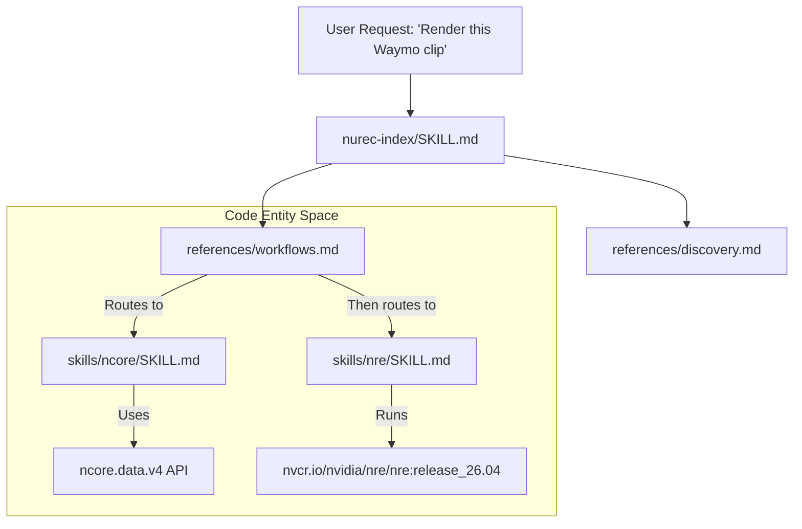
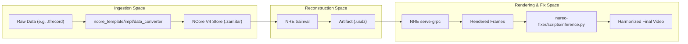

<!-- source: DeepWiki mcp.deepwiki.com · repo NVIDIA/nurec-skills · page 1 NuRec Skills — Overview · fetched 2026-10-26 -->

# NuRec Skills — Overview

Relevant source files

The following files were used as context for generating this wiki page:

- [README.md](README.md)
- [skills/asset-harvester/evals/evals.json](skills/asset-harvester/evals/evals.json)
- [skills/ncore/SKILL.md](skills/ncore/SKILL.md)
- [skills/ncore/evals/evals.json](skills/ncore/evals/evals.json)
- [skills/ncore/ncore_template/impl/data_converter/example_converter.py](skills/ncore/ncore_template/impl/data_converter/example_converter.py)
- [skills/nre/evals/evals.json](skills/nre/evals/evals.json)
- [skills/nurec-index/SKILL.md](skills/nurec-index/SKILL.md)
- [skills/nurec-index/evals/evals.json](skills/nurec-index/evals/evals.json)
- [skills/physical-ai-datasets/SKILL.md](skills/physical-ai-datasets/SKILL.md)
- [skills/physical-ai-datasets/evals/evals.json](skills/physical-ai-datasets/evals/evals.json)

NVIDIA NuRec Skills is a collection of agentic tools designed to automate the neural reconstruction and rendering pipeline for autonomous vehicles (AV) and robotics. These skills are **thin coordination layers** that teach AI agents (such as Cursor, Claude Code, or Codex) how to drive NVIDIA's public NGC containers, GitHub repositories, and Hugging Face artifacts to transform raw sensor data into high-fidelity 3D simulations [README.md:3-35]().

## Repository Purpose and Scope

The repository provides a structured way for agents to handle tasks ranging from sensor data conversion to real-time gRPC rendering. It follows the [agentskills.io](https://agentskills.io) convention, where each skill is defined by a `SKILL.md` file containing YAML frontmatter for discovery and a hand-curated recipe for execution [README.md:20-29]().

### Core Skills Catalogue

| Name | Role | Primary Task |
| :--- | :--- | :--- |
| `nurec-index` | **Router** | Dispatches tasks to the correct sub-skill [skills/nurec-index/SKILL.md:43-48](). |
| `physical-ai-datasets` | **Catalog** | Manages NVIDIA `PhysicalAI-*` datasets on Hugging Face [skills/physical-ai-datasets/SKILL.md:52-60](). |
| `ncore` | **Ingestion** | Converts raw sensor logs (ROS 2, Waymo, etc.) into NCore V4 format [skills/ncore/SKILL.md:39-46](). |
| `nre` | **Engine** | Trains 3D Gaussian reconstructions and renders novel views [skills/nre/SKILL.md:46-46](). |
| `asset-harvester` | **Extraction** | Extracts 3D Gaussian Splat assets for individual objects [README.md:47-47](). |
| `nurec-fixer` | **Refinement** | Post-processes renders using DiffusionHarmonizer [README.md:48-48](). |

**Sources:** [README.md:41-49](), [skills/nurec-index/SKILL.md:49-55]()

---

## Repository Structure and Skill Architecture

The repository is organized into flat folders under `skills/`, with a symlink at `.agents/skills/` to ensure cross-skill links resolve correctly across different agent runtimes [README.md:50-88]().

For details on the YAML frontmatter, Markdown recipes, and how agents index these skills, see **[Repository Structure and Skill Architecture](#1.1)**.

### Natural Language to Code Entity Mapping: Indexing
The following diagram illustrates how an agent moves from a user's natural language request to specific code entities within the `nurec-skills` repository.

**Sources:** [README.md:50-80](), [skills/nurec-index/SKILL.md:74-87](), [skills/ncore/SKILL.md:152-153]()

---

## End-to-End Pipeline

The NuRec pipeline typically follows a linear progression from raw data to a rendered, harmonized simulation. This flow is managed through the `nurec-index` router and predefined workflows.

1.  **Ingestion:** Convert raw data (e.g., `Waymo`, `PAI`, or `ROS 2`) into `NCore V4` using `ncore` [skills/ncore/SKILL.md:98-108]().
2.  **Training:** Feed `NCore V4` to `NRE` to produce a `USDZ` reconstruction [skills/nurec-index/SKILL.md:156-163]().
3.  **Rendering:** Use `NRE` (locally or via `serve-grpc`) to generate novel views [skills/nurec-index/SKILL.md:156-163]().
4.  **Refinement:** (Optional) Use `nurec-fixer` to remove artifacts from rendered frames [README.md:48-48]().

For a deep dive into data flow between skills and specific pipeline stages, see **[End-to-End Pipeline: From Raw Sensor Data to Neural Reconstruction](#1.2)**.

### Pipeline Component Interaction
This diagram maps the high-level pipeline stages to the specific code modules and tools used at each step.

**Sources:** [skills/ncore/SKILL.md:41-46](), [skills/ncore/ncore_template/impl/data_converter/example_converter.py:9-16](), [skills/nurec-index/SKILL.md:156-163](), [README.md:48-48]()

---

## Environment Prerequisites and Setup

Running NuRec skills requires specific hardware and software configurations:
*   **Hardware:** Linux x86_64, NVIDIA GPU (Ampere+), and at least 16GB VRAM (24GB+ recommended) [README.md:132-137]().
*   **Software:** Docker 23+, NVIDIA Container Toolkit, and Python 3.10+ [README.md:138-148]().
*   **Secrets:** `NGC_API_KEY` for containers and `HF_TOKEN` for datasets/models must be configured [README.md:138-145]().

Every skill includes a `validate_setup.py` script to ensure the environment is ready before execution [README.md:69-78]().

For hardware requirements, container access, and secret management patterns, see **[Environment Prerequisites and Setup](#1.3)**.

**Sources:** [README.md:127-148](), [skills/ncore/SKILL.md:116-125]()

---

