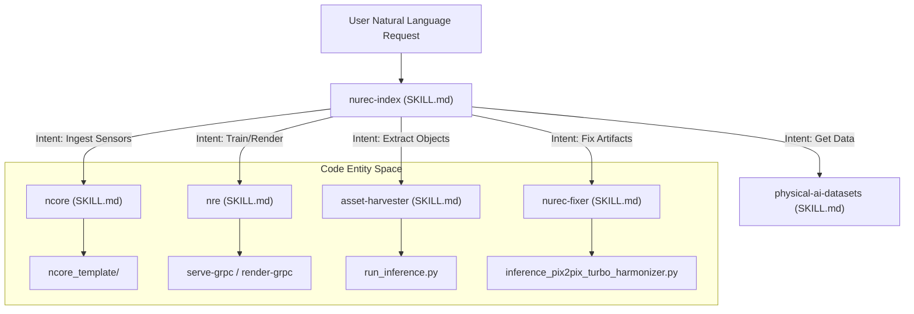
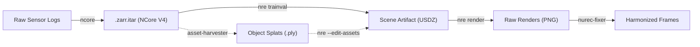

<!-- source: DeepWiki mcp.deepwiki.com · repo NVIDIA/nurec-skills · page 1.1 Repository Structure and Skill Architecture · fetched 2026-10-26 -->

# Repository Structure and Skill Architecture

<details>
<summary>Relevant source files</summary>

The following files were used as context for generating this wiki page:

- [.github/workflows/request-nvskills-ci.yml](.github/workflows/request-nvskills-ci.yml)
- [README.md](README.md)
- [skills/nurec-index/references/discovery.md](skills/nurec-index/references/discovery.md)
- [skills/nurec-index/references/teardown.md](skills/nurec-index/references/teardown.md)
- [skills/nurec-index/references/workflows.md](skills/nurec-index/references/workflows.md)

</details>


This page details the technical organization of the `nurec-skills` repository, the `agentskills.io` convention it implements, and the mechanisms through which AI agents discover and index these skills.

## The Skill Architecture

A **skill** in this repository is a specialized coordination layer designed for AI agents (such as Cursor, Claude Code, or Codex). Unlike traditional software libraries, these skills are encapsulated as Markdown files with structured metadata that teach an agent how to drive external NVIDIA infrastructure, including NGC containers, Hugging Face artifacts, and specialized GitHub repositories [README.md:20-35]().

### agentskills.io Convention
The repository follows the [agentskills.io](https://agentskills.io) standard for skill definition. Each skill is defined by a `SKILL.md` file containing two primary sections:
1.  **YAML Frontmatter**: A structured block containing the skill `name`, `description`, trigger keywords, compatibility requirements, and `upstream` pointers to the canonical source code or container tags [README.md:22-29]().
2.  **Markdown Recipe**: A hand-curated set of instructions, commands, and logic that the agent executes to perform specific tasks [README.md:26-29]().

### Skill Metadata and Upstream Mapping
Each skill maintains a `metadata:` block in its frontmatter. This block is the source of truth for versioning, pinning specific NRE container tags, Asset Harvester commits, or DiffusionHarmonizer release branches [README.md:85-88]().

| Skill Name | Upstream Source | Target Version/Tag |
| :--- | :--- | :--- |
| `nurec-index` | Hand-curated | N/A (Router) |
| `ncore` | [NVIDIA/ncore](https://github.com/NVIDIA/ncore) | `2026.04` |
| `nre` | `nvcr.io/nvidia/nre/{nre,nre-tools}` | `release_26.04` |
| `asset-harvester` | [NVIDIA/asset-harvester](https://github.com/NVIDIA/asset-harvester) | `main` |
| `nurec-fixer` | [nvidia/DiffusionHarmonizer](https://huggingface.co/nvidia/DiffusionHarmonizer) | `main` |

**Sources:** [README.md:41-48](), [README.md:85-88]()

---

## Directory Structure and Symlink Strategy

The repository uses a specific layout to ensure that agents can resolve cross-skill references regardless of their indexing root.

### The .agents/skills Symlink
The directory `.agents/skills/` is a symlink pointing to the `skills/` directory [README.md:53-53](). This strategy ensures that:
*   Agents indexing from the root (standard behavior) find skills at `.agents/skills/<name>/SKILL.md`.
*   Relative links between skills (e.g., `../nre/SKILL.md`) remain valid across different agent runtimes [README.md:82-84]().

### Internal Folder Layout
Each skill is organized as a flat folder containing the primary entry point and its supporting assets:

```text
skills/
├── <skill-name>/
│   ├── SKILL.md           # The primary recipe and metadata
│   ├── references/        # Deep-dive docs (CLI refs, schemas, workflows)
│   ├── scripts/           # Python/Bash utilities (e.g., validate_setup.py)
│   └── tests.yaml         # Skill-specific validation tests
```
**Sources:** [README.md:52-80]()

---

## Skill Discovery and Indexing

Agents discover skills through a prioritized search of local and global directories. The `nurec-index` skill serves as the central entry point for all NuRec-related tasks [README.md:38-39]().

### Resolution Order
Agent runtimes typically look for skills in the following order:
1.  `.agents/skills/<name>/SKILL.md`
2.  `.claude/skills/<name>/SKILL.md`
3.  `.cursor/skills/<name>/SKILL.md` (Project-scoped)
4.  `~/.cursor/skills/<name>/SKILL.md` (User-global)

**Sources:** [skills/nurec-index/references/discovery.md:25-30]()

### Discovery and Routing Logic
The following diagram illustrates how a user request in "Natural Language Space" is mapped to specific code entities and sibling skills via the `nurec-index` router.

**Diagram: Intent-to-Skill Mapping**

**Sources:** [README.md:38-48](), [skills/nurec-index/references/workflows.md:8-60](), [skills/nurec-index/references/discovery.md:55-56]()

---

## Skill Interaction and Data Flow

Skills are designed to be composable. The output of one skill (e.g., `ncore`) serves as the input for the next (e.g., `nre`).

### End-to-End Skill Pipeline
The reconstruction workflow transitions from raw data to a rendered, harmonized scene through a sequence of skill invocations.

**Diagram: Cross-Skill Data Flow**

**Sources:** [skills/nurec-index/references/workflows.md:8-74]()

### Implementation Details
*   **NCore V4 Conversion**: The `ncore` skill drives the conversion of various formats (Waymo, PAI, COLMAP) into the `.zarr.itar` NCore V4 format [skills/nurec-index/references/workflows.md:13-16]().
*   **NRE Execution**: The `nre` skill orchestrates `docker run` commands for `nvcr.io/nvidia/nre/nre` to perform training and novel-view synthesis [README.md:46-46]().
*   **Asset Extraction**: `asset-harvester` utilizes `SparseViewDiT` and `TokenGS` to extract 3D Gaussian Splats from the NCore logs [README.md:47-47]().
*   **Harmonization**: `nurec-fixer` applies `DiffusionHarmonizer` (based on Cosmos Predict2) to resolve flickering and lighting mismatches in rendered frames [README.md:48-48]().

---

## Validation and CI/CD

The repository implements a standardized validation pattern to ensure environment readiness before skill execution.

### validate_setup.py Pattern
Most skills include a `scripts/validate_setup.py` utility. Agents are instructed to run this script to verify:
*   **GPU Compatibility**: Ampere or newer (Compute Capability ≥ 8.0) [README.md:134-137]().
*   **Secret Presence**: Presence of `NGC_API_KEY` and `HF_TOKEN` without leaking their values to logs [skills/nurec-index/references/teardown.md:30-48]().
*   **Container Runtimes**: Docker 23+ and NVIDIA Container Toolkit installation [README.md:138-141]().

### CI Dispatch
Automated validation is handled via the `request-nvskills-ci.yml` workflow. This workflow triggers on:
*   The `/nvskills-ci` comment command in Pull Requests [.github/workflows/request-nvskills-ci.yml:14-16]().
*   Signature pushes from the `nv-skills-ci[bot]` [.github/workflows/request-nvskills-ci.yml:17-19]().

The workflow dispatches requests to the central `NVIDIA/skills` CI infrastructure using the `NVSKILLS_CI_DISPATCH_TOKEN` [.github/workflows/request-nvskills-ci.yml:23-25]().

**Sources:** [README.md:129-148](), [skills/nurec-index/references/teardown.md:30-48](), [.github/workflows/request-nvskills-ci.yml:1-25]()

---

