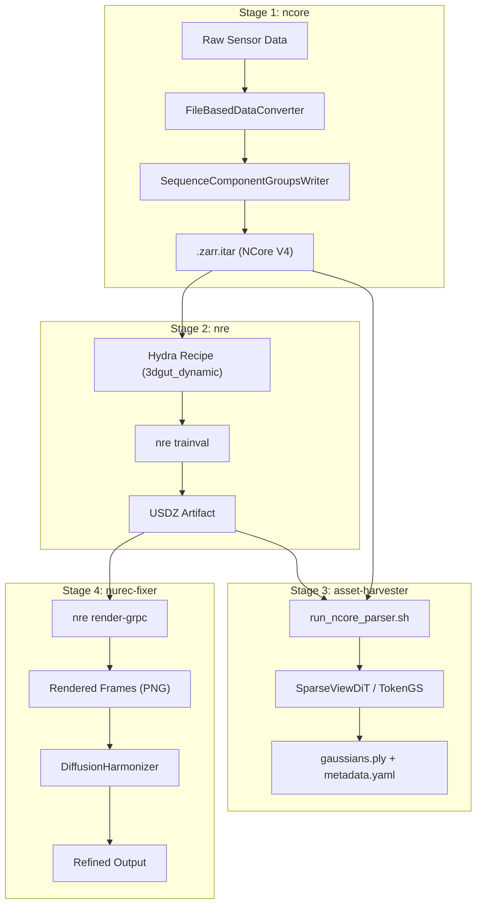

<!-- source: DeepWiki mcp.deepwiki.com · repo NVIDIA/nurec-skills · page 1.2 End-to-End Pipeline: From Raw Sensor Data to Neural Reconstruction · fetched 2026-10-26 -->

# End-to-End Pipeline: From Raw Sensor Data to Neural Reconstruction

Relevant source files

The following files were used as context for generating this wiki page:

- [.github/workflows/request-nvskills-ci.yml](.github/workflows/request-nvskills-ci.yml)
- [skills/asset-harvester/evals/evals.json](skills/asset-harvester/evals/evals.json)
- [skills/ncore/SKILL.md](skills/ncore/SKILL.md)
- [skills/ncore/evals/evals.json](skills/ncore/evals/evals.json)
- [skills/ncore/ncore_template/impl/data_converter/example_converter.py](skills/ncore/ncore_template/impl/data_converter/example_converter.py)
- [skills/nre/evals/evals.json](skills/nre/evals/evals.json)
- [skills/nurec-index/SKILL.md](skills/nurec-index/SKILL.md)
- [skills/nurec-index/evals/evals.json](skills/nurec-index/evals/evals.json)
- [skills/nurec-index/references/discovery.md](skills/nurec-index/references/discovery.md)
- [skills/nurec-index/references/teardown.md](skills/nurec-index/references/teardown.md)
- [skills/nurec-index/references/workflows.md](skills/nurec-index/references/workflows.md)
- [skills/physical-ai-datasets/SKILL.md](skills/physical-ai-datasets/SKILL.md)
- [skills/physical-ai-datasets/evals/evals.json](skills/physical-ai-datasets/evals/evals.json)

The NuRec pipeline is a four-stage linear workflow designed to transform raw sensor data (cameras, LiDAR, radar) into high-fidelity 3D neural reconstructions. This process involves data ingestion, neural training, object-level asset extraction, and post-process harmonization.

## Pipeline Overview

The pipeline consists of four primary "sibling" skills that communicate via standardized data formats, primarily **NCore V4** for sensor data and **USDZ** for reconstructed scenes [skills/nurec-index/SKILL.md:45-55]().

### The Four Stages

| Stage | Skill | Primary Responsibility | Input | Output |
| :--- | :--- | :--- | :--- | :--- |
| **1. Ingest** | `ncore` | Convert raw logs to NCore V4 | Raw logs (Bag, TFRecord, etc.) | `.zarr.itar` (NCore V4) |
| **2. Train** | `nre` | Neural Reconstruction Engine | NCore V4 Store | USDZ Artifact |
| **3. Harvest** | `asset-harvester` | Per-object Gaussian extraction | NCore V4 + USDZ | `.ply` + `metadata.yaml` |
| **4. Fix** | `nurec-fixer` | Diffusion-based harmonization | Rendered Frames | Refined Frames |

**Sources:** [skills/nurec-index/SKILL.md:45-55](), [skills/nurec-index/references/workflows.md:8-23]()

---

## Data Flow and Code Entities

The following diagram bridges the high-level pipeline concepts to the specific code entities and file formats used to pass data between stages.

### System Entity Mapping

**Sources:** [skills/ncore/ncore_template/impl/data_converter/example_converter.py:48-50](), [skills/nurec-index/SKILL.md:145-155](), [skills/nurec-index/references/workflows.md:48-74]()

---

## Stage 1: NCore Ingestion (`ncore`)

The `ncore` skill serves as the entry point for all custom data. It standardizes disparate sensor formats into the NCore V4 specification, which utilizes Zarr-backed `.itar` archives for high-performance I/O [skills/ncore/SKILL.md:41-47]().

### Implementation Detail: `FileBasedDataConverter`
Custom datasets are integrated by subclassing `FileBasedDataConverter` [skills/ncore/ncore_template/impl/data_converter/example_converter.py:50](). The developer must implement:
1. `get_sequence_ids()`: Discovers available clips in the source directory.
2. `convert_sequence()`: Iterates through frames and writes components using `SequenceComponentGroupsWriter` [skills/ncore/ncore_template/impl/data_converter/example_converter.py:48]().

### Key Data Components
* **PosesComponent**: High-precision (float64) ego and sensor extrinsics [skills/ncore/ncore_template/impl/data_converter/example_converter.py:45]().
* **IntrinsicsComponent**: Camera models (Pinhole, FTheta, Fisheye) [skills/ncore/ncore_template/impl/data_converter/example_converter.py:42]().
* **CameraSensorComponent**: JPEG-encoded image streams [skills/ncore/ncore_template/impl/data_converter/example_converter.py:40]().
* **LidarSensorComponent**: Structured or unstructured point clouds [skills/ncore/ncore_template/impl/data_converter/example_converter.py:43]().

**Sources:** [skills/ncore/SKILL.md:62-66](), [skills/ncore/ncore_template/impl/data_converter/example_converter.py:39-50]()

---

## Stage 2: Neural Reconstruction (`nre`)

The Neural Reconstruction Engine (NRE) consumes the NCore V4 store to train a 3D Gaussian Splatting representation (3DGUT or 3DGRT) [skills/nurec-index/SKILL.md:152-155]().

### The Training Loop
NRE uses **Hydra** for configuration management. A typical workflow involves:
1. Generating auxiliary inputs (segmentation masks, depth estimates) using `nre-tools`.
2. Running `trainval` to optimize the Gaussian primitives.
3. Exporting the final model to a **USDZ** file, which packages the geometry, appearance, and metadata into a single portable artifact [skills/nurec-index/references/workflows.md:17-22]().

**Sources:** [skills/nurec-index/SKILL.md:51-52](), [skills/nurec-index/references/workflows.md:17-22]()

---

## Stage 3: Asset Harvesting (`asset-harvester`)

When specific objects (e.g., a particular vehicle) need to be extracted for re-insertion into other scenes, the `asset-harvester` skill is used [skills/nurec-index/references/workflows.md:48-58]().

### Workflow: Extraction to Metadata
1. **Parsing**: `run_ncore_parser.sh` extracts relevant image crops and masks from the NCore V4 log based on object track IDs [skills/nurec-index/references/workflows.md:50-51]().
2. **Reconstruction**: Uses `SparseViewDiT` and `TokenGS` to create a 3D Gaussian model from limited views.
3. **Alignment**: Produces `gaussians.ply` and a `metadata.yaml` containing the object's original scale and orientation [skills/nurec-index/references/workflows.md:52-54]().

**Sources:** [skills/nurec-index/SKILL.md:53-54](), [skills/nurec-index/references/workflows.md:48-58]()

---

## Stage 4: Post-Process Fixer (`nurec-fixer`)

The final stage addresses visual artifacts such as "floaters," ghosting, or lighting mismatches that occur during neural rendering or object insertion [skills/nurec-index/references/workflows.md:60-64]().

### DiffusionHarmonizer
The `nurec-fixer` utilizes **DiffusionHarmonizer** (based on Cosmos Predict2) to perform image-to-image refinement [skills/nurec-index/references/workflows.md:69-74](). It can be used in two modes:
* **Inline**: Integrated into the NRE gRPC server via `--enable-difix` [skills/nurec-index/references/workflows.md:66-68]().
* **Standalone**: A post-processing script that operates on a folder of rendered PNGs [skills/nurec-index/references/workflows.md:69-74]().

**Sources:** [skills/nurec-index/SKILL.md:55](), [skills/nurec-index/references/workflows.md:60-74]()

---

## Decision Matrix: Which Skill to Use?

| Scenario | Primary Skill | Handoff To |
| :--- | :--- | :--- |
| "I have a ROS2 bag and want to see it in 3D" | `ncore` | `nre` |
| "I need to download NVIDIA's sample AV data" | `physical-ai-datasets` | `nre` |
| "I want to remove a car from a scene" | `nre` (via edit-assets) | `nurec-fixer` |
| "I want to save a specific truck as a 3D asset" | `asset-harvester` | `nre` (for insertion) |
| "My renders have flickering artifacts" | `nurec-fixer` | N/A |

**Sources:** [skills/nurec-index/SKILL.md:173-185](), [skills/nurec-index/references/workflows.md:1-106]()

---

## Pipeline Governance and CI

The integrity of the end-to-end pipeline is maintained via the `request-nvskills-ci.yml` workflow. This CI process triggers validation across all skills when specific comment triggers (e.g., `/nvskills-ci`) or signature pushes are detected [github/workflows/request-nvskills-ci.yml:6-19]().

**Sources:** [.github/workflows/request-nvskills-ci.yml:1-25]()

---

