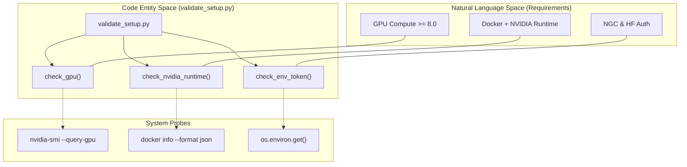
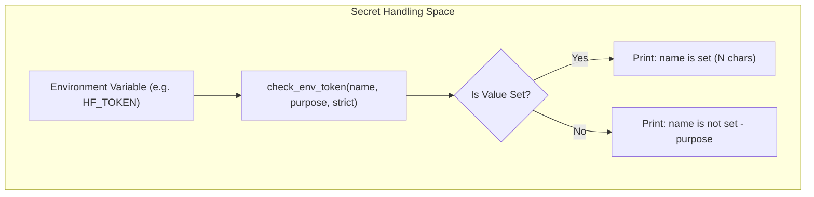

<!-- source: DeepWiki mcp.deepwiki.com · repo NVIDIA/nurec-skills · page 1.3 Environment Prerequisites and Setup · fetched 2026-10-26 -->

# Environment Prerequisites and Setup

<details>
<summary>Relevant source files</summary>

The following files were used as context for generating this wiki page:

- [skills/asset-harvester/scripts/validate_setup.py](skills/asset-harvester/scripts/validate_setup.py)
- [skills/nre/references/install.md](skills/nre/references/install.md)
- [skills/nre/scripts/.env.example](skills/nre/scripts/.env.example)
- [skills/nre/scripts/validate_setup.py](skills/nre/scripts/validate_setup.py)
- [skills/nurec-fixer/scripts/.env.example](skills/nurec-fixer/scripts/.env.example)
- [skills/nurec-fixer/scripts/validate_setup.py](skills/nurec-fixer/scripts/validate_setup.py)

</details>


This page details the hardware, software, and authentication requirements for the NuRec Skills repository. To ensure consistency across diverse reconstruction tasks—ranging from sensor ingestion to neural rendering and diffusion-based fixing—the repository utilizes a standardized validation pattern to verify host readiness before execution.

## Hardware and OS Requirements

NuRec Skills requires high-performance NVIDIA hardware and a Linux environment. Windows and macOS are not supported, and Linux `aarch64` is currently excluded [skills/nre/scripts/validate_setup.py:79-85]().

### GPU and Driver Matrix
The requirements vary slightly depending on whether the host is performing full Neural Reconstruction Engine (NRE) training or only post-processing "fixing" tasks.

| Component | Minimum Requirement | Recommended |
| :--- | :--- | :--- |
| **Architecture** | Linux x86_64 [skills/nre/scripts/validate_setup.py:79-85]() | Ubuntu 22.04+ |
| **GPU VRAM** | 24 GB [skills/nre/scripts/validate_setup.py:55]() | 48 GB+ [skills/nre/scripts/validate_setup.py:56]() |
| **Compute Capability** | sm_80 (Ampere) [skills/nurec-fixer/scripts/validate_setup.py:31]() | sm_89+ (Ada/Hopper) |
| **Driver (NRE/Training)** | R570+ [skills/nre/scripts/validate_setup.py:54]() | R580+ (for Blackwell) |
| **Driver (Fixer-only)** | R535+ [skills/nre/scripts/validate_setup.py:53]() | R570+ |
| **Disk Space** | 120 GB free [skills/nurec-fixer/scripts/validate_setup.py:32]() | TBs for large datasets |

**Sources:** [skills/nre/references/install.md:54-61](), [skills/nre/scripts/validate_setup.py:53-56](), [skills/nurec-fixer/scripts/validate_setup.py:31-32]().

## Software Dependencies

The codebase relies heavily on containerization to manage complex CUDA dependencies.

### Container Runtime
*   **Docker:** Version >= 23.0.1 is required [skills/nre/references/install.md:62]().
*   **NVIDIA Container Toolkit:** Version >= 1.13.5 must be installed and configured as the `nvidia` runtime in Docker [skills/nre/references/install.md:62-64]().
*   **Shared Memory:** Training and rendering containers require significant shared memory; `--shm-size=64g` is standard for NRE workflows [skills/nre/references/install.md:73-74]().

### Python and Tools
For skills that run partially on the host (like `asset-harvester` or `ncore`), the following are checked:
*   **Python:** >= 3.10 [skills/asset-harvester/scripts/validate_setup.py:44]().
*   **Conda:** Required for local environment management in `asset-harvester` [skills/asset-harvester/scripts/validate_setup.py:77-78]().
*   **GCC:** Versions 10-13 are supported for building local extensions like `gsplat` [skills/asset-harvester/scripts/validate_setup.py:46-47]().

**Sources:** [skills/nre/references/install.md:62-74](), [skills/asset-harvester/scripts/validate_setup.py:44-47]().

## Secret Management and Authentication

NuRec Skills interacts with two primary registries: NVIDIA GPU Cloud (NGC) for container images and Hugging Face (HF) for model weights and datasets.

### Required Tokens
1.  **NGC_API_KEY:** Required to pull `nvcr.io/nvidia/nre` images and authenticate in-container model downloads [skills/nre/scripts/validate_setup.py:25-27]().
2.  **HF_TOKEN:** Required for gated datasets (e.g., `PhysicalAI-Autonomous-Vehicles-NuRec`) and model cards like `nvidia/Harmonizer` [skills/nre/scripts/.env.example:12-16]().

### Configuration via .env
Users should create a `.env` file based on the provided templates to manage these secrets locally without committing them to version control [skills/nurec-fixer/scripts/.env.example:4-6]().

**Sources:** [skills/nre/scripts/.env.example:7-17](), [skills/nurec-fixer/scripts/.env.example:1-20]().

## The Validation Pattern

Each skill includes a `validate_setup.py` script. This script performs non-networked checks to ensure the host environment matches the requirements defined in the skill's `SKILL.md`.

### Logic Flow: validate_setup.py
The validation scripts follow a common structure: they probe for executables, query `nvidia-smi` for hardware specs, and check environment variables.

### Environment Validation Logic
"The diagram below illustrates how `validate_setup.py` bridges the Natural Language requirements defined in `SKILL.md` to the Code Entity Space by executing specific system probes."


**Sources:** [skills/nurec-fixer/scripts/validate_setup.py:65-160](), [skills/nre/scripts/validate_setup.py:89-189]().

### Secret Verification Safety
The codebase enforces a length-only check for secrets to prevent accidental leakage in logs or terminal history.

### Secret Check Flow
"This diagram shows the `check_env_token` logic which prevents echoing sensitive strings while confirming their presence."


**Sources:** [skills/nurec-fixer/scripts/validate_setup.py:149-159](), [skills/nre/references/install.md:39-44]().

### Execution Summary
To validate a skill's environment, navigate to the skill directory and run:
```bash
# Example for NRE
python scripts/validate_setup.py --strict
```
A return code of `0` indicates the environment is ready for the `setup.sh` or `run.sh` entrypoints [skills/nre/scripts/validate_setup.py:29-32]().

**Sources:** [skills/nre/scripts/validate_setup.py:19-32](), [skills/asset-harvester/scripts/validate_setup.py:137-190]().

---

