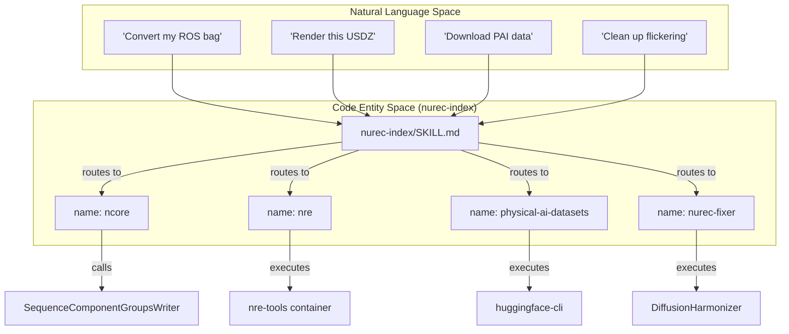
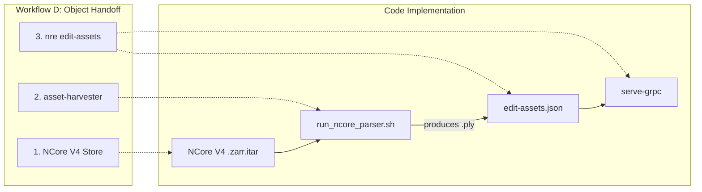

<!-- source: DeepWiki mcp.deepwiki.com · repo NVIDIA/nurec-skills · page 2.1 Routing Logic and Workflow References · fetched 2026-10-26 -->

# Routing Logic and Workflow References

Relevant source files

The following files were used as context for generating this wiki page:

- [.github/workflows/request-nvskills-ci.yml](.github/workflows/request-nvskills-ci.yml)
- [skills/ncore/SKILL.md](skills/ncore/SKILL.md)
- [skills/ncore/ncore_template/impl/data_converter/example_converter.py](skills/ncore/ncore_template/impl/data_converter/example_converter.py)
- [skills/nurec-index/BENCHMARK.md](skills/nurec-index/BENCHMARK.md)
- [skills/nurec-index/SKILL.md](skills/nurec-index/SKILL.md)
- [skills/nurec-index/references/discovery.md](skills/nurec-index/references/discovery.md)
- [skills/nurec-index/references/teardown.md](skills/nurec-index/references/teardown.md)
- [skills/nurec-index/references/workflows.md](skills/nurec-index/references/workflows.md)
- [skills/nurec-index/skill-card.md](skills/nurec-index/skill-card.md)
- [skills/physical-ai-datasets/SKILL.md](skills/physical-ai-datasets/SKILL.md)

The `nurec-index` skill serves as the central architectural router for the NVIDIA NuRec ecosystem. Its primary purpose is to evaluate user intent and dispatch requests to the appropriate specialized sibling skill within the `nurec-skills` repository. It manages the lifecycle of multi-stage pipelines, provides discovery mechanisms for skills not present on the local filesystem, and defines the standardized teardown order for reclaiming system resources.

### Sources:
- [skills/nurec-index/SKILL.md:43-66]()
- [skills/nurec-index/SKILL.md:68-95]()

---

## Routing and Intent Classification

The routing logic is defined by a mapping of user goals to specific code entities (skills). When a request is received, the system classifies the intent to determine if it requires a single-stage execution or a multi-stage workflow.

### Intent Mapping Table

| User Goal | Target Skill | Implementation Reference |
| :--- | :--- | :--- |
| Find/Download NVIDIA datasets | `physical-ai-datasets` | [skills/nurec-index/SKILL.md:175-175]() |
| Convert raw sensor data to V4 | `ncore` | [skills/nurec-index/SKILL.md:176-177]() |
| Train 3D reconstruction | `ncore` → `nre` | [skills/nurec-index/SKILL.md:178-178]() |
| Render novel views / USDZ | `nre` | [skills/nurec-index/SKILL.md:180-180]() |
| Extract 3D Gaussian objects | `asset-harvester` | [skills/nurec-index/SKILL.md:181-181]() |
| Fix artifacts / Harmonize | `nurec-fixer` | [skills/nurec-index/SKILL.md:183-183]() |

### Natural Language to Code Entity Space: Routing Logic
This diagram illustrates how user-facing "Natural Language" intents are mapped to specific skill entities and their underlying code implementations.

### Sources:
- [skills/nurec-index/SKILL.md:170-186]()
- [skills/ncore/ncore_template/impl/data_converter/example_converter.py:48-48]()
- [skills/nurec-index/references/workflows.md:1-106]()

---

## Standardized Workflows (A–G)

Workflows represent pre-defined sequences of skill executions designed for common end-to-end tasks. These are documented in `references/workflows.md`.

*   **Workflow A (Custom Recording):** `ncore` (Conversion) → `nre` (Train/Render).
*   **Workflow D (Object Editing):** `ncore` (Context) → `asset-harvester` (Extraction) → `nre` (Insertion via `serve-grpc --enable-editing-actors`).
*   **Workflow E (Post-Processing):** `nre` (Render) → `nurec-fixer` (Harmonization).
*   **Workflow G (Simulator Integration):** `physical-ai-datasets` (USDZ) → `nre` (`serve-grpc`).

### Natural Language to Code Entity Space: Multi-Skill Pipeline
This diagram bridges the high-level workflow descriptions to the specific command-line entry points and classes used in the pipeline.

### Sources:
- [skills/nurec-index/references/workflows.md:8-22]()
- [skills/nurec-index/references/workflows.md:48-58]()
- [skills/nurec-index/references/workflows.md:60-74]()

---

## Skill Discovery and Teardown

### Discovery Mechanism
If a sibling skill is not present on the local disk, `nurec-index` follows a discovery protocol to locate the skill at `https://github.com/NVIDIA/nurec-skills`. The system checks standard paths in order:
1. `.agents/skills/<name>/SKILL.md`
2. `.claude/skills/<name>/SKILL.md`
3. `.cursor/skills/<name>/SKILL.md`

Agents are strictly prohibited from auto-cloning; they must request user consent before performing a network fetch of the repository.

### Teardown Reference
A full NuRec workflow can consume over 150 GB of disk space. The teardown sequence is critical for resource management:

| Order | Skill | Component to Remove | Est. Size |
| :--- | :--- | :--- | :--- |
| 1 | `nre` | Docker images + Hydra outputs | ~120 GB |
| 2 | `nurec-fixer` | Cosmos images + HF caches | 100 GB+ |
| 3 | `asset-harvester` | Conda envs + Checkpoints | ~30 GB |
| 4 | `ncore` | `.zarr.itar` shards | Variable |
| 5 | `physical-ai-datasets` | `~/.cache/huggingface/hub/` | Variable |

### Sources:
- [skills/nurec-index/references/discovery.md:1-60]()
- [skills/nurec-index/references/teardown.md:1-16]()

---

## Security and CI/CD

### Secret Management
All skills must adhere to the "Verify, Don't Echo" policy for `NGC_API_KEY` and `HF_TOKEN`. Implementation involves length-only checks to avoid terminal leakage:
`test -n "$HF_TOKEN" && echo "HF_TOKEN: set (${#HF_TOKEN} chars)" || echo "HF_TOKEN: missing"`

### CI Governance
The repository uses the `request-nvskills-ci.yml` workflow to trigger validation.
*   **Trigger:** Commenting `/nvskills-ci` on a PR or a signature push from `nv-skills-ci[bot]`.
*   **Action:** Dispatches to `NVIDIA/skills/.github/workflows/team-request.yml@main`.

### Sources:
- [skills/nurec-index/references/teardown.md:28-49]()
- [.github/workflows/request-nvskills-ci.yml:1-25]()

---

