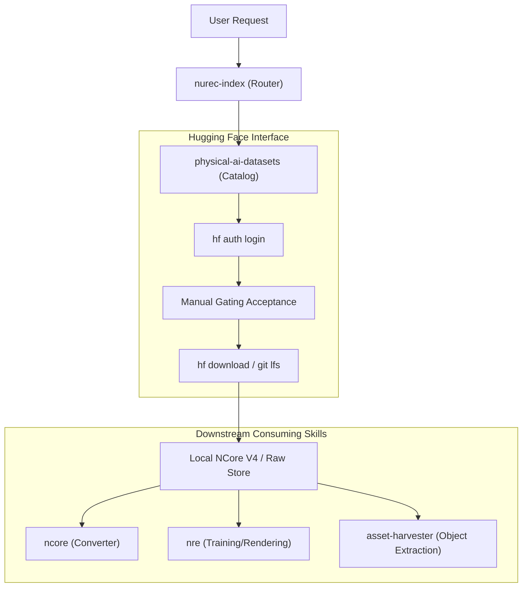
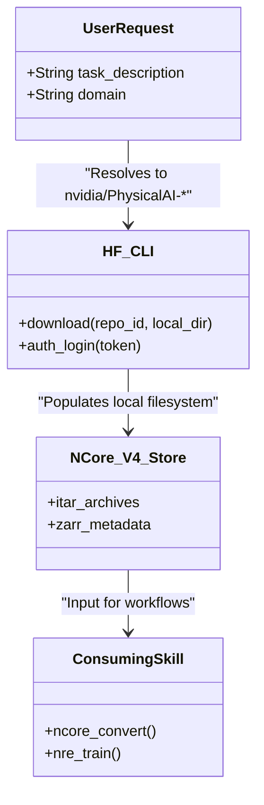

<!-- source: DeepWiki mcp.deepwiki.com · repo NVIDIA/nurec-skills · page 2.2 Physical AI Datasets Skill · fetched 2026-10-26 -->

# Physical AI Datasets Skill

<details>
<summary>Relevant source files</summary>

The following files were used as context for generating this wiki page:

- [skills/asset-harvester/evals/evals.json](skills/asset-harvester/evals/evals.json)
- [skills/ncore/SKILL.md](skills/ncore/SKILL.md)
- [skills/ncore/evals/evals.json](skills/ncore/evals/evals.json)
- [skills/ncore/ncore_template/impl/data_converter/example_converter.py](skills/ncore/ncore_template/impl/data_converter/example_converter.py)
- [skills/nre/evals/evals.json](skills/nre/evals/evals.json)
- [skills/nurec-index/SKILL.md](skills/nurec-index/SKILL.md)
- [skills/nurec-index/evals/evals.json](skills/nurec-index/evals/evals.json)
- [skills/physical-ai-datasets/SKILL.md](skills/physical-ai-datasets/SKILL.md)
- [skills/physical-ai-datasets/evals/evals.json](skills/physical-ai-datasets/evals/evals.json)

</details>


The `physical-ai-datasets` skill provides a comprehensive catalog and interface for discovering, evaluating, and downloading NVIDIA's Physical AI datasets hosted on Hugging Face. These datasets support a wide range of tasks including autonomous vehicle (AV) reconstruction, robotics manipulation, spatial intelligence, and neural reconstruction. This skill acts as a discovery and routing layer; it does not perform training or rendering but prepares the data for consuming skills like `ncore` and `nre` [skills/physical-ai-datasets/SKILL.md:4-14]().

## System Overview and Data Flow

The skill manages the transition from the **Natural Language Space** (user requests for specific data types) to the **Code Entity Space** (Hugging Face CLI commands and local directory structures).

### Natural Language to Code Entity Mapping

| User Intent (Natural Language) | Code Entity / Command | Target Sibling Skill |
| :--- | :--- | :--- |
| "Find AV training data" | `nvidia/PhysicalAI-Autonomous-Vehicles` | `ncore` |
| "Get robot grasping data" | `nvidia/PhysicalAI-Grasping-GraspGen` | `asset-harvester` |
| "Need sim-ready scenes" | `nvidia/PhysicalAI-SimReady-Scenes` | `nre` |
| "Download GR00T samples" | `nvidia/PhysicalAI-Robotics-GR00T-X-Embodiment` | Isaac-GR00T (Upstream) |

**Sources:** [skills/physical-ai-datasets/SKILL.md:62-73](), [skills/physical-ai-datasets/SKILL.md:126-138]()

### Data Ingestion Flow

The following diagram illustrates how a user request for a dataset is processed and handed off to downstream skills.

**Dataset Handoff Pipeline**

**Sources:** [skills/nurec-index/SKILL.md:45-55](), [skills/physical-ai-datasets/SKILL.md:140-160](), [skills/physical-ai-datasets/SKILL.md:175-180]()

## Implementation Details

### Catalog Organization
The skill categorizes datasets by domain to facilitate rapid lookup. Each entry includes the Hugging Face path, size, license type, and whether the dataset is gated (requires manual approval on the website) [skills/physical-ai-datasets/SKILL.md:7-12]().

### Security and Authentication
A critical component of the implementation is the safe handling of the `HF_TOKEN`. The skill enforces a "length-only" check to prevent accidental leakage of secrets in logs or terminal output [skills/physical-ai-datasets/SKILL.md:99-118]().

**Key Security Pattern:**
```bash
# Correct way to verify token presence without echoing value
test -n "$HF_TOKEN" && echo "HF_TOKEN: set (${#HF_TOKEN} chars)" || echo "HF_TOKEN: missing"
```
**Sources:** [skills/physical-ai-datasets/SKILL.md:105-117](), [skills/ncore/SKILL.md:132-144]()

### Download Patterns
The skill defines three primary download patterns depending on the dataset scale and user requirements:
1.  **Full Download:** Using `hf download` for small/medium datasets [skills/physical-ai-datasets/SKILL.md:162-163]().
2.  **Filtered Download:** Using `--include` patterns for massive datasets like `PhysicalAI-Autonomous-Vehicles` (133 TB) [skills/physical-ai-datasets/SKILL.md:165-169]().
3.  **Sparse Checkout:** Using `git-lfs` for incremental updates [skills/physical-ai-datasets/SKILL.md:171-173]().

## Technical Reference: Dataset Families

The skill maps specific `PhysicalAI-*` families to the appropriate technical tools.

| Family | Purpose | Primary Consumer |
| :--- | :--- | :--- |
| **Autonomous-Vehicles** | Raw sensor logs (Hyperion 8.1) | `ncore` |
| **Robotics-Manipulation** | Multi-modal trajectory data | Isaac Sim / Cosmos |
| **Robotics-NuRec** | Pre-trained USDZ / NCore V4 scenes | `nre` |
| **Sim-Ready** | Physically based assets/materials | `asset-harvester` |

**Sources:** [skills/physical-ai-datasets/SKILL.md:126-138](), [skills/physical-ai-datasets/SKILL.md:7-12]()

### Dependency Mapping

**Natural Language to Code Entity Space**

**Sources:** [skills/physical-ai-datasets/SKILL.md:52-60](), [skills/ncore/SKILL.md:41-46](), [skills/nre/SKILL.md:162-164]()

## Handoff to Consuming Skills

Once a dataset is downloaded, the agent must transition to the next skill in the pipeline.

1.  **If the data is raw sensor logs (e.g., Waymo, PAI raw):** Handoff to `ncore` for conversion to V4 format [skills/nurec-index/SKILL.md:176]().
2.  **If the data is already in NCore V4 or USDZ:** Handoff to `nre` for reconstruction or rendering [skills/nurec-index/SKILL.md:178]().
3.  **If the goal is object extraction:** Handoff to `asset-harvester` [skills/nurec-index/SKILL.md:181]().

**Sources:** [skills/nurec-index/SKILL.md:45-55](), [skills/nurec-index/SKILL.md:173-182]()

---

