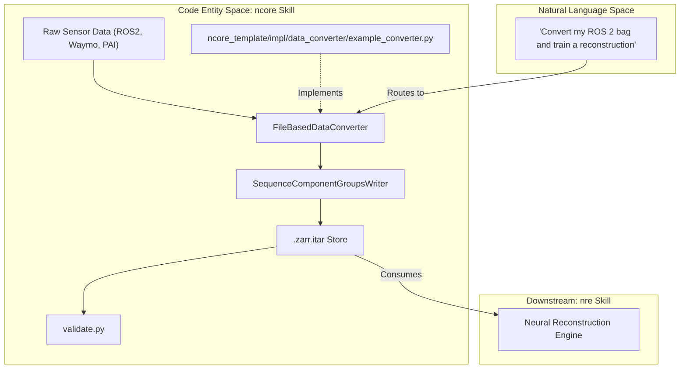
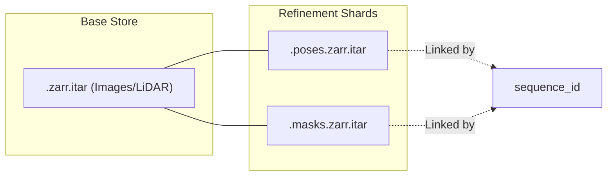

<!-- source: DeepWiki mcp.deepwiki.com · repo NVIDIA/nurec-skills · page 3 NCore: Sensor Data Ingestion and V4 Format · fetched 2026-10-26 -->

# NCore: Sensor Data Ingestion and V4 Format

Relevant source files

The following files were used as context for generating this wiki page:

- [skills/asset-harvester/evals/evals.json](skills/asset-harvester/evals/evals.json)
- [skills/ncore/SKILL.md](skills/ncore/SKILL.md)
- [skills/ncore/evals/evals.json](skills/ncore/evals/evals.json)
- [skills/ncore/ncore_template/impl/data_converter/example_converter.py](skills/ncore/ncore_template/impl/data_converter/example_converter.py)
- [skills/nre/evals/evals.json](skills/nre/evals/evals.json)
- [skills/nurec-index/SKILL.md](skills/nurec-index/SKILL.md)
- [skills/nurec-index/evals/evals.json](skills/nurec-index/evals/evals.json)
- [skills/physical-ai-datasets/SKILL.md](skills/physical-ai-datasets/SKILL.md)
- [skills/physical-ai-datasets/evals/evals.json](skills/physical-ai-datasets/evals/evals.json)

NCore is the foundational data ingestion skill for the NuRec ecosystem. Its primary purpose is to convert raw sensor recordings—ranging from autonomous vehicle (AV) logs to custom robotics rigs—into the **NCore V4** format. This standardized format is a prerequisite for downstream tasks such as training reconstructions in NRE or extracting objects via Asset Harvester [skills/ncore/SKILL.md:4-17]().

NCore provides two primary paths for data ingestion: driving existing in-tree converters (e.g., PAI, Waymo, COLMAP) or authoring new converters using a provided template for custom sensor configurations [skills/ncore/SKILL.md:40-46]().

## System Architecture: Data Ingestion Flow

The following diagram illustrates how raw sensor data is transformed into the NCore V4 format and handed off to the Neural Reconstruction Engine (NRE).

### Sensor Ingestion to NRE Pipeline

**Sources:** [skills/ncore/SKILL.md:4-17](), [skills/ncore/SKILL.md:98-109](), [skills/ncore/ncore_template/impl/data_converter/example_converter.py:48-50]()

## Mental Model: The V4 Store

The NCore V4 format is designed for high-precision spatial data, utilizing `.zarr.itar` archives to store multi-modal sensor streams. It organizes data into **Component Groups** (e.g., `camera`, `lidar`, `poses`) that are linked by a common `sequence_id`.

| Component | Description | Code Entity |
| :--- | :--- | :--- |
| **Poses** | Ego-motion and sensor extrinsics (float64) | `PosesComponent` |
| **Intrinsics** | Camera models (Pinhole, Fisheye, F-Theta) | `IntrinsicsComponent` |
| **Sensors** | Raw data: JPEG images or LiDAR point clouds | `CameraSensorComponent` / `LidarSensorComponent` |
| **Cuboids** | 3D bounding box tracks for dynamic objects | `CuboidsComponent` |

For a deep dive into the archive structure, float64 re-referencing for precision, and the lifecycle of a store, see **[NCore V4 Data Model and Store Lifecycle](#3.1)**.

**Sources:** [skills/ncore/ncore_template/impl/data_converter/example_converter.py:39-49](), [skills/ncore/SKILL.md:72-75]()

## Authoring Converters

Users can ingest data via two distinct paths depending on the source format:

*   **Path A: In-Tree Converters:** Pre-built Bazel-based tools for common datasets like **PAI** (NVIDIA Physical AI), **Waymo Open**, and **COLMAP** outputs [skills/ncore/SKILL.md:98-104]().
*   **Path B: Custom Templates:** For unsupported formats (e.g., PandaSet, NuScenes, custom ROS 2 bags), NCore provides a `FileBasedDataConverter` scaffold. Developers implement `get_sequence_ids` and `convert_sequence` to map their data into the V4 schema [skills/ncore/ncore_template/impl/data_converter/example_converter.py:11-16]().

For implementation details and code examples, see **[Authoring Converters: In-Tree and Custom Templates](#3.2)**.

**Sources:** [skills/ncore/SKILL.md:98-109](), [skills/ncore/ncore_template/impl/data_converter/example_converter.py:50]()

## Robotics-to-Sim (r2s) Sharding

In complex robotics pipelines, NCore supports a **sharding pattern**. Instead of one monolithic file, a sequence is broken into modular shards (e.g., `.poses.zarr.itar`, `.masks.zarr.itar`). This allows for:
1.  **Modular Refinement:** Updating poses or masks without re-writing bulky raw image data.
2.  **LiDAR Motion Compensation:** Handling rolling-shutter effects in LiDAR sweeps during conversion.

For details on the sharding architecture and its use in robotics pipelines, see **[r2s Sharding Pattern and Robotics Pipelines](#3.3)**.

### Shard Relationship Diagram

**Sources:** [skills/ncore/SKILL.md:91-92](), [skills/ncore/ncore_template/impl/data_converter/example_converter.py:48-49]()

## Supported Dataset Recipes

NCore includes specific recipes for popular AV and robotics datasets:
*   **PAI (NVIDIA Physical AI):** Consumed directly via `pai-v4` or `pai-stream-v4` [skills/ncore/SKILL.md:77-78]().
*   **Waymo Open:** Converts `.tfrecord` files via `waymo-v4` [skills/ncore/SKILL.md:103]().
*   **Sensor-Only Rigs:** Specific guidance for Mono+Depth, Multi-Stereo, and Livox (non-repetitive) LiDAR [skills/ncore/SKILL.md:81-89]().

To find and download these datasets before conversion, refer to the [Physical AI Datasets Skill](#2.2) [skills/nurec-index/SKILL.md:49]().

**Sources:** [skills/ncore/SKILL.md:76-90](), [skills/nurec-index/SKILL.md:49]()

---

