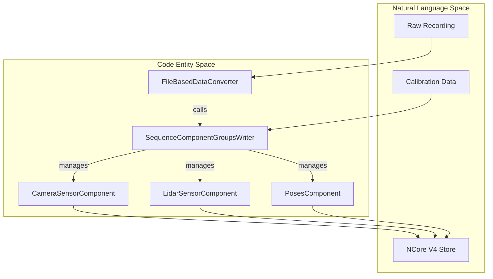
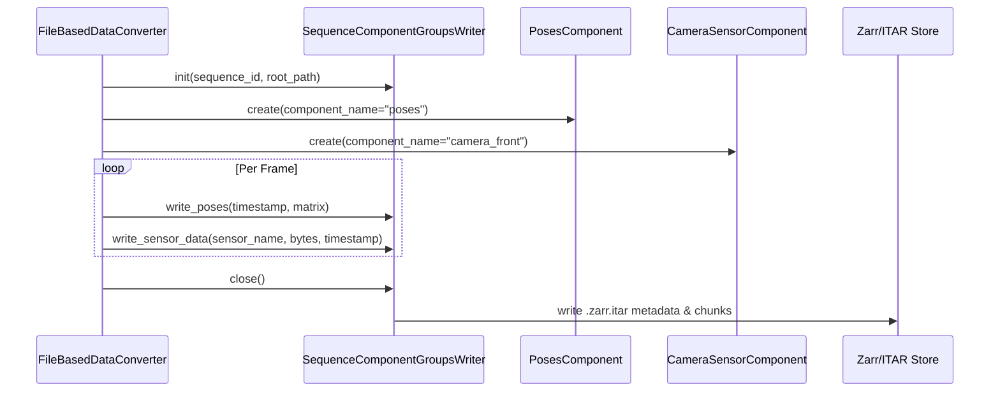

<!-- source: DeepWiki mcp.deepwiki.com · repo NVIDIA/nurec-skills · page 3.1 NCore V4 Data Model and Store Lifecycle · fetched 2026-10-26 -->

# NCore V4 Data Model and Store Lifecycle

<details>
<summary>Relevant source files</summary>

The following files were used as context for generating this wiki page:

- [skills/ncore/SKILL.md](skills/ncore/SKILL.md)
- [skills/ncore/ncore_template/__init__.py](skills/ncore/ncore_template/__init__.py)
- [skills/ncore/ncore_template/impl/__init__.py](skills/ncore/ncore_template/impl/__init__.py)
- [skills/ncore/ncore_template/impl/data_converter/__init__.py](skills/ncore/ncore_template/impl/data_converter/__init__.py)
- [skills/ncore/ncore_template/impl/data_converter/example_converter.py](skills/ncore/ncore_template/impl/data_converter/example_converter.py)
- [skills/nurec-index/SKILL.md](skills/nurec-index/SKILL.md)
- [skills/physical-ai-datasets/SKILL.md](skills/physical-ai-datasets/SKILL.md)

</details>


This page provides a technical deep dive into the **NCore V4** data format, the lifecycle of a V4 store, and the underlying implementation details of the ingestion pipeline. NCore V4 is the unified sensor data format used by the NuRec ecosystem to represent multi-modal recordings (Camera, LiDAR, Radar, Poses) for neural reconstruction and robotics-to-sim (r2s) workflows.

## The V4 Store Architecture

An NCore V4 store is conceptually a collection of **Component Groups** that describe a sequence of sensor data over time. Physically, these are stored as `.zarr.itar` archives, which combine the Zarr format's chunked, compressed N-dimensional array capabilities with an indexed-TAR (`.itar`) wrapper for efficient cloud and local streaming [skills/ncore/SKILL.md:42-46]().

### Core Entities and Data Model

The data model is hierarchical, starting from a **Sequence** and branching into specialized **Components**.

| Entity | Description | Code Reference |
| :--- | :--- | :--- |
| **Component Group** | A logical grouping of related data (e.g., `observations`, `poses`, `calibration`). | [skills/ncore/ncore_template/impl/data_converter/example_converter.py:52-52]() |
| **Sequence** | A single continuous recording identified by a unique `sequence_id`. | [skills/ncore/ncore_template/impl/data_converter/example_converter.py:12-12]() |
| **Poses** | High-precision trajectory data (6-DoF) for the ego-vehicle or sensors. | [skills/ncore/ncore_template/impl/data_converter/example_converter.py:45-45]() |
| **CameraSensor** | RAW or JPEG compressed imagery with associated timestamps. | [skills/ncore/ncore_template/impl/data_converter/example_converter.py:40-40]() |
| **LidarSensor** | Structured or unstructured point clouds with intensity and timing. | [skills/ncore/ncore_template/impl/data_converter/example_converter.py:43-43]() |
| **Intrinsics** | Mathematical models for sensors (FTheta, Pinhole, Fisheye). | [skills/ncore/ncore_template/impl/data_converter/example_converter.py:42-42]() |

### Precision and Re-referencing
To maintain `float64` precision for global coordinates (e.g., UTM or WGS84) without losing accuracy in `float32` neural networks, NCore V4 employs **re-referencing**. All poses are typically stored relative to a local origin (the first frame of a sequence) while preserving the global offset in metadata [skills/ncore/SKILL.md:112-113]().

**Sources:** [skills/ncore/SKILL.md:42-46](), [skills/ncore/ncore_template/impl/data_converter/example_converter.py:39-53]()

---

## Data Flow: Ingestion to V4 Store

The lifecycle of data conversion involves reading raw formats (ROS bags, Waymo TFRecords, etc.) and writing them using the `SequenceComponentGroupsWriter`.

### System Entity Mapping

This diagram bridges the natural language concepts of "Recording" and "Store" to the specific classes in `ncore.data.v4`.


**Sources:** [skills/ncore/ncore_template/impl/data_converter/example_converter.py:39-50](), [skills/ncore/SKILL.md:42-50]()

---

## The Writer Lifecycle

The `SequenceComponentGroupsWriter` is the primary interface for creating V4 stores. It ensures that all components (poses, images, point clouds) are synchronized and adhere to the V4 specification.

### Key Functions and Workflow

1.  **Initialization**: The writer is initialized with a `root_dir` and `sequence_id` [skills/ncore/ncore_template/impl/data_converter/example_converter.py:48-48]().
2.  **Component Registration**: Components like `PosesComponent` or `CameraSensorComponent` are added to the writer.
3.  **Frame Writing**: Data is appended per-frame. For sensors, this includes the raw bytes and a nanosecond-precision timestamp.
4.  **Finalization**: The writer flushes buffers and writes the Zarr metadata, finalizing the `.zarr.itar` archive.

### Data Flow Diagram


**Sources:** [skills/ncore/ncore_template/impl/data_converter/example_converter.py:39-50](), [skills/ncore/ncore_template/impl/data_converter/example_converter.py:11-16]()

---

## Sensor Models in V4

NCore V4 supports sophisticated sensor models to ensure high-fidelity reconstruction in NRE.

### Camera Models
Supported models include:
*   **OpenCVPinhole**: Standard rectilinear projection [skills/ncore/ncore_template/impl/data_converter/example_converter.py:34-34]().
*   **OpenCVFisheye**: For wide-angle lenses [skills/ncore/ncore_template/impl/data_converter/example_converter.py:33-33]().
*   **FTheta**: Used for high-distortion fisheye cameras common in AV rigs [skills/ncore/ncore_template/impl/data_converter/example_converter.py:31-31]().

### LiDAR Models
NCore handles both structured (spinning) and unstructured LiDAR. A critical implementation detail for spinning LiDAR is the `RowOffsetStructuredSpinningLidarModelParameters`, which defines:
*   `spinning_direction`: "cw" (clockwise) or "ccw" (counter-clockwise). Most automotive LiDARs are "cw" [skills/ncore/ncore_template/impl/data_converter/example_converter.py:112-112]().
*   `row_elevations_rad`: Must be in **descending order** (highest beam first) [skills/ncore/ncore_template/impl/data_converter/example_converter.py:81-83]().

**Sources:** [skills/ncore/ncore_template/impl/data_converter/example_converter.py:31-38](), [skills/ncore/ncore_template/impl/data_converter/example_converter.py:68-108]()

---

## Validation and Conventions

All NCore V4 stores must pass the `validate.py` suite before they are consumed by NRE or other downstream skills.

### Key Validation Checks
*   **Timestamp Monotonicity**: Timestamps within a component must strictly increase.
*   **Coordinate Systems**: NCore uses a Right-Handed System (RHS). For cameras, X is Right, Y is Down, and Z is Forward (Optical frame).
*   **Pose Continuity**: Large jumps in ego-motion are flagged as potential calibration errors.

### Directory Structure Convention
A standard V4 store follows this layout:
```text
<sequence_id>/
├── observations.zarr.itar  # Images, LiDAR, Radar
├── poses.zarr.itar         # Ego and Sensor poses
├── calibration.json        # Static extrinsics and intrinsics
└── metadata.json           # Sequence-level info
```

**Sources:** [skills/ncore/SKILL.md:92-93](), [skills/ncore/SKILL.md:75-75](), [skills/ncore/ncore_template/impl/data_converter/example_converter.py:11-16]()

---

