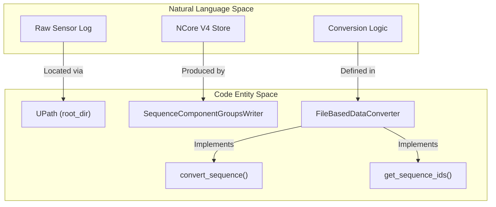
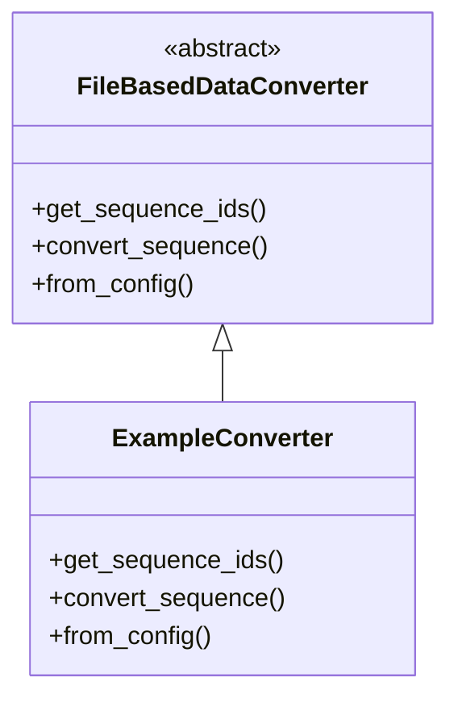
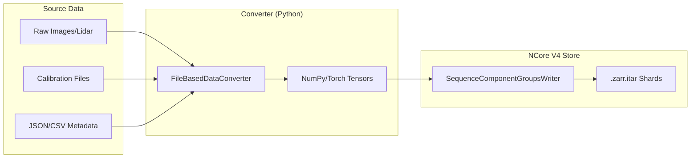

<!-- source: DeepWiki mcp.deepwiki.com · repo NVIDIA/nurec-skills · page 3.2 Authoring Converters: In-Tree and Custom Templates · fetched 2026-10-26 -->

# Authoring Converters: In-Tree and Custom Templates

<details>
<summary>Relevant source files</summary>

The following files were used as context for generating this wiki page:

- [skills/ncore/SKILL.md](skills/ncore/SKILL.md)
- [skills/ncore/ncore_template/__init__.py](skills/ncore/ncore_template/__init__.py)
- [skills/ncore/ncore_template/impl/__init__.py](skills/ncore/ncore_template/impl/__init__.py)
- [skills/ncore/ncore_template/impl/data_converter/__init__.py](skills/ncore/ncore_template/impl/data_converter/__init__.py)
- [skills/ncore/ncore_template/impl/data_converter/example_converter.py](skills/ncore/ncore_template/impl/data_converter/example_converter.py)
- [skills/nurec-index/SKILL.md](skills/nurec-index/SKILL.md)
- [skills/physical-ai-datasets/SKILL.md](skills/physical-ai-datasets/SKILL.md)

</details>


This page documents the two primary pathways for ingesting sensor data into the NCore V4 format. Converting raw data into a valid NCore V4 store is a prerequisite for training neural reconstructions with NRE or performing per-object extraction with the Asset Harvester [skills/ncore/SKILL.md:40-46]().

## Conversion Strategy Overview

The repository provides two distinct paths for data conversion based on the source format's maturity and complexity.

| Path | Use Case | Implementation Method |
| :--- | :--- | :--- |
| **Path A: In-Tree** | PAI, Waymo, COLMAP, ScanNet++ | Bazel-based command line tools [skills/ncore/SKILL.md:99-104]() |
| **Path B: Custom** | PandaSet, NuScenes, ROS 2, Custom Rigs | Python subclass of `FileBasedDataConverter` [skills/ncore/SKILL.md:106-108]() |

### System to Code Entity Mapping: Conversion Flow

The following diagram maps the high-level conversion concepts to their specific code entities within the `ncore` skill.

**NCore Conversion Entity Map**

Sources: [skills/ncore/ncore_template/impl/data_converter/example_converter.py:48-53](), [skills/ncore/SKILL.md:152-159]()

---

## Path A: In-Tree Bazel Converters

In-tree converters are optimized for high-performance processing of large-scale datasets. They handle complex sensor calibrations (e.g., FTheta models, rolling shutter timing) and coordinate system transformations [skills/ncore/SKILL.md:110-113]().

### Supported In-Tree Formats
*   **PAI (Physical AI):** Ingests NVIDIA Physical AI datasets from Hugging Face or local disk using `tools/data_converter/pai:convert` [skills/ncore/SKILL.md:102]().
*   **Waymo Open:** Processes `.tfrecord` files via `tools/data_converter/waymo:convert` [skills/ncore/SKILL.md:103]().
*   **COLMAP / ScanNet++:** Converts SfM (Structure from Motion) outputs to V4 using `tools/data_converter/colmap:convert` [skills/ncore/SKILL.md:104]().

### Usage Pattern
These converters are typically invoked via Bazel:
```bash
bazel run //tools/data_converter/pai:convert -- --input_path /data/pai_clip --output_path /data/v4_store
```
Sources: [skills/ncore/SKILL.md:102-105](), [skills/ncore/SKILL.md:120-121]()

---

## Path B: Custom FileBasedDataConverter

For unsupported formats or custom robotics rigs, users should implement a converter using the `ncore_template` scaffold. This template provides a boilerplate for managing the V4 store lifecycle [skills/ncore/SKILL.md:44-46]().

### Key Class: `ExampleConverter`
The `ExampleConverter` (found in `skills/ncore/ncore_template/impl/data_converter/example_converter.py`) serves as the reference implementation [skills/ncore/ncore_template/impl/data_converter/example_converter.py:11-16]().

**Converter Class Hierarchy**

Sources: [skills/ncore/ncore_template/impl/data_converter/example_converter.py:159-165](), [skills/ncore/ncore_template/impl/data_converter/example_converter.py:448-450]()

### Implementation Methods

#### 1. `get_sequence_ids`
This method scans the `root_dir` and returns a list of unique sequence identifiers found in the raw data [skills/ncore/ncore_template/impl/data_converter/example_converter.py:12]().

#### 2. `convert_sequence`
The core logic where raw sensor data is mapped to V4 components. It utilizes the `SequenceComponentGroupsWriter` to commit data to the store [skills/ncore/ncore_template/impl/data_converter/example_converter.py:48-49]().

#### 3. `from_config`
A factory method that instantiates the converter using a `FileBasedDataConverterConfig` object [skills/ncore/ncore_template/impl/data_converter/example_converter.py:159-160]().

### Component Writers
Within `convert_sequence`, data is written using specific V4 component writers:
*   `PosesComponent`: 6-DoF ego-vehicle or sensor poses [skills/ncore/ncore_template/impl/data_converter/example_converter.py:45]().
*   `IntrinsicsComponent`: Camera (Pinhole, Fisheye, FTheta) or LiDAR models [skills/ncore/ncore_template/impl/data_converter/example_converter.py:42]().
*   `CameraSensorComponent`: Raw image bytes (JPEG/PNG) [skills/ncore/ncore_template/impl/data_converter/example_converter.py:40]().
*   `LidarSensorComponent`: Range, intensity, and elongation data [skills/ncore/ncore_template/impl/data_converter/example_converter.py:43]().

Sources: [skills/ncore/ncore_template/impl/data_converter/example_converter.py:39-50](), [skills/ncore/ncore_template/impl/data_converter/example_converter.py:65-108]()

---

## Data Flow: Raw to NCore V4

The conversion process follows a structured data flow where raw files are parsed into NumPy arrays before being serialized into `.zarr.itar` archives.

**Conversion Data Flow**

Sources: [skills/ncore/ncore_template/impl/data_converter/example_converter.py:25-49](), [skills/ncore/SKILL.md:40-46]()

### Critical Calibration Parameters
When authoring custom converters, specifically for spinning LiDARs, four parameters must be verified to avoid "silent correctness traps":
1.  `spinning_direction`: "cw" (clockwise) or "ccw" (counter-clockwise) [skills/ncore/ncore_template/impl/data_converter/example_converter.py:70-73]().
2.  `row_elevations_rad`: Actual per-beam inclination angles (descending order) [skills/ncore/ncore_template/impl/data_converter/example_converter.py:78-84]().
3.  `column_azimuths_rad`: Per-column azimuth at frame start [skills/ncore/ncore_template/impl/data_converter/example_converter.py:86-97]().
4.  `row_azimuth_offsets_rad`: Per-beam offsets (e.g., for Ouster sensors) [skills/ncore/ncore_template/impl/data_converter/example_converter.py:99-103]().

Sources: [skills/ncore/ncore_template/impl/data_converter/example_converter.py:65-108]()

---

