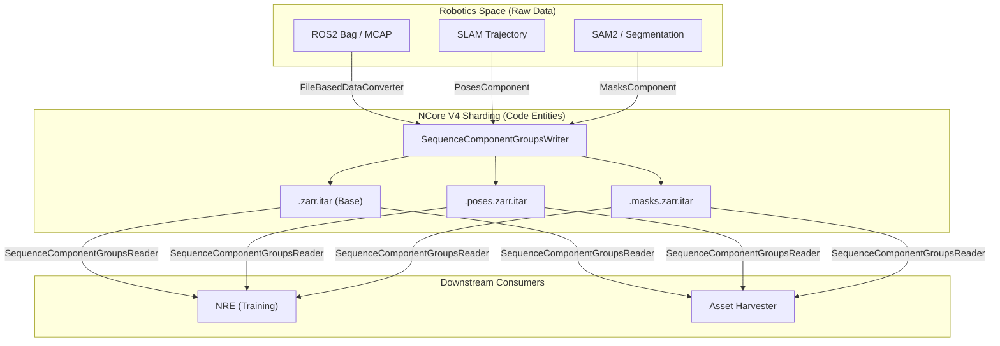
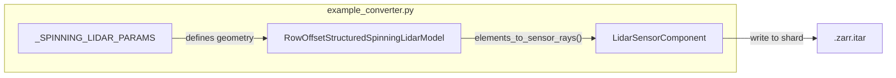

<!-- source: DeepWiki mcp.deepwiki.com · repo NVIDIA/nurec-skills · page 3.3 r2s Sharding Pattern and Robotics Pipelines · fetched 2026-10-26 -->

# r2s Sharding Pattern and Robotics Pipelines

Relevant source files

The following files were used as context for generating this wiki page:

- [skills/asset-harvester/evals/evals.json](skills/asset-harvester/evals/evals.json)
- [skills/ncore/SKILL.md](skills/ncore/SKILL.md)
- [skills/ncore/evals/evals.json](skills/ncore/evals/evals.json)
- [skills/ncore/ncore_template/impl/data_converter/example_converter.py](skills/ncore/ncore_template/impl/data_converter/example_converter.py)
- [skills/nre/evals/evals.json](skills/nre/evals/evals.json)
- [skills/nurec-index/SKILL.md](skills/nurec-index/SKILL.md)
- [skills/nurec-index/evals/evals.json](skills/nurec-index/evals/evals.json)
- [skills/physical-ai-datasets/SKILL.md](skills/physical-ai-datasets/SKILL.md)
- [skills/physical-ai-datasets/evals/evals.json](skills/physical-ai-datasets/evals/evals.json)

The **robotics-to-sim (r2s)** sharding architecture is a modular data pattern designed for high-performance ingestion and refinement of robotics sensor data within the NCore V4 ecosystem. Unlike monolithic files, r2s leverages sharded `.zarr.itar` archives to allow independent updates to poses, masks, and sensor data without re-writing the entire dataset [skills/ncore/SKILL.md:91-91]().

## Purpose and Scope

The r2s pattern enables:
1.  **Modular Refinement**: Updating ego-poses or semantic masks (e.g., from a new SLAM run or SAM2 model) without touching multi-gigabyte camera/LiDAR shards [skills/ncore/SKILL.md:44-46]().
2.  **LiDAR Motion Compensation**: Handling the rolling-shutter effect of spinning LiDARs through precise per-column azimuth and pose interpolation [skills/ncore/ncore_template/impl/data_converter/example_converter.py:65-108]().
3.  **Cross-Skill Handoff**: Providing a stable interface between `ncore` (ingestion), `nre` (reconstruction), and `asset-harvester` (object extraction) [skills/nurec-index/SKILL.md:80-84]().

## Architecture Overview

In an r2s pipeline, a single logical sequence is split across multiple physical shards linked by a common `sequence_id`.

### Shard Types

| Shard Extension | Content Description | Key Code Entities |
| :--- | :--- | :--- |
| `.zarr.itar` | **Base Shard**: Raw sensor data (JPEG images, LiDAR points, Radar). | `CameraSensorComponent`, `LidarSensorComponent` |
| `.poses.zarr.itar` | **Pose Shard**: 6-DoF trajectory of the rig and individual sensors. | `PosesComponent` |
| `.masks.zarr.itar` | **Mask Shard**: Ego-vehicle masks or semantic segmentation. | `MasksComponent` |
| `.intrinsics.zarr.itar` | **Intrinsics Shard**: Camera models (FTheta, Pinhole) and LiDAR beam elevations. | `IntrinsicsComponent` |

### System Data Flow

The following diagram bridges the robotics data space to the NCore V4 code entities.

**Robotics-to-Sim Data Flow**

**Sources:** [skills/ncore/ncore_template/impl/data_converter/example_converter.py:39-50](), [skills/ncore/SKILL.md:41-46]()

## LiDAR Motion Compensation

A critical component of robotics pipelines is the handling of spinning LiDAR sensors (e.g., Velodyne, Ouster, Hesai). The `ncore` implementation requires specific parameters to ensure spatial consistency in the reconstruction [skills/ncore/ncore_template/impl/data_converter/example_converter.py:65-108]().

### Key Parameters in `RowOffsetStructuredSpinningLidarModelParameters`

*   **`spinning_direction`**: Determines if the column index increases clockwise (`cw`) or counter-clockwise (`ccw`). A mismatch results in a Z-flip in NuRec [skills/ncore/ncore_template/impl/data_converter/example_converter.py:70-76]().
*   **`row_elevations_rad`**: Must be actual per-beam inclination angles. NCore requires these in **descending order** (highest beam first) [skills/ncore/ncore_template/impl/data_converter/example_converter.py:78-84]().
*   **`column_azimuths_rad`**: The actual per-column azimuth at frame start. NCore validates that azimuths are strictly increasing relative to the spin direction [skills/ncore/ncore_template/impl/data_converter/example_converter.py:86-97]().

**LiDAR Ingestion Logic**

**Sources:** [skills/ncore/ncore_template/impl/data_converter/example_converter.py:110-156]()

## Modular Refinement Workflow

The sharding pattern allows for a "multi-pass" refinement of the robotics data.

1.  **Initial Ingestion**: Convert raw logs using `FileBasedDataConverter` to create the base `.zarr.itar` and an initial `.poses.zarr.itar` [skills/ncore/ncore_template/impl/data_converter/example_converter.py:50-52]().
2.  **Pose Optimization**: Run a high-precision SLAM or bundle adjustment. The resulting poses are written to a *new* `.poses.zarr.itar` shard using `SequenceComponentGroupsWriter` [skills/ncore/ncore_template/impl/data_converter/example_converter.py:48-49]().
3.  **Semantic Masking**: Apply a model like SAM2 to the images in the base shard. The masks are saved to `.masks.zarr.itar` [skills/ncore/ncore_template/impl/data_converter/example_converter.py:44-44]().
4.  **Linking**: The `SequenceComponentGroupsReader` automatically links these shards by their shared `sequence_id` during NRE training [skills/ncore/ncore_template/impl/data_converter/example_converter.py:47-47]().

## Implementation Reference

### Key Classes
*   **`FileBasedDataConverter`**: The base class for authoring new robotics converters [skills/ncore/ncore_template/impl/data_converter/example_converter.py:50-50]().
*   **`SequenceComponentGroupsWriter`**: Handles the physical writing of shards to disk [skills/ncore/ncore_template/impl/data_converter/example_converter.py:48-48]().
*   **`PosesComponent` / `MasksComponent`**: Specific component writers that enforce V4 schema compliance [skills/ncore/ncore_template/impl/data_converter/example_converter.py:44-45]().

### Common Robotics Recipes
*   **ROS2 Bag (MCAP/SQLite3)**: Ingesting via `ncore` to handle multi-modal synchronization [skills/ncore/evals/evals.json:18-28]().
*   **Multi-Stereo Rigs**: Handling surround-view camera pairs with overlapping fields of view [skills/ncore/evals/evals.json:32-42]().
*   **Solid-State LiDAR (Livox)**: Managing non-repetitive scan patterns within the V4 structured format [skills/ncore/evals/evals.json:21-28]().

**Sources:**
- [skills/ncore/SKILL.md:41-46]()
- [skills/ncore/SKILL.md:91-91]()
- [skills/ncore/ncore_template/impl/data_converter/example_converter.py:39-52]()
- [skills/ncore/ncore_template/impl/data_converter/example_converter.py:65-108]()
- [skills/ncore/ncore_template/impl/data_converter/example_converter.py:110-156]()
- [skills/ncore/evals/evals.json:18-42]()
- [skills/nurec-index/SKILL.md:80-84]()

---

