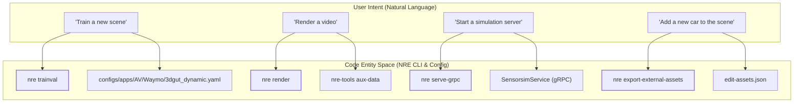
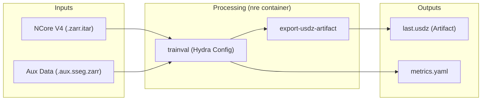

<!-- source: DeepWiki mcp.deepwiki.com · repo NVIDIA/nurec-skills · page 4 NRE: Neural Reconstruction Engine · fetched 2026-10-26 -->

# NRE: Neural Reconstruction Engine

Relevant source files

The following files were used as context for generating this wiki page:

- [skills/asset-harvester/SKILL.md](skills/asset-harvester/SKILL.md)
- [skills/nre/BENCHMARK.md](skills/nre/BENCHMARK.md)
- [skills/nre/SKILL.md](skills/nre/SKILL.md)
- [skills/nre/references/workflows.md](skills/nre/references/workflows.md)
- [skills/nre/skill-card.md](skills/nre/skill-card.md)

The **Neural Reconstruction Engine (NRE)** is the core skill for training, rendering, and manipulating 3D Gaussian Splatting reconstructions within the NuRec ecosystem. It consumes sensor data in **NCore V4** format and produces high-fidelity, renderable USDZ artifacts. NRE supports both local batch rendering and a high-performance gRPC-based sensor simulation API.

## Core Capabilities and Architecture

NRE is delivered via two primary Docker containers: `nvcr.io/nvidia/nre/nre` for training and gRPC services, and `nvcr.io/nvidia/nre/nre-tools` for auxiliary data generation [skills/nre/SKILL.md:38-39](). The engine implements the **3DGUT** (Gaussian Universal Training) and **3DGRT** (Ray-Traced) backends to reconstruct dynamic AV scenes [skills/nre/SKILL.md:53-54]().

### Natural Language to Code Entity Mapping

The following diagram bridges high-level user intents to the specific CLI commands and configuration entities used within the NRE skill.

**Intent-to-Entity Mapping**

Sources: [skills/nre/SKILL.md:74-88](), [skills/nre/references/workflows.md:7-54]()

## Data Flow and Pipeline

The NRE pipeline typically follows a linear progression from NCore shards to final rendered outputs.

**NRE Internal Data Flow**

Sources: [skills/nre/SKILL.md:113-118](), [skills/nre/references/workflows.md:7-23]()

## Key Sub-Topics

### [NRE Installation and Container Images](#4.1)
Covers the setup of the `nre` and `nre-tools` containers. It details the requirement for `NGC_API_KEY`, GPU prerequisites (Ampere/Hopper/Blackwell), and mandatory Docker configurations like `--shm-size=64g` [skills/nre/SKILL.md:18-24]().
*For details, see [NRE Installation and Container Images](#4.1).*

### [Hydra Configuration and Training Recipes](#4.2)
NRE uses Hydra to manage complex training parameters. Key recipes include `3dgut_dynamic.yaml` for Waymo and `car2sim_6cam.yaml` (via the `pai.yaml` overlay) for NVIDIA Physical AI datasets [skills/nre/SKILL.md:124-137]().
*For details, see [Hydra Configuration and Training Recipes](#4.2).*

### [NRE CLI Reference and Auxiliary Data](#4.3)
A comprehensive guide to the `nre` and `nre-tools` CLI. This includes training commands, artifact upgrading (`upgrade-artifact`), and the generation of semantic segmentation or depth shards required for high-quality reconstruction [skills/nre/SKILL.md:74-95]().
*For details, see [NRE CLI Reference and Auxiliary Data](#4.3).*

### [Local Rendering and Custom Rig Trajectories](#4.4)
Explains how to use `nre render` for offline batch processing. It covers rendering along the original sensor poses or defining custom trajectories for novel-view synthesis [skills/nre/references/workflows.md:19-20]().
*For details, see [Local Rendering and Custom Rig Trajectories](#4.4).*

### [gRPC Rendering API and Thin Client](#4.5)
Documents the `SensorsimService` gRPC interface. This allows low-latency, programmatically controlled rendering of RGB and LiDAR data, supporting integration with simulators like CARLA or Isaac Sim [skills/nre/references/workflows.md:20-22]().
*For details, see [gRPC Rendering API and Thin Client](#4.5).*

### [Asset Editing: Scene Manipulation via edit-assets.json](#4.6)
Describes the workflow for modifying scenes by inserting or removing actors. This utilizes `export-external-assets` to package **Asset Harvester** outputs and `edit-assets.json` to define scene transformations [skills/nre/references/workflows.md:43-54]().
*For details, see [Asset Editing: Scene Manipulation via edit-assets.json](#4.6).*

### [Example Workflows: Bash, Hydra, and OSMO](#4.7)
Provides ready-to-use templates for common tasks, including multi-GPU training (`trainer.world_size`), resuming from checkpoints (`resume=last`), and running end-to-end PAI pipelines [skills/nre/references/workflows.md:55-86]().
*For details, see [Example Workflows: Bash, Hydra, and OSMO](#4.7).*

### [NRE Troubleshooting and Teardown](#4.8)
A reference for resolving common issues such as OOM (Out of Memory) errors, container authentication failures, and disk space management [skills/nre/BENCHMARK.md:23-28]().
*For details, see [NRE Troubleshooting and Teardown](#4.8).*

## Summary Table of NRE Operations

| Operation | Tool / Command | Primary Output |
| :--- | :--- | :--- |
| **Train** | `nre trainval` | `last.ckpt`, `metrics.yaml` |
| **Export** | `nre export-usdz-artifact` | `last.usdz` |
| **Render (Local)** | `nre render` | `.mp4`, `.png` |
| **Render (API)** | `nre serve-grpc` | gRPC Stream (RGB/LiDAR) |
| **Aux Gen** | `nre-tools aux-data` | `.aux.sseg.zarr`, `.aux.depth.zarr` |
| **Edit** | `nre export-external-assets` | Repackaged USDZ + `edit-assets.json` |

Sources: [skills/nre/SKILL.md:74-95](), [skills/nre/references/workflows.md:7-54]()

---

