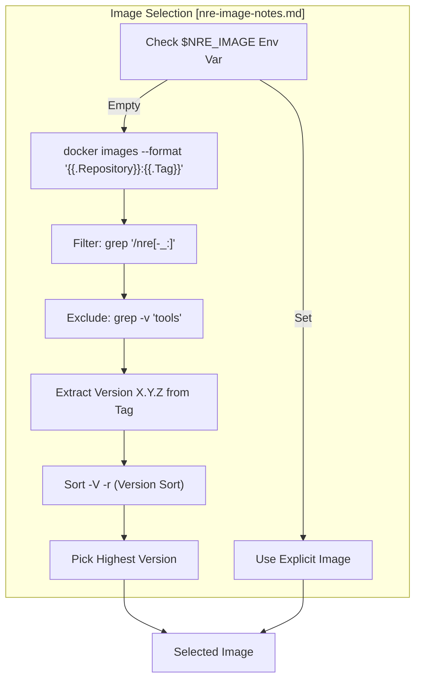
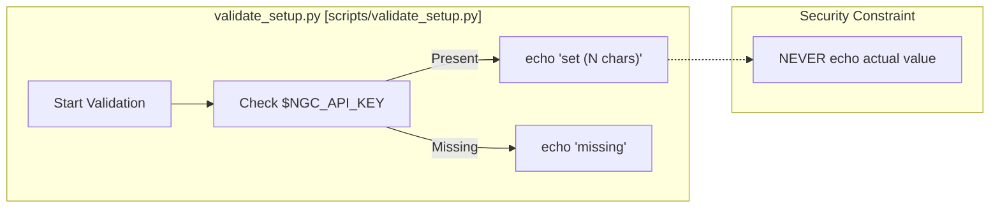

<!-- source: DeepWiki mcp.deepwiki.com · repo NVIDIA/nurec-skills · page 4.1 NRE Installation and Container Images · fetched 2026-10-26 -->

# NRE Installation and Container Images

<details>
<summary>Relevant source files</summary>

The following files were used as context for generating this wiki page:

- [skills/nre/references/install.md](skills/nre/references/install.md)
- [skills/nre/references/ngc-and-registry.md](skills/nre/references/ngc-and-registry.md)
- [skills/nre/references/nre-image-notes.md](skills/nre/references/nre-image-notes.md)

</details>


This page documents the installation procedures, container image architecture, and environment configuration for the Neural Reconstruction Engine (NRE). It covers the transition between General Availability (GA) and floating tags, security practices for secret management, and the specific container runtime requirements for high-fidelity neural rendering.

## Container Image Architecture

NRE is distributed via two primary container images hosted on the NVIDIA GPU Cloud (NGC) registry (`nvcr.io`). These images encapsulate the complex CUDA, PyTorch, and TensorRT dependencies required for Gaussian Splatting and volumetric rendering.

| Image Name | Primary Use Cases | SHM Requirement |
|:---|:---|:---|
| `nre/nre` | Training, Validation, Rendering (CLI/gRPC), USDZ Export, Model Serving. | `--shm-size=64g` |
| `nre-tools` | Auxiliary data generation, Asset Harvester subcommands, NCore V4 parsing. | `--shm-size=2g` |

### Tagging Strategy: GA vs. Floating
NRE follows a dual-tagging strategy to balance stability with ease of use:
*   **Floating Tags (`:latest`):** These tags always point to the most recent stable build. While convenient for initial setup, they may change behavior between checkout sessions [skills/nre/references/install.md:13-15]().
*   **Release Tags (`:25.11`, `:26.04`):** Pinned versions used when re-runnability and bit-exact reproducibility are required [skills/nre/references/install.md:13-15]().
*   **GA Channel:** General Availability builds are often mirrored with a `-ga` suffix (e.g., `nre-ga:latest`) for users directed to the enterprise-stable channel [skills/nre/references/install.md:17-20]().

### Image Selection Logic
When multiple NRE images are cached locally, the system uses a version-parsing logic to select the highest-versioned renderer image while excluding the `nre-tools` sibling.

**Image Discovery Data Flow**

Sources: [skills/nre/references/nre-image-notes.md:24-49]()

## Installation and Authentication

### Registry Access
Accessing NRE images requires an NVIDIA NGC account and an API Key. The system resolves keys in a specific priority order to support both developer environments and automated CI/CD pipelines.

**Credential Resolution Order:**
1.  `$NGC_CLI_API_KEY`: Primary source, often exported by automated provisioning systems [skills/nre/references/ngc-and-registry.md:19-21]().
2.  `$NGC_API_KEY`: Secondary fallback [skills/nre/references/ngc-and-registry.md:22-22]().
3.  **User Prompt:** Interactive fallback if no environment variables are detected [skills/nre/references/ngc-and-registry.md:23-24]().

### Authentication Commands
To authenticate the local Docker daemon:
```bash
echo "$NGC_KEY" | docker login nvcr.io -u '$oauthtoken' --password-stdin
```
The use of `--password-stdin` is mandatory to prevent the API key from appearing in process tables or shell history [skills/nre/references/install.md:47-50]().

## Prerequisites and Host Configuration

### Hardware Matrix
NRE requires modern NVIDIA hardware with high VRAM capacity for the 3D Gaussian Splatting (3DGS) optimization process.

| Component | Requirement | Notes |
|:---|:---|:---|
| **CPU Arch** | x86_64 | aarch64 is not supported [skills/nre/references/install.md:54-54](). |
| **GPU** | NVIDIA Ampere, Ada, Hopper, or Blackwell | >= 24GB VRAM (48GB+ recommended) [skills/nre/references/install.md:55-56](). |
| **Driver** | R550+ (R570+ recommended) | Blackwell requires R580+ [skills/nre/references/install.md:57-60](). |
| **Runtime** | Docker >= 23.0.1 + NVIDIA Container Toolkit >= 1.13.5 | Must support `--runtime=nvidia` [skills/nre/references/install.md:62-64](). |

### Bind-Mount and UID Threading
The NRE container expects two primary host bind mounts:
1.  **Dataset Mount:** Read-only access to NCore V4 shards and auxiliary data [skills/nre/references/install.md:22-23]().
2.  **Output Mount:** Read-write access for artifacts, checkpoints, and renders [skills/nre/references/install.md:22-23]().

To prevent permission issues where output files are owned by `root`, all `docker run` commands should thread the host's UID and GID:
```bash
docker run -u "$(id -u):$(id -g)" ...
```
Sources: [skills/nre/references/install.md:75-80]()

## Security and Validation

### Safe Secret Verification
Ad-hoc bash scripts that interpolate secrets can inadvertently leak tokens to logs. NRE documentation mandates a length-only check for verification.

**Validation Logic**

Sources: [skills/nre/references/install.md:27-45]()

### Memory and SHM Sizing
Shared memory (`/dev/shm`) is critical for the multi-GPU communication and data loading patterns in NRE.
*   **Training/Render:** Requires `--shm-size=64g` to accommodate large Gaussian attribute tensors [skills/nre/references/install.md:73-74]().
*   **Tools:** Requires `--shm-size=2g` for basic NCore parsing [skills/nre/references/install.md:73-74]().

## Version-Specific Rendering Flags

The NRE image family introduces specific flags starting with version `26.04` to handle different rendering backends.

| Flag | Behavior |
|:---|:---|
| `--renderer default` | **Recommended.** Loads the artifact's natively-trained renderer (e.g., `3dgut-gsplat` or `3dgut-nrend`) [skills/nre/references/nre-image-notes.md:100-103](). |
| `--renderer gsplat` | Forces the `gsplat` rasterizer. Compatible with all 3DGUT artifacts but may cause flicker on `nrend`-trained models [skills/nre/references/nre-image-notes.md:103-110](). |
| `--renderer nrend` | Uses the `NRendWrapper` (C++/CUDA) path. Highly sensitive to spherical harmonic (SH) tensor shapes [skills/nre/references/nre-image-notes.md:118-124](). |
| `--image-format jpeg` | **Default.** 10x faster encoding and 6x smaller file sizes than PNG [skills/nre/references/nre-image-notes.md:126-134](). |

Sources: [skills/nre/references/nre-image-notes.md:59-69](), [skills/nre/references/nre-image-notes.md:100-124]()

---

