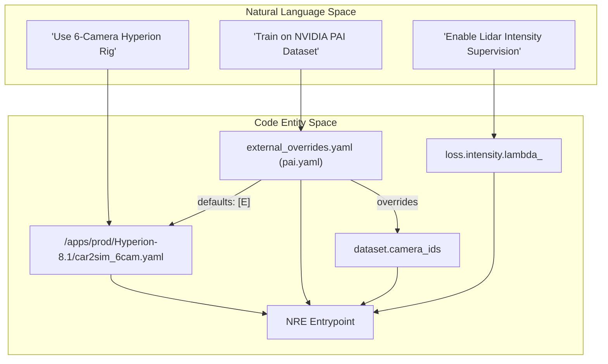
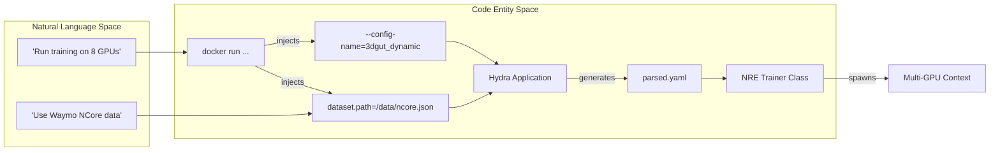

<!-- source: DeepWiki mcp.deepwiki.com · repo NVIDIA/nurec-skills · page 4.2 Hydra Configuration and Training Recipes · fetched 2026-10-26 -->

# Hydra Configuration and Training Recipes

Relevant source files

The following files were used as context for generating this wiki page:

- [skills/nre/references/configs/pai.yaml](skills/nre/references/configs/pai.yaml)
- [skills/nre/references/configuration.md](skills/nre/references/configuration.md)
- [skills/nre/references/example-workflows/hydra/download-pai-samples.yaml](skills/nre/references/example-workflows/hydra/download-pai-samples.yaml)
- [skills/nre/references/example-workflows/hydra/nre-overrides/pai.yaml](skills/nre/references/example-workflows/hydra/nre-overrides/pai.yaml)
- [skills/nre/references/example-workflows/hydra/nre-overrides/waymo.yaml](skills/nre/references/example-workflows/hydra/nre-overrides/waymo.yaml)
- [skills/nre/references/example-workflows/hydra/paths.yaml](skills/nre/references/example-workflows/hydra/paths.yaml)

The Neural Reconstruction Engine (NRE) utilizes [Hydra](https://hydra.cc/) to manage its extensive configuration space. Training recipes are structured hierarchically, allowing users to inherit from production-grade baselines while overriding dataset-specific parameters such as sensor IDs, sampling rates, and loss weights.

## Configuration Hierarchy and Resolution

NRE configuration is resolved at runtime by the containerized training application. The `--config-name` passed to the entrypoint is interpreted relative to the internal `configs/` tree within the NRE image [skills/nre/references/configuration.md:20-22]().

### Base Recipes
Base recipes define the fundamental model architecture and densification strategies. Key families include:

| Recipe Family | Purpose | Key Files |
|:---|:---|:---|
| **3DGUT** | 3D Gaussian Uncertainty-aware Training. | `configs/apps/AV/Waymo/3dgut_dynamic.yaml` [skills/nre/references/configuration.md:44]() |
| **3DGRT** | 3D Gaussian Ray Tracing. | `configs/apps/AV/NV/3dgrt_dynamic.yaml` [skills/nre/references/configuration.md:104]() |
| **Car2Sim** | Hyperion-8.1 6-camera production recipe. | `/apps/prod/Hyperion-8.1/car2sim_6cam.yaml` [skills/nre/references/configuration.md:68]() |

### Dataset-Specific Overlays
Overlays adapt base recipes to specific dataset rigs. For example, the Waymo recipes bake in `camera_front_50fov` and `lidar_top` [skills/nre/references/configuration.md:54-57](), while PandaSet recipes include a 260-pixel bottom mask for the `back_camera` [skills/nre/references/configuration.md:115-118]().

### Configuration Data Flow
The following diagram illustrates how high-level dataset requirements are transformed into specific code entities via the Hydra override pattern.

**Title: Configuration Override and Resolution Flow**

**Sources:** [skills/nre/references/configs/pai.yaml:1-21](), [skills/nre/references/configuration.md:59-81]()

---

## The `pai.yaml` Override Pattern

For the NVIDIA Physical AI (PAI) dataset, NRE uses a "thin overlay" pattern. Instead of modifying the base `car2sim_6cam.yaml`, users mount a custom `pai.yaml` into the container to handle PAI-specific requirements [skills/nre/references/configs/pai.yaml:1-4]().

### Key Overrides in `pai.yaml`
1.  **Sensor Guard**: Explicitly defines `camera_ids` (front wide, tele, cross, and rear) and `lidar_ids` (`lidar_top_360fov`) to match the `pai-to-ncore` export [skills/nre/references/configs/pai.yaml:23-44]().
2.  **Lidar Intensity**: Adds `intensity` as an extra signal to all model layers (background, road, dynamic) so the model predicts it during validation [skills/nre/references/configs/pai.yaml:12-20]().
3.  **Loss Supervision**: Sets `loss.intensity.lambda_: 1.0` to ensure the predicted intensity is learned rather than remaining meaningless [skills/nre/references/configs/pai.yaml:53-59]().

**Sources:** [skills/nre/references/configs/pai.yaml:10-59](), [skills/nre/references/example-workflows/hydra/nre-overrides/pai.yaml:1-59]()

---

## The `parsed.yaml` Lifecycle

When an NRE training run begins, Hydra resolves the entire configuration tree into a single, flat file named `parsed.yaml`.

### Purpose and Location
*   **Location**: Found at `/workdir/output/<RUN-ID>/config/parsed.yaml` [skills/nre/references/configuration.md:142]().
*   **Reproducibility**: This file contains every parameter used for the run, including defaults that were not explicitly overridden.
*   **Resumption**: To resume a training run or perform additional validation, users can pass `--config-name=parsed.yaml` (after mounting the previous output directory) to ensure bit-identical configuration [skills/nre/references/configuration.md:7-8]().

**Sources:** [skills/nre/references/configuration.md:1-12](), [skills/nre/references/configuration.md:140-142]()

---

## Multi-GPU Training and Hydra Execution

NRE supports multi-GPU training via `torchrun` or internal distribution logic. Configuration for distributed runs is typically handled via Hydra system overrides.

### Execution Workflow
The following diagram bridges the user command-line intent to the internal execution entities.

**Title: NRE Execution and Config Injection**

**Sources:** [skills/nre/references/configuration.md:3-16](), [skills/nre/references/example-workflows/hydra/nre-overrides/waymo.yaml:1-47]()

### Common CLI Overrides
When launching via `docker run`, the following Hydra overrides are standard [skills/nre/references/configuration.md:9-11]():
*   `mode=<train|val|trainval>`: Defines the execution phase.
*   `dataset.path=<path>`: The path to the NCore JSON index inside the container.
*   `out_dir=<path>`: The target directory for checkpoints and artifacts.
*   `trainer.max_epochs`: Overrides the default training duration [skills/nre/references/example-workflows/hydra/nre-overrides/waymo.yaml:22]().

**Sources:** [skills/nre/references/configuration.md:1-16](), [skills/nre/references/example-workflows/hydra/nre-overrides/waymo.yaml:8-47]()

---

