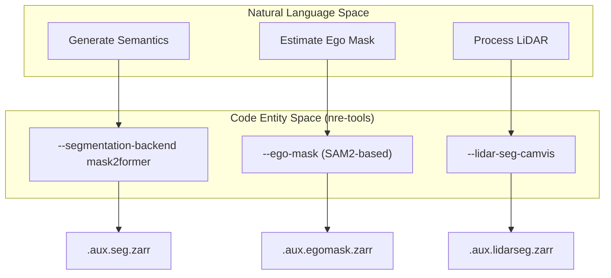
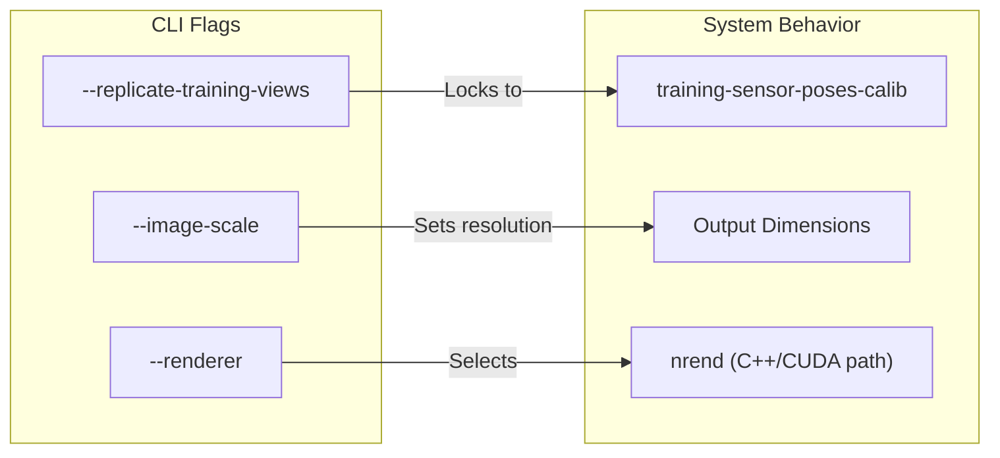

<!-- source: DeepWiki mcp.deepwiki.com · repo NVIDIA/nurec-skills · page 4.3 NRE CLI Reference and Auxiliary Data · fetched 2026-10-26 -->

# NRE CLI Reference and Auxiliary Data

Relevant source files

The following files were used as context for generating this wiki page:

- [skills/nre/references/aux-data.md](skills/nre/references/aux-data.md)
- [skills/nre/references/cli-reference.md](skills/nre/references/cli-reference.md)
- [skills/nre/references/cookbook.md](skills/nre/references/cookbook.md)
- [skills/nre/references/long-running-tasks.md](skills/nre/references/long-running-tasks.md)

This page provides a comprehensive technical reference for the Neural Reconstruction Engine (NRE) command-line interface and the auxiliary data pipeline. The NRE CLI is the primary interface for training reconstructions, rendering frames, and exporting assets, while the `nre-tools` container handles the generation of required per-frame signals.

## 1. NRE Container Entry Points

The NRE system is distributed via the `nvcr.io/nvidia/nre/nre` Docker image. It uses a dual-mode entry point: if no sub-command is provided, it defaults to the Hydra training/validation application; otherwise, it dispatches to specific utility sub-commands [skills/nre/references/cli-reference.md:63-69]().

### 1.1 Training and Validation (Default Mode)
Training is the core operation of NRE, consuming NCore V4 datasets and producing USDZ artifacts.

| Override | Default | Purpose |
|----------|---------|---------|
| `--config-name` | (required) | Path to the Hydra recipe (e.g., `configs/apps/AV/Waymo/3dgut_dynamic.yaml`) [skills/nre/references/cli-reference.md:88](). |
| `mode` | `trainval` | Execution mode: `train`, `val`, or `trainval` [skills/nre/references/cli-reference.md:89](). |
| `dataset.path` | (required) | Path to the NCore JSON manifest inside the container [skills/nre/references/cli-reference.md:90](). |
| `out_dir` | (required) | Output directory for checkpoints and logs [skills/nre/references/cli-reference.md:91](). |

**Implementation Detail:** Training utilizes `torch.set_float32_matmul_precision` (defaulting to `medium`) and supports multi-GPU scaling via `trainer.world_size` [skills/nre/references/cli-reference.md:95-96]().

### 1.2 Sub-command Reference Table

| Sub-command | Primary Function |
|-------------|------------------|
| `render` | Local (non-gRPC) frame rendering from a USDZ artifact [skills/nre/references/cli-reference.md:25](). |
| `serve-grpc` | Launches the `SensorsimService` for remote rendering [skills/nre/references/cli-reference.md:26](). |
| `export-gaussian-plys` | Exports per-layer Gaussian `.ply` files [skills/nre/references/cli-reference.md:29](). |
| `export-mesh` | Generates Poisson triangle meshes from fused point clouds [skills/nre/references/cli-reference.md:31](). |
| `export-external-assets` | Repackages Asset-Harvester output for NRE ingestion [skills/nre/references/cli-reference.md:42](). |
| `eval-rendering-metrics` | Computes PSNR, SSIM, and LPIPS against ground truth [skills/nre/references/cli-reference.md:51](). |
| `upgrade-artifact` | Migrates a `.usdz` file to a newer NRE version schema [skills/nre/references/cli-reference.md:49](). |

**Sources:** [skills/nre/references/cli-reference.md:20-57](), [skills/nre/references/cli-reference.md:86-106]()

---

## 2. Auxiliary Data Pipeline (nre-tools)

Before NRE can begin training, it requires auxiliary signals (semantics, depth, ego-masks) produced by the `nvcr.io/nvidia/nre/nre-tools` container [skills/nre/references/aux-data.md:3-9]().

### 2.1 Data Flow and Generation
The `nre-tools` pipeline processes NCore V4 shards to generate `.aux.<kind>.zarr` files.

**Natural Language to Code Entity Mapping: Aux Pipeline**

### 2.2 Key Configuration Flags
*   **Segmentation:** Controlled by `--segmentation-backend` (defaults to `mask2former`) [skills/nre/references/aux-data.md:104]().
*   **Depth:** Supports `depthanythingv2` via `--depth-backend` [skills/nre/references/aux-data.md:112]().
*   **Ego-Mask:** Automatic SAM2-based estimation enabled via `--ego-mask` [skills/nre/references/aux-data.md:117]().
*   **Storage:** Defaults to `itar` (indexed tar) for production efficiency [skills/nre/references/aux-data.md:121]().

**Sources:** [skills/nre/references/aux-data.md:10-26](), [skills/nre/references/aux-data.md:91-129]()

---

## 3. Rendering Operations

NRE supports two primary rendering paths: local CLI-based rendering and gRPC-based service rendering.

### 3.1 Local Rendering (`render`)
The `render` sub-command is used for high-fidelity playback or generating training-view replicates without a server.

**Code Entity Association: Render Parameters**

### 3.2 Exporting Artifacts
NRE provides specialized exporters to bridge the gap between neural reconstructions and standard 3D formats.
*   **`export-usdz-artifact`**: Re-bundles a configuration and checkpoint into a portable USDZ [skills/nre/references/cli-reference.md:43]().
*   **`export-gaussian-usd-asset`**: Specifically for downstream USD pipelines [skills/nre/references/cli-reference.md:30]().
*   **`export-external-assets`**: Creates the `edit-assets.json` stub required for actor insertion [skills/nre/references/cli-reference.md:42]().

**Sources:** [skills/nre/references/cli-reference.md:25-43](), [skills/nre/references/cookbook.md:91-145]()

---

## 4. Execution Conventions

### 4.1 Long-Running Task Protocol
Any NRE task expected to exceed 5 minutes (e.g., training, batch renders, custom rig bakes) must follow the subagent delegation rule [skills/nre/references/long-running-tasks.md:15-19]().

1.  **Delegation:** Use the `Task` tool to spawn a subagent [skills/nre/references/long-running-tasks.md:106]().
2.  **Ticker:** The subagent must report status every 5 minutes including `state`, `elapsed`, and `last log line` [skills/nre/references/long-running-tasks.md:18-24]().
3.  **Non-blocking:** The parent agent remains responsive to user queries while the subagent polls the background process [skills/nre/references/long-running-tasks.md:116-118]().

### 4.2 Resource Management
*   **Shared Memory:** NRE training requires significant SHM (e.g., `--shm-size=64g`) [skills/nre/references/cli-reference.md:74]().
*   **Permissions:** Use `-u "$(id -u):$(id -g)"` to ensure output files are owned by the host user [skills/nre/references/cookbook.md:17]().

**Sources:** [skills/nre/references/long-running-tasks.md:1-33](), [skills/nre/references/long-running-tasks.md:101-119](), [skills/nre/references/cookbook.md:15-30]()

---

