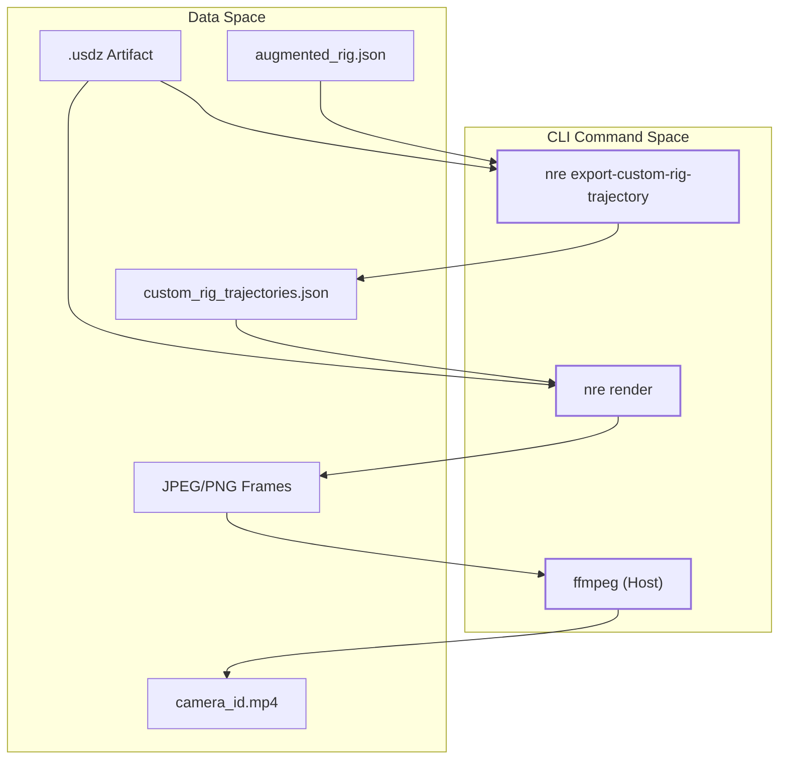
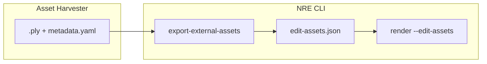

<!-- source: DeepWiki mcp.deepwiki.com · repo NVIDIA/nurec-skills · page 4.4 Local Rendering and Custom Rig Trajectories · fetched 2026-10-26 -->

# Local Rendering and Custom Rig Trajectories

<details>
<summary>Relevant source files</summary>

The following files were used as context for generating this wiki page:

- [skills/nre/references/asset-editing.md](skills/nre/references/asset-editing.md)
- [skills/nre/references/custom-rig-trajectories/048b974e_custom_rig_trajectories.json](skills/nre/references/custom-rig-trajectories/048b974e_custom_rig_trajectories.json)
- [skills/nre/references/custom-rig-trajectories/0fd06bc3_custom_rig_trajectories.json](skills/nre/references/custom-rig-trajectories/0fd06bc3_custom_rig_trajectories.json)
- [skills/nre/references/local-render.md](skills/nre/references/local-render.md)
- [skills/nre/references/mp4-encoding.md](skills/nre/references/mp4-encoding.md)
- [skills/nre/references/rig-json/augmented_rig.json](skills/nre/references/rig-json/augmented_rig.json)
- [skills/nre/references/rig-json/rig.json](skills/nre/references/rig-json/rig.json)

</details>


This page documents the local rendering capabilities of the Neural Reconstruction Engine (NRE). While NRE supports gRPC-based rendering for high-throughput applications, local rendering via the CLI allows for direct interaction with trained artifacts for validation, visualization, and custom trajectory generation using the host's GPU.

## Overview and Execution Environment

Local rendering is performed using the `nre` container image via `docker run`. It requires a host with NVIDIA GPU support (`--gpus all`) and appropriate mount points for input USDZ artifacts, rig definitions, and output directories [skills/nre/references/local-render.md:18-34]().

### Host Mount Conventions
*   **INPUT_USDZ_HOST** → `/inputs/usdz`: Contains the `.usdz` reconstruction files [skills/nre/references/local-render.md:32-32]().
*   **INPUT_RIG_HOST** → `/inputs/augmented_rig`: Contains `*_augmented.json` rig definitions [skills/nre/references/local-render.md:33-33]().
*   **OUTPUT_HOST** → `/outputs`: Destination for rendered frames and metadata [skills/nre/references/local-render.md:34-34]().

### Code Entity Space: Local Rendering Flow
The following diagram illustrates the relationship between CLI commands and the data they consume or produce.


**Sources:** [skills/nre/references/local-render.md:88-116](), [skills/nre/references/mp4-encoding.md:46-63]()

## Render Modes

NRE provides two primary options for local rendering based on the complexity of the desired camera movement.

### Option 1: Rig Offset (Simple)
Used when the target view is a fixed translation or rotation offset from the original recorded rig. It does not require an external JSON rig file [skills/nre/references/local-render.md:67-67]().
*   **Parameters:** `--rig-translation-offset` and `--rig-rotation-offset`.
*   **Rotation Convention:** `(yaw, -roll, -pitch)` in degrees [skills/nre/references/local-render.md:70-72]().

### Option 2: Custom Rig Trajectory (Full)
Used when a user provides a completely new or augmented rig definition (e.g., a "virtual" camera rig). This requires a two-step process unless a cache hit occurs [skills/nre/references/local-render.md:68-68]().

1.  **Export Trajectory:** Call `export-custom-rig-trajectory` to bake the augmented rig into the scene's coordinate system, producing a `custom_rig_trajectories.json` [skills/nre/references/local-render.md:96-97]().
2.  **Render:** Call `render --custom-rig-trajectory <path_to_json>` to generate frames [skills/nre/references/local-render.md:98-98]().

**Sources:** [skills/nre/references/local-render.md:63-75]()

## Performance Characteristics

Local rendering via the CLI incurs a "Cold-Start Tax" because every `docker run` invocation must initialize the CUDA context and deserialize the USDZ artifact.

| Phase | Duration (A100 40GB) | Description |
| :--- | :--- | :--- |
| **CLI Cold-Start Tax** | ~50s per container | Docker boot, Python imports, CUDA init, USDZ deserialization [skills/nre/references/local-render.md:104-106](). |
| **Option 2 Total Tax** | ~85s per turn | Requires two containers (Export + Render) [skills/nre/references/local-render.md:109-111](). |
| **Pre-baked Cache Hit** | ~50s per turn | Elides the export step if the rig/UUID matches the cache [skills/nre/references/local-render.md:115-117](). |
| **Steady-State Render** | 22–42 ms/frame | The actual neural rendering time per frame [skills/nre/references/local-render.md:145-145](). |

### Pre-baked Trajectory Cache
To mitigate the cold-start tax for common evaluation clips, NRE looks for pre-computed trajectories in `skills/nre/references/custom-rig-trajectories/` [skills/nre/references/local-render.md:92-95](). If the USDZ matches a cached UUID prefix (e.g., `048b974e_custom_rig_trajectories.json`), the export step is skipped [skills/nre/references/custom-rig-trajectories/048b974e_custom_rig_trajectories.json:1-60]().

**Sources:** [skills/nre/references/local-render.md:78-150](), [skills/nre/references/custom-rig-trajectories/048b974e_custom_rig_trajectories.json:1-85]()

## Asset Editing and Scene Manipulation

Local rendering supports scene modification through `edit-assets.json`. This allows for removing, replacing, or inserting 3D assets (e.g., cars, trucks) into the reconstruction.

### Data Flow: Asset Insertion

**Sources:** [skills/nre/references/asset-editing.md:11-33]()

### Implementation Details
*   **`remove`**: A list of `track_id` strings to filter out at render time [skills/nre/references/asset-editing.md:126-133]().
*   **`replace`**: Maps an `original_id` from the artifact to a `replacement_id` from external assets [skills/nre/references/asset-editing.md:143-151]().
*   **`insert`**: Adds new tracks using the `CuboidTracks.to_dict()` layout, specifying poses and timestamps [skills/nre/references/asset-editing.md:189-199]().

**Sources:** [skills/nre/references/asset-editing.md:101-199]()

## MP4 Encoding

NRE renders produce individual image frames (JPEG or PNG). These must be encoded into MP4s for viewing.

### Host-side ffmpeg
The recommended approach is using `ffmpeg` on the host after the container exits. This streams frames from disk and avoids container memory overhead [skills/nre/references/mp4-encoding.md:15-19]().

**Naming Convention (Required for Viewers):**
*   `gt_camera_<id>.mp4`: Ground Truth [skills/nre/references/mp4-encoding.md:35-35]().
*   `camera_<id>.mp4`: Adapted/Neural Render [skills/nre/references/mp4-encoding.md:36-36]().

### Encoding Command Template
```bash
ffmpeg -y -framerate 30 -pattern_type glob -i "${FRAME_DIR}/*.jpeg" \
  -c:v libx264 -pix_fmt yuv420p \
  "$SEQ_DIR/${CAMERA_ID}.mp4"
```
[skills/nre/references/mp4-encoding.md:60-63]()

**Sources:** [skills/nre/references/mp4-encoding.md:1-70]()

---

