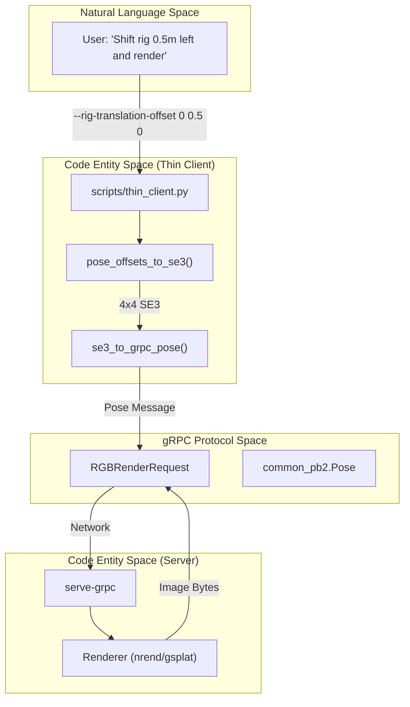
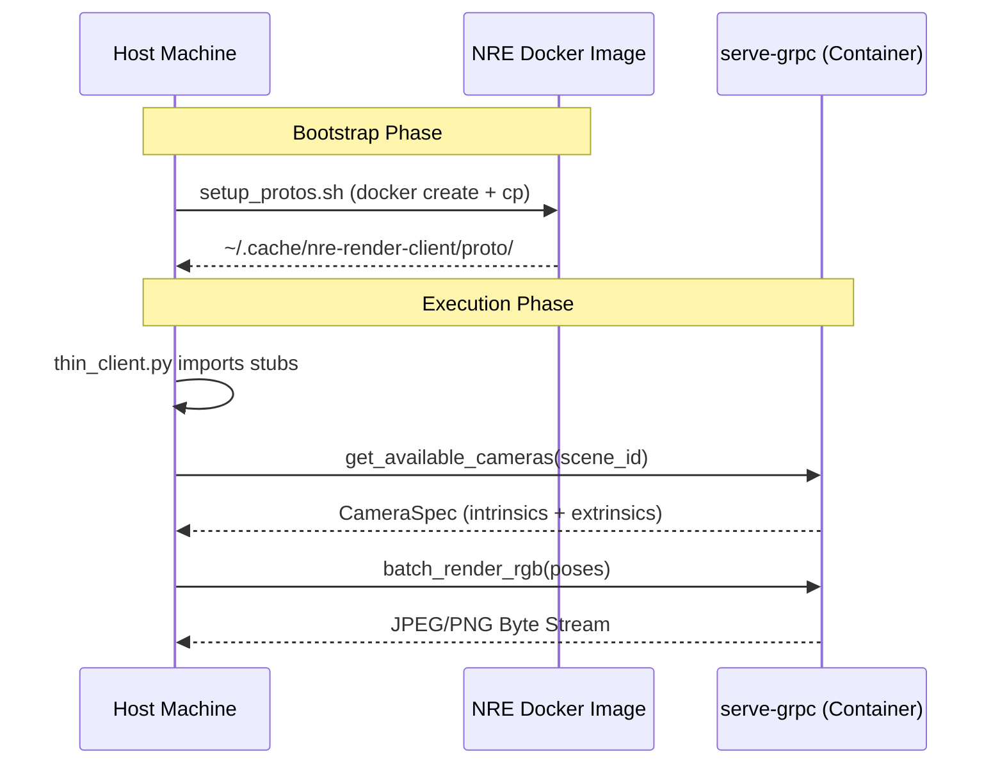

<!-- source: DeepWiki mcp.deepwiki.com · repo NVIDIA/nurec-skills · page 4.5 gRPC Rendering API and Thin Client · fetched 2026-10-26 -->

# gRPC Rendering API and Thin Client

Relevant source files

The following files were used as context for generating this wiki page:

- [skills/nre/references/NRE_RenderClient/README.md](skills/nre/references/NRE_RenderClient/README.md)
- [skills/nre/references/NRE_RenderClient/scripts/setup_protos.sh](skills/nre/references/NRE_RenderClient/scripts/setup_protos.sh)
- [skills/nre/references/NRE_RenderClient/scripts/thin_client.py](skills/nre/references/NRE_RenderClient/scripts/thin_client.py)
- [skills/nre/references/grpc-api.md](skills/nre/references/grpc-api.md)
- [skills/nre/scripts/session_teardown.sh](skills/nre/scripts/session_teardown.sh)
- [skills/nre/scripts/session_warm_server.sh](skills/nre/scripts/session_warm_server.sh)

The Neural Reconstruction Engine (NRE) provides a high-performance gRPC interface for remote rendering, enabling external clients to request RGB and LiDAR frames from trained reconstructions without the overhead of per-frame CLI invocations [skills/nre/references/grpc-api.md:3-5](). This architecture supports "warm-server" sessions where a single long-running container serves multiple rendering requests, significantly reducing latency by avoiding repeated CUDA context initialization and model loading [skills/nre/references/NRE_RenderClient/README.md:4-15]().

## System Architecture

The gRPC rendering ecosystem consists of three primary components:
1.  **SensorsimService (Server):** The NRE container running the `serve-grpc` command [skills/nre/references/grpc-api.md:9]().
2.  **NRE_RenderClient (Thin Client):** A host-side Python client (`scripts/thin_client.py`) that communicates with the server via gRPC stubs [skills/nre/references/NRE_RenderClient/README.md:21-27]().
3.  **Session Orchestration:** Scripts for idempotent server lifecycle management (`session_warm_server.sh` and `session_teardown.sh`) [skills/nre/scripts/session_warm_server.sh:2-9]().

### Data Flow: Natural Language to Code Entity Space

The following diagram illustrates how a high-level user request for a "novel view" translates into specific code entities and gRPC messages.

**Diagram: Novel View Request Flow**

**Sources:** [skills/nre/references/NRE_RenderClient/scripts/thin_client.py:31-37](), [skills/nre/references/NRE_RenderClient/scripts/thin_client.py:167-173](), [skills/nre/references/grpc-api.md:112-113]()

---

## SensorsimService Interface

The gRPC service is defined in `nre/grpc/protos/sensorsim.proto` [skills/nre/references/grpc-api.md:18](). It manages scene loading, camera discovery, and frame synthesis.

### Core RPC Methods

| RPC Method | Request Type | Purpose |
| :--- | :--- | :--- |
| `render_rgb` | `RGBRenderRequest` | Renders a single RGB frame for a specific camera and pose [skills/nre/references/grpc-api.md:112](). |
| `batch_render_rgb` | `BatchRGBRenderRequest` | Renders multiple cameras/frames in one server-side scheduling unit [skills/nre/references/grpc-api.md:113](). |
| `render_lidar` | `LidarRenderRequest` | Generates a LiDAR sweep (returns XYZ and intensity buffers) [skills/nre/references/grpc-api.md:114](). |
| `edit_assets` | `EditAssetsRequest` | Mutates the model by replacing or inserting dynamic-object tracks [skills/nre/references/grpc-api.md:110](). |
| `restore_model_parameters`| `RestoreModelParametersRequest` | Reverts asset edits to the original trained state [skills/nre/references/grpc-api.md:111](). |
| `get_available_scenes` | `Empty` | Lists USDZ scene IDs currently loaded or discoverable [skills/nre/references/grpc-api.md:104](). |

**Sources:** [skills/nre/references/grpc-api.md:100-115]()

---

## NRE Render Client (Thin Client)

The `thin_client.py` script provides a low-latency alternative to the `nre render` CLI. It bypasses the "Docker cold-start tax" (Docker boot, Python interpreter startup, and CUDA context init) by maintaining a persistent connection to a warm server [skills/nre/references/NRE_RenderClient/README.md:4-9]().

### Key Features
*   **Novel View Generation:** Supports `--rig-translation-offset` and `--rig-rotation-offset` to shift the ego-vehicle rig relative to the recorded trajectory [skills/nre/references/NRE_RenderClient/scripts/thin_client.py:31-37]().
*   **Rig Overrides:** The `--rig-file` flag allows overriding camera intrinsics (e.g., adding windshield distortion) at request time [skills/nre/references/NRE_RenderClient/scripts/thin_client.py:44-51]().
*   **Runtime Scene Loading:** Uses `SceneDownloadInterceptor` to register new USDZ scenes via `--scene-url` without restarting the server [skills/nre/references/NRE_RenderClient/scripts/thin_client.py:38-43]().

### Setup and Stub Extraction
Because the gRPC stubs (`_pb2.py`) must match the server's protobuf version, the `setup_protos.sh` script extracts the pre-generated stubs directly from the NRE Docker image [skills/nre/references/NRE_RenderClient/scripts/setup_protos.sh:2-4]().

**Diagram: Client Bootstrap and Execution**

**Sources:** [skills/nre/references/NRE_RenderClient/scripts/setup_protos.sh:154-159](), [skills/nre/references/NRE_RenderClient/scripts/thin_client.py:12-20](), [skills/nre/references/NRE_RenderClient/README.md:105-107]()

---

## Session Management

To facilitate "warm" sessions, the repository provides orchestration scripts that handle image discovery and container lifecycle.

### `session_warm_server.sh`
This script performs an idempotent boot of the gRPC server. It:
1.  **Discovers Images:** Iterates through locally cached NRE images, sorting by version tag to find the highest compatible version (>= 26.04) [skills/nre/scripts/session_warm_server.sh:117-132]().
2.  **Validates Capabilities:** Checks if the image supports required features like `SceneDownloadInterceptor` [skills/nre/scripts/session_warm_server.sh:81-83]().
3.  **Manages Mounts:** Bind-mounts a host directory (via `NRE_GRPC_USDZ_HOST_DIR`) where USDZ artifacts are stored [skills/nre/scripts/session_warm_server.sh:47-52]().
4.  **Tracks State:** Writes the container ID and port to `/tmp/nre-grpc-session.state` for later teardown [skills/nre/scripts/session_warm_server.sh:85-86]().

### `session_teardown.sh`
Stops and removes the warm server container. It is idempotent and ensures the container is fully reaped from `docker ps` before exiting to prevent naming collisions on subsequent boots [skills/nre/scripts/session_teardown.sh:2-12]().

**Sources:** [skills/nre/scripts/session_warm_server.sh:2-86](), [skills/nre/scripts/session_teardown.sh:2-24]()

---

