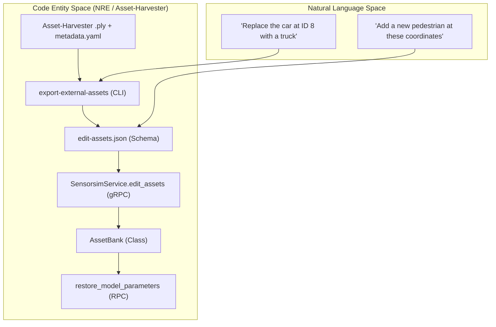
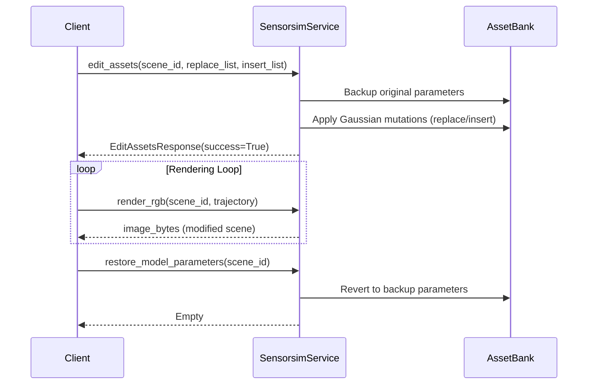

<!-- source: DeepWiki mcp.deepwiki.com · repo NVIDIA/nurec-skills · page 4.6 Asset Editing: Scene Manipulation via edit-assets.json · fetched 2026-10-26 -->

# Asset Editing: Scene Manipulation via edit-assets.json

Relevant source files

The following files were used as context for generating this wiki page:

- [skills/nre/references/asset-editing.md](skills/nre/references/asset-editing.md)
- [skills/nre/references/cli-reference.md](skills/nre/references/cli-reference.md)
- [skills/nre/references/grpc-api.md](skills/nre/references/grpc-api.md)
- [skills/nre/references/local-render.md](skills/nre/references/local-render.md)

This section documents the end-to-end lifecycle for manipulating 3D assets within a trained Neural Reconstruction Engine (NRE) scene. The system supports removing original dynamic actors, replacing them with new assets, or inserting entirely new actors into the reconstruction using a JSON-driven orchestration layer.

## Pipeline Architecture

Asset editing bridges the output of **Asset-Harvester** (which extracts 3D Gaussian Splat assets from raw data) with the **NRE gRPC Server** (which renders the modified scene). The process involves repackaging the trained USDZ artifact to include external assets and then applying mutations in memory during a rendering session.

### Data Flow: Asset Harvesting to Rendering

The diagram below illustrates how natural language concepts (like "replacing a car") translate into specific code entities and CLI operations.

**Natural Language to Code Entity Mapping**

Sources: [skills/nre/references/asset-editing.md:9-33](), [skills/nre/references/grpc-api.md:109-111]()

## 1. Repackaging: export-external-assets

The first step in the editing lifecycle is incorporating harvested assets into the NRE environment. The `export-external-assets` sub-command takes a trained USDZ and a directory of Asset-Harvester outputs to create a new, "editable" USDZ artifact.

### Artifact Structure
When repackaged, the new USDZ contains an `external_assets/` directory in its internal zip layout:
*   **`<track_id>/<track_id>.ply`**: The Gaussian splat geometry for each asset.
*   **`metadata.yaml`**: A mirror of the Asset-Harvester metadata, including `label_class` and `cuboid_dims`.

Sources: [skills/nre/references/asset-editing.md:71-96](), [skills/nre/references/cli-reference.md:42-42]()

## 2. The edit-assets.json Schema

The `edit-assets.json` file is the primary interface for defining scene mutations. It is a structured JSON representation of the operations supported by the `SensorsimService.edit_assets` gRPC call.

### Operation Types

| Operation | Target | Description |
| :--- | :--- | :--- |
| `remove` | `original_id` | Filters out dynamic actors from the original reconstruction so they are not rendered. |
| `replace` | `original_id` + `replacement_id` | Swaps an original actor with a harvested asset, optionally overriding the AABB size. |
| `insert` | `asset_ids` + `data` | Injects a new actor with a custom trajectory (poses and timestamps) into the scene. |

### Implementation Detail: replace and insert
For `replace` operations, the `object_size` (AABB in meters) is required. If omitted in the JSON, the system falls back to the `cuboid_dims` recorded in the artifact's metadata. For `insert` operations, the `data` block must follow the `CuboidTracks.to_dict()` layout used in NCore.

Sources: [skills/nre/references/asset-editing.md:101-200]()

## 3. Runtime Manipulation via gRPC

Editing is performed in-memory on the NRE server. The server must be started with the `--enable-editing-actors` flag to allow these mutations.

### Sequence of Operations
1.  **`serve-grpc --enable-editing-actors`**: The server initializes and prepares an `AssetBank` to manage Gaussian parameters.
2.  **`edit_assets` RPC**: The client sends the `EditAssetsRequest`. The server mutates the loaded Gaussians in memory.
3.  **Rendering**: Subsequent `render_rgb` or `render_lidar` calls reflect the modified scene state.
4.  **`restore_model_parameters` RPC**: Reverts the in-memory Gaussians to their original trained state, ensuring the server remains clean for the next request or tenant.

**gRPC Interaction Logic**

Sources: [skills/nre/references/asset-editing.md:26-33](), [skills/nre/references/grpc-api.md:109-111](), [skills/nre/references/grpc-api.md:50-50]()

## 4. Multi-Tenant Safety and Performance

The NRE server implements several safeguards to handle asset editing in shared environments:

*   **Parameter Restoration**: The mandatory use of `restore_model_parameters` prevents "leaking" edits from one simulation run into another.
*   **AssetBank LRU Cache**: The server manages a count-based LRU cache (default size 10) for loaded backends. If a new scene or edit exceeds GPU memory, the server auto-evicts the oldest backend to free resources.
*   **JIT Loading**: The first time a scene is edited, there is a small "JIT-load tax" (~7-10s) as the `SceneDownloadInterceptor` fetches the USDZ and the first render RPC uploads the modified model to the GPU. Subsequent renders in the same session are performed at steady-state speeds (~25-40ms per frame).

Sources: [skills/nre/references/grpc-api.md:51-51](), [skills/nre/references/local-render.md:127-144](), [skills/nre/references/asset-editing.md:35-39]()

---

