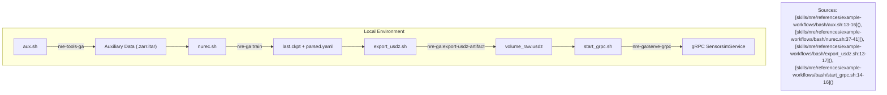
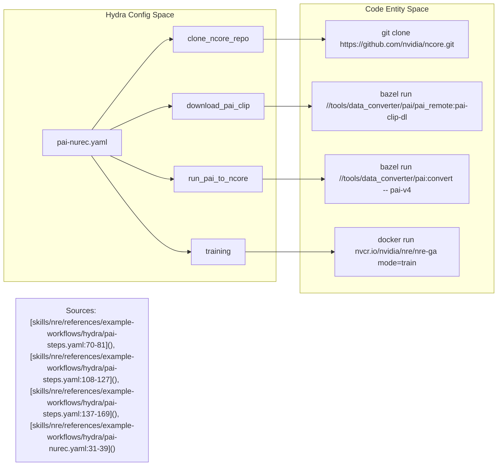
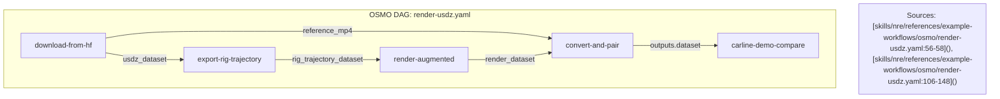

<!-- source: DeepWiki mcp.deepwiki.com · repo NVIDIA/nurec-skills · page 4.7 Example Workflows: Bash, Hydra, and OSMO · fetched 2026-10-26 -->

# Example Workflows: Bash, Hydra, and OSMO

Relevant source files

The following files were used as context for generating this wiki page:

- [skills/nre/references/example-workflows/bash/aux.sh](skills/nre/references/example-workflows/bash/aux.sh)
- [skills/nre/references/example-workflows/bash/export_usdz.sh](skills/nre/references/example-workflows/bash/export_usdz.sh)
- [skills/nre/references/example-workflows/bash/nurec.sh](skills/nre/references/example-workflows/bash/nurec.sh)
- [skills/nre/references/example-workflows/bash/nurec_workflow_pai.md](skills/nre/references/example-workflows/bash/nurec_workflow_pai.md)
- [skills/nre/references/example-workflows/bash/render.sh](skills/nre/references/example-workflows/bash/render.sh)
- [skills/nre/references/example-workflows/bash/start_grpc.sh](skills/nre/references/example-workflows/bash/start_grpc.sh)
- [skills/nre/references/example-workflows/hydra/download-waymo-samples.yaml](skills/nre/references/example-workflows/hydra/download-waymo-samples.yaml)
- [skills/nre/references/example-workflows/hydra/ncore-steps.yaml](skills/nre/references/example-workflows/hydra/ncore-steps.yaml)
- [skills/nre/references/example-workflows/hydra/nurec-steps.yaml](skills/nre/references/example-workflows/hydra/nurec-steps.yaml)
- [skills/nre/references/example-workflows/hydra/pai-nurec.yaml](skills/nre/references/example-workflows/hydra/pai-nurec.yaml)
- [skills/nre/references/example-workflows/hydra/pai-steps.yaml](skills/nre/references/example-workflows/hydra/pai-steps.yaml)
- [skills/nre/references/example-workflows/hydra/pai-to-ncore.yaml](skills/nre/references/example-workflows/hydra/pai-to-ncore.yaml)
- [skills/nre/references/example-workflows/hydra/personal-template.yaml](skills/nre/references/example-workflows/hydra/personal-template.yaml)
- [skills/nre/references/example-workflows/hydra/render-pai-nurec.yaml](skills/nre/references/example-workflows/hydra/render-pai-nurec.yaml)
- [skills/nre/references/example-workflows/hydra/tools.yaml](skills/nre/references/example-workflows/hydra/tools.yaml)
- [skills/nre/references/example-workflows/hydra/waymo-nurec.yaml](skills/nre/references/example-workflows/hydra/waymo-nurec.yaml)
- [skills/nre/references/example-workflows/osmo/pai-nurec.yaml](skills/nre/references/example-workflows/osmo/pai-nurec.yaml)
- [skills/nre/references/example-workflows/osmo/render-usdz.yaml](skills/nre/references/example-workflows/osmo/render-usdz.yaml)

This page provides a technical reference for the example workflow implementations within the NuRec repository. These workflows automate the transition from raw sensor data (e.g., NVIDIA Physical AI or Waymo) to NCore V4 shards, neural reconstruction training, and final artifact export.

The repository supports three primary execution modalities:
1.  **Bash Scripts**: Low-level Docker wrappers for local execution and debugging.
2.  **Hydra Workflows**: Structured, multi-step YAML recipes for local or remote orchestration.
3.  **OSMO DAGs**: Cloud-native Directed Acyclic Graphs for distributed scaling on Kubernetes/MinIO backends.

## 1. Bash Workflow Implementation

The bash scripts provide the most direct interface to the NRE (Neural Reconstruction Engine) container images. They handle volume mounting, UID/GID mapping for file permission consistency, and the required `--shm-size` overrides for PyTorch multiprocessing [skills/nre/references/example-workflows/bash/nurec.sh:31-32]().

### Data Flow: Local Reconstruction
The following diagram illustrates the sequence of bash scripts required to reconstruct a PAI clip.

**Diagram: Bash Workflow Execution Sequence**

### Key Script Details
*   **`nurec.sh`**: Drives the training process using the `external_overrides.yaml` pattern. It mounts a local `pai.yaml` configuration into the container's Hydra search path at `/app/run.runfiles/_main/configs` [skills/nre/references/example-workflows/bash/nurec.sh:29-36]().
*   **`aux.sh`**: Invokes `nre-tools-ga` to generate LiDAR segmentation and camera visibility masks required for high-fidelity reconstruction [skills/nre/references/example-workflows/bash/aux.sh:13-18]().
*   **`start_grpc.sh`**: Launches the `serve-grpc` entrypoint with `--enable-editing-actors`, allowing downstream skills like the Asset Harvester to modify the scene [skills/nre/references/example-workflows/bash/start_grpc.sh:15-18]().

**Sources:** [skills/nre/references/example-workflows/bash/nurec.sh:1-50](), [skills/nre/references/example-workflows/bash/aux.sh:1-25](), [skills/nre/references/example-workflows/bash/start_grpc.sh:1-20]()

## 2. Hydra YAML Workflows

Hydra workflows provide a modular abstraction over the bash scripts, allowing for complex multi-step pipelines like `pai-nurec`. These workflows utilize a shared library of steps defined in `nurec-steps.yaml` and `pai-steps.yaml` [skills/nre/references/example-workflows/hydra/pai-nurec.yaml:26-27]().

### Implementation Architecture
The Hydra system maps natural language concepts (e.g., "download clip") to specific Dockerized Bazel commands.

**Diagram: Hydra Workflow Mapping**

### Workflow Specifications
| Workflow | Purpose | Key Steps |
| :--- | :--- | :--- |
| `pai-to-ncore` | Converts PAI raw data to NCore V4 | `clone_ncore_repo`, `run_pai_to_ncore` [skills/nre/references/example-workflows/hydra/pai-to-ncore.yaml:33-35]() |
| `pai-nurec` | End-to-end PAI reconstruction | `generate_aux_data`, `training`, `export_usdz_artifact` [skills/nre/references/example-workflows/hydra/pai-nurec.yaml:31-39]() |
| `render-pai-nurec` | Renders a trained PAI artifact | `ngc_login`, `render_pai_usdz` [skills/nre/references/example-workflows/hydra/render-pai-nurec.yaml:23-26]() |

**Sources:** [skills/nre/references/example-workflows/hydra/pai-nurec.yaml:1-113](), [skills/nre/references/example-workflows/hydra/pai-steps.yaml:1-170](), [skills/nre/references/example-workflows/hydra/pai-to-ncore.yaml:1-36]()

## 3. OSMO DAG Pipelines

OSMO workflows are designed for Kubernetes environments using the OSMO orchestrator. They leverage `outputs.dataset` to pass state between isolated tasks in a cluster [skills/nre/references/example-workflows/osmo/render-usdz.yaml:21-22]().

### `pai-nurec.yaml` Pipeline
This pipeline automates the ingestion of PAI clips directly from Hugging Face into a cloud-based reconstruction.

*   **Task `convert-pai-to-ncore`**: Clones the `ncore` repository, builds the converter via Bazel, and streams data from Hugging Face using the provided `hf-token` [skills/nre/references/example-workflows/osmo/pai-nurec.yaml:75-101]().
*   **Task `training`**: Consumes the `pai-ncore-data` dataset and runs the NRE training container with a 64Gi `/dev/shm` remount to prevent bus errors [skills/nre/references/example-workflows/osmo/pai-nurec.yaml:51-57]().

### `render-usdz.yaml` (Carline Demo)
A specialized DAG for rendering augmented scenes (e.g., car-line adaptation). It implements a two-step rig application flow:
1.  **`export-rig-trajectory`**: Generates a custom camera path based on an `augmented_rig.json` [skills/nre/references/example-workflows/osmo/render-usdz.yaml:5-6]().
2.  **`render-augmented`**: Uses the exported trajectory to render the neural volume [skills/nre/references/example-workflows/osmo/render-usdz.yaml:27-30]().

**Diagram: OSMO Task Dependencies**

### Resource Requirements
OSMO tasks specify distinct resource pools for CPU-bound conversion and GPU-bound training:
*   **GPU Tasks**: Request `gpu: 1` and typically `32Gi` to `64Gi` of memory [skills/nre/references/example-workflows/osmo/pai-nurec.yaml:66-70]().
*   **Shared Memory**: The workflows include explicit `shm_size` parameters (e.g., `16g` or `64g`) which must be matched by the underlying Kubernetes pod template's `emptyDir` size limit [skills/nre/references/example-workflows/osmo/render-usdz.yaml:80-83]().

**Sources:** [skills/nre/references/example-workflows/osmo/pai-nurec.yaml:1-207](), [skills/nre/references/example-workflows/osmo/render-usdz.yaml:1-148]()

---

