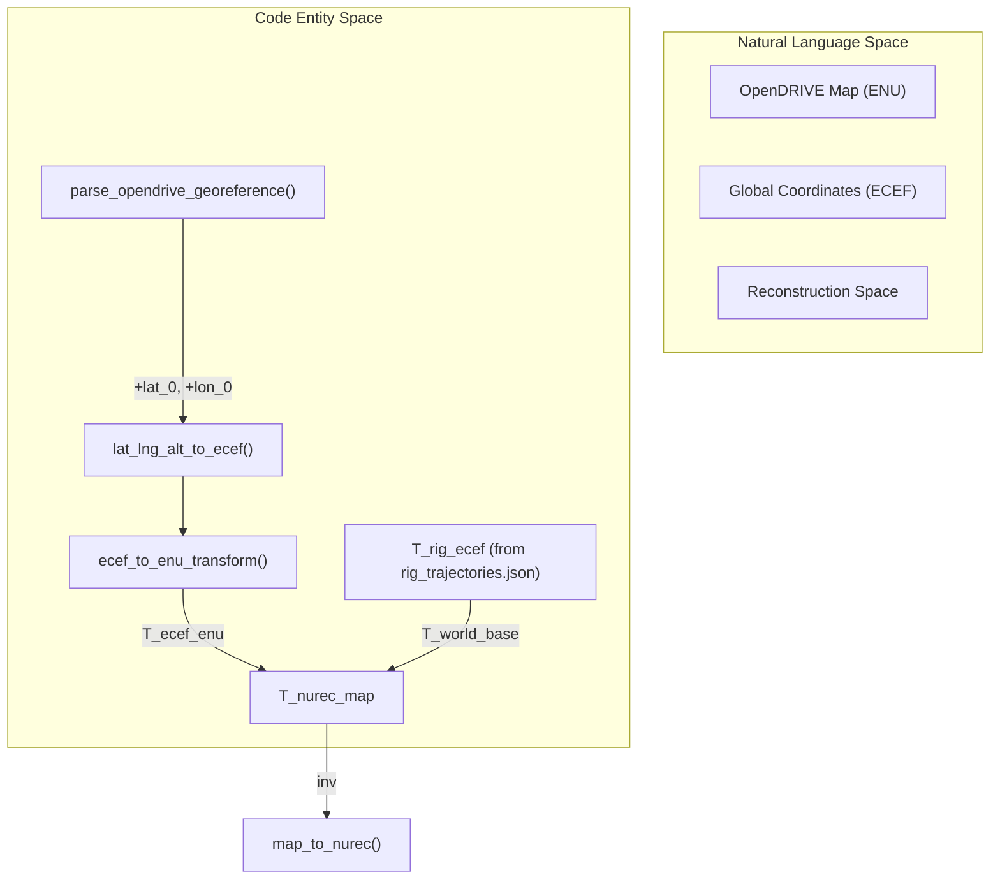
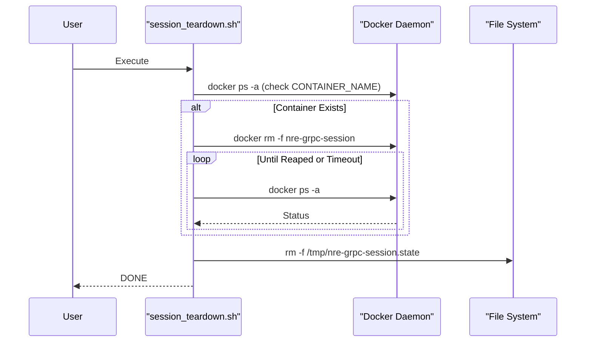

<!-- source: DeepWiki mcp.deepwiki.com · repo NVIDIA/nurec-skills · page 4.8 NRE Troubleshooting and Teardown · fetched 2026-10-26 -->

# NRE Troubleshooting and Teardown

Relevant source files

The following files were used as context for generating this wiki page:

- [skills/nre/references/physical-ai-render.md](skills/nre/references/physical-ai-render.md)
- [skills/nre/references/teardown.md](skills/nre/references/teardown.md)
- [skills/nre/references/troubleshooting.md](skills/nre/references/troubleshooting.md)
- [skills/nre/scripts/session_teardown.sh](skills/nre/scripts/session_teardown.sh)

This page provides technical guidance for resolving common failure modes in the Neural Reconstruction Engine (NRE) and details the procedures for reclaiming system resources after training or rendering sessions. It covers hardware-specific crashes, memory management, and the lifecycle of the gRPC server containers.

## Common Failure Modes and Resolutions

NRE operations involving high-fidelity 3D Gaussian Splatting (3DGS) are resource-intensive. The following table details known error states and their remediation.

| Error Symptom | Root Cause | Resolution |
|:---|:---|:---|
| `OOM Killed` / `CUDA out of memory` | Training recipes default to $\ge$ 48 GB VRAM [skills/nre/references/troubleshooting.md:9-9](). | Reduce `dataset.camera_ids`, lower `trainer.max_epochs`, or use `trainer.precision=16-mixed` [skills/nre/references/troubleshooting.md:9-9](). |
| `RuntimeError: ... torch.cuda.is_available() is False` | Missing `--gpus all` flag or NVIDIA Container Toolkit [skills/nre/references/troubleshooting.md:8-8](). | Ensure `--gpus all` is passed to `docker run`; verify Toolkit $\ge$ 1.13.5 [skills/nre/references/troubleshooting.md:8-8](). |
| Multi-GPU crash with `dataset.aux_data=false` | Known regression in 25.06–25.07 releases [skills/nre/references/troubleshooting.md:19-19](). | Use single-GPU for debugging or pre-generate aux data via `nre-tools` [skills/nre/references/troubleshooting.md:19-19](). |
| `wandb` prompt blocks execution | Non-interactive shell waiting for telemetry choice [skills/nre/references/troubleshooting.md:10-10](). | Set `WANDB_MODE=disabled` or `logger=tensorboard` in the environment [skills/nre/references/troubleshooting.md:10-10](). |
| `replacement_id not found` | `export-external-assets` skipped or USDZ mismatch [skills/nre/references/troubleshooting.md:14-14](). | Re-run `export-external-assets` with correct `--external-assets-dir` [skills/nre/references/troubleshooting.md:14-14](). |
| Slow USDZ loading | Legacy artifact format requiring in-memory upgrade [skills/nre/references/troubleshooting.md:21-21](). | Run `upgrade-artifact --input old.usdz --output upgraded.usdz` [skills/nre/references/troubleshooting.md:21-21](). |

### Multi-GPU and Driver Constraints
For users on Blackwell architecture (e.g., RTX Pro 6000D), ensure the host driver is updated to R580+ to avoid kernel mismatches [skills/nre/references/troubleshooting.md:18-18](). When performing distributed training, NRE relies on `parsed.yaml` to maintain volume mount consistency; ensure the host paths for datasets match exactly between `trainval` and `export-*` commands [skills/nre/references/troubleshooting.md:11-11]().

**Sources:** [skills/nre/references/troubleshooting.md:5-22]()

---

## Physical AI Render Logic

When rendering NVIDIA Physical AI datasets, users often need to align custom trajectories (e.g., from a simulator) to the NuRec coordinate frame. The system uses a coordinate chain: **NuRec $\rightarrow$ ECEF $\rightarrow$ ENU (Map)** [skills/nre/references/physical-ai-render.md:99-99]().

### Coordinate Space Mapping
The transformation `T_nurec_map` is derived by combining the rig's ECEF pose at frame 0 with the OpenDRIVE georeference [skills/nre/references/physical-ai-render.md:102-106]().

**NuRec Coordinate Alignment Flow**

**Sources:** [skills/nre/references/physical-ai-render.md:102-106](), [skills/nre/references/physical-ai-render.md:114-130](), [skills/nre/references/physical-ai-render.md:150-162](), [skills/nre/references/physical-ai-render.md:165-171]()

---

## Session Teardown and Resource Reclamation

A full NRE execution can consume significant disk space ($\approx$ 120 GB for container images alone) [skills/nre/references/teardown.md:3-3](). The `session_teardown.sh` script provides an automated, idempotent way to stop the gRPC server and clean up state files.

### The `session_teardown.sh` Logic
The script addresses race conditions where `docker rm -f` returns before the Docker daemon has fully reaped the container record [skills/nre/scripts/session_teardown.sh:8-12]().

**Teardown Sequence**

**Sources:** [skills/nre/scripts/session_teardown.sh:22-57]()

### Manual Disk Reclamation
To manually clear the environment, follow these steps:

1.  **Stop Containers:** Identify and kill any `serve-grpc` instances [skills/nre/references/teardown.md:9-10]().
2.  **Remove Images:** Delete `nre` and `nre-tools` images and prune builders [skills/nre/references/teardown.md:13-14]().
3.  **Clear Caches:** Remove Hydra-resolved configs and Fixer weights located at `${HOME}/.cache/nre` [skills/nre/references/teardown.md:17-17]().
4.  **Delete Artifacts:** Remove output directories. If training was run without the `-u $(id -u):$(id -g)` flag, `sudo` may be required to delete root-owned outputs [skills/nre/references/teardown.md:29-34]().

**Sources:** [skills/nre/references/teardown.md:1-38]()

---

