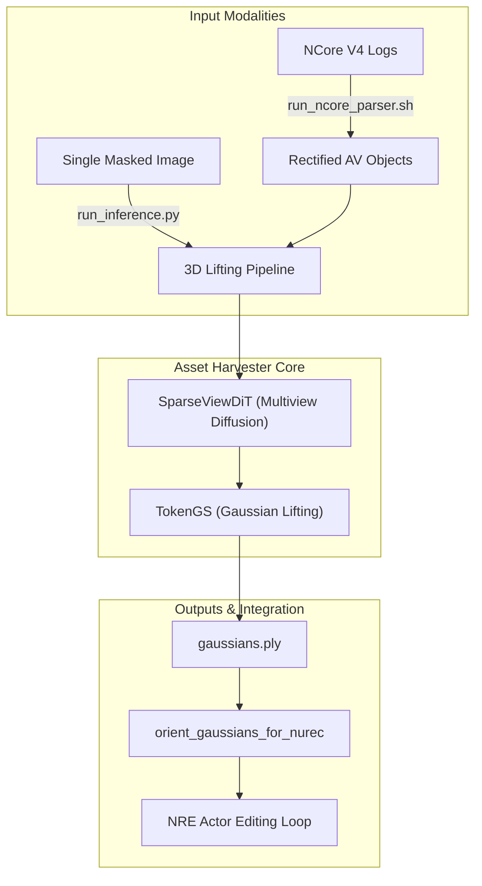
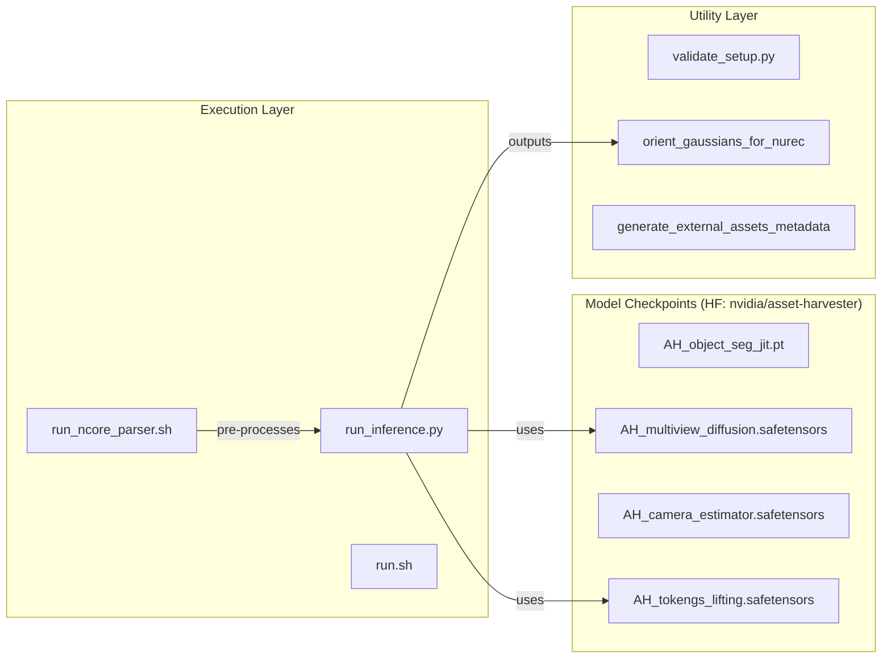

<!-- source: DeepWiki mcp.deepwiki.com · repo NVIDIA/nurec-skills · page 5 Asset Harvester: Per-Object 3D Gaussian Extraction · fetched 2026-10-26 -->

# Asset Harvester: Per-Object 3D Gaussian Extraction

Relevant source files

The following files were used as context for generating this wiki page:

- [skills/asset-harvester/BENCHMARK.md](skills/asset-harvester/BENCHMARK.md)
- [skills/asset-harvester/SKILL.md](skills/asset-harvester/SKILL.md)
- [skills/asset-harvester/skill-card.md](skills/asset-harvester/skill-card.md)
- [skills/nre/SKILL.md](skills/nre/SKILL.md)

The **Asset Harvester** skill provides a specialized pipeline for extracting individual 3D Gaussian Splat assets from sparse autonomous vehicle (AV) observations. Unlike full-scene reconstruction, this skill focuses on isolating specific actors (e.g., vehicles, pedestrians) from driving logs or single masked images to create simulation-ready `.ply` assets for use in NVIDIA Omniverse NuRec.

## Purpose and Scope

Asset Harvester bridges the gap between raw sensor data and object-level scene augmentation. It utilizes a two-stage deep learning architecture: **SparseViewDiT** for multiview diffusion (generating 16 consistent views) and **TokenGS** for feed-forward Gaussian lifting [skills/asset-harvester/SKILL.md:85-93]().

The primary outputs are:
*   `gaussians.ply`: The 3D Gaussian Splat asset [skills/asset-harvester/SKILL.md:5-6]().
*   `metadata.yaml`: Integration data for NuRec object insertion [skills/asset-harvester/SKILL.md:7-8]().
*   `multiview/` and `3d_lifted/` renders: Diagnostic MP4 videos and images [skills/asset-harvester/SKILL.md:109-111]().

### High-Level Data Flow

**Sources:** [skills/asset-harvester/SKILL.md:89-93](), [skills/asset-harvester/SKILL.md:149-152]()

## System Architecture and Code Entities

The following diagram maps the logical components of the harvesting process to the specific scripts and checkpoints defined in the codebase.

### Mapping Natural Language to Code Entities

**Sources:** [skills/asset-harvester/SKILL.md:95-99](), [skills/asset-harvester/SKILL.md:138-142](), [skills/asset-harvester/SKILL.md:149-151]()

## Child Page Overview

### [Asset Harvester Installation and Environment](#5.1)
This section covers the setup of the local environment. Asset Harvester requires a specific Conda environment and a pinned build of the `gsplat` library. It also details the hardware constraints (16GB+ VRAM recommended) and the use of `validate_setup.py` to verify CUDA 12.8 and GCC compatibility.
*   **Key Entities:** `setup.sh`, `validate_setup.py`, `HF_TOKEN`.
*   **For details, see [Asset Harvester Installation and Environment](#5.1).**

### [Asset Harvester Workflows and CLI Reference](#5.2)
This section provides the operational guide for running inference. It details three main paths:
1.  **Rectified AV Objects:** Using pre-cropped images from the `data_samples`.
2.  **Single Uncalibrated Images:** Leveraging the `AH_camera_estimator` for pose estimation.
3.  **NCore V4 Logs:** The end-to-end path for extracting objects directly from driving logs using `run_ncore_parser.sh`.
*   **Key Entities:** `run_inference.py`, `--offload_model_to_cpu`, `run_ncore_parser.sh`.
*   **For details, see [Asset Harvester Workflows and CLI Reference](#5.2).**

### [Asset Harvester Integration with NRE](#5.3)
This section explains how to move from a standalone `.ply` file to a dynamic actor inside an NRE scene. It covers the critical `orient_gaussians_for_nurec` step which aligns the coordinate system of the harvested asset with the NuRec world space, and how to generate the `metadata.yaml` required by NRE's `export-external-assets` command.
*   **Key Entities:** `orient_gaussians_for_nurec`, `metadata.yaml`, `edit-assets.json`.
*   **For details, see [Asset Harvester Integration with NRE](#5.3).**

## When to Use Asset Harvester

| Use Case | Recommended Skill |
| :--- | :--- |
| Extracting a specific car from a Waymo or PAI clip | **Asset Harvester** |
| Reconstructing an entire city intersection | **NRE** |
| Generating 3D assets from a single masked photo | **Asset Harvester** |
| Converting raw sensor logs to a structured format | **NCore** |
| Harmonizing lighting on an inserted object | **NuRec Fixer** |

**Sources:** [skills/asset-harvester/SKILL.md:59-81](), [skills/nre/SKILL.md:9-11]()

---

