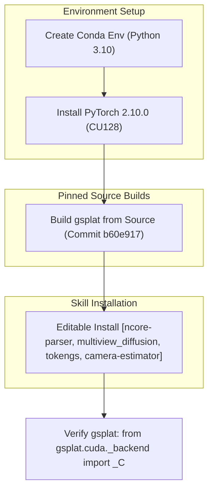
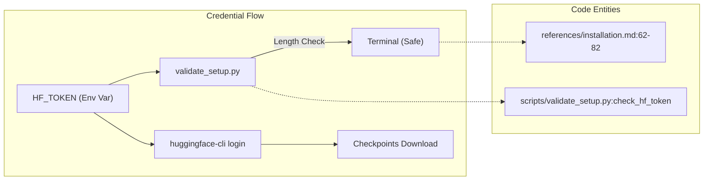

<!-- source: DeepWiki mcp.deepwiki.com · repo NVIDIA/nurec-skills · page 5.1 Asset Harvester Installation and Environment · fetched 2026-10-26 -->

# Asset Harvester Installation and Environment

<details>
<summary>Relevant source files</summary>

The following files were used as context for generating this wiki page:

- [skills/asset-harvester/references/cli-reference.md](skills/asset-harvester/references/cli-reference.md)
- [skills/asset-harvester/references/end-to-end-ncore.md](skills/asset-harvester/references/end-to-end-ncore.md)
- [skills/asset-harvester/references/installation.md](skills/asset-harvester/references/installation.md)
- [skills/asset-harvester/references/troubleshooting.md](skills/asset-harvester/references/troubleshooting.md)
- [skills/asset-harvester/references/workflows.md](skills/asset-harvester/references/workflows.md)
- [skills/asset-harvester/scripts/validate_setup.py](skills/asset-harvester/scripts/validate_setup.py)

</details>


The Asset Harvester skill requires a specialized environment to handle 3D Gaussian Splatting (3DGS) lifting, multiview diffusion, and NCore V4 data parsing. This page documents the dual-environment strategy, strict CUDA/GCC constraints for source-built dependencies, and the lifecycle of model checkpoints.

## Environment Bifurcation

Asset Harvester utilizes two distinct Conda environments to manage conflicting dependency requirements between the core reconstruction pipeline and the evaluation benchmark suite.

| Environment Name | Primary Purpose | Key Constraints |
| :--- | :--- | :--- |
| `asset-harvester` | Core inference: Diffusion + TokenGS lifting | `transformers==4.48.3`, `torch==2.10.0`, `gsplat` (pinned source build) |
| `av-object-benchmark` | Quantitative evaluation (PSNR, LPIPS, DINOv3) | `transformers>=4.56.0`, `pytorch-lightning`, `sam-3d-body` |

The `av-object-benchmark` environment is created by cloning the base `asset-harvester` environment and applying an additional installation script to upgrade specific libraries required for modern vision foundation models [skills/asset-harvester/references/troubleshooting.md:16-16](), [skills/asset-harvester/references/end-to-end-ncore.md:69-76]().

### Dependency Resolution and CUDA ABI
A critical requirement for the `asset-harvester` environment is the source-build of `gsplat`. Installing `gsplat` via PyPI wheels often leads to CUDA ABI mismatches [skills/asset-harvester/references/troubleshooting.md:9-9](). The installation must use the pinned commit `b60e917c95afc449c5be33a634f1f457e116ff5e` [skills/asset-harvester/references/installation.md:20-21]().

**Sources:**
- [skills/asset-harvester/references/troubleshooting.md:16-16]()
- [skills/asset-harvester/references/end-to-end-ncore.md:69-76]()
- [skills/asset-harvester/references/installation.md:20-21]()

## Automated and Manual Installation

### One-Shot Setup
The recommended installation path uses `setup.sh`, which automates git submodule initialization, Conda environment creation, and the complex `gsplat` build process [skills/asset-harvester/references/installation.md:18-22]().

```bash
# Automated install (approx. 20 minutes)
bash setup.sh
conda activate asset-harvester
```

### Manual Installation Sequence
If `setup.sh` cannot be used, the following sequence ensures the `gsplat` build uses the correct CUDA toolkit and host compiler [skills/asset-harvester/references/installation.md:24-36]().



**Sources:**
- [skills/asset-harvester/references/installation.md:9-14]()
- [skills/asset-harvester/references/installation.md:24-36]()
- [skills/asset-harvester/references/installation.md:40-42]()

## System Constraints and Validation

### Hardware and Toolchain Prerequisites
The pipeline has specific requirements for the host compiler and GPU drivers to support CUDA 12.8 and the 3DGS kernels.

*   **GPU Driver:** Minimum version 570 [skills/asset-harvester/scripts/validate_setup.py:45-45]().
*   **VRAM:** ~16 GB recommended. Systems with less memory should use `--offload_model_to_cpu` [skills/asset-harvester/references/troubleshooting.md:11-11]().
*   **Compiler:** GCC version must be between 10 and 13. GCC 12 is recommended [skills/asset-harvester/references/troubleshooting.md:10-10](), [skills/asset-harvester/scripts/validate_setup.py:46-47]().

### Validation Utility (`validate_setup.py`)
The `scripts/validate_setup.py` utility performs non-network checks to ensure the host environment is prepared for the `setup.sh` process [skills/asset-harvester/scripts/validate_setup.py:4-12]().

| Check | Function | Target |
| :--- | :--- | :--- |
| Python | `check_python` | >= 3.10 [skills/asset-harvester/scripts/validate_setup.py:67-73]() |
| Driver | `check_driver` | >= 570 via `nvidia-smi` [skills/asset-harvester/scripts/validate_setup.py:85-104]() |
| Compiler | `check_gcc` | 10-13 window [skills/asset-harvester/scripts/validate_setup.py:107-123]() |
| Secrets | `check_hf_token` | Verifies `HF_TOKEN` presence [skills/asset-harvester/scripts/validate_setup.py:126-134]() |

**Sources:**
- [skills/asset-harvester/scripts/validate_setup.py:4-12]()
- [skills/asset-harvester/scripts/validate_setup.py:44-47]()
- [skills/asset-harvester/references/troubleshooting.md:10-11]()

## Checkpoint Management

Asset Harvester requires four primary model checkpoints hosted on Hugging Face. These are downloaded via the `huggingface_hub` CLI [skills/asset-harvester/references/installation.md:46-50]().

### Checkpoint Inventory
The following files must be present in the `checkpoints/` directory for full functionality:

1.  **`AH_multiview_diffusion.safetensors`**: The SparseViewDiT model for generating consistent novel views [skills/asset-harvester/references/cli-reference.md:11-11]().
2.  **`AH_tokengs_lifting.safetensors`**: The TokenGS model for lifting 2D images into 3D Gaussian Splats [skills/asset-harvester/references/cli-reference.md:12-12]().
3.  **`AH_camera_estimator.safetensors`**: Required for single-image mode to predict camera intrinsics/extrinsics [skills/asset-harvester/references/cli-reference.md:13-13]().
4.  **`AH_object_seg_jit.pt`**: Mask2Former JIT model for foreground segmentation [skills/asset-harvester/references/cli-reference.md:50-50]().

### Secret Handling (`HF_TOKEN`)
Access to `nvidia/asset-harvester` checkpoints requires a Hugging Face token. The codebase enforces safe verification of these secrets to prevent accidental exposure in logs [skills/asset-harvester/references/installation.md:62-82]().



**Sources:**
- [skills/asset-harvester/references/installation.md:46-60]()
- [skills/asset-harvester/references/installation.md:62-82]()
- [skills/asset-harvester/references/cli-reference.md:11-13]()
- [skills/asset-harvester/references/cli-reference.md:50-50]()

## Environment Teardown

A full installation consumes approximately 30–40 GB of disk space [skills/asset-harvester/references/troubleshooting.md:21-24](). To clean the environment, follow the sequence below to remove Conda environments, model caches, and output artifacts [skills/asset-harvester/references/troubleshooting.md:26-49]().

1.  **Deactivate and remove Conda envs**: `asset-harvester` and `av-object-benchmark`.
2.  **Clear Model Hubs**: Delete `checkpoints/` and the Hugging Face hub cache for `nvidia/asset-harvester`.
3.  **Purge Caches**: Run `pip cache purge` and `conda clean --all`.

**Sources:**
- [skills/asset-harvester/references/troubleshooting.md:21-24]()
- [skills/asset-harvester/references/troubleshooting.md:26-49]()

---

