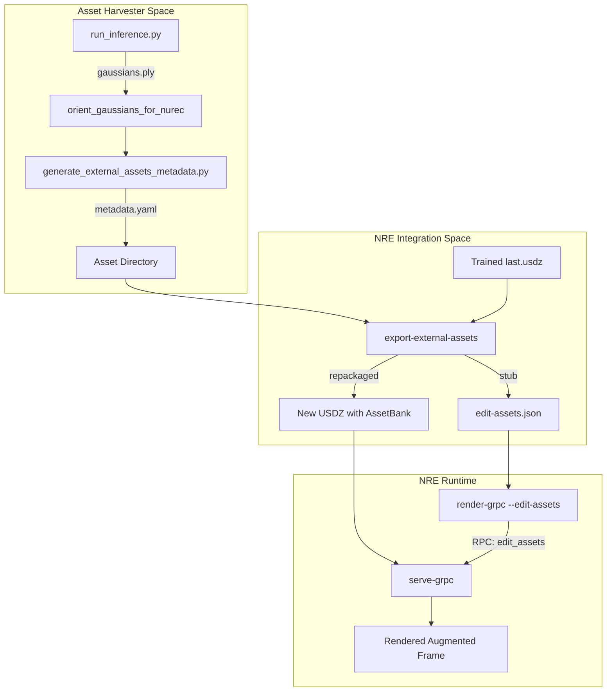
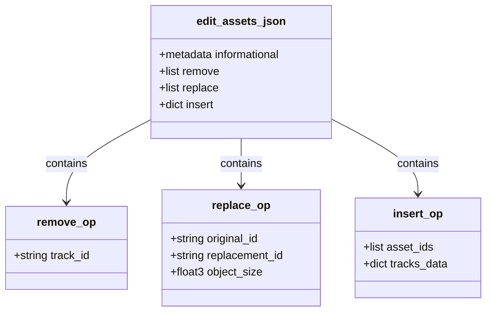

<!-- source: DeepWiki mcp.deepwiki.com · repo NVIDIA/nurec-skills · page 5.3 Asset Harvester Integration with NRE · fetched 2026-10-26 -->

# Asset Harvester Integration with NRE

<details>
<summary>Relevant source files</summary>

The following files were used as context for generating this wiki page:

- [skills/asset-harvester/SKILL.md](skills/asset-harvester/SKILL.md)
- [skills/asset-harvester/references/cli-reference.md](skills/asset-harvester/references/cli-reference.md)
- [skills/asset-harvester/references/end-to-end-ncore.md](skills/asset-harvester/references/end-to-end-ncore.md)
- [skills/asset-harvester/references/installation.md](skills/asset-harvester/references/installation.md)
- [skills/asset-harvester/references/troubleshooting.md](skills/asset-harvester/references/troubleshooting.md)
- [skills/asset-harvester/references/workflows.md](skills/asset-harvester/references/workflows.md)
- [skills/nre/SKILL.md](skills/nre/SKILL.md)
- [skills/nre/references/asset-editing.md](skills/nre/references/asset-editing.md)
- [skills/nre/references/local-render.md](skills/nre/references/local-render.md)

</details>


The integration between the **Asset Harvester** skill and the **Neural Reconstruction Engine (NRE)** enables a complete actor-editing loop. This workflow allows users to extract high-fidelity 3D Gaussian assets from sparse sensor observations (e.g., AV logs) and re-insert them into a reconstructed 3D scene. This process facilitates scene augmentation, such as replacing a vehicle in a driving log with a different model or inserting new dynamic actors into a static environment [skills/nre/SKILL.md:87-88]().

## Data Flow and Integration Architecture

The integration relies on a structured handoff where harvested `.ply` files and their associated metadata are packaged into an NRE-compatible USDZ artifact.

### Integration Pipeline

| Stage | Process | Entity / Tool |
| :--- | :--- | :--- |
| **1. Extraction** | Extract `.ply` from NCore V4 or images | `run_inference.py` [skills/asset-harvester/references/cli-reference.md:7-17]() |
| **2. Alignment** | Coordinate transformation for NRE | `orient_gaussians_for_nurec` [skills/asset-harvester/references/cli-reference.md:75-85]() |
| **3. Metadata** | Generate asset manifest | `generate_external_assets_metadata.py` [skills/asset-harvester/references/cli-reference.md:87-94]() |
| **4. Packaging** | Inject assets into USDZ | `export-external-assets` [skills/nre/references/asset-editing.md:19-23]() |
| **5. Editing** | Define scene modifications | `edit-assets.json` [skills/nre/references/asset-editing.md:101-119]() |
| **6. Rendering** | Render modified scene | `serve-grpc --enable-editing-actors` [skills/nre/references/asset-editing.md:26-31]() |

### System Integration Diagram
This diagram bridges the conceptual "Asset Harvesting" space to the "NRE Scene Editing" code space.

**Asset to Scene Integration Flow**

**Sources:** [skills/nre/references/asset-editing.md:9-33](), [skills/asset-harvester/references/end-to-end-ncore.md:104-127]()

---

## Coordinate Alignment and Metadata

Before harvested assets can be used in NRE, they must be aligned to the coordinate system expected by the NRE renderer.

### orient_gaussians_for_nurec
The `orient_gaussians_for_nurec` utility rotates Gaussian PLY files. By default, it applies a 90-degree Y-axis rotation to align the Asset Harvester output with the NuRec external-assets insertion requirements [skills/asset-harvester/references/cli-reference.md:75-85]().
*   **Input:** Directory containing per-sample `gaussians.ply`.
*   **Flag:** `--degrees` (Default: 90) [skills/asset-harvester/references/cli-reference.md:85]().
*   **Flag:** `--in-place` to mutate the source directory directly [skills/asset-harvester/references/end-to-end-ncore.md:114]().

### Metadata Generation
The `generate_external_assets_metadata.py` script creates a `metadata.yaml` file at the root of the asset directory [skills/asset-harvester/references/cli-reference.md:87-94](). This file is required for NRE to understand the dimensions and classification of the harvested assets.

**Metadata Schema Example:**
```yaml
assets:
  "track_8":
    ply_file: "track_8/gaussians.ply"
    label_class: "car"
    cuboids_dims: [4.5, 2.0, 1.8]   # [size_x, size_y, size_z] in meters
```
**Sources:** [skills/nre/references/asset-editing.md:54-64](), [skills/asset-harvester/references/end-to-end-ncore.md:119-122]()

---

## Asset Packaging via export-external-assets

The NRE CLI command `export-external-assets` is the bridge that merges harvested assets into a NuRec scene [skills/nre/references/asset-editing.md:71-85]().

### Implementation Details
When executed, this command performs three primary tasks:
1.  **USDZ Repackaging:** It takes an existing trained USDZ and adds the harvested `.ply` files into a specific internal zip structure under `external_assets/<track_id>/` [skills/nre/references/asset-editing.md:91-96]().
2.  **AssetBank Registration:** It mirrors the `metadata.yaml` into the USDZ so the renderer can resolve asset IDs to physical dimensions [skills/nre/references/asset-editing.md:94-95]().
3.  **JSON Stub Generation:** It writes a starter `edit-assets.json` file pre-populated with the `external_assets_metadata` found in the harvesting output [skills/nre/references/asset-editing.md:98-119]().

**Sources:** [skills/nre/references/asset-editing.md:71-100](), [skills/nre/SKILL.md:55-57]()

---

## Actor Editing Loop

Once the assets are packaged, the scene is manipulated via the `edit-assets.json` configuration or direct gRPC calls.

### Scene Manipulation Logic
The editing operations live in the renderable model's memory on the NRE server. They mutate the loaded Gaussians until a `restore_model_parameters` RPC is called [skills/nre/references/asset-editing.md:35-39]().

**Entity Relationship: Editing Operations**

**Sources:** [skills/nre/references/asset-editing.md:103-118]()

### Key Operations
*   **Remove:** Prevents specific `track_id`s from the original `sequence_tracks.json` from rendering [skills/nre/references/asset-editing.md:126-134]().
*   **Replace:** Maps an `original_id` (from the scene) to a `replacement_id` (from the Asset Harvester). It uses `object_size` to scale the new asset to fit the original's cuboid [skills/nre/references/asset-editing.md:141-157]().
*   **Insert:** Injects an entirely new track. The user must provide `tracks_poses` and `tracks_timestamps_us` following the standard NCore `CuboidTracks` format [skills/nre/references/asset-editing.md:182-197]().

### Important Integration Constraints
*   **PPISP:** Post-Process Intensity Super-Resolution (PPISP) must be **disabled** during the original scene reconstruction in NRE. If enabled, inserted assets from Asset Harvester will appear over-saturated [skills/asset-harvester/references/end-to-end-ncore.md:131-132]().
*   **Scale:** Asset Harvester does not predict physical scale. NRE reads the scale from the source clip's cuboid dimensions [skills/asset-harvester/references/end-to-end-ncore.md:133-134]().

**Sources:** [skills/nre/references/asset-editing.md:126-197](), [skills/asset-harvester/references/end-to-end-ncore.md:129-137]()

---

