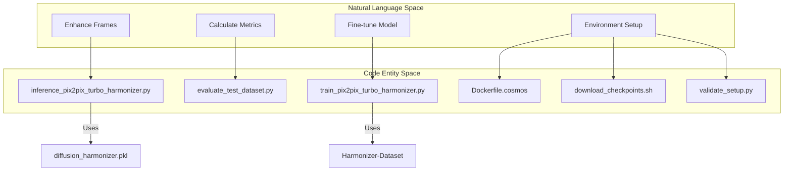
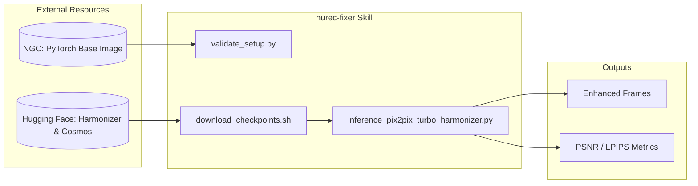

<!-- source: DeepWiki mcp.deepwiki.com · repo NVIDIA/nurec-skills · page 6 NuRec Fixer: DiffusionHarmonizer Post-Processing · fetched 2026-10-26 -->

# NuRec Fixer: DiffusionHarmonizer Post-Processing

Relevant source files

The following files were used as context for generating this wiki page:

- [skills/nurec-fixer/BENCHMARK.md](skills/nurec-fixer/BENCHMARK.md)
- [skills/nurec-fixer/SKILL.md](skills/nurec-fixer/SKILL.md)
- [skills/nurec-fixer/skill-card.md](skills/nurec-fixer/skill-card.md)

The `nurec-fixer` skill provides a post-processing pipeline for enhancing rendered frames from neural reconstructions. It utilizes **NVIDIA DiffusionHarmonizer**, a single-step, temporally-aware image diffusion enhancer based on the Cosmos Predict2 architecture [skills/nurec-fixer/SKILL.md:58-63]().

The primary purpose of this skill is to bridge the gap between neural reconstructions (NeRF, 3DGS, NuRec) and photorealistic simulation by improving realism, reducing reconstruction artifacts, and harmonizing inserted dynamic objects with the surrounding scene [skills/nurec-fixer/SKILL.md:58-63]().

### Conceptual Overview

DiffusionHarmonizer operates in two distinct modes:
*   **Offline:** Enhances pseudo-training views to distill improvements back into the 3D representation [skills/nurec-fixer/SKILL.md:131-133]().
*   **Online:** Harmonizes color, lighting, and shadows for inserted actors during simulation or inference [skills/nurec-fixer/SKILL.md:134-137]().

The skill is built upon the public `NVIDIA/harmonizer` release and replaces older, obsolete Fixer recipes [skills/nurec-fixer/SKILL.md:86-90]().

### System Architecture: Code Entity Mapping

The following diagram maps the high-level functional components to the specific Python entry points and configuration files within the `nurec-fixer` directory.

**NuRec Fixer Component Map**

Sources: [skills/nurec-fixer/SKILL.md:97-108](), [skills/nurec-fixer/skill-card.md:22-30]()

### Skill Workflow and Dependencies

The `nurec-fixer` skill relies on specific hardware and software prerequisites, including NVIDIA Ampere+ GPUs and authenticated access to Hugging Face for model weights [skills/nurec-fixer/SKILL.md:16-26]().

**Data and Execution Flow**

Sources: [skills/nurec-fixer/SKILL.md:143-164](), [skills/nurec-fixer/skill-card.md:22-24]()

---

## 6.1 DiffusionHarmonizer Setup and Container Environment
The setup process involves building a specialized Docker environment (`harmonizer-cosmos-env`) derived from the `nvcr.io/nvidia/pytorch:25.10-py3` base image [skills/nurec-fixer/SKILL.md:24-26](). Users must download checkpoints using the provided shell script, which fetches the `diffusion_harmonizer.pkl` and the `Cosmos-Predict2-0.6B` base model [skills/nurec-fixer/SKILL.md:97-101]().

For detailed setup instructions, model dependencies, and validation steps, see [DiffusionHarmonizer Setup and Container Environment](#6.1).

## 6.2 Inference: Frame Enhancement and Temporal Conditioning
Inference is handled by `inference_pix2pix_turbo_harmonizer.py`. This script supports single-step enhancement and includes a temporal feedback loop to ensure consistency across video frames [skills/nurec-fixer/SKILL.md:58-63](). It requires specific CLI flags for input resolution and model paths, typically achieving ~212 ms latency on H100 hardware.

For details on CLI flags, temporal conditioning, and output conventions, see [Inference: Frame Enhancement and Temporal Conditioning](#6.2).

## 6.3 Evaluation, Training, and Troubleshooting
The skill includes tools for measuring performance via PSNR and LPIPS metrics using `evaluate_test_dataset.py` [skills/nurec-fixer/SKILL.md:107](). Additionally, `train_pix2pix_turbo_harmonizer.py` allows for fine-tuning the model on custom datasets using the `accelerate` launch utility [skills/nurec-fixer/SKILL.md:108]().

For metrics definitions, training configurations, and common troubleshooting steps, see [Evaluation, Training, and Troubleshooting](#6.3).

---
### Summary Table: Key Entry Points

| Task | File Path | Primary Dependency |
| :--- | :--- | :--- |
| **Setup Validation** | `scripts/validate_setup.py` | Docker, HF_TOKEN |
| **Checkpoint Download** | `./download_checkpoints.sh` | `huggingface_hub` |
| **Frame Enhancement** | `src/inference_pix2pix_turbo_harmonizer.py` | `diffusion_harmonizer.pkl` |
| **Metrics/Eval** | `src/evaluate_test_dataset.py` | Test Dataset Layout |
| **Fine-tuning** | `src/train_pix2pix_turbo_harmonizer.py` | `Harmonizer-Dataset` |

Sources: [skills/nurec-fixer/SKILL.md:92-108](), [skills/nurec-fixer/skill-card.md:22-30]()

---

