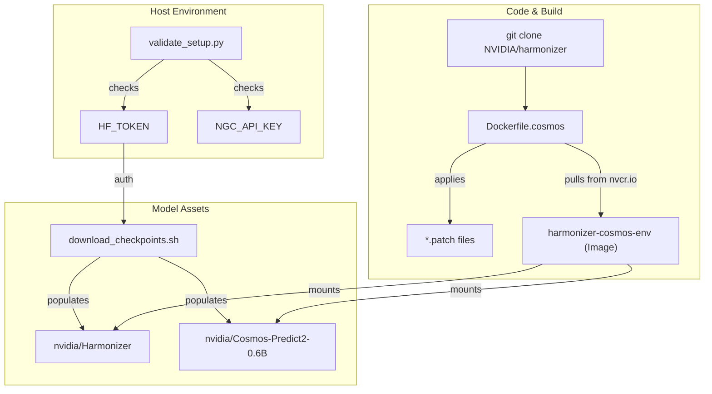
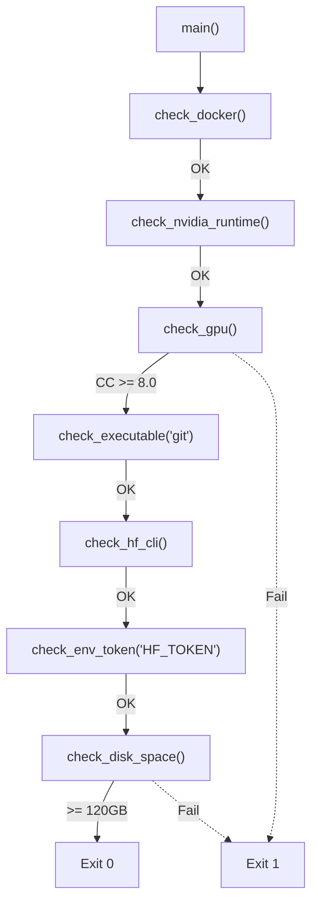

<!-- source: DeepWiki mcp.deepwiki.com · repo NVIDIA/nurec-skills · page 6.1 DiffusionHarmonizer Setup and Container Environment · fetched 2026-10-26 -->

# DiffusionHarmonizer Setup and Container Environment

<details>
<summary>Relevant source files</summary>

The following files were used as context for generating this wiki page:

- [skills/nurec-fixer/SKILL.md](skills/nurec-fixer/SKILL.md)
- [skills/nurec-fixer/references/wrapper-image.md](skills/nurec-fixer/references/wrapper-image.md)
- [skills/nurec-fixer/scripts/.env.example](skills/nurec-fixer/scripts/.env.example)
- [skills/nurec-fixer/scripts/validate_setup.py](skills/nurec-fixer/scripts/validate_setup.py)

</details>


The `nurec-fixer` skill provides the environment and tools to run **NVIDIA DiffusionHarmonizer**, a single-step, temporally-aware image diffusion enhancer designed for neural reconstruction artifacts and object-insertion harmonization [skills/nurec-fixer/SKILL.md:54-63](). This page details the setup of the `harmonizer-cosmos-env` container, model dependency management via Hugging Face, and host validation procedures.

## System Architecture and Data Flow

The setup process bridges the local host environment with the containerized runtime. The `nurec-fixer` skill relies on a specific container image built from the upstream `NVIDIA/harmonizer` repository, which integrates the `cosmos-predict2` library [skills/nurec-fixer/SKILL.md:23-26]().

### Setup and Initialization Flow

The following diagram illustrates the relationship between host prerequisites, the container build process, and the model checkpoint acquisition.

**Diagram: DiffusionHarmonizer Setup Workflow**

**Sources:** [skills/nurec-fixer/SKILL.md:92-103](), [skills/nurec-fixer/references/wrapper-image.md:9-23](), [skills/nurec-fixer/scripts/validate_setup.py:4-15]()

## Container Environment: harmonizer-cosmos-env

The runtime environment is defined by `Dockerfile.cosmos` located in the root of the `NVIDIA/harmonizer` repository [skills/nurec-fixer/SKILL.md:23-26]().

### Image Composition
*   **Base Image:** `nvcr.io/nvidia/pytorch:25.10-py3` [skills/nurec-fixer/references/wrapper-image.md:21-21]().
*   **Core Libraries:** Installs `cosmos-predict2` and dependencies from `requirements.txt` [skills/nurec-fixer/references/wrapper-image.md:21-23]().
*   **Patches:** The build process applies `tokenizer.patch` and `text2image_dit.patch` to the base environment to ensure compatibility with the Harmonizer architecture [skills/nurec-fixer/references/wrapper-image.md:21-23]().

### Build Command
To create the reproducible environment, the image should be built from the repository root:
```bash
docker build -t harmonizer-cosmos-env -f Dockerfile.cosmos .
```
[skills/nurec-fixer/references/wrapper-image.md:15-18]()

## Model Dependencies and Checkpoints

DiffusionHarmonizer requires two distinct sets of model weights fetched from Hugging Face. These are managed by the `download_checkpoints.sh` script [skills/nurec-fixer/SKILL.md:97-101]().

| Model Asset | Source | Local Path (Container) |
| :--- | :--- | :--- |
| **Harmonizer Weights** | `nvidia/Harmonizer` | `/work/models/diffusion_harmonizer.pkl` |
| **Cosmos Base Model** | `nvidia/Cosmos-Predict2-0.6B-Text2Image` | `/work/src/checkpoints/nvidia/...` |

**Sources:** [skills/nurec-fixer/SKILL.md:97-101](), [skills/nurec-fixer/references/wrapper-image.md:40-48]()

## Prerequisite Validation

Before execution, the `scripts/validate_setup.py` utility must be run to ensure the host meets the minimum hardware and software requirements [skills/nurec-fixer/SKILL.md:167-173]().

### Validation Logic
The script `check_gpu()` verifies that `nvidia-smi` is present and that at least one GPU meets the **Compute Capability >= 8.0** (Ampere architecture or newer) requirement [skills/nurec-fixer/scripts/validate_setup.py:90-131]().

**Diagram: validate_setup.py Execution Logic**

**Sources:** [skills/nurec-fixer/scripts/validate_setup.py:177-211](), [skills/nurec-fixer/scripts/validate_setup.py:31-32]()

### Configuration Environment
Secrets and tokens are managed via a `.env` file, which must be sourced before running the validation or download scripts [skills/nurec-fixer/scripts/.env.example:1-6]().
*   `HF_TOKEN`: Required for gated access to `nvidia/Harmonizer` and `nvidia/Cosmos-Predict2` [skills/nurec-fixer/scripts/.env.example:8-13]().
*   `NGC_API_KEY`: Required for authenticating with `nvcr.io` to pull the PyTorch base image [skills/nurec-fixer/scripts/.env.example:15-19]().

## Resource Requirements
The skill has significant storage and compute requirements:
*   **Disk Space:** ~120 GB free disk space is recommended for the container image, checkpoints, and datasets [skills/nurec-fixer/SKILL.md:19-19](), [skills/nurec-fixer/scripts/validate_setup.py:32-32]().
*   **Compute:** Minimum NVIDIA Ampere+ (A100, A10, L40, H100, RTX 30/40) [skills/nurec-fixer/SKILL.md:17-19]().

**Sources:** [skills/nurec-fixer/SKILL.md:16-26](), [skills/nurec-fixer/scripts/validate_setup.py:31-32]()

---

