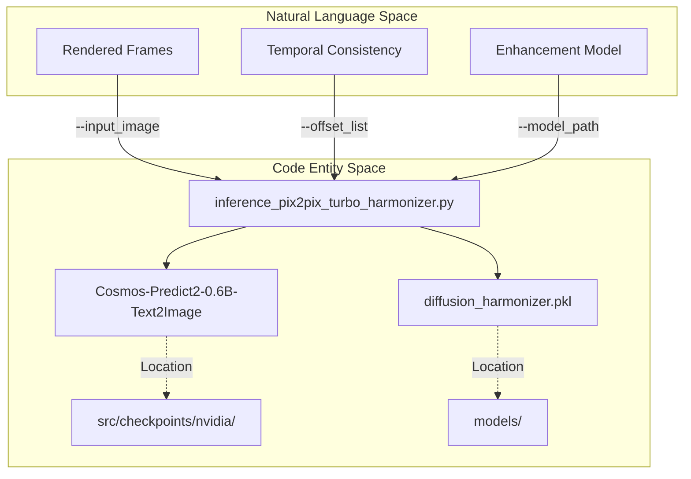
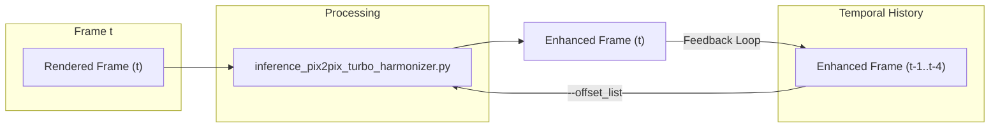

<!-- source: DeepWiki mcp.deepwiki.com · repo NVIDIA/nurec-skills · page 6.2 Inference: Frame Enhancement and Temporal Conditioning · fetched 2026-10-26 -->

# Inference: Frame Enhancement and Temporal Conditioning

Relevant source files

The following files were used as context for generating this wiki page:

- [skills/nurec-fixer/SKILL.md](skills/nurec-fixer/SKILL.md)
- [skills/nurec-fixer/evals/evals.json](skills/nurec-fixer/evals/evals.json)
- [skills/nurec-fixer/references/inference.md](skills/nurec-fixer/references/inference.md)

This page documents the inference procedures for the `nurec-fixer` skill, specifically focusing on the use of **NVIDIA DiffusionHarmonizer** to enhance neural reconstructions. DiffusionHarmonizer is a single-step, temporally-aware image diffusion enhancer designed to improve realism, reduce reconstruction artifacts, and harmonize inserted dynamic objects within 3DGS or NeRF renderings [skills/nurec-fixer/SKILL.md:58-63]().

## Core Inference Script: `inference_pix2pix_turbo_harmonizer.py`

The primary entry point for inference is `src/inference_pix2pix_turbo_harmonizer.py` [skills/nurec-fixer/SKILL.md:104-106](). This script distills a multi-step diffusion model into a single-step enhancer, making it suitable for both offline data cleanup and online simulation enhancement [skills/nurec-fixer/SKILL.md:121-127]().

### Operational Context and Data Flow
The script must be executed from within the `/work/src` directory of the container to ensure sibling modules and checkpoints are correctly resolved [skills/nurec-fixer/references/inference.md:58-60](). 

**Data Flow Overview:**
1.  **Input:** A directory containing rendered RGB frames (`.png`, `.jpg`, `.jpeg`) [skills/nurec-fixer/references/inference.md:105-105]().
2.  **Processing:** The script loads the base Cosmos Predict2 model and the Harmonizer adapter [skills/nurec-fixer/references/inference.md:58-63]().
3.  **Output:** Enhanced frames are written to a sibling directory named `<input_dir>_<model_identifier>` [skills/nurec-fixer/references/inference.md:61-63](). Note that there is no explicit `--output` flag [skills/nurec-fixer/references/inference.md:63-63]().

### System Architecture: Natural Language to Code Entity Space

The following diagram bridges the high-level concepts of the "Fixer" pipeline to the specific code entities and files used during inference.

**Inference System Mapping**

Sources: [skills/nurec-fixer/references/inference.md:56-118](), [skills/nurec-fixer/SKILL.md:92-108]()

## CLI Configuration and Flags

The inference script exposes several flags to control the diffusion process, resolution, and temporal behavior.

| Flag | Default | Purpose |
| :--- | :--- | :--- |
| `--input_image` | (Required) | Directory of input frames to process [skills/nurec-fixer/references/inference.md:105-105](). |
| `--model_path` | (Required) | Path to the Harmonizer checkpoint (`diffusion_harmonizer.pkl`) [skills/nurec-fixer/references/inference.md:106-106](). |
| `--model_identifier` | `fixer` | Suffix for the output folder [skills/nurec-fixer/references/inference.md:107-107](). |
| `--timestep` | `250` | Diffusion timestep for the distilled model [skills/nurec-fixer/references/inference.md:108-108](). |
| `--resolution` | `1024` | Internal size key. `1024` maps to `1024x576` [skills/nurec-fixer/references/inference.md:109-109](). |
| `--nontemporal` | (Off) | Disables temporal conditioning for independent frame processing [skills/nurec-fixer/references/inference.md:117-117](). |
| `--offset_list` | `-1 -2 -3 -4` | Negative offsets for temporal reference frames [skills/nurec-fixer/references/inference.md:116-116](). |
| `--use_sched` | (Off) | Enables the scheduler for improved quality [skills/nurec-fixer/references/inference.md:110-110](). |

Sources: [skills/nurec-fixer/references/inference.md:101-118]()

## Temporal Feedback Loop

DiffusionHarmonizer is **temporal by default** [skills/nurec-fixer/references/inference.md:125-125](). It maintains consistency by using previously enhanced frames as conditioning for the current frame.

**Temporal Logic:**
*   **Feedback Mechanism:** Once enough history is generated, the script uses the four previous enhanced frames (defined by `--offset_list -1 -2 -3 -4`) as temporal references [skills/nurec-fixer/references/inference.md:125-127]().
*   **Cold Start:** Early frames in a sequence fall back to a non-temporal pass until the history buffer is filled [skills/nurec-fixer/references/inference.md:127-128]().
*   **Isolation Requirement:** Because outputs are fed back as future references, users must keep output folders separate to prevent stale temporal data from being reused [skills/nurec-fixer/references/inference.md:128-130]().

**Temporal Conditioning Flow**

Sources: [skills/nurec-fixer/references/inference.md:123-130]()

## Performance and Latency

Inference performance is optimized for high-end NVIDIA hardware. On an **NVIDIA H100 GPU**, the model achieves a per-frame latency of approximately **212 ms** [skills/nurec-fixer/references/inference.md:119-121]().

**Capacity Planning Considerations:**
*   **Compute:** Requires Ampere+ architecture (compute capability >= 8.0) [skills/nurec-fixer/SKILL.md:17-18]().
*   **Memory:** The `harmonizer-cosmos-env` container should be run with `--ipc=host` to avoid shared memory bottlenecks [skills/nurec-fixer/references/inference.md:69-69]().
*   **Resolution:** Latency is tied to the `--resolution` key; supported keys include `1024`, `960`, and `1360` [skills/nurec-fixer/references/inference.md:109-109]().

Sources: [skills/nurec-fixer/SKILL.md:17-18](), [skills/nurec-fixer/references/inference.md:109-121]()

---

