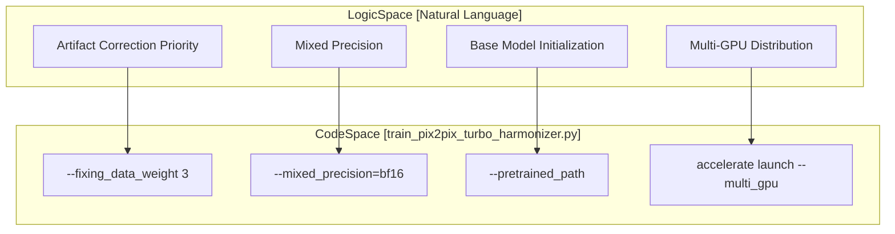
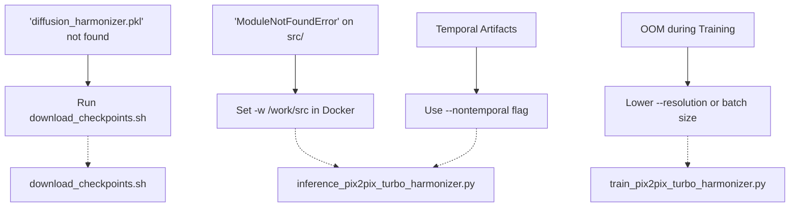

<!-- source: DeepWiki mcp.deepwiki.com · repo NVIDIA/nurec-skills · page 6.3 Evaluation, Training, and Troubleshooting · fetched 2026-10-26 -->

# Evaluation, Training, and Troubleshooting

<details>
<summary>Relevant source files</summary>

The following files were used as context for generating this wiki page:

- [skills/nurec-fixer/references/evaluation.md](skills/nurec-fixer/references/evaluation.md)
- [skills/nurec-fixer/references/teardown.md](skills/nurec-fixer/references/teardown.md)
- [skills/nurec-fixer/references/training.md](skills/nurec-fixer/references/training.md)
- [skills/nurec-fixer/references/troubleshooting.md](skills/nurec-fixer/references/troubleshooting.md)

</details>


This page provides technical details for the evaluation, training, and maintenance of the `nurec-fixer` skill. It covers quantitative performance measurement using standard metrics, the fine-tuning pipeline for the DiffusionHarmonizer model, and operational procedures for troubleshooting and disk reclamation.

## Quantitative Evaluation

The `evaluate_test_dataset.py` script provides a standardized interface for measuring the quality of enhanced renders against ground truth (GT) data. It calculates Peak Signal-to-Noise Ratio (PSNR) and Learned Perceptual Image Patch Similarity (LPIPS) [skills/nurec-fixer/references/evaluation.md:3-3]() [skills/nurec-fixer/references/evaluation.md:29-32]().

### Test Dataset Layout
To run evaluation, the dataset must be structured with paired `render` and `gt` directories. Filenames and camera subdirectories must match exactly between the two sets [skills/nurec-fixer/references/evaluation.md:7-25]().

```text
test_dataset/
├── {scene_id_1}/
│   ├── render/
│   │   ├── {camera_id_1}/
│   │   │   ├── {timestamp_1}.png
│   │   └── {camera_id_2}/
│   └── gt/
│       ├── {camera_id_1}/
│       │   ├── {timestamp_1}.png
│       └── {camera_id_2}/
```

### Execution Logic
The script requires the base Cosmos model checkpoints to be present in `src/checkpoints/` and the trained harmonizer model path passed via `--model` [skills/nurec-fixer/references/evaluation.md:29-45]().

| Flag | Description |
| :--- | :--- |
| `--model` | Path to the trained `.pkl` checkpoint. |
| `--input` | Path to the root of the `test_dataset`. |
| `--output` | Directory where enhanced images and metrics will be saved. |
| `--calculate-for-input` | Optional: Reports metrics for the raw input renders vs GT as a baseline. |

**Sources:** [skills/nurec-fixer/references/evaluation.md:27-56](), [skills/nurec-fixer/references/troubleshooting.md:109-129]()

---

## Model Training and Fine-Tuning

Training for `nurec-fixer` utilizes `train_pix2pix_turbo_harmonizer.py` launched via the `accelerate` framework to support multi-GPU distribution [skills/nurec-fixer/references/training.md:53-70]().

### Training Data Strategy
The system supports a curated dataset of ~350K synthetic-real pairs designed to address specific neural reconstruction failure modes [skills/nurec-fixer/references/training.md:8-22]().

| Failure Mode | Data Source |
| :--- | :--- |
| **ISP Drift** | ISP Modification (color/tone mismatch) |
| **Illumination Mismatch** | Relighting (inserted objects vs scene) |
| **Missing Shadows** | PBR Shadow Simulation / Asset Re-insertion |
| **Novel-view Artifacts** | Artifacts Correction (blur, ghosting, spurious geometry) |

**Sources:** [skills/nurec-fixer/references/training.md:24-31]()

### Training Implementation
Training is performed in `bf16` mixed precision. When training on the standard release dataset, the `--fixing_data_weight 3` flag is used to prioritize artifact-correction examples [skills/nurec-fixer/references/training.md:64-110]().

**Entity Mapping: Training Launch**
> This diagram bridges the logical training requirements to the specific CLI arguments in `train_pix2pix_turbo_harmonizer.py`.


**Sources:** [skills/nurec-fixer/references/training.md:64-110]()

---

## Troubleshooting and Failure Modes

### Environment and Setup
*   **Authentication:** 401/403 errors during `docker pull` from `nvcr.io` require authentication using the `$oauthtoken` username and the `NGC_API_KEY` [skills/nurec-fixer/references/troubleshooting.md:12-21]().
*   **Checkpoint Visibility:** `inference_pix2pix_turbo_harmonizer.py` expects sibling modules in `src/` and checkpoints in `src/checkpoints/`. The container must be launched with `-w /work/src` to ensure these paths resolve correctly [skills/nurec-fixer/references/troubleshooting.md:67-75]().

### Runtime Issues
*   **Temporal Artifacts:** If enhanced frames show flickering, ensure input filenames are zero-padded (e.g., `frame_0001.png`) for correct natural sorting. For unordered images, use the `--nontemporal` flag to disable the feedback loop [skills/nurec-fixer/references/troubleshooting.md:93-99]().
*   **Output Permissions:** Files created by the container may be owned by `root` if the `-u $(id -u):$(id -g)` flag is omitted during `docker run` [skills/nurec-fixer/references/troubleshooting.md:83-91]().

**Entity Mapping: Common Failure Resolutions**
> Maps runtime symptoms to specific file locations and resolution steps.


**Sources:** [skills/nurec-fixer/references/troubleshooting.md:50-106]()

---

## Disk Teardown and Resource Reclamation

A full training and inference workflow can consume over 100 GB of disk space [skills/nurec-fixer/references/teardown.md:3-5]().

### Cleanup Procedure
1.  **Docker Images:** Remove the `harmonizer-cosmos-env` and base PyTorch images [skills/nurec-fixer/references/teardown.md:24-29]().
2.  **Hugging Face Cache:** Use `hf cache delete` to remove cached models from `nvidia/Harmonizer` and `nvidia/Cosmos-Predict2` [skills/nurec-fixer/references/teardown.md:43-55]().
3.  **Local Artifacts:** Delete the `models/`, `src/checkpoints/`, and `data/` directories within the checkout [skills/nurec-fixer/references/teardown.md:33-38]().

### Artifact Size Reference
| Artifact | Source | Approx. Size |
| :--- | :--- | :--- |
| `harmonizer-cosmos-env` | `docker build` | Tens of GB |
| `diffusion_harmonizer.pkl` | `nvidia/Harmonizer` | Model-dependent |
| `Cosmos-Predict2-0.6B` | `nvidia/Cosmos-Predict2` | Model-dependent |
| `Harmonizer-Dataset` | `nvidia/Harmonizer-Dataset` | Large |

**Sources:** [skills/nurec-fixer/references/teardown.md:7-17](), [skills/nurec-fixer/references/teardown.md:31-62]()

---

