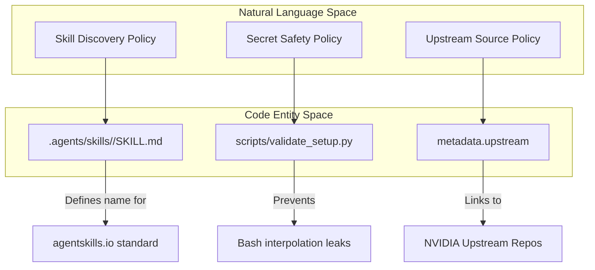
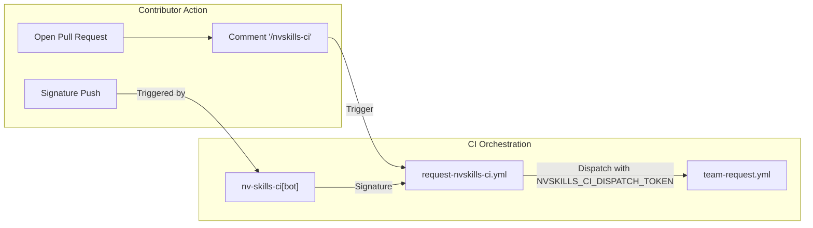

<!-- source: DeepWiki mcp.deepwiki.com · repo NVIDIA/nurec-skills · page 7 CI/CD, Governance, and Contributing · fetched 2026-10-26 -->

# CI/CD, Governance, and Contributing

Relevant source files

The following files were used as context for generating this wiki page:

- [.github/ISSUE_TEMPLATE/bug_report_template.md](.github/ISSUE_TEMPLATE/bug_report_template.md)
- [.github/ISSUE_TEMPLATE/config.yml](.github/ISSUE_TEMPLATE/config.yml)
- [.github/ISSUE_TEMPLATE/documentation_request_template.md](.github/ISSUE_TEMPLATE/documentation_request_template.md)
- [.github/ISSUE_TEMPLATE/feature_request_template.md](.github/ISSUE_TEMPLATE/feature_request_template.md)
- [.github/workflows/request-nvskills-ci.yml](.github/workflows/request-nvskills-ci.yml)
- [SECURITY.md](SECURITY.md)
- [skills/nurec-index/references/discovery.md](skills/nurec-index/references/discovery.md)
- [skills/nurec-index/references/teardown.md](skills/nurec-index/references/teardown.md)
- [skills/nurec-index/references/workflows.md](skills/nurec-index/references/workflows.md)

This page provides a high-level overview of the governance structures, automated testing pipelines, and contribution protocols for the NuRec Skills repository. It defines how the project maintains security standards, manages community feedback via issues, and utilizes GitHub Actions for continuous integration.

## Governance and Repository Standards

The `nurec-skills` repository follows the `agentskills.io` standard for skill discovery and portability. Governance is centralized around the `nurec-index` skill, which serves as the primary router for the ecosystem [skills/nurec-index/references/discovery.md:19-23](). 

Key governance policies include:
*   **Thin-Local-Skill Policy**: The skills in this repository act as coordination layers for upstream projects like NCore, NRE, and Asset Harvester [skills/nurec-index/references/discovery.md:67-84]().
*   **Security-First Automation**: Automated workflows and scripts are designed to prevent secret leakage (e.g., `NGC_API_KEY` or `HF_TOKEN`) by enforcing validation through `validate_setup.py` rather than ad-hoc shell interpolation [skills/nurec-index/references/teardown.md:28-36]().
*   **Explicit Consent for Network Fetching**: Agents are prohibited from auto-cloning external dependencies without explicit user confirmation to mitigate supply-chain risks [skills/nurec-index/references/discovery.md:34-44]().

### Governance Entity Mapping
The following diagram bridges the high-level governance concepts to the specific code entities that enforce them.

**Diagram: Governance to Code Mapping**

Sources: [skills/nurec-index/references/discovery.md:19-23](), [skills/nurec-index/references/teardown.md:28-36](), [skills/nurec-index/references/discovery.md:67-84]()

## CI/CD Pipeline: GitHub Actions

The repository utilizes GitHub Actions to validate skill integrity and ensure that changes do not break the end-to-end NuRec pipeline. The primary entry point for automation is the `request-nvskills-ci` workflow.

### The `request-nvskills-ci` Workflow
This workflow acts as a gateway for triggering NVIDIA's internal skill validation suites. It is triggered by specific `issue_comment` events (e.g., `/nvskills-ci`) or by signature pushes from the `nv-skills-ci[bot]` [.github/workflows/request-nvskills-ci.yml:6-19](). 

The workflow dispatches requests to the `NVIDIA/skills` central repository using a dedicated dispatch token [.github/workflows/request-nvskills-ci.yml:23-25]().

For technical details on trigger conditions and dispatch logic, see [GitHub Actions CI: request-nvskills-ci Workflow](#7.1).

## Security Policy

NVIDIA maintains a strict security protocol for all source code repositories. Security vulnerabilities must **never** be reported via GitHub Issues. Instead, all findings should be submitted through the NVIDIA Vulnerability Disclosure Program (VDP) hosted on Intigriti [SECURITY.md:5-11]().

Reports should include:
*   Affected product and version/branch.
*   Vulnerability type and potential impact.
*   Detailed reproduction instructions and Proof-of-Concept (PoC) material [SECURITY.md:12-14]().

For detailed submission links and PSIRT policies, see [Security Policy and Issue Reporting](#7.2).

Sources: [SECURITY.md:1-23]()

## Contributing and Issue Reporting

Contributions are managed through structured GitHub Issue templates to ensure maintainers have sufficient context to act on reports. 

### Issue Templates
The repository provides three primary templates for community interaction:
1.  **Bug Report**: Used for reproducible problems with a specific skill, requiring environment details and steps to reproduce [.github/ISSUE_TEMPLATE/bug_report_template.md:1-51]().
2.  **Feature Request**: Used to suggest improvements or new capabilities within the NuRec routing model [.github/ISSUE_TEMPLATE/feature_request_template.md:1-42]().
3.  **Documentation Request**: Used to report incorrect or missing information in the skill guides [.github/ISSUE_TEMPLATE/documentation_request_template.md:1-45]().

### Support and Discussions
For general usage questions, how-to guides, and community discussion, users are directed to the **NVIDIA Developer Forum** under the Omniverse / NuRec category [.github/ISSUE_TEMPLATE/config.yml:3-9]().

### CI/CD and Contribution Workflow
The following diagram illustrates the flow from a contributor's action to the automated CI response.

**Diagram: Contribution to CI Workflow**

Sources: [.github/workflows/request-nvskills-ci.yml:6-25](), [.github/ISSUE_TEMPLATE/bug_report_template.md:1-7]()

For details on how to use these templates and where to report specific issues, see [Security Policy and Issue Reporting](#7.2).

---

