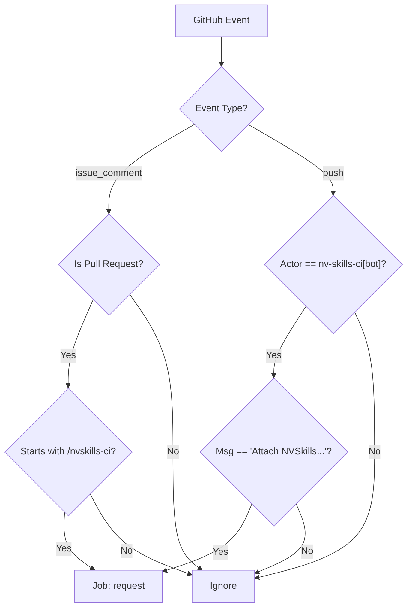
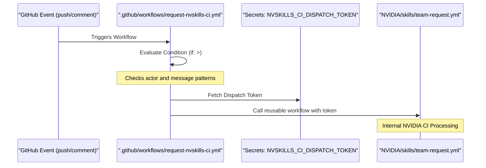

<!-- source: DeepWiki mcp.deepwiki.com · repo NVIDIA/nurec-skills · page 7.1 GitHub Actions CI: request-nvskills-ci Workflow · fetched 2026-10-26 -->

# GitHub Actions CI: request-nvskills-ci Workflow

Relevant source files

The following files were used as context for generating this wiki page:

- [.github/workflows/request-nvskills-ci.yml](.github/workflows/request-nvskills-ci.yml)
- [skills/nurec-index/references/discovery.md](skills/nurec-index/references/discovery.md)
- [skills/nurec-index/references/teardown.md](skills/nurec-index/references/teardown.md)
- [skills/nurec-index/references/workflows.md](skills/nurec-index/references/workflows.md)

The `request-nvskills-ci.yml` workflow serves as the primary entry point for triggering Continuous Integration (CI) tasks within the `nurec-skills` repository. It acts as a bridge between the public repository and NVIDIA's internal CI infrastructure by dispatching requests to a centralized skills validation pipeline.

## Purpose and Scope

The workflow is designed to:
1.  **Authorize CI Execution**: Ensure that only authorized users or automated bots can trigger resource-intensive CI tasks.
2.  **Dispatch to Centralized CI**: Forward valid requests to the `NVIDIA/skills` repository's `team-request.yml` workflow using a secure dispatch token.
3.  **Support Manual and Automated Triggers**: Handle both human-initiated comments on Pull Requests and automated signature pushes from the `nv-skills-ci` bot.

## Trigger Conditions

The workflow is triggered by two specific event types defined in [.github/workflows/request-nvskills-ci.yml:6-9](): `issue_comment` (specifically when created) and `push`.

### 1. Comment Trigger (`/nvskills-ci`)
A user can manually trigger the CI by commenting on a Pull Request. The workflow evaluates the following logic to determine if it should proceed:
*   The event must be an `issue_comment` [.github/workflows/request-nvskills-ci.yml:14]().
*   The comment must be associated with a Pull Request [.github/workflows/request-nvskills-ci.yml:15]().
*   The comment body must start with the command `/nvskills-ci` [.github/workflows/request-nvskills-ci.yml:16]().

### 2. Signature Push Trigger
The CI can be triggered automatically when specific validation signatures are attached to the repository. This is controlled by environment variables and actor checks:
*   The actor must be the authorized bot, defaulting to `nv-skills-ci[bot]` [.github/workflows/request-nvskills-ci.yml:18]().
*   The commit message must start with a specific signature title, defaulting to `Attach NVSkills validation signatures` [.github/workflows/request-nvskills-ci.yml:19]().

### Workflow Trigger Logic

The following diagram illustrates the decision flow for triggering the CI request.

**Trigger Decision Flow**

Sources: [.github/workflows/request-nvskills-ci.yml:13-19]()

## Implementation and Data Flow

The workflow does not execute CI tests directly. Instead, it utilizes the `uses` keyword to call a remote reusable workflow [.github/workflows/request-nvskills-ci.yml:23]().

### Key Components
*   **Remote Workflow**: `NVIDIA/skills/.github/workflows/team-request.yml@main` [.github/workflows/request-nvskills-ci.yml:23]().
*   **Permissions**: The job requires `contents: read` and `pull-requests: read` to validate the context of the trigger [.github/workflows/request-nvskills-ci.yml:20-22]().
*   **Secrets**: The `NVSKILLS_CI_DISPATCH_TOKEN` is passed to the remote workflow to authorize the cross-repository dispatch [.github/workflows/request-nvskills-ci.yml:24-25]().

### Data Flow Diagram
This diagram bridges the GitHub Action configuration to the external CI entities.

**CI Dispatch Data Flow**

Sources: [.github/workflows/request-nvskills-ci.yml:11-25]()

## Configuration Variables

The workflow behavior can be customized using GitHub Actions variables. If these variables are not set in the repository settings, the workflow falls back to hardcoded defaults.

| Variable Name | Default Value | Usage |
| :--- | :--- | :--- |
| `NVSKILLS_SIGNATURE_PUSH_ACTOR` | `nv-skills-ci[bot]` | Identifies the authorized bot for push triggers [.github/workflows/request-nvskills-ci.yml:18](). |
| `NVSKILLS_SIGNATURE_COMMIT_TITLE` | `Attach NVSkills validation signatures` | The required commit message prefix for automated triggers [.github/workflows/request-nvskills-ci.yml:19](). |

Sources: [.github/workflows/request-nvskills-ci.yml:17-19]()

## Security and Best Practices

As the workflow handles sensitive tokens and interacts with external repositories, it adheres to several security principles mentioned across the repository documentation:

1.  **Token Rotation**: If the `NVSKILLS_CI_DISPATCH_TOKEN` is ever exposed, it must be rotated immediately in the repository secrets [skills/nurec-index/references/teardown.md:24-27]().
2.  **Secret Masking**: GitHub Actions automatically masks the `NVSKILLS_CI_DISPATCH_TOKEN` in logs, but developers are cautioned against using bash patterns that might leak variables during debugging [skills/nurec-index/references/teardown.md:38-43]().
3.  **Permission Limitation**: The workflow uses the minimum required permissions (`read` access) to perform its dispatch function [.github/workflows/request-nvskills-ci.yml:20-22]().

Sources: [.github/workflows/request-nvskills-ci.yml:20-25](), [skills/nurec-index/references/teardown.md:24-43]()

---

